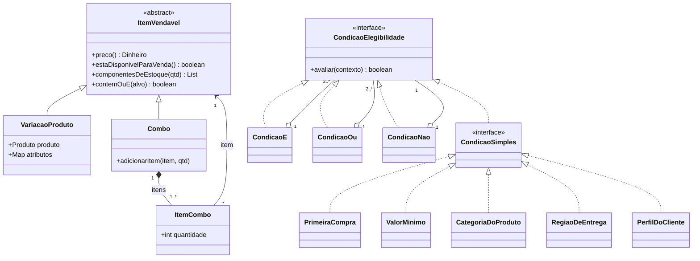

# 02. Modelo de domínio

> **Objetivo:** descrever as entidades do domínio, seus relacionamentos e as decisões de modelagem sobre variações de produto, categorias hierárquicas, combos/kits e preservação do histórico comercial nos pedidos.
> **Etapas do roadmap relacionadas:** E2 a E8 (cada etapa refina as entidades que introduz). Ver [08-roadmap.md](08-roadmap.md).
> **Status:** implementado (E1–E9): o modelo reflete o código e as migrações até V8 (usuário, cliente, endereço, pedido, catálogo, estoque, carrinho, promoções, cobrança, estorno, frete e auditoria); os relatórios gerenciais (E9) leem os snapshots do pedido sem entidade nova (última seção). Passagens marcadas como proposta ou premissa no corpo registram a decisão original da etapa.

## 1. Entidades e responsabilidades

| Entidade | Responsabilidade | Etapa |
|---|---|---|
| Usuario | Credencial de acesso (e-mail, hash da senha, situação ativo/inativo) e um ou mais perfis (`CLIENTE`, `ADMIN`, `OPERADOR_COMERCIAL`, `ESTOQUE`, `PROMOCOES`). Pertence ao módulo `seguranca`. | E1 (`implementado`) |
| Cliente | Dados cadastrais do comprador. Um usuário com perfil cliente possui um cliente; o cliente guarda `usuarioId`. | E1 (`implementado`) |
| Endereco | Endereço de entrega do cliente. Um cliente tem um ou mais; apenas um é o principal. | E1 (`implementado`) |
| Categoria | Nó da árvore de categorias (categoria pai opcional). Árvore simples, sem pattern. | E2 (`implementado`) |
| Produto | Item do catálogo, com dados comuns: nome, descrição, marca e uma categoria. Agrupa variações; não é vendável por si só. | E2 (`implementado`) |
| ItemVendavel | Contrato comum de tudo o que se vende (SKU único no catálogo, nome, preço, situação). É o componente do Composite de itens vendáveis. | E2 (`implementado`) |
| VariacaoProduto | Variação vendável de um produto (SKU), com preço próprio e atributos nome/valor como tamanho, cor ou capacidade (par `nome`/`valor`, sem classe própria). É a folha do Composite e a unidade que o estoque controla. | E2 (`implementado`) |
| Combo | Conjunto vendido com SKU e preço próprios, composto por variações ou outros combos. É o composto do Composite. | E2 (`implementado`) |
| ItemCombo | Componente de um combo: um `ItemVendavel` e a quantidade em que entra. | E2 (`implementado`) |
| SaldoEstoque | Saldo de uma variação: quantidade disponível e quantidade reservada (nunca negativas). Guarda só o id da variação. | E2 (`implementado`) |
| ReservaEstoque | Reserva de unidades de uma variação vinculada a um pedido (só o id do pedido), com situação `ATIVA`, `LIBERADA`, `BAIXADA` ou `REPOSTA`. | E2 (`implementado`); a expiração fica para a E6 |
| Carrinho | Itens e quantidades de um cliente, mais cupom aplicado e valores calculados. Não reserva estoque. | E3 |
| ItemCarrinho | SKU de item vendável (variação ou combo), quantidade e referências comerciais dentro de um carrinho. | E3 |
| Pedido | Resultado do checkout. Guarda a situação do ciclo de vida, os valores comerciais da compra e o endereço de entrega copiado. Agregado raiz (ver 1.2). | E4 (`implementado`) |
| ItemPedido | Linha do pedido com cópia dos dados comerciais no momento da compra (snapshot). | E4 (`implementado`) |
| DescontoPedido | Desconto concedido no pedido (promoção ou cupom), com descrição, origem, alvo (itens ou frete) e valor copiados. Substitui, no código, o rascunho `PromocaoAplicada`. | E4 (`implementado`) |
| EntradaHistorico | Registro de cada mudança de situação, incluindo a criação e os cancelamentos (de, para, momento, responsável e motivo). Era o rascunho `HistoricoPedido`. | E4 (`implementado`) |
| Promocao | Campanha com nome, vigência, prioridade, tipo, parâmetros, regra de acumulação e condições. | E5 |
| CondicaoElegibilidade | Regra que decide se a promoção (ou cupom) se aplica. Pode ser composta (E, OU, NÃO). | E5 |
| Cupom | Código promocional com validade, limite de usos, condições e benefício. | E5 |
| PromocaoAplicada | Referência de uma promoção ou cupom efetivamente concedido, para relatórios por campanha (o valor copiado já fica em `DescontoPedido`). | E5 |
| Pagamento | Pagamento de um pedido: forma, valor e situação. | E6 |
| TransacaoPagamento | Evento recebido ou enviado ao gateway, com identificador externo único (base da idempotência). | E6 |
| Entrega | Modalidade, custo, endereço de entrega copiado, situação e código de rastreio. | E7 |

Os **valores monetários** usam o tipo `Dinheiro` do módulo `compartilhado` (`implementado` na E1; internamente `BigDecimal`, arredondamento `HALF_EVEN`), nunca `double`.

### 1.1 Entidades da E1 como implementadas (`implementado`)

Tabelas criadas pela migração `V1__usuarios_clientes_enderecos.sql`; as classes JPA são `seguranca.dominio.Usuario`, `cliente.dominio.Cliente` e `cliente.dominio.Endereco`.

**`usuario`** (módulo `seguranca`)

| Campo | Tipo | Regras |
|---|---|---|
| `id` | `BIGINT` identidade | Chave primária. |
| `email` | `VARCHAR(255)`, obrigatório | Normalizado (minúsculas, sem espaços nas pontas) antes de gravar. Único: `uk_usuario_email`. |
| `senha_hash` | `VARCHAR(255)`, obrigatório | Hash gerado pelo `DelegatingPasswordEncoder`; a senha em claro nunca é gravada nem devolvida. |
| `ativo` | `BOOLEAN`, padrão `true` | Usuário inativo não faz login. |
| `criado_em`, `atualizado_em` | `TIMESTAMPTZ` | Preenchidos pela aplicação/banco. |

**`usuario_perfil`**: tabela de coleção de perfis. Chave primária `(usuario_id, perfil)`; `usuario_id` referencia `usuario`; `perfil` é `TEXT` com `CHECK` restrito a `CLIENTE`, `ADMIN`, `OPERADOR_COMERCIAL`, `ESTOQUE`, `PROMOCOES` (enum `Perfil`). Todo perfil exceto `CLIENTE` é administrativo, e a API administrativa não atribui `CLIENTE`.

**`cliente`**

| Campo | Tipo | Regras |
|---|---|---|
| `id` | `BIGINT` identidade | Chave primária. |
| `usuario_id` | `BIGINT`, obrigatório | Referencia `usuario`. Único: `uk_cliente_usuario` (um usuário, no máximo um cliente). Apenas o id, sem associação JPA entre `Cliente` e `Usuario` (dependência entre módulos por identificador). |
| `nome` | `VARCHAR(255)`, obrigatório | Alterável pelo próprio cliente. |
| `cpf` | `CHAR(11)`, obrigatório | Só dígitos, validado (dígitos verificadores; sequências repetidas rejeitadas). Único: `uk_cliente_cpf`. Não é alterável depois do cadastro. |
| `telefone` | `VARCHAR(20)`, opcional | Alterável pelo próprio cliente. |

O e-mail do cliente é o do seu `usuario` (não é duplicado em `cliente`) e também não é alterável por `PUT /api/clientes/me`.

**`endereco`**

| Campo | Tipo | Regras |
|---|---|---|
| `id` | `BIGINT` identidade | Chave primária. |
| `cliente_id` | `BIGINT`, obrigatório | Referencia `cliente`; índice `ix_endereco_cliente`. Toda busca é feita por `(id, clienteId)`, então um endereço de outro cliente aparece como inexistente (404). |
| `apelido` | `VARCHAR(60)`, opcional | |
| `cep` | `CHAR(8)`, obrigatório | Normalizado para 8 dígitos (aceita hífen na entrada). |
| `logradouro`, `numero`, `bairro`, `cidade` | obrigatórios | `complemento` é opcional. |
| `uf` | `CHAR(2)`, obrigatório | Validada contra as 27 UFs. |
| `principal` | `BOOLEAN`, padrão `false` | O primeiro endereço do cliente é o principal. |
| `ativo` | `BOOLEAN`, padrão `true` | A remoção é **por inativação** (`ativo = false`), não apaga a linha, preservando futuras referências de pedidos. |
| `criado_em` | `TIMESTAMPTZ` | Usado para promover o ativo mais antigo quando o principal é removido. |

Regra de endereço principal, garantida pelo banco e pela aplicação: o índice único parcial `ux_endereco_principal_ativo ON endereco (cliente_id) WHERE principal AND ativo` impede mais de um principal ativo por cliente. A troca (`PUT /api/clientes/me/enderecos/{id}/principal`) e a promoção do endereço ativo mais antigo ao remover o principal ficam em `cliente.dominio.RegraEnderecoPrincipal`.

### 1.2 Pedido como implementado (`implementado`, E4)

Tabelas criadas pela migração `V2__pedidos.sql`; as classes JPA estão em `pedido.dominio`. O `Pedido` é o agregado raiz: itens, descontos e histórico só se alteram por ele, e o snapshot comercial não tem setters. Valores monetários em `NUMERIC(12,2)` (`Dinheiro` no código). Pacote e fluxo em [03-arquitetura.md](03-arquitetura.md); ciclo de vida em [06-ciclo-vida-pedido.md](06-ciclo-vida-pedido.md).

**`pedido`** (`Pedido`)

| Campo | Tipo | Regras |
|---|---|---|
| `id` | `BIGINT` identidade | Chave primária. |
| `cliente_id` | `BIGINT`, obrigatório | Referencia `cliente`; apenas o id no código (sem associação JPA entre módulos). Nunca muda. |
| `situacao` | `TEXT`, obrigatório | `CHECK` restrito aos 8 valores de `SituacaoPedido`. É o valor persistido do estado; o objeto de estado (`EstadoPedido`) é derivado dele e não é persistido. |
| `entrega_apelido`, `entrega_cep`, `entrega_logradouro`, `entrega_numero`, `entrega_complemento`, `entrega_bairro`, `entrega_cidade`, `entrega_uf` | texto | **Snapshot do endereço**: campos copiados do endereço no momento da compra (classe embutida `EnderecoEntrega`), sem chave estrangeira para `endereco`. Alterar ou remover o endereço do cliente depois não muda o pedido. `apelido` e `complemento` são opcionais. |
| `subtotal`, `total_descontos`, `frete`, `total` | `NUMERIC(12,2)`, obrigatórios | Copiados do cálculo de preço; imutáveis. A fábrica `Pedido.criar` exige `subtotal` igual à soma dos itens, `total_descontos` igual à soma dos descontos e `total = subtotal - total_descontos + frete`. |
| `criado_em` | `TIMESTAMPTZ`, obrigatório | Momento da criação. |
| `versao` | `BIGINT`, padrão `0` | `@Version`: **lock otimista**. Na disputa de duas transições simultâneas a segunda falha ao gravar e vira 409. |

Índices: `ix_pedido_cliente_criado_em (cliente_id, criado_em DESC)` (listagem do cliente, do mais recente ao mais antigo) e `ix_pedido_situacao` (filtro administrativo).

**`pedido_item`** (`ItemPedido`): `pedido_id` (referência), `sku`, `nome_produto`, `descricao_variacao` (opcional), `quantidade` (`CHECK` > 0), `preco_unitario` e `total_item`. Guarda o SKU (sem chave estrangeira para a variação, que só existe a partir da etapa 2); índice `ix_pedido_item_pedido`.

**`pedido_desconto`** (`DescontoPedido`): `pedido_id`, `descricao`, `origem` (`CHECK`: `PROMOCAO` ou `CUPOM`), `alvo` (`CHECK`: `ITENS` ou `FRETE`) e `valor`. Um pedido sem desconto simplesmente não tem linhas.

**`pedido_historico`** (`EntradaHistorico`): `pedido_id`, `de` (**nulo** na entrada de criação; `CHECK` com os 8 valores), `para` (`CHECK`), `ocorrido_em`, `responsavel_tipo` (`CHECK`: `CLIENTE`, `ADMINISTRATIVO` ou `SISTEMA`), `responsavel_usuario_id` (nulo para `SISTEMA`) e `motivo` (obrigatório no cancelamento, validado pelo agregado). Ordenado pelo id (ordem de gravação). Registro de fatos: as colunas são `updatable = false` no mapeamento.

Itens, descontos e histórico são coleções do agregado (`@OneToMany` com cascade e `orphanRemoval`, carregadas por `SUBSELECT`); a listagem usa um resumo (`ResumoPedido`: id, cliente, situação, total e data) que não as carrega. A migração e as restrições são verificadas por `infra.MigracaoV2Tests`.

### 1.3 Catálogo e estoque como implementados (`implementado`, E2)

Tabelas criadas pela migração `V3__catalogo_estoque.sql`; as classes JPA estão em `catalogo.dominio` e `estoque.dominio`. Valores monetários em `NUMERIC(12,2)` (`Dinheiro` no código). Pacotes e contratos em [03-arquitetura.md](03-arquitetura.md); o pattern em [04-design-patterns.md](04-design-patterns.md), seção 3.8.

**`categoria`** (`Categoria`)

| Campo | Tipo | Regras |
|---|---|---|
| `id` | `BIGINT` identidade | Chave primária. |
| `nome` | `VARCHAR(100)`, obrigatório | **Único por pai, sem diferenciar maiúsculas**: índice único `ux_categoria_pai_nome` em `(COALESCE(pai_id, 0), LOWER(nome))`; as raízes compartilham o "pai 0". O mesmo nome pode repetir sob pais diferentes. |
| `pai_id` | `BIGINT`, opcional | Autorreferência a `categoria`; nulo = categoria raiz. Mover valida que o novo pai não é a própria categoria nem uma descendente (sem ciclos). A remoção só é aceita sem subcategorias e sem produtos. |

**`produto`** (`Produto`): `id`, `nome`, `descricao` (`TEXT`, opcional), `marca` (opcional), `categoria_id` (obrigatório, referencia `categoria`; índice `ix_produto_categoria`), `ativo` (padrão `true`) e `criado_em`. Inativar o produto inativa todas as suas variações; nada é excluído (o histórico de pedidos é preservado).

**`item_vendavel`** (`ItemVendavel`): raiz da herança JPA **`JOINED`** do Composite. A variação e o combo compartilham o `id` desta tabela.

| Campo | Tipo | Regras |
|---|---|---|
| `id` | `BIGINT` identidade | Chave primária, herdada pelas tabelas filhas. |
| `sku` | `VARCHAR(60)`, obrigatório | **Único no catálogo inteiro** (`uk_item_vendavel_sku`): um SKU de variação não pode coincidir com o de outra variação nem com o de um combo. Não é alterável. |
| `nome` | `VARCHAR(255)`, obrigatório | A variação deriva o nome do produto e dos valores dos atributos. |
| `preco` | `NUMERIC(12,2)`, obrigatório | `CHECK (preco > 0)` (`ck_item_vendavel_preco`). |
| `ativo` | `BOOLEAN`, padrão `true` | A inativação substitui a exclusão. |
| `tipo` | `VARCHAR(20)`, obrigatório | Discriminador, `CHECK` restrito a `VARIACAO` ou `COMBO`. |

**`variacao_produto`** (`VariacaoProduto`, folha): `id` (chave primária e FK para `item_vendavel`) e `produto_id` (obrigatório, FK para `produto`; índice `ix_variacao_produto_produto`). **`variacao_atributo`**: tabela de coleção dos atributos livres (nome/valor), chave primária `(variacao_id, nome)` e `valor` obrigatório; um tipo novo de característica não exige cadastro prévio.

**`combo`** (`Combo`, composto): apenas `id` (chave primária e FK para `item_vendavel`). **`combo_item`** (`ItemCombo`): `id`, `combo_id` (FK para `combo`), `item_id` (FK para `item_vendavel`, ou seja, variação **ou outro combo**) e `quantidade`, com `CHECK (quantidade > 0)`, unicidade `(combo_id, item_id)` e `CHECK (combo_id <> item_id)`. O ciclo indireto (combo que contém um combo que o contém) é rejeitado pelo domínio (`Combo.adicionarItem`), porque o banco só barra o ciclo direto.

**`saldo_estoque`** (`SaldoEstoque`, módulo `estoque`)

| Campo | Tipo | Regras |
|---|---|---|
| `variacao_id` | `BIGINT` | Chave primária. **Sem chave estrangeira** para `variacao_produto`: o `estoque` não depende do esquema do `catalogo`; o id é só a referência. O saldo nasce zerado quando o evento `VariacaoCadastrada` é publicado. |
| `disponivel`, `reservado` | `INTEGER`, padrão 0 | `CHECK (>= 0)` em ambos (`ck_saldo_estoque_disponivel`, `ck_saldo_estoque_reservado`): o banco é a última barreira contra estoque negativo. |
| `atualizado_em` | `TIMESTAMPTZ` | Atualizado a cada movimentação. |

**`reserva_estoque`** (`ReservaEstoque`)

| Campo | Tipo | Regras |
|---|---|---|
| `id` | `BIGINT` identidade | Chave primária. |
| `pedido_id`, `variacao_id` | `BIGINT`, obrigatórios | **Sem chave estrangeira** para `pedido` nem para `variacao_produto` (desacoplamento: o estoque não depende do esquema de outros módulos). Unicidade `(pedido_id, variacao_id)` (`uk_reserva_estoque_pedido_variacao`): um pedido reserva uma variação uma única vez; índice `ix_reserva_estoque_pedido`. |
| `quantidade` | `INTEGER` | `CHECK (> 0)`. |
| `situacao` | `VARCHAR(20)` | `CHECK` restrito a `ATIVA`, `LIBERADA`, `BAIXADA` e `REPOSTA` (enum `SituacaoReserva`). Transições válidas: `ATIVA` para `LIBERADA` ou `BAIXADA`, e `BAIXADA` para `REPOSTA`. |
| `criado_em`, `atualizado_em` | `TIMESTAMPTZ` | Momento da reserva e da última troca de situação. |

A reserva e as trocas de situação são atualizações condicionais atômicas (RN-21, em [05-regras-negocio.md](05-regras-negocio.md)). A migração e as restrições são verificadas por `infra.MigracaoV3Tests`.

## 2. Diagrama de classes

O diagrama cobre cliente, endereço, catálogo (categoria, produto, item vendável, variação e combo), estoque, carrinho, pedido, item do pedido, promoção, cupom, pagamento e entrega. Os nomes e atributos de catálogo e estoque (E2) refletem o código; os dos módulos das etapas 3, 5, 6 e 7 são preliminares.

```mermaid
classDiagram
    direction LR

    class Usuario {
        +Long id
        +String email
        +String senhaHash
        +boolean ativo
        +Set~Perfil~ perfis
    }
    class Perfil {
        <<enumeration>>
        CLIENTE
        ADMIN
        OPERADOR_COMERCIAL
        ESTOQUE
        PROMOCOES
    }
    class Cliente {
        +Long id
        +Long usuarioId
        +String nome
        +Cpf cpf
        +String telefone
    }
    class Endereco {
        +Long id
        +Long clienteId
        +String apelido
        +String cep
        +String logradouro
        +String numero
        +String complemento
        +String bairro
        +String cidade
        +String uf
        +boolean principal
        +boolean ativo
    }

    class Categoria {
        +Long id
        +String nome
        +Long paiId
    }
    class Produto {
        +Long id
        +String nome
        +String descricao
        +String marca
        +boolean ativo
    }
    class ItemVendavel {
        <<abstract>>
        +Long id
        +String sku
        +String nome
        +Dinheiro preco
        +boolean ativo
        +estaDisponivelParaVenda() boolean
        +componentesDeEstoque(qtd) List~ComponenteEstoque~
    }
    class VariacaoProduto {
        +Map atributos
    }
    class Combo {
        +adicionarItem(item, qtd)
    }
    class ItemCombo {
        +int quantidade
    }
    class SaldoEstoque {
        +Long variacaoId
        +int disponivel
        +int reservado
    }
    class ReservaEstoque {
        +Long id
        +Long pedidoId
        +Long variacaoId
        +int quantidade
        +SituacaoReserva situacao
    }

    class Carrinho {
        +Long id
        +recalcular()
    }
    class ItemCarrinho {
        +int quantidade
    }

    class Pedido {
        +Long id
        +SituacaoPedido situacao
        +EnderecoEntrega entrega
        +BigDecimal subtotal
        +BigDecimal totalDescontos
        +BigDecimal frete
        +BigDecimal total
        +Long versao
    }
    class ItemPedido {
        +String sku
        +String nomeProduto
        +String descricaoVariacao
        +int quantidade
        +BigDecimal precoUnitario
        +BigDecimal totalItem
    }
    class EntradaHistorico {
        +SituacaoPedido de
        +SituacaoPedido para
        +Instant ocorridoEm
        +TipoResponsavel responsavelTipo
        +Long responsavelUsuarioId
        +String motivo
    }
    class DescontoPedido {
        +String descricao
        +OrigemDesconto origem
        +AlvoDoDesconto alvo
        +BigDecimal valor
    }
    class PromocaoAplicada {
        +String nomePromocao
        +BigDecimal valorDesconto
    }

    class Promocao {
        +Long id
        +String nome
        +int prioridade
        +Periodo vigencia
        +ModoAcumulacao modo
    }
    class CondicaoElegibilidade {
        <<interface>>
        +avaliar(contexto) boolean
    }
    class Cupom {
        +String codigo
        +Periodo vigencia
        +int limiteUsos
        +int usos
    }

    class Pagamento {
        +Long id
        +FormaPagamento forma
        +BigDecimal valor
        +SituacaoPagamento situacao
    }
    class TransacaoPagamento {
        +String idExterno
        +String tipo
        +Instant recebidaEm
    }
    class Entrega {
        +Long id
        +String modalidade
        +BigDecimal custo
        +SituacaoEntrega situacao
        +String codigoRastreio
    }

    Cliente "0..1" ..> "1" Usuario : usuarioId
    Usuario --> "1..*" Perfil
    Cliente "1" *-- "1..*" Endereco : possui

    Categoria "0..1" o-- "*" Categoria : subcategorias
    Categoria "1" o-- "*" Produto : classifica
    Produto "1" *-- "1..*" VariacaoProduto : variacoes
    ItemVendavel <|-- VariacaoProduto
    ItemVendavel <|-- Combo
    Combo "1" *-- "1..*" ItemCombo : itens
    ItemCombo "*" --> "1" ItemVendavel : item
    SaldoEstoque "1" ..> "1" VariacaoProduto : variacaoId
    ReservaEstoque "*" ..> "1" VariacaoProduto : variacaoId
    ReservaEstoque "*" ..> "1" Pedido : pedidoId

    Cliente "1" -- "0..1" Carrinho : possui
    Carrinho "1" *-- "*" ItemCarrinho : itens
    ItemCarrinho "*" --> "1" ItemVendavel : refere
    Carrinho "*" --> "0..1" Cupom : aplica

    Cliente "1" --> "*" Pedido : realiza
    Pedido "1" *-- "1..*" ItemPedido : itens
    ItemPedido "*" ..> "1" ItemVendavel : origem (SKU)
    Pedido "1" *-- "*" EntradaHistorico : historico
    Pedido "1" *-- "*" DescontoPedido : descontos
    PromocaoAplicada "*" ..> "1" Promocao : origem
    Pedido "1" --> "*" Pagamento : pagamentos
    Pedido "1" --> "0..1" Entrega : entrega

    Pagamento "1" *-- "*" TransacaoPagamento : transacoes
    Entrega ..> Endereco : copia de

    Promocao "1" o-- "0..1" CondicaoElegibilidade : condicao
    Cupom "1" o-- "0..1" CondicaoElegibilidade : condicao
    Cupom "*" --> "0..1" Promocao : vinculado a
```

Pontos de leitura:
- `Usuario` e `Perfil` (com as regras de acesso) pertencem ao módulo `seguranca`; `Cliente` referencia o usuário apenas por `usuarioId` (seta tracejada), sem acoplar os módulos. Os atributos de `Usuario`, `Cliente` e `Endereco` (E1) e de `Pedido`, `ItemPedido`, `DescontoPedido` e `EntradaHistorico` (E4) no diagrama já refletem o código.
- A seta tracejada de `ItemPedido` para `ItemVendavel` (hoje só o SKU copiado) e de `Entrega` para `Endereco` indica referência para fins de rastreio, não dependência de valores. Os dados comerciais são copiados (seção 5).
- `SaldoEstoque` e `ReservaEstoque` pertencem ao módulo de estoque e referenciam a variação e o pedido **apenas por id** (setas tracejadas, sem chave estrangeira no banco, seção 1.3). O pedido não conhece a reserva: é o estoque que guarda o `pedidoId` e reage aos eventos do pedido.
- `ItemVendavel`, `VariacaoProduto`, `Combo` e `ItemCombo` formam o Composite do catálogo (seção 6). `Categoria` é uma árvore simples, sem pattern (seção 4).
- `CondicaoElegibilidade` é detalhada no diagrama da seção 6.

## 3. Variações de produto (decisão proposta)

**Problema:** uma camiseta tem tamanhos e cores, um celular tem capacidades. O enunciado exige decidir como representar isso e permitir novos tipos de produto sem mudanças excessivas no código.

**Decisão (`implementado`, E2):** separar **Produto** de **VariacaoProduto (SKU)**.
- `Produto` guarda o que é comum (nome, descrição, marca, categoria).
- `VariacaoProduto` é a unidade vendável (uma subclasse de `ItemVendavel`): tem `sku` único no catálogo, preço e um mapa de atributos nome/valor (tabela `variacao_atributo`).
- Estoque, carrinho e itens de pedido apontam para a **variação**, não para o produto.
- Um produto sem variações reais possui uma única variação padrão (sem atributos), evitando dois caminhos de código (com e sem variação): o cadastro exige ao menos uma variação (por exemplo, o Teclado Mecânico da demonstração).

**Por quê:** atributos em pares nome/valor permitem representar tamanho, cor, capacidade e atributos de tipos futuros sem criar uma subclasse de `Produto` para cada tipo. Isso atende ao requisito de extensibilidade do catálogo (RF-10, RF-13) com baixo impacto.

**Alternativas descartadas:**
- Herança de produto por tipo (`Camiseta`, `Celular`): cada novo tipo exige nova classe e nova tabela.
- Um produto por combinação (camiseta azul M como produto): duplica nome e descrição e dificulta agrupar a vitrine.

**Trade-off:** atributos genéricos perdem validação por tipo. Mitigação possível, se necessário: um conjunto de atributos permitidos por categoria.

## 4. Categorias hierárquicas (`implementado`, E2)

- `Categoria` possui uma `categoria pai` opcional (autorrelacionamento), formando uma árvore de profundidade livre. Exemplo: Eletrônicos > Celulares > Acessórios.
- Todo produto pertence a exatamente uma categoria (a mais específica).
- Para promoções e políticas comerciais, **uma regra associada a uma categoria vale também para suas subcategorias**. A condição "pertence à categoria X" percorre os ancestrais da categoria do produto. Esta é uma decisão a confirmar na etapa de promoções (E5).
- Persistência: coluna `pai_id` (seção 1.3), com nome único por pai. **Sem pattern:** é uma árvore simples, sem comportamento que varie entre nó e folha; os descendentes e ancestrais são calculados em memória por `ArvoreDeCategorias` (a quantidade de categorias é pequena), e a troca por uma CTE recursiva atrás do mesmo serviço é possível se crescer. O filtro público por categoria inclui as subcategorias, e `ConsultarItensVendaveis` informa a categoria do item e todas as ancestrais, insumo da condição "pertence à categoria X" da E5.

## 5. Preservação do histórico comercial no pedido (snapshot)

O enunciado exige que alterações futuras de preço não modifiquem pedidos antigos (RF-42). Por isso o pedido **copia** os dados comerciais no momento do checkout, em vez de apenas referenciar o catálogo.

| Dado copiado | Onde fica |
|---|---|
| SKU, nome do produto e atributos da variação, preço unitário, quantidade | `ItemPedido` |
| Subtotal, soma dos descontos, frete e total | `Pedido` |
| Descrição, origem (`PROMOCAO` ou `CUPOM`), alvo (itens ou frete) e valor de cada desconto, inclusive o do cupom | `DescontoPedido` (descrição copiada; a referência à promoção chega com a etapa 5) |
| Endereço de entrega (campos copiados, sem chave estrangeira) | colunas `entrega_*` do `Pedido` (`EnderecoEntrega`) |
| Valor do frete | `Pedido.frete` (modalidade e rastreio ficam em `Entrega`, etapa 7) |
| Situação e transições, com data, responsável e motivo | `EntradaHistorico` |

Implementado na E4 (`pedido.aplicacao.CriarPedidoTests`: preço e endereço alterados ou removidos depois da compra não mudam o pedido). Regra: depois que o pedido é criado, nenhum cálculo dele depende do preço atual do catálogo nem da promoção atual. A referência à variação serve apenas para rastreio e relatórios.

## 6. Combos e kits (`implementado`, E2)

**Problema:** o enunciado permite vender conjuntos de produtos como combos ou kits. O carrinho e o checkout não devem precisar distinguir "produto simples" de "combo" a cada passo.

**Decisão (`implementado`):** tratar combo com o pattern **Composite** (detalhado em [04-design-patterns.md](04-design-patterns.md), seção 3.8). A abstração `ItemVendavel` é estendida por `VariacaoProduto` (folha) e por `Combo` (composto, lista de `ItemCombo` com `ItemVendavel` e quantidade, que pode conter outro combo). O combo tem **SKU e preço próprios** (definidos no cadastro, não calculados a partir dos componentes), para o carrinho e as promoções o endereçarem como qualquer item.

**Estoque do combo:** não possui saldo próprio. A disponibilidade é derivada dos componentes (menor razão `disponivel / quantidade no combo`, divisão inteira, calculada sobre `componentesDeEstoque(1)` já agregados), e a reserva é feita por componente (`componentesDeEstoque(q)` devolve as variações e quantidades). Isso evita duas fontes de verdade para o mesmo estoque. Um combo ou um de seus componentes inativo deixa o combo indisponível para venda.

O segundo grupo do diagrama mostra as **condições de elegibilidade** combináveis (Composite no estilo Specification). Ele está neste documento porque as condições são parte do modelo de `Promocao` e `Cupom`; o contrato é detalhado em [03-arquitetura.md](03-arquitetura.md) e o pattern em [04-design-patterns.md](04-design-patterns.md).

## 7. Decisões e questões em aberto

| Item | Situação |
|---|---|
| Produto separado de variação (SKU) com atributos nome/valor | `implementado` (E2, seção 1.3) |
| SKU único no catálogo inteiro (variações e combos), em `item_vendavel` | `implementado` (E2) |
| Estoque associado à variação, por id, sem chave estrangeira entre módulos | `implementado` (E2) |
| Categorias em árvore simples (sem pattern), nome único por pai | `implementado` (E2) |
| Regra da categoria vale também para subcategorias (promoções) | `proposto` (confirmar em E5); o catálogo já informa as categorias ancestrais de cada item |
| Pedido com cópia dos dados comerciais (snapshot) | decidido (exigência do enunciado); `implementado` na E4 (seção 1.2) |
| Concorrência nas transições do pedido: lock otimista (`@Version`, coluna `versao`) em vez de lock pessimista | `implementado` (E4) |
| Histórico do pedido com entrada inicial de criação (`de` nulo) e responsável de três tipos | `implementado` (E4) |
| Combos/kits via Composite (`ItemVendavel`, `VariacaoProduto`, `Combo`, `ItemCombo`), com SKU e preço próprios e sem estoque próprio | `implementado` (E2) |
| Tipo `Dinheiro` dedicado ou `BigDecimal` direto | decidido na E1: tipo `Dinheiro` em `compartilhado.dominio` (`implementado`) |
| `Usuario`/`Perfil` em `seguranca`; `Cliente` referencia `usuarioId`; endereço removido por inativação, com índice parcial de principal | `implementado` (E1) |
| Mecanismo de concorrência no estoque: **atualização condicional atômica** (`disponivel >= quantidade`), não `@Version` nem lock pessimista | decidido e `implementado` na E2 (RN-21, ver [05-regras-negocio.md](05-regras-negocio.md)) |

## Carrinho: modelo efetivo da E3

`Carrinho` é agregado por cliente com versão otimista e revisão de alterações. `ItemCarrinho` é embutido e guarda SKU, quantidade positiva, id/nome e preço de referência do item vendável. Variações e combos usam a mesma linha comercial; componentes físicos não são cobrados como linhas adicionais. A migração V4 cria `carrinho` (cliente único, FK e versão) e `item_carrinho` (chave carrinho/SKU e restrições de quantidade/preço). Não há FK para catálogo: referências permitem exibir e remover itens que saiam de venda. Cupom pertence à E5 e não está persistido nesta etapa.

Verificação: `CarrinhoTests` e `CarrinhoPersistenciaTests` cobrem invariantes, gravação/leitura em sessões distintas, restrições da V4 e conflito entre alterações concorrentes apenas nas linhas.

## Checkout: modelo efetivo da E4b

`CheckoutFacade` coordena uma compra sem introduzir entidade ou tabela própria. `CompraRevalidada` reúne a seleção carregada, a prévia comercial, o snapshot de `DadosNovoPedido` e a demanda física agregada. `PreviaCheckout` contém `confirmacao` e `insuficiencias`; `ConfirmacaoCheckout` guarda versão do carrinho, linhas (SKU, nome, descrição da variação, quantidade, preço unitário e subtotal), descontos, subtotal, frete, total e endereço copiado.

A confirmação é uma expectativa do comprador, comparada com dados correntes; os preços recebidos não alimentam o pedido. A descrição da variação vem do contrato polimórfico do catálogo, com atributos ordenados (`cor: azul, tamanho: M`); kits não recebem descrição artificial e mantêm seu preço próprio. Componentes físicos são agregados para reserva e não viram linhas comerciais extras.

Ao concluir, o pedido passa de CRIADO para AGUARDANDO_PAGAMENTO e `Carrinho.esvaziar()` incrementa a revisão do agregado. Pedido, histórico, reserva, saldos e limpeza participam de uma única transação. Frete é zero e descontos são vazios na E4b; promoções/cupons, cobrança e modalidade de entrega pertencem às E5–E7. Testes: `checkout.aplicacao.RevalidarCheckoutTests`, `ConfirmacaoCheckoutTests` e `CheckoutIntegracaoTests`.

## Promoções e cupons: modelo efetivo da E5

`PromocaoConfig` guarda nome, tipo, parâmetros, condição, vigência UTC, prioridade, modo de acumulação, ativo, criação e versão. `Cupom` guarda código único normalizado/imutável, benefício, condições, compatibilidade com promoções e limites global/individual. A V5 cria `promocao_config`, `cupom`, `saldo_cupom` e `uso_cupom`, acrescenta `carrinho.cupom_codigo` e referências opcionais (`referencia_id`, `codigo`) ao desconto do pedido. Não há uma tabela por tipo de promoção. Parâmetros e árvores declarativas ficam em JSONB, com validação pelos criadores registrados.

A árvore `CondicaoConfig` representa E/OU/NÃO e folhas de primeira compra, mínimo, categoria, SKU, região, período e perfil autenticado. Categorias incluem ancestrais; kits são avaliados pelo SKU/preço próprios, sem desconto adicional dos componentes físicos. Primeira compra significa ausência de aprovação de pagamento no histórico até a avaliação; cancelamentos/recusas sem pagamento não eliminam a elegibilidade. Pagamento aprovado e posteriormente cancelado continua contando.

O cupom selecionado é parte versionada do carrinho. `uso_cupom` identifica uma utilização por pedido, seu cliente e cupom, estado CONSUMIDO/DEVOLVIDO e instantes. Só uma compra concluída com benefício positivo consome; prévia e seleção não consomem. Devolução preserva o histórico e libera a vaga global/individual uma única vez. O snapshot do pedido conserva nome, origem, alvo, valor, referência e código disponíveis no momento da compra; registros anteriores à V5 mantêm as referências opcionais nulas.

## Pagamento persistente (E6)

`Cobranca` preserva pedido, fornecedor, forma, total e transação externa, com situação PENDENTE/APROVADO/RECUSADO e datas. Há no máximo uma cobrança por pedido e uma cobrança por transação externa. O total vem do snapshot; inclusive total zero é aceito pelos simuladores.

`ConfirmacaoPagamento` identifica o resultado terminal recebido. Sua chave é a transação externa da cobrança: repetição com o mesmo resultado é no-op, resultado divergente é conflito. A gravação e os efeitos comerciais compartilham a transação.

`Estorno` preserva pedido, transação original, total, situação PENDENTE/FALHOU/CONCLUIDO, comprovante externo, tentativas, último erro e data. Existe no máximo um por pedido/cobrança. Pedido legado pago pelo antigo atalho pode ter pendência sem transação conhecida; nunca se inventa uma cobrança histórica. Referências ao módulo pedido são IDs, sem associações JPA. Na V6 as tabelas são `cobranca`, `confirmacao_pagamento` e `estorno`.

## Entrega selecionada (E7)

`OpcaoEntrega` identifica fornecedor/modalidade e uma cotação bruta com prazo estimado em dias úteis após aprovação. Provedores simulados calculam por região e modalidade; o catálogo não fornece peso físico e nenhum peso é inventado para cobrar frete.

O pedido incorpora `DadosEntregaSelecionada`: código, fornecedor, modalidade e prazo positivo, em quatro colunas `opcao_entrega_*` da V7, opcionais em conjunto para preservar legados. O snapshot não referencia configuração ou transportadora. Cotação posterior não muda endereço, prazo, frete nem total de pedido comprado. `frete` continua bruto; `freteLiquido` é derivado de frete menos descontos FRETE, sem coluna redundante. Novas compras HTTP exigem seleção; pedidos legados expõem opcaoEntrega=null.

### Auditoria administrativa — E8, grupo 2

`RegistroAuditoria` é uma entidade de inclusão em `auditoria.dominio`: id, usuarioId, ocorridoEm, operacao, recursoTipo, recursoId e detalhes JSONB. A V8 cria `auditoria_operacao`, com índices de momento/id, usuário/momento e operação/momento, sem FK ou remoção em cascata. Não fabrica registros anteriores à implantação e preserva pedidos/cobranças V7. Não há setters, update/delete na porta `RegistrosAuditoria` nem rotas de escrita. A consulta administrativa é o `GET /api/admin/auditoria` (grupo 3).

`OperacaoAdministrativa`, em `compartilhado.dominio`, copia profundamente mapas/listas JSON e rejeita identificações inválidas, objetos arbitrários e chaves de credenciais, inclusive aninhadas. Cada evento descreve o estado anterior e posterior; criação usa anterior nulo e remoção usa posterior nulo. Valores monetários são números decimais, e componentes/variações são snapshots, sem referência a entidades mutáveis.

### Relatórios gerenciais (E9, `implementado`)

O módulo `relatorio` não cria entidades nem tabelas (nenhuma migração nova; a última continua a V8). Ele lê os snapshots já gravados em `pedido`, `pedido_item`, `pedido_desconto` e `pedido_historico` e devolve registros de resultado imutáveis: `ResumoVendas`, `ProdutoMaisVendido` e `DescontoPorCampanha`, mais o `PeriodoRelatorio` (inicio e fim inclusivos) e o `FiltroProdutosMaisVendidos` (período e limite de 1 a 50).

**Venda** é o pedido com transição para `PAGO` em `pedido_historico` dentro do período e cuja situação atual não é `CANCELADO`; o valor é `pedido.total`. O período usa o instante do pagamento, não o de criação. Pedido pago e depois cancelado deixa de ser venda; o cancelamento é contado em `quantidadeCancelamentos` pelo instante da transição para `CANCELADO`, tenha o pedido sido pago ou não. Produtos são agrupados por SKU, nome e descrição da variação do próprio pedido (o snapshot, não o catálogo atual). Descontos são agrupados por `(origem, referencia_id)`; descontos legados sem `referencia_id` (anteriores à V5) são agrupados por `(origem, descricao)`.
