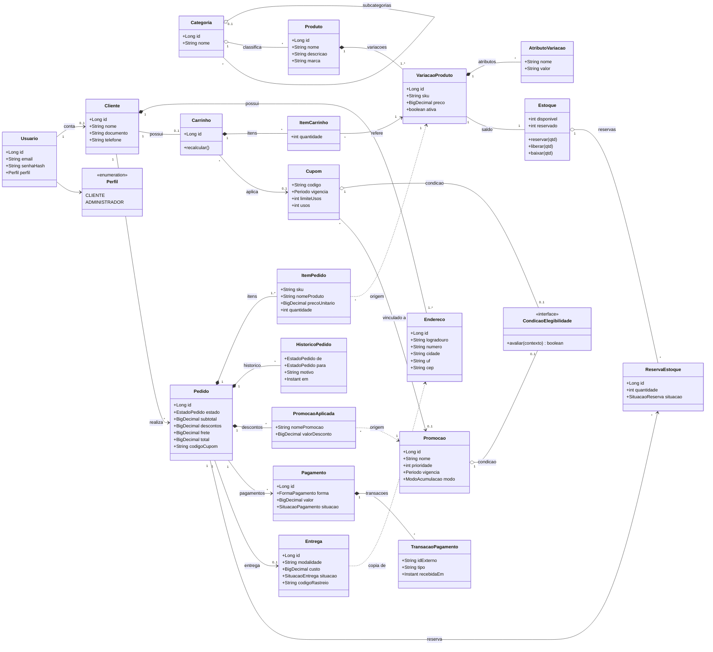
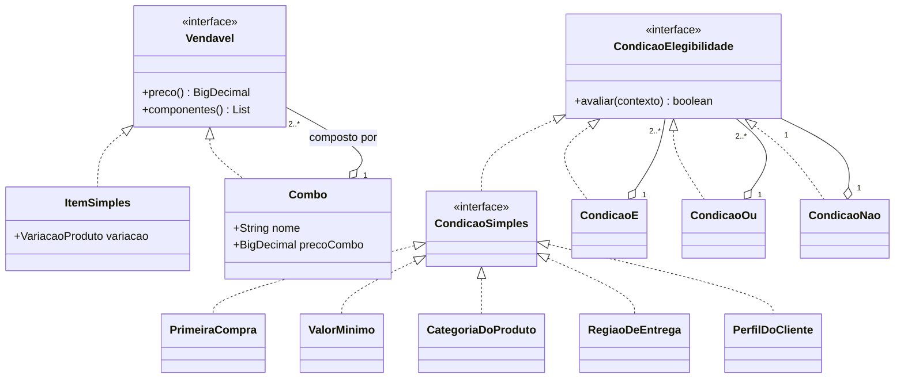

# 02. Modelo de domínio

> **Objetivo:** descrever as entidades do domínio, seus relacionamentos e as decisões de modelagem sobre variações de produto, categorias hierárquicas, combos/kits e preservação do histórico comercial nos pedidos.
> **Etapas do roadmap relacionadas:** E2 a E8 (cada etapa refina as entidades que introduz). Ver [08-roadmap.md](08-roadmap.md).
> **Status:** rascunho (diagrama preliminar; decisões marcadas como `proposto` podem mudar na etapa que implementa a entidade).

## 1. Entidades e responsabilidades

| Entidade | Responsabilidade | Etapa |
|---|---|---|
| Usuario | Credencial de acesso (e-mail, hash da senha) e perfil (cliente, administrador e perfis administrativos opcionais). | E1 |
| Cliente | Dados cadastrais do comprador. Um usuário com perfil cliente possui um cliente. | E1 |
| Endereco | Endereço de entrega do cliente. Um cliente tem um ou mais. | E1 |
| Categoria | Nó da árvore de categorias (categoria pai opcional). | E2 |
| Produto | Item do catálogo, com dados comuns: nome, descrição, marca e categoria. | E2 |
| VariacaoProduto | Variação vendável de um produto (SKU), com preço próprio e atributos como tamanho, cor ou capacidade. É a unidade que entra no carrinho e no estoque. | E2 |
| AtributoVariacao | Par nome/valor que descreve uma variação (por exemplo `cor = azul`). | E2 |
| Estoque | Saldo de uma variação: quantidade disponível e quantidade reservada. | E2 |
| ReservaEstoque | Reserva de unidades vinculada a um pedido, com situação (ativa, convertida em baixa, liberada, expirada). | E4 |
| Carrinho | Itens e quantidades de um cliente, mais cupom aplicado e valores calculados. Não reserva estoque. | E3 |
| ItemCarrinho | Variação e quantidade dentro de um carrinho. | E3 |
| Pedido | Resultado do checkout. Guarda o estado do ciclo de vida e os valores comerciais da compra. | E4 |
| ItemPedido | Linha do pedido com cópia dos dados comerciais no momento da compra (snapshot). | E4 |
| HistoricoPedido | Registro de cada mudança de estado, incluindo cancelamentos (data, origem, motivo). | E4 |
| Promocao | Campanha com nome, vigência, prioridade, tipo, parâmetros, regra de acumulação e condições. | E5 |
| CondicaoElegibilidade | Regra que decide se a promoção (ou cupom) se aplica. Pode ser composta (E, OU, NÃO). | E5 |
| Cupom | Código promocional com validade, limite de usos, condições e benefício. | E5 |
| PromocaoAplicada | Desconto efetivamente concedido em um pedido por uma promoção ou cupom (alimenta relatórios). | E5 |
| Pagamento | Pagamento de um pedido: forma, valor e situação. | E6 |
| TransacaoPagamento | Evento recebido ou enviado ao gateway, com identificador externo único (base da idempotência). | E6 |
| Entrega | Modalidade, custo, endereço de entrega copiado, situação e código de rastreio. | E7 |

Os **valores monetários** usam `BigDecimal` (ou um tipo `Dinheiro` do módulo compartilhado), nunca `double`.

## 2. Diagrama de classes preliminar

O diagrama cobre cliente, endereço, produto, variação, categoria, estoque, carrinho, pedido, item do pedido, promoção, cupom, pagamento e entrega. Nomes e atributos são preliminares.

Pontos de leitura:
- A seta tracejada de `ItemPedido` para `VariacaoProduto` e de `Entrega` para `Endereco` indica referência para fins de rastreio, não dependência de valores. Os dados comerciais são copiados (seção 5).
- `Estoque` e `ReservaEstoque` pertencem ao módulo de estoque. O pedido guarda apenas a referência à reserva.
- `CondicaoElegibilidade` é detalhada no diagrama da seção 6.

## 3. Variações de produto (decisão proposta)

**Problema:** uma camiseta tem tamanhos e cores, um celular tem capacidades. O enunciado exige decidir como representar isso e permitir novos tipos de produto sem mudanças excessivas no código.

**Decisão (`proposto`):** separar **Produto** de **VariacaoProduto (SKU)**.
- `Produto` guarda o que é comum (nome, descrição, marca, categoria).
- `VariacaoProduto` é a unidade vendável: tem `sku`, preço e um conjunto de `AtributoVariacao` (nome/valor).
- Estoque, carrinho e itens de pedido apontam para a **variação**, não para o produto.
- Um produto sem variações reais possui uma única variação padrão, evitando dois caminhos de código (com e sem variação).

**Por quê:** atributos em pares nome/valor permitem representar tamanho, cor, capacidade e atributos de tipos futuros sem criar uma subclasse de `Produto` para cada tipo. Isso atende ao requisito de extensibilidade do catálogo (RF-10, RF-13) com baixo impacto.

**Alternativas descartadas:**
- Herança de produto por tipo (`Camiseta`, `Celular`): cada novo tipo exige nova classe e nova tabela.
- Um produto por combinação (camiseta azul M como produto): duplica nome e descrição e dificulta agrupar a vitrine.

**Trade-off:** atributos genéricos perdem validação por tipo. Mitigação possível, se necessário: um conjunto de atributos permitidos por categoria.

## 4. Categorias hierárquicas (decisão proposta)

- `Categoria` possui uma `categoria pai` opcional (autorrelacionamento), formando uma árvore de profundidade livre. Exemplo: Eletrônicos > Celulares > Acessórios.
- Todo produto pertence a exatamente uma categoria (a mais específica).
- Para promoções e políticas comerciais, **uma regra associada a uma categoria vale também para suas subcategorias**. A condição "pertence à categoria X" percorre os ancestrais da categoria do produto. Esta é uma decisão a confirmar na etapa de promoções (E5).
- Persistência prevista: coluna `categoria_pai_id`. Consultas de subárvore podem usar CTE recursiva se necessário.

## 5. Preservação do histórico comercial no pedido (snapshot)

O enunciado exige que alterações futuras de preço não modifiquem pedidos antigos (RF-42). Por isso o pedido **copia** os dados comerciais no momento do checkout, em vez de apenas referenciar o catálogo.

| Dado copiado | Onde fica |
|---|---|
| SKU, nome do produto e atributos da variação, preço unitário, quantidade | `ItemPedido` |
| Subtotal, soma dos descontos, frete e total | `Pedido` |
| Nome e valor de cada promoção ou cupom aplicado | `PromocaoAplicada` (nome copiado, referência opcional à promoção) |
| Código do cupom usado | `Pedido` |
| Endereço de entrega (campos copiados) e modalidade/custo do frete | `Entrega` |
| Estado e transições, com data e motivo | `HistoricoPedido` |

Regra: depois que o pedido é criado, nenhum cálculo dele depende do preço atual do catálogo nem da promoção atual. A referência à variação serve apenas para rastreio e relatórios.

## 6. Combos e kits (opcional, decisão proposta)

**Problema:** o enunciado permite vender conjuntos de produtos como combos ou kits. O carrinho e o checkout não devem precisar distinguir "produto simples" de "combo" a cada passo.

**Decisão (`proposto`, opcional):** tratar combo com o pattern **Composite**. Uma abstração `Vendavel` é implementada por `ItemSimples` (uma variação) e por `Combo` (lista de `Vendavel` com quantidades). O preço do combo é definido explicitamente ou calculado a partir dos componentes.

**Estoque do combo:** não possui saldo próprio. A disponibilidade é derivada dos componentes (menor razão `disponivel / quantidade no combo`), e a reserva é feita por componente. Isso evita duas fontes de verdade para o mesmo estoque.

O segundo grupo do diagrama mostra as **condições de elegibilidade** combináveis (Composite no estilo Specification). Ele está neste documento porque as condições são parte do modelo de `Promocao` e `Cupom`; o contrato é detalhado em [03-arquitetura.md](03-arquitetura.md) e o pattern em [04-design-patterns.md](04-design-patterns.md).

## 7. Decisões e questões em aberto

| Item | Situação |
|---|---|
| Produto separado de variação (SKU) com atributos nome/valor | `proposto` |
| Estoque associado à variação | `proposto` |
| Categorias em árvore, regra da categoria vale para subcategorias | `proposto` (confirmar em E5) |
| Pedido com cópia dos dados comerciais (snapshot) | decidido (exigência do enunciado) |
| Combos/kits via Composite, sem estoque próprio | `proposto`, opcional |
| Tipo `Dinheiro` dedicado ou `BigDecimal` direto | em aberto, decidir em E1 |
| Mecanismo de concorrência no estoque (atualização condicional ou `@Version`) | em aberto, decidido em E4 (ver [05-regras-negocio.md](05-regras-negocio.md)) |
