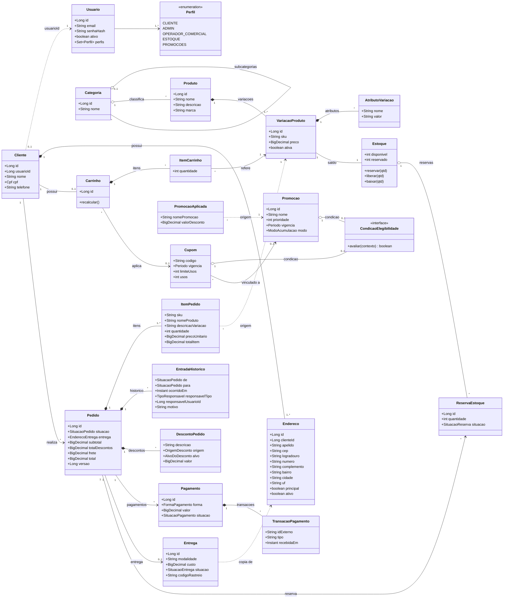
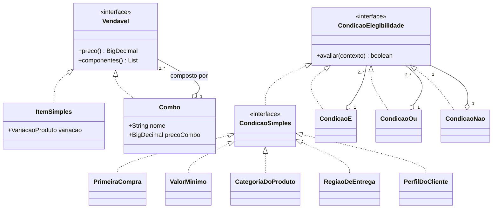

# 02. Modelo de domínio

> **Objetivo:** descrever as entidades do domínio, seus relacionamentos e as decisões de modelagem sobre variações de produto, categorias hierárquicas, combos/kits e preservação do histórico comercial nos pedidos.
> **Etapas do roadmap relacionadas:** E2 a E8 (cada etapa refina as entidades que introduz). Ver [08-roadmap.md](08-roadmap.md).
> **Status:** parcialmente `implementado`: `Usuario`, `Cliente` e `Endereco` (E1) refletem o código e a migração `V1` (seção 1.1), e o agregado do pedido (E4, change `pedido-ciclo-vida`) reflete o código e a migração `V2` (seção 1.2). O restante é rascunho (diagrama preliminar; decisões marcadas como `proposto` podem mudar na etapa que implementa a entidade).

## 1. Entidades e responsabilidades

| Entidade | Responsabilidade | Etapa |
|---|---|---|
| Usuario | Credencial de acesso (e-mail, hash da senha, situação ativo/inativo) e um ou mais perfis (`CLIENTE`, `ADMIN`, `OPERADOR_COMERCIAL`, `ESTOQUE`, `PROMOCOES`). Pertence ao módulo `seguranca`. | E1 (`implementado`) |
| Cliente | Dados cadastrais do comprador. Um usuário com perfil cliente possui um cliente; o cliente guarda `usuarioId`. | E1 (`implementado`) |
| Endereco | Endereço de entrega do cliente. Um cliente tem um ou mais; apenas um é o principal. | E1 (`implementado`) |
| Categoria | Nó da árvore de categorias (categoria pai opcional). | E2 |
| Produto | Item do catálogo, com dados comuns: nome, descrição, marca e categoria. | E2 |
| VariacaoProduto | Variação vendável de um produto (SKU), com preço próprio e atributos como tamanho, cor ou capacidade. É a unidade que entra no carrinho e no estoque. | E2 |
| AtributoVariacao | Par nome/valor que descreve uma variação (por exemplo `cor = azul`). | E2 |
| Estoque | Saldo de uma variação: quantidade disponível e quantidade reservada. | E2 |
| ReservaEstoque | Reserva de unidades vinculada a um pedido, com situação (ativa, convertida em baixa, liberada, expirada). | E4 |
| Carrinho | Itens e quantidades de um cliente, mais cupom aplicado e valores calculados. Não reserva estoque. | E3 |
| ItemCarrinho | Variação e quantidade dentro de um carrinho. | E3 |
| Pedido | Resultado do checkout. Guarda a situação do ciclo de vida, os valores comerciais da compra e o endereço de entrega copiado. Agregado raiz (ver 1.2). | E4 (`implementado`) |
| ItemPedido | Linha do pedido com cópia dos dados comerciais no momento da compra (snapshot). | E4 (`implementado`) |
| DescontoPedido | Desconto concedido no pedido (promoção ou cupom), com descrição, origem, alvo (itens ou frete) e valor copiados. Substitui, no código, o rascunho `PromocaoAplicada`. | E4 (`implementado`) |
| EntradaHistorico | Registro de cada mudança de situação, incluindo a criação e os cancelamentos (de, para, momento, responsável e motivo). Era o rascunho `HistoricoPedido`. | E4 (`implementado`) |
| Promocao | Campanha com nome, vigência, prioridade, tipo, parâmetros, regra de acumulação e condições. | E5 |
| CondicaoElegibilidade | Regra que decide se a promoção (ou cupom) se aplica. Pode ser composta (E, OU, NÃO). | E5 |
| Cupom | Código promocional com validade, limite de usos, condições e benefício. | E5 |
| PromocaoAplicada | Referência de uma promoção ou cupom efetivamente concedido, para relatórios por campanha (o valor copiado já fica em `DescontoPedido`). | E5 |
| Pagamento | Pagamento de um pedido: forma, valor e situação. | E6 |
| TransacaoPagamento | Evento recebido ou enviado ao gateway, com identificador externo único (base da idempotência). | E6 |
| Entrega | Modalidade, custo, endereço de entrega copiado, situação e código de rastreio. | E7 |

Os **valores monetários** usam o tipo `Dinheiro` do módulo `compartilhado` (`implementado` na E1; internamente `BigDecimal`, arredondamento `HALF_EVEN`), nunca `double`.

### 1.1 Entidades da E1 como implementadas (`implementado`)

Tabelas criadas pela migração `V1__usuarios_clientes_enderecos.sql`; as classes JPA são `seguranca.dominio.Usuario`, `cliente.dominio.Cliente` e `cliente.dominio.Endereco`.

**`usuario`** (módulo `seguranca`)

| Campo | Tipo | Regras |
|---|---|---|
| `id` | `BIGINT` identidade | Chave primária. |
| `email` | `VARCHAR(255)`, obrigatório | Normalizado (minúsculas, sem espaços nas pontas) antes de gravar. Único: `uk_usuario_email`. |
| `senha_hash` | `VARCHAR(255)`, obrigatório | Hash gerado pelo `DelegatingPasswordEncoder`; a senha em claro nunca é gravada nem devolvida. |
| `ativo` | `BOOLEAN`, padrão `true` | Usuário inativo não faz login. |
| `criado_em`, `atualizado_em` | `TIMESTAMPTZ` | Preenchidos pela aplicação/banco. |

**`usuario_perfil`**: tabela de coleção de perfis. Chave primária `(usuario_id, perfil)`; `usuario_id` referencia `usuario`; `perfil` é `TEXT` com `CHECK` restrito a `CLIENTE`, `ADMIN`, `OPERADOR_COMERCIAL`, `ESTOQUE`, `PROMOCOES` (enum `Perfil`). Todo perfil exceto `CLIENTE` é administrativo, e a API administrativa não atribui `CLIENTE`.

**`cliente`**

| Campo | Tipo | Regras |
|---|---|---|
| `id` | `BIGINT` identidade | Chave primária. |
| `usuario_id` | `BIGINT`, obrigatório | Referencia `usuario`. Único: `uk_cliente_usuario` (um usuário, no máximo um cliente). Apenas o id, sem associação JPA entre `Cliente` e `Usuario` (dependência entre módulos por identificador). |
| `nome` | `VARCHAR(255)`, obrigatório | Alterável pelo próprio cliente. |
| `cpf` | `CHAR(11)`, obrigatório | Só dígitos, validado (dígitos verificadores; sequências repetidas rejeitadas). Único: `uk_cliente_cpf`. Não é alterável depois do cadastro. |
| `telefone` | `VARCHAR(20)`, opcional | Alterável pelo próprio cliente. |

O e-mail do cliente é o do seu `usuario` (não é duplicado em `cliente`) e também não é alterável por `PUT /api/clientes/me`.

**`endereco`**

| Campo | Tipo | Regras |
|---|---|---|
| `id` | `BIGINT` identidade | Chave primária. |
| `cliente_id` | `BIGINT`, obrigatório | Referencia `cliente`; índice `ix_endereco_cliente`. Toda busca é feita por `(id, clienteId)`, então um endereço de outro cliente aparece como inexistente (404). |
| `apelido` | `VARCHAR(60)`, opcional | |
| `cep` | `CHAR(8)`, obrigatório | Normalizado para 8 dígitos (aceita hífen na entrada). |
| `logradouro`, `numero`, `bairro`, `cidade` | obrigatórios | `complemento` é opcional. |
| `uf` | `CHAR(2)`, obrigatório | Validada contra as 27 UFs. |
| `principal` | `BOOLEAN`, padrão `false` | O primeiro endereço do cliente é o principal. |
| `ativo` | `BOOLEAN`, padrão `true` | A remoção é **por inativação** (`ativo = false`), não apaga a linha, preservando futuras referências de pedidos. |
| `criado_em` | `TIMESTAMPTZ` | Usado para promover o ativo mais antigo quando o principal é removido. |

Regra de endereço principal, garantida pelo banco e pela aplicação: o índice único parcial `ux_endereco_principal_ativo ON endereco (cliente_id) WHERE principal AND ativo` impede mais de um principal ativo por cliente. A troca (`PUT /api/clientes/me/enderecos/{id}/principal`) e a promoção do endereço ativo mais antigo ao remover o principal ficam em `cliente.dominio.RegraEnderecoPrincipal`.

### 1.2 Pedido como implementado (`implementado`, E4)

Tabelas criadas pela migração `V2__pedidos.sql`; as classes JPA estão em `pedido.dominio`. O `Pedido` é o agregado raiz: itens, descontos e histórico só se alteram por ele, e o snapshot comercial não tem setters. Valores monetários em `NUMERIC(12,2)` (`Dinheiro` no código). Pacote e fluxo em [03-arquitetura.md](03-arquitetura.md); ciclo de vida em [06-ciclo-vida-pedido.md](06-ciclo-vida-pedido.md).

**`pedido`** (`Pedido`)

| Campo | Tipo | Regras |
|---|---|---|
| `id` | `BIGINT` identidade | Chave primária. |
| `cliente_id` | `BIGINT`, obrigatório | Referencia `cliente`; apenas o id no código (sem associação JPA entre módulos). Nunca muda. |
| `situacao` | `TEXT`, obrigatório | `CHECK` restrito aos 8 valores de `SituacaoPedido`. É o valor persistido do estado; o objeto de estado (`EstadoPedido`) é derivado dele e não é persistido. |
| `entrega_apelido`, `entrega_cep`, `entrega_logradouro`, `entrega_numero`, `entrega_complemento`, `entrega_bairro`, `entrega_cidade`, `entrega_uf` | texto | **Snapshot do endereço**: campos copiados do endereço no momento da compra (classe embutida `EnderecoEntrega`), sem chave estrangeira para `endereco`. Alterar ou remover o endereço do cliente depois não muda o pedido. `apelido` e `complemento` são opcionais. |
| `subtotal`, `total_descontos`, `frete`, `total` | `NUMERIC(12,2)`, obrigatórios | Copiados do cálculo de preço; imutáveis. A fábrica `Pedido.criar` exige `subtotal` igual à soma dos itens, `total_descontos` igual à soma dos descontos e `total = subtotal - total_descontos + frete`. |
| `criado_em` | `TIMESTAMPTZ`, obrigatório | Momento da criação. |
| `versao` | `BIGINT`, padrão `0` | `@Version`: **lock otimista**. Na disputa de duas transições simultâneas a segunda falha ao gravar e vira 409. |

Índices: `ix_pedido_cliente_criado_em (cliente_id, criado_em DESC)` (listagem do cliente, do mais recente ao mais antigo) e `ix_pedido_situacao` (filtro administrativo).

**`pedido_item`** (`ItemPedido`): `pedido_id` (referência), `sku`, `nome_produto`, `descricao_variacao` (opcional), `quantidade` (`CHECK` > 0), `preco_unitario` e `total_item`. Guarda o SKU (sem chave estrangeira para a variação, que só existe a partir da etapa 2); índice `ix_pedido_item_pedido`.

**`pedido_desconto`** (`DescontoPedido`): `pedido_id`, `descricao`, `origem` (`CHECK`: `PROMOCAO` ou `CUPOM`), `alvo` (`CHECK`: `ITENS` ou `FRETE`) e `valor`. Um pedido sem desconto simplesmente não tem linhas.

**`pedido_historico`** (`EntradaHistorico`): `pedido_id`, `de` (**nulo** na entrada de criação; `CHECK` com os 8 valores), `para` (`CHECK`), `ocorrido_em`, `responsavel_tipo` (`CHECK`: `CLIENTE`, `ADMINISTRATIVO` ou `SISTEMA`), `responsavel_usuario_id` (nulo para `SISTEMA`) e `motivo` (obrigatório no cancelamento, validado pelo agregado). Ordenado pelo id (ordem de gravação). Registro de fatos: as colunas são `updatable = false` no mapeamento.

Itens, descontos e histórico são coleções do agregado (`@OneToMany` com cascade e `orphanRemoval`, carregadas por `SUBSELECT`); a listagem usa um resumo (`ResumoPedido`: id, cliente, situação, total e data) que não as carrega. A migração e as restrições são verificadas por `infra.MigracaoV2Tests`.

## 2. Diagrama de classes preliminar

O diagrama cobre cliente, endereço, produto, variação, categoria, estoque, carrinho, pedido, item do pedido, promoção, cupom, pagamento e entrega. Nomes e atributos são preliminares.

Pontos de leitura:
- `Usuario` e `Perfil` (com as regras de acesso) pertencem ao módulo `seguranca`; `Cliente` referencia o usuário apenas por `usuarioId` (seta tracejada), sem acoplar os módulos. Os atributos de `Usuario`, `Cliente` e `Endereco` (E1) e de `Pedido`, `ItemPedido`, `DescontoPedido` e `EntradaHistorico` (E4) no diagrama já refletem o código.
- A seta tracejada de `ItemPedido` para `VariacaoProduto` (hoje só o SKU copiado) e de `Entrega` para `Endereco` indica referência para fins de rastreio, não dependência de valores. Os dados comerciais são copiados (seção 5).
- `Estoque` e `ReservaEstoque` pertencem ao módulo de estoque. O pedido guarda apenas a referência à reserva.
- `CondicaoElegibilidade` é detalhada no diagrama da seção 6.

## 3. Variações de produto (decisão proposta)

**Problema:** uma camiseta tem tamanhos e cores, um celular tem capacidades. O enunciado exige decidir como representar isso e permitir novos tipos de produto sem mudanças excessivas no código.

**Decisão (`proposto`):** separar **Produto** de **VariacaoProduto (SKU)**.
- `Produto` guarda o que é comum (nome, descrição, marca, categoria).
- `VariacaoProduto` é a unidade vendável: tem `sku`, preço e um conjunto de `AtributoVariacao` (nome/valor).
- Estoque, carrinho e itens de pedido apontam para a **variação**, não para o produto.
- Um produto sem variações reais possui uma única variação padrão, evitando dois caminhos de código (com e sem variação).

**Por quê:** atributos em pares nome/valor permitem representar tamanho, cor, capacidade e atributos de tipos futuros sem criar uma subclasse de `Produto` para cada tipo. Isso atende ao requisito de extensibilidade do catálogo (RF-10, RF-13) com baixo impacto.

**Alternativas descartadas:**
- Herança de produto por tipo (`Camiseta`, `Celular`): cada novo tipo exige nova classe e nova tabela.
- Um produto por combinação (camiseta azul M como produto): duplica nome e descrição e dificulta agrupar a vitrine.

**Trade-off:** atributos genéricos perdem validação por tipo. Mitigação possível, se necessário: um conjunto de atributos permitidos por categoria.

## 4. Categorias hierárquicas (decisão proposta)

- `Categoria` possui uma `categoria pai` opcional (autorrelacionamento), formando uma árvore de profundidade livre. Exemplo: Eletrônicos > Celulares > Acessórios.
- Todo produto pertence a exatamente uma categoria (a mais específica).
- Para promoções e políticas comerciais, **uma regra associada a uma categoria vale também para suas subcategorias**. A condição "pertence à categoria X" percorre os ancestrais da categoria do produto. Esta é uma decisão a confirmar na etapa de promoções (E5).
- Persistência prevista: coluna `categoria_pai_id`. Consultas de subárvore podem usar CTE recursiva se necessário.

## 5. Preservação do histórico comercial no pedido (snapshot)

O enunciado exige que alterações futuras de preço não modifiquem pedidos antigos (RF-42). Por isso o pedido **copia** os dados comerciais no momento do checkout, em vez de apenas referenciar o catálogo.

| Dado copiado | Onde fica |
|---|---|
| SKU, nome do produto e atributos da variação, preço unitário, quantidade | `ItemPedido` |
| Subtotal, soma dos descontos, frete e total | `Pedido` |
| Descrição, origem (`PROMOCAO` ou `CUPOM`), alvo (itens ou frete) e valor de cada desconto, inclusive o do cupom | `DescontoPedido` (descrição copiada; a referência à promoção chega com a etapa 5) |
| Endereço de entrega (campos copiados, sem chave estrangeira) | colunas `entrega_*` do `Pedido` (`EnderecoEntrega`) |
| Valor do frete | `Pedido.frete` (modalidade e rastreio ficam em `Entrega`, etapa 7) |
| Situação e transições, com data, responsável e motivo | `EntradaHistorico` |

Implementado na E4 (`pedido.aplicacao.CriarPedidoTests`: preço e endereço alterados ou removidos depois da compra não mudam o pedido). Regra: depois que o pedido é criado, nenhum cálculo dele depende do preço atual do catálogo nem da promoção atual. A referência à variação serve apenas para rastreio e relatórios.

## 6. Combos e kits (opcional, decisão proposta)

**Problema:** o enunciado permite vender conjuntos de produtos como combos ou kits. O carrinho e o checkout não devem precisar distinguir "produto simples" de "combo" a cada passo.

**Decisão (`proposto`, opcional):** tratar combo com o pattern **Composite**. Uma abstração `Vendavel` é implementada por `ItemSimples` (uma variação) e por `Combo` (lista de `Vendavel` com quantidades). O preço do combo é definido explicitamente ou calculado a partir dos componentes.

**Estoque do combo:** não possui saldo próprio. A disponibilidade é derivada dos componentes (menor razão `disponivel / quantidade no combo`), e a reserva é feita por componente. Isso evita duas fontes de verdade para o mesmo estoque.

O segundo grupo do diagrama mostra as **condições de elegibilidade** combináveis (Composite no estilo Specification). Ele está neste documento porque as condições são parte do modelo de `Promocao` e `Cupom`; o contrato é detalhado em [03-arquitetura.md](03-arquitetura.md) e o pattern em [04-design-patterns.md](04-design-patterns.md).

## 7. Decisões e questões em aberto

| Item | Situação |
|---|---|
| Produto separado de variação (SKU) com atributos nome/valor | `proposto` |
| Estoque associado à variação | `proposto` |
| Categorias em árvore, regra da categoria vale para subcategorias | `proposto` (confirmar em E5) |
| Pedido com cópia dos dados comerciais (snapshot) | decidido (exigência do enunciado); `implementado` na E4 (seção 1.2) |
| Concorrência nas transições do pedido: lock otimista (`@Version`, coluna `versao`) em vez de lock pessimista | `implementado` (E4) |
| Histórico do pedido com entrada inicial de criação (`de` nulo) e responsável de três tipos | `implementado` (E4) |
| Combos/kits via Composite, sem estoque próprio | `proposto`, opcional |
| Tipo `Dinheiro` dedicado ou `BigDecimal` direto | decidido na E1: tipo `Dinheiro` em `compartilhado.dominio` (`implementado`) |
| `Usuario`/`Perfil` em `seguranca`; `Cliente` referencia `usuarioId`; endereço removido por inativação, com índice parcial de principal | `implementado` (E1) |
| Mecanismo de concorrência no estoque (atualização condicional ou `@Version`) | em aberto, decidido em E4 (ver [05-regras-negocio.md](05-regras-negocio.md)) |
