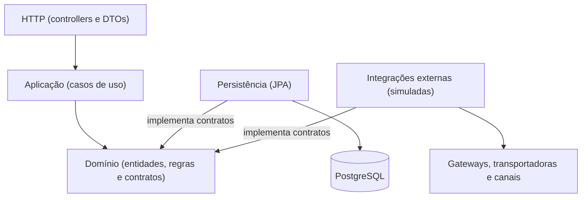
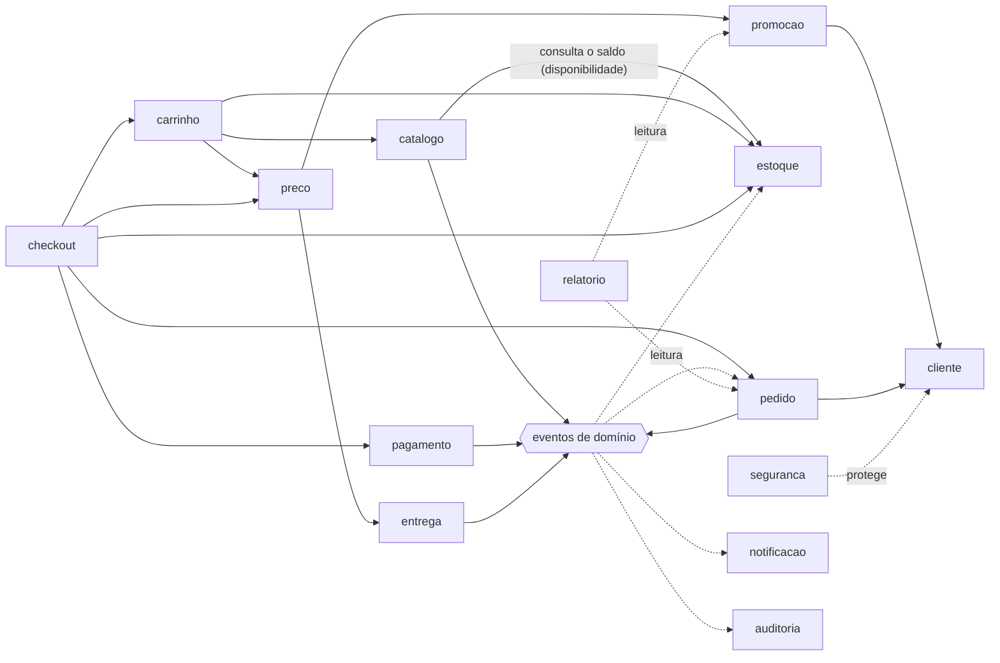
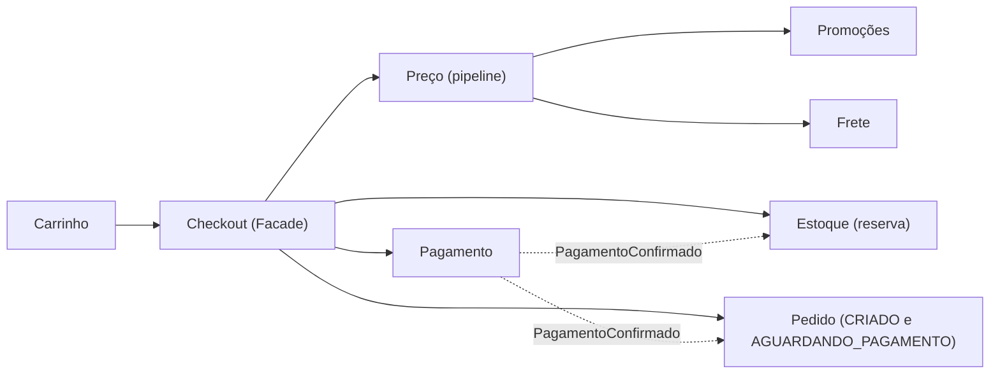

# 03. Arquitetura

> **Objetivo:** definir as camadas, a organização de pacotes por módulo, os pontos de variação e os contratos centrais (interfaces) que sustentam a extensibilidade exigida pelo enunciado.
> **Etapas do roadmap relacionadas:** E1 a E9. A fundação (E1) cria a estrutura; cada etapa seguinte preenche o seu módulo. Ver [08-roadmap.md](08-roadmap.md).
> **Status:** implementado (E1–E9): pacotes, contratos, módulos (`pedido`, `catalogo`, `estoque`, carrinho e pipeline de preço, promoções, pagamento, entrega, notificação, auditoria e relatórios) e regras ArchUnit refletem o código. Trechos descritos como sugestão preliminar no corpo registram a decisão original da etapa.

## 1. Princípios

1. **Um módulo, uma responsabilidade de negócio.** Nenhum módulo concentra catálogo, carrinho, promoções, checkout, pagamento e entrega (RNF-04).
2. **O domínio não depende de infraestrutura.** Regras de negócio não conhecem Spring MVC, JPA nem clientes HTTP de provedores.
3. **Variação por contrato.** Tudo o que o enunciado diz que "poderá mudar" (promoções, condições, pagamento, frete, notificação) fica atrás de uma interface, e uma nova variante é uma nova classe, não uma alteração nas existentes.
4. **Módulos se comunicam por contratos e eventos**, não por acesso a classes internas uns dos outros.

## 2. Camadas

As camadas se repetem dentro de cada módulo, e a regra de dependência aponta sempre para o domínio.

| Camada | Pacote (dentro do módulo) | Responsabilidade | Pode depender de |
|---|---|---|---|
| HTTP | `web` | Controllers REST, DTOs de entrada e saída, validação de requisição, tradução de erros para respostas HTTP. | aplicação |
| Aplicação | `aplicacao` | Casos de uso: orquestram o domínio, controlam transação, publicam eventos. | domínio |
| Domínio | `dominio` | Entidades, regras de negócio, contratos (interfaces) e eventos de domínio. Sem anotações de framework web. | nada além do módulo compartilhado |
| Persistência | `infra.persistencia` | Repositórios Spring Data JPA, mapeamento e migrações. Implementa as interfaces de repositório declaradas no domínio. | domínio |
| Integrações | `infra.integracao` | Adaptadores para sistemas externos (gateways de pagamento, transportadoras, canais de notificação), todos simulados nesta fase. Implementam contratos do domínio. | domínio |



A seta de persistência e integrações para o domínio é a **inversão de dependência**: o domínio declara a interface (por exemplo `GatewayPagamento`) e a infraestrutura a implementa.

## 3. Organização de pacotes por módulo

Pacote raiz: `br.com.fatec.ecommerce` (`implementado` na E1). Cada módulo abaixo é um subpacote com as subdivisões da seção 2 que a etapa realmente precisa.

| Módulo (pacote) | Responsabilidade | Etapa |
|---|---|---|
| `compartilhado` | Tipos comuns sem regra de negócio: `Dinheiro`, exceções base, `EventoDominio` e `PublicadorEventos`, tratamento de erros (`ProblemDetail`), configuração do OpenAPI. `Periodo` continua previsto. | E1 (`implementado`) |
| `seguranca` | `Usuario` e `Perfil` (credencial e perfis de acesso), autenticação (login e emissão de JWT), autorização por perfil, hash de senha, gestão de usuários administrativos. Transversal. | E1 (`implementado`) |
| `cliente` | `Cliente` (referencia o usuário por `usuarioId`, sem associação JPA) e `Endereco`. | E1 (`implementado`) |
| `catalogo` | Produtos, variações, categorias em árvore, combos (Composite de itens vendáveis), consulta pública e administração do catálogo. | E2 (`implementado`, change `catalogo-estoque`) |
| `estoque` | Saldo por variação, ajuste administrativo, reserva tudo-ou-nada, liberação, baixa e reposição idempotentes, e os ouvintes dos eventos do pedido e do catálogo. | E2 (`implementado`, change `catalogo-estoque`); a reserva é acionada pelo checkout (E4) |
| `carrinho` | Carrinho e itens; consulta (não reserva) disponibilidade. | E3 |
| `pedido` | Pedido, itens, descontos, máquina de estados (State) e histórico, consultas, cancelamento e eventos do pedido. | E4 (`implementado`, change `pedido-ciclo-vida`) |
| `checkout` | Orquestração da conversão de carrinho em pedido (Facade). Não tem regras de preço, estoque, pagamento ou entrega: apenas coordena os demais. | E4 (change `checkout`, depois de `carrinho-compras`) |
| `promocao` | Promoções, condições de elegibilidade, política de conflito, cupons. | E5 (contratos em `dominio` na E1) |
| `preco` | Pipeline de formação do preço: subtotal, promoções, cupom, frete e total. | E5 (contrato em `dominio` na E1) |
| `pagamento` | Pagamentos, gateways (Adapters), registro de transações e idempotência. | E6 (contratos em `dominio` na E1) |
| `entrega` | Modalidades, provedores de frete, cotação e acompanhamento. | E7 (contratos em `dominio` na E1) |
| `notificacao` | Canais de notificação e reação a eventos. | E8 (contrato em `dominio` na E1) |
| `auditoria` | Registro de operações administrativas (quem, o quê, quando). | E8 |
| `relatorio` | Consultas gerenciais, somente leitura. | E9 (`implementado`) |

### Pacotes efetivos (E1, E2 e E4)

Estrutura real do código (raiz `br.com.fatec.ecommerce`), todos com status `implementado`, exceto onde indicado:

| Pacote | Conteúdo (classes principais) |
|---|---|
| `compartilhado.dominio` | `Dinheiro`, `ConflitoException` (com `tipo()`, `titulo()` e `propriedades()` genéricos; ver a seção 7), `DadoInvalidoException`, `NaoAutenticadoException`, `RecursoNaoEncontradoException`, `SenhaForte` (anotação de política de senha) e `SenhaForteValidator`, `EventoDominio`, `PublicadorEventos` |
| `compartilhado.web` | `TratadorGlobalDeErros` (`@RestControllerAdvice` com `ProblemDetail`), `Problemas` |
| `compartilhado.infra` | `PublicadorEventosSpring`, `ConfiguracaoOpenApi` |
| `seguranca.dominio` | `Usuario`, `Perfil`, `UsuarioRepository`, `RegraUltimoAdmin` |
| `seguranca.aplicacao` | `Autenticar`, `EmissorDeToken`, `TokenEmitido`, `GerenciarUsuariosAdministrativos` |
| `seguranca.web` | `AutenticacaoController`, `UsuariosAdministrativosController` e seus DTOs |
| `seguranca.infra.persistencia` | `UsuarioJpaRepository`, `UsuarioRepositoryJpa` |
| `seguranca.infra.config` | `ConfiguracaoSeguranca`, `EmissorDeTokenJwt`, `JwtProperties`, `ProblemDetailAuthenticationEntryPoint`, `ProblemDetailAccessDeniedHandler` |
| `cliente.dominio` | `Cliente`, `Endereco`, `Cpf`, `Uf`, `RegraEnderecoPrincipal`, validações `CpfValido` e `UfValida`, `ClienteRepository`, `EnderecoRepository` |
| `cliente.aplicacao` | `CadastrarCliente`, `GerenciarCliente`, `GerenciarEnderecos` |
| `cliente.web` | `ClienteController`, `EnderecoController` e seus DTOs |
| `cliente.infra.persistencia` | `ClienteJpaRepository`, `ClienteRepositoryJpa`, `EnderecoJpaRepository`, `EnderecoRepositoryJpa` |
| `infra.demo` | `UsuariosDeDemonstracao` (`ApplicationRunner` do perfil `dev`; fica fora dos módulos porque cruza `seguranca`, `cliente`, `catalogo`, `estoque` e `pedido`; cria também um pedido de demonstração com reserva de estoque, ver [10-execucao.md](10-execucao.md)) e `CatalogoDeDemonstracao` (carga idempotente de categorias, produtos, combo e estoque, só no perfil `dev`; usa os casos de uso reais com um contexto de segurança de sistema temporário) |
| `catalogo.dominio` (E2) | `ItemVendavel`, `VariacaoProduto`, `Combo`, `ItemCombo` (Composite), `Produto`, `Categoria`, `ArvoreDeCategorias`, `ComponenteEstoque`, `ItemVendavelRepository`, `ProdutoRepository`, `CategoriaRepository` |
| `catalogo.dominio.evento` (E2) | `VariacaoCadastrada` |
| `catalogo.aplicacao` (E2) | `GerenciarCategorias`, `GerenciarProdutos`, `CadastrarVariacao`, `GerenciarCombos`, `ConsultarCatalogo`, `ConsultarItensVendaveis` e os tipos de entrada e saída (`NovaVariacao`, `ComponenteDeCombo`, `FiltroDeProdutos`, `ProdutoResumo`, `ProdutoDetalhe`, `ProdutoAdministrativo`, `ComboDetalhe`, `NoDeCategoria`, `ItemVendavelInfo`) |
| `catalogo.web` (E2) | `CatalogoPublicoController`, `CategoriasAdministrativasController`, `ProdutosAdministrativosController`, `CombosAdministrativosController` e seus DTOs |
| `catalogo.infra.persistencia` (E2) | `CategoriaJpaRepository`, `CategoriaRepositoryJpa`, `ProdutoJpaRepository`, `ProdutoRepositoryJpa`, `ItemVendavelJpaRepository`, `ItemVendavelRepositoryJpa`, `ViolacoesDeUnicidade` |
| `estoque.dominio` (E2) | `SaldoEstoque`, `ReservaEstoque`, `SituacaoReserva`, `ComponenteAReservar`, `EstoqueInsuficienteException`, `SaldoNaoEncontradoException`, `SaldoEstoqueRepository`, `ReservaEstoqueRepository` |
| `estoque.aplicacao` (E2) | `ReservarEstoque`, `MovimentarReservas`, `AjustarEstoque`, `ConsultarSaldo` e os ouvintes `OuvinteDePedidosDoEstoque` e `OuvinteDeCatalogoDoEstoque` |
| `estoque.web` (E2) | `EstoqueAdministrativoController`, `AjusteDeEstoqueRequest`, `SaldoResponse` |
| `estoque.infra.persistencia` (E2) | `SaldoEstoqueJpaRepository`, `SaldoEstoqueRepositoryJpa`, `ReservaEstoqueJpaRepository`, `ReservaEstoqueRepositoryJpa` (reserva e movimentações por `UPDATE` condicional nativo) |
| `pedido.dominio` | `Pedido` (agregado), `ItemPedido`, `DescontoPedido`, `EnderecoEntrega`, `EntradaHistorico`, `SituacaoPedido`, `OperacaoPedido`, `Responsavel`, `TipoResponsavel`, `OrigemDesconto`, `AlvoDoDesconto`, `DadosNovoPedido` (snapshot de entrada), `ResumoPedido`, `TransicaoInvalidaException`, `PedidoRepository` |
| `pedido.dominio.estado` | `EstadoPedido`, `EstadoPedidoBase`, `DadosDaTransicao` e os 8 estados `Criado`, `AguardandoPagamento`, `Pago`, `PagamentoRecusado`, `EmPreparacao`, `Enviado`, `Entregue`, `Cancelado` |
| `pedido.dominio.evento` | `PedidoCriado`, `PedidoPago`, `PedidoPagamentoRecusado`, `PedidoEmPreparacao`, `PedidoEnviado`, `PedidoEntregue`, `PedidoCancelado` |
| `pedido.aplicacao` | `CriarPedido`, `ConfirmarReservaDoPedido`, `TransicionarPedido`, `ConsultarPedidos`, `CancelarPedidoDoCliente` |
| `pedido.web` | `PedidosDoClienteController`, `PedidosAdministrativosController`, `PagamentoSimuladoController` (temporário) e seus DTOs (`PedidoResponse`, `ResumoPedidoResponse`, `MotivoRequest`, `PagamentoSimuladoRequest`, `UsuarioDoToken`) |
| `pedido.infra.persistencia` | `PedidoJpaRepository`, `PedidoRepositoryJpa` (converte o conflito de lock otimista em `ConflitoException`) |
| `promocao.dominio` | Somente contratos e tipos de apoio: `Promocao`, `CondicaoElegibilidade`, `PoliticaConflito`, `ContextoPreco`, `ItemPreco`, `DescontoCandidato`, `DescontoAplicado`, `AlvoDesconto`, `ModoAcumulacao` |
| `preco.dominio` | `EtapaPreco`, `CalculoPreco`, handlers `EtapaSubtotal` e `EtapaTotal` (E3) |
| `pagamento.dominio` | Somente contratos: `GatewayPagamento`, `FormaPagamento`, `SolicitacaoCobranca`, `ResultadoCobranca`, `SolicitacaoEstorno`, `ResultadoEstorno` |
| `entrega.dominio` | Somente contratos: `ProvedorFrete`, `ContextoFrete`, `CotacaoFrete` |
| `notificacao.dominio` | Somente contratos: `CanalNotificacao`, `Notificacao` |

Os pacotes `dominio` de `promocao`, `preco`, `pagamento`, `entrega` e `notificacao` não têm nenhuma implementação na E1 (apenas interfaces e `record`s); cada implementação chega na etapa do módulo dono (E5 a E8).

Estrutura de exemplo de um módulo:

```text
br.com.fatec.ecommerce.promocao
  ├── web                    PromocaoController, PromocaoRequest, PromocaoResponse
  ├── aplicacao              CalcularPromocoes, CadastrarPromocao
  ├── dominio                Promocao, CondicaoElegibilidade, PoliticaConflito, PromocaoRepository
  └── infra
      └── persistencia       PromocaoJpaRepository, PromocaoEntity
```

### Dependências entre módulos



Leitura do diagrama:
- Linhas cheias são dependências diretas (chamada a uma interface de aplicação do outro módulo).
- Linhas pontilhadas para `eventos de domínio` são **reações por evento**: o publicador não conhece quem reage. Por exemplo, a confirmação publica `PedidoPago` por `TransicionarPedido`; estoque, cupons e notificação reagem sem dependência direta desses interessados no publicador. Auditoria reage ao evento explícito `OperacaoAdministrativa`, publicado pelos serviços administrativos.
- Não há dependência circular entre as classes de domínio. `pedido` não depende de `pagamento`, `entrega`, `notificacao`, **`estoque` nem `catalogo`**; do `cliente` usa só `ClienteRepository` (conferir que o cliente existe e achar o cliente do usuário autenticado), e do `compartilhado` os tipos comuns.
- **`catalogo` e `estoque` (E2, `implementado`).** Há dependência nos dois sentidos, mas só no sentido permitido e fiscalizado: (1) `catalogo` para `estoque`, porque a consulta pública mostra a disponibilidade e usa `ConsultarSaldo`; (2) `estoque` para `catalogo`, **somente** o pacote `catalogo.dominio.evento` (o evento `VariacaoCadastrada`, para criar o saldo zero), e para `pedido.dominio.evento` (os eventos do pedido, mais `SituacaoPedido`). O estoque guarda apenas o id da variação e o id do pedido (sem chave estrangeira). O `catalogo` não depende do `pedido`.
- `seguranca` é transversal e foi simplificado no diagrama (protege todos os módulos expostos por HTTP).

### Verificação da regra "nenhum módulo concentra tudo"

| Responsabilidade do enunciado | Módulo dono |
|---|---|
| Catálogo | `catalogo` |
| Carrinho | `carrinho` |
| Promoções | `promocao` (regras) e `preco` (cálculo em etapas) |
| Checkout | `checkout` (apenas orquestra) |
| Pagamento | `pagamento` |
| Entrega | `entrega` |

Cada responsabilidade tem um dono distinto, e o único módulo que enxerga vários deles é `checkout`, de propósito: ele é uma fachada fina, sem regra de negócio própria.

## 4. Pontos de variação

Cada ponto de variação corresponde a um trecho do enunciado em que "novos itens poderão surgir". A coluna "como adicionar" mostra o impacto esperado de uma mudança.

| Ponto de variação | Origem no enunciado | Contrato | Implementações iniciais (propostas) | Como adicionar uma nova |
|---|---|---|---|---|
| Tipo de promoção | Promoções (4 tipos, quinta ou sexta com baixo impacto) | `Promocao` | Leve 3 pague 2, percentual por categoria, valor fixo acima do mínimo, primeira compra, frete grátis | Nova classe que implementa `Promocao` e registro na fábrica |
| Condição de elegibilidade | Condições (várias simultâneas) | `CondicaoElegibilidade` | Primeira compra, valor mínimo, categoria, região, período, perfil, mais E/OU/NÃO | Nova classe de condição, combinável com as existentes |
| Política de conflito | Conflitos entre promoções | `PoliticaConflito` | Exclusiva primeiro, depois acumuláveis mais a melhor não acumulável (ver [05-regras-negocio.md](05-regras-negocio.md)) | Nova política (por exemplo "somente o maior desconto") |
| Etapa do preço | Formação do preço | `EtapaPreco` | Subtotal, promoções, cupom, frete, total | Nova etapa inserida no pipeline |
| Estado do pedido | Pedidos (ciclo de vida) | `EstadoPedido` | Um estado por situação (ver [06-ciclo-vida-pedido.md](06-ciclo-vida-pedido.md)) | Novo estado com suas transições |
| Gateway de pagamento | Pagamentos (fornecedor diferente) | `GatewayPagamento` | Cartão simulado, PIX simulado, boleto simulado | Novo adaptador para o provedor |
| Provedor de frete | Entrega (novos serviços) | `ProvedorFrete` | Entrega padrão, expressa e retirada simuladas | Novo provedor, sem tocar em checkout |
| Canal de notificação | Notificações (novos canais) | `CanalNotificacao` | E-mail simulado, console/log | Novo canal registrado como ouvinte |
| Item vendável | Carrinho (combos/kits); Catálogo (novos tipos) | `ItemVendavel` | `VariacaoProduto`, `Combo` (`implementado`, E2) | Nova subclasse de `ItemVendavel`, sem alterar combo, carrinho, preço nem estoque |
| Reação a eventos | Eventos do sistema | `EventoDominio` e ouvintes | Estoque (`OuvinteDePedidosDoEstoque`, `OuvinteDeCatalogoDoEstoque`, `implementado` na E2), notificação, auditoria | Novo ouvinte do evento, sem alterar o publicador |
| Tipo de benefício do cupom | Cupons (percentual, fixo, outros) | Reuso de `Promocao`/efeito | Percentual e valor fixo | Nova implementação de efeito |

## 5. Contratos centrais (interfaces sugeridas)

As assinaturas das seções 5.1 a 5.8 foram **criadas na E1 como contratos** (status `implementado` como contrato; nenhuma delas tem implementação, exceto `PublicadorEventos`) e correspondem ao código. Elas ainda são **provisórias**: as etapas dos módulos donos podem refiná-las, e o que mudar deve ser registrado aqui. A seção 5.9 (`EstadoPedido`) foi **implementada na E4** e descreve o código real.

Desvios em relação à proposta original, registrados na E1:

| Desvio | Motivo |
|---|---|
| `ContextoPreco` e `ItemPreco` ficam em `promocao.dominio` (não em `preco`). | Evita o ciclo `preco` ↔ `promocao`: `preco` depende de `promocao`, nunca o contrário. `CalculoPreco` (em `preco.dominio`) referencia o contexto de `promocao`. |
| `ResultadoCobranca` é um `record` com o enum aninhado `Situacao` (`APROVADO`, `RECUSADO`, `PENDENTE`) e o `idTransacaoExterna`. | Torna explícito o resultado da cobrança, incluindo o caso pendente (PIX e boleto). |
| `ContextoFrete` tem `uf`, `pesoKg` e `subtotal`. | Define o mínimo para "região, peso, valor" de `ProvedorFrete.atende`. |
| `PublicadorEventos` (porta em `compartilhado.dominio`) e `PublicadorEventosSpring` (adaptador em `compartilhado.infra`). | O domínio publica eventos sem depender do Spring; o adaptador delega ao `ApplicationEventPublisher`. É a única implementação de contrato existente na E1. |
| `EstadoPedido` e o módulo `pedido` não foram criados na E1. | Criados na E4 (seção 5.9). A assinatura final difere da proposta original: as operações não recebem o `Pedido`; o estado não guarda dados e devolve o próximo estado. |

### 5.1 Promoção

```java
public interface Promocao {
    Long id();
    String nome();
    int prioridade();
    ModoAcumulacao modo();                       // ACUMULAVEL, NAO_ACUMULAVEL, EXCLUSIVA
    boolean vigenteEm(Instant momento);
    Optional<DescontoCandidato> avaliar(ContextoPreco contexto);   // empty se não elegível
}
```

- `ContextoPreco` (`record` em `promocao.dominio`) agrega o que as regras precisam: `itens` (lista de `ItemPreco`), `clienteId`, `primeiraCompra`, `uf`, `subtotal` (`Dinheiro`) e `momento`. `ItemPreco` traz `varianteId`, `sku`, `categoriaIds`, `quantidade` e `precoUnitario`.
- `DescontoCandidato` (`record`) descreve o efeito: `promocaoId`, `nome`, `valor`, **alvo** (`AlvoDesconto`: `ITENS` ou `FRETE`), `modo` e `prioridade`. Com o alvo `FRETE`, o frete grátis entra no mesmo mecanismo das demais promoções (RF-55). `DescontoAplicado` (`promocaoId`, `nome`, `valor`, `alvo`) é o que sobrevive à política de conflito.
- Cada tipo de promoção implementa `avaliar`; a verificação de condições é delegada a uma `CondicaoElegibilidade`, então o tipo só cuida do cálculo do desconto.

### 5.2 Condição de elegibilidade

```java
public interface CondicaoElegibilidade {
    boolean avaliar(ContextoPreco contexto);
}
```

Condições simples (primeira compra, valor mínimo, categoria, região, período, perfil) e compostas (`CondicaoE`, `CondicaoOu`, `CondicaoNao`) implementam a mesma interface (Composite). Um objeto `CondicaoE` com três filhos resolve "várias condições simultâneas" sem método grande.

### 5.3 Política de conflito

```java
public interface PoliticaConflito {
    List<DescontoAplicado> resolver(List<DescontoCandidato> elegiveis);
}
```

Recebe todos os descontos candidatos e devolve quais serão efetivamente aplicados. A política padrão proposta está na seção D4 do design e é detalhada em [05-regras-negocio.md](05-regras-negocio.md). Como é uma interface, trocar a política não altera nenhuma promoção.

### 5.4 Etapa de preço (pipeline)

```java
public interface EtapaPreco {
    void processar(CalculoPreco calculo);        // lê e atualiza subtotal, descontos, frete e total
}
```

`CalculoPreco` (em `preco.dominio`) é a classe mutável que acumula o `ContextoPreco` de entrada, o subtotal, a lista de `DescontoAplicado`, o frete e o total.

O serviço de preço executa as etapas em ordem fixa (subtotal, promoções, cupom, frete, total). O resultado detalha cada parcela para o cliente (RF-37).

### 5.5 Gateway de pagamento

```java
public interface GatewayPagamento {
    String fornecedor(); // identidade estavel para cobrancas e estornos
    boolean suporta(FormaPagamento forma);
    ResultadoCobranca cobrar(SolicitacaoCobranca solicitacao);
    ResultadoEstorno estornar(SolicitacaoEstorno solicitacao);
}
```

Tipos de apoio (`pagamento.dominio`): `FormaPagamento` (`CARTAO_CREDITO`, `PIX`, `BOLETO`), `SolicitacaoCobranca(pedidoId, forma, valor)`, `ResultadoCobranca(situacao, idTransacaoExterna)` com `Situacao` `APROVADO`, `RECUSADO` ou `PENDENTE`, `SolicitacaoEstorno(idTransacaoExterna, valor)` e `ResultadoEstorno(estornado, idTransacaoExterna)`.

Cada fornecedor (simulado) tem um adaptador que traduz a interface própria dele para este contrato. As regras centrais (`pagamento`, `pedido`) só conhecem `GatewayPagamento`.

A **confirmação** vinda do exterior carrega um identificador de transação. Ele é registrado com restrição de unicidade, e a repetição vira no-op (idempotência, ver [05-regras-negocio.md](05-regras-negocio.md)).

### 5.6 Provedor de frete

```java
public interface ProvedorFrete {
    String fornecedor(); // identidade estavel, junto a modalidade
    String modalidade();
    boolean atende(ContextoFrete contexto);       // região, peso, valor
    CotacaoFrete cotar(ContextoFrete contexto);   // custo e prazo
}
```

`ContextoFrete(uf, pesoKg, subtotal)` e `CotacaoFrete(modalidade, custo, prazoDias)`, ambos `record`s em `entrega.dominio`.

O módulo `entrega` coleta as cotações de todos os provedores que atendem o contexto. Uma nova transportadora é um novo `ProvedorFrete`.

### 5.7 Canal de notificação

```java
public interface CanalNotificacao {
    String canal();
    void enviar(Notificacao notificacao);
}
```

`Notificacao(destinatario, assunto, mensagem)` é um `record` em `notificacao.dominio`.

O módulo `notificacao` reage a eventos de domínio e envia por todos os canais ativos. O módulo `pedido` não conhece nenhum canal.

### 5.8 Eventos de domínio

```java
public interface EventoDominio {
    Instant ocorridoEm();
}
```

Eventos, com origem e interessados. Os do pedido estão `implementado` (E4, pacote `pedido.dominio.evento`); a E6 reutiliza os eventos do pedido como acontecimentos comerciais:

| Evento | Publicado por | Ouvintes previstos | Situação |
|---|---|---|---|
| `PedidoCriado` | `pedido` (chegada a `AGUARDANDO_PAGAMENTO`, depois da reserva) | `notificacao` | `implementado` (E4) |
| `PedidoPago` | `pedido` (chegada a `PAGO`) | `estoque` (converte reserva em baixa; `implementado` na E2), `notificacao` | `implementado` (E4) |
| `PedidoPagamentoRecusado` | `pedido` (chegada a `PAGAMENTO_RECUSADO`) | `estoque` (libera reserva; `implementado` na E2), `notificacao` | `implementado` (E4) |
| `PedidoEmPreparacao` | `pedido` | a definir (etapas 7 e 8) | `implementado` (E4) |
| `PedidoEnviado` | `pedido` | `notificacao` | `implementado` (E4) |
| `PedidoEntregue` | `pedido` | a definir (etapas 7 e 8) | `implementado` (E4) |
| `PedidoCancelado` | `pedido` (traz `responsavel` e `motivo`) | `estoque` (libera reserva ou repõe a baixa, conforme `de`; `implementado` na E2), `pagamento` (estorno), `notificacao` | `implementado` (E4) |
| `VariacaoCadastrada` | `catalogo` (`CadastrarVariacao`, ao cadastrar uma variação; traz `variacaoId`, `sku` e `ocorridoEm`) | `estoque` (cria o saldo zero) | `implementado` (E2) |

`PedidoPago` e `PedidoPagamentoRecusado` anunciam as transições aplicadas por `ConfirmarPagamento` via `TransicionarPedido`. A E6 não cria os eventos preliminares `PagamentoConfirmado`/`PagamentoRecusado`, evitando dois anúncios do mesmo acontecimento.

Todos os eventos do pedido são `record`s que implementam `EventoDominio` e carregam `pedidoId`, `clienteId`, `de`, `para` e `ocorridoEm`. Cada estado decide o que anuncia ao ser alcançado (`EstadoPedido.eventoDeChegada`); os serviços `ConfirmarReservaDoPedido` e `TransicionarPedido` os publicam depois de salvar. Os ouvintes de produção existentes são os do estoque (E2): `estoque.aplicacao.OuvinteDePedidosDoEstoque` (`PedidoPago` baixa, `PedidoPagamentoRecusado` libera, `PedidoCancelado` libera ou repõe conforme `de`) e `estoque.aplicacao.OuvinteDeCatalogoDoEstoque` (`VariacaoCadastrada`), ambos `@EventListener` síncronos, na transação de quem publicou. O módulo `pedido` não foi alterado para isso. Pagamento ganhou `OuvinteDePedidosDoPagamento` na E6; cupom tem `OuvinteDePedidosDoCupom` na E5. Notificação possui `OuvinteDePedidosDaNotificacao` após commit na E8 (grupo 1); registro de auditoria implementado no grupo 2; consulta implementada no grupo 3 (o teste `pedido.aplicacao.OuvinteDeCancelamentoTests` registra um só para provar o mecanismo). Ver [04-design-patterns.md](04-design-patterns.md), seção 3.6.

Publicação (`implementado` na E1): a interface `PublicadorEventos` (`void publicar(EventoDominio evento)`, em `compartilhado.dominio`) é implementada por `PublicadorEventosSpring` (`compartilhado.infra`), que delega ao `ApplicationEventPublisher` do Spring. Os ouvintes usarão `@EventListener`/`@TransactionalEventListener` nas etapas seguintes. Assim o domínio não depende do Spring.

### 5.9 Estado do pedido (`implementado`, E4)

Pacote `pedido.dominio.estado`. Assinatura real:

```java
public interface EstadoPedido {
    SituacaoPedido situacao();
    EstadoPedido aguardarPagamento();
    EstadoPedido confirmarPagamento();
    EstadoPedido recusarPagamento();
    EstadoPedido iniciarPreparacao();
    EstadoPedido enviar();
    EstadoPedido entregar();
    EstadoPedido cancelar(Responsavel responsavel);
    Optional<EventoDominio> eventoDeChegada(DadosDaTransicao transicao);
}
```

Diferenças em relação à proposta original: as operações não recebem o `Pedido` (o estado não guarda nem altera dados; só devolve o próximo estado); `cancelar` recebe o `Responsavel`, porque a regra por perfil mora no estado (`Pago` e `EmPreparacao` exigem responsável administrativo); e `eventoDeChegada` permite ao estado de destino anunciar o evento da transição. `EstadoPedidoBase` implementa tudo lançando `TransicaoInvalidaException`, e cada estado concreto sobrescreve só as transições que admite. `SituacaoPedido` (enum persistido como texto) devolve a instância de cada estado (`estado()`). Estados e transições estão em [06-ciclo-vida-pedido.md](06-ciclo-vida-pedido.md); o pattern, em [04-design-patterns.md](04-design-patterns.md), seção 3.4.

`EstadoPedido` não está na lista de contratos da onda 0 verificada pelo ArchUnit (`CONTRATOS_DA_ONDA_0`), porque os estados concretos são do domínio do pedido e não adaptadores em `infra`.

### 5.10 Contratos do catálogo e do estoque (`implementado`, E2)

São os serviços de aplicação que os próximos módulos (carrinho, checkout, promoções) consomem; não são interfaces de domínio, e sim os pontos de entrada que cada módulo expõe. Assinaturas reais:

```java
// catalogo.aplicacao: contrato do Composite para carrinho, checkout e promoções (sem restrição de perfil)
public class ConsultarItensVendaveis {
    ItemVendavelInfo porSku(String sku);                  // 404 se não existir
    List<ItemVendavelInfo> porSkus(Collection<String> skus); // ordem pedida, sem repetição
}
public record ItemVendavelInfo(Long id, String sku, String nome, Dinheiro preco, boolean ativo,
        boolean disponivelParaVenda, Set<Long> categoriaIds, List<ComponenteEstoque> componentes) { }

// estoque.aplicacao
public class ReservarEstoque {
    void para(Long pedidoId, Collection<ComponenteAReservar> componentes);  // tudo-ou-nada; EstoqueInsuficienteException (409)
}
public class MovimentarReservas {                         // idempotentes
    void liberar(Long pedidoId);   // ATIVA -> LIBERADA
    void baixar(Long pedidoId);    // ATIVA -> BAIXADA
    void repor(Long pedidoId);     // BAIXADA -> REPOSTA
}
public class ConsultarSaldo {
    SaldoEstoque porVariacao(Long variacaoId);
    List<SaldoEstoque> porVariacoes(Collection<Long> variacaoIds);
    List<SaldoEstoque> abaixoDe(int limite);
}
public class AjustarEstoque {
    SaldoEstoque ajustar(Long variacaoId, int delta, String motivo);   // 409 se o disponível ficasse negativo
}
```

- `ConsultarItensVendaveis` devolve a mesma visão para uma variação e para um combo; `componentes` são as variações e quantidades que **uma unidade** do item consome (`ItemVendavel.componentesDeEstoque(1)`), e `categoriaIds` traz a categoria do item e todas as ancestrais. O `ItemPreco` das promoções (seção 5.1) é montado a partir dessa visão na etapa 3. Ver o pattern em [04-design-patterns.md](04-design-patterns.md), seção 3.8.
- `ReservarEstoque.para` recebe `ComponenteAReservar(variacaoId, quantidade)`, tipo do próprio `estoque`: quem reserva (o checkout; hoje, o pedido de demonstração) converte os `ComponenteEstoque` do catálogo, e assim o `estoque` não conhece o `catalogo`. Soma as quantidades por variação, processa em **ordem de variação** (evita deadlock entre pedidos que disputam as mesmas variações), usa um `UPDATE` condicional atômico (RN-21), e roda na transação do chamador: a exceção desfaz as reservas anteriores. Reservar duas vezes para o mesmo pedido responde 409.
- `EstoqueInsuficienteException` estende `ConflitoException` e acrescenta ao Problem Details as propriedades `variacaoId` e `disponivel` (tipo `estoque-insuficiente`).
- `ConsultarSaldo` é o que o `catalogo` usa para a disponibilidade (no sentido de dependência permitido, seção 3).

### 5.11 Rotas e perfis do catálogo e do estoque (`implementado`, E2)

Regras em `seguranca.infra.config.ConfiguracaoSeguranca`, avaliadas na ordem (vence a primeira) e antes da regra geral de `/api/admin/**`; os controllers repetem a restrição com `@PreAuthorize`.

| Rota | Acesso |
|---|---|
| `GET /api/catalogo/**` (`categorias`, `produtos`, `produtos/{id}`, `combos`, `combos/{id}`) | público (sem token); escrita em `/api/catalogo/**` cai em `authenticated` |
| `/api/admin/categorias/**`, `/api/admin/produtos/**`, `/api/admin/combos/**` | `ADMIN` e `OPERADOR_COMERCIAL` |
| `/api/admin/estoque/**` | `ADMIN` e `ESTOQUE` |
| `/api/admin/pedidos/**` | como na E4 (ver [07-casos-de-uso.md](07-casos-de-uso.md)) |
| `/api/admin/**` (o restante: usuários, confirmação simulada e recuperação de estorno) | somente `ADMIN` |

As regras anteriores continuam valendo (`/api/admin/usuarios` segue só do `ADMIN`; os pedidos não foram abertos). As rotas e os casos de uso estão em [07-casos-de-uso.md](07-casos-de-uso.md) (UC-03 e UC-A01 a UC-A04).

## 6. Fluxo resumido (visão de módulos)

Visão geral do que acontece no checkout, apenas para ilustrar a colaboração entre módulos. Os diagramas de sequência completos ficam em [07-casos-de-uso.md](07-casos-de-uso.md).



## 7. Decisões e questões em aberto

| Item | Situação |
|---|---|
| Monólito modular (um deploy, módulos por pacote), sem microsserviços | `proposto` |
| Pacote raiz `br.com.fatec.ecommerce` | `implementado` (E1) |
| Módulo `preco` separado de `promocao` | `proposto` |
| Eventos via Spring com interface própria (`PublicadorEventos` e `PublicadorEventosSpring`) | `implementado` (E1) |
| Regras de arquitetura fiscalizadas por testes ArchUnit (`RegrasDeArquiteturaTests`): `dominio` não depende de `web`, `infra`, `aplicacao` nem de `org.springframework.web`, `stereotype` e `context`; `web` não depende de `infra`; contratos da onda 0 são interfaces; implementações concretas ficam em `infra`, com handlers `EtapaPreco` também permitidos em `preco.dominio` desde a E3 | `implementado` (E1) |
| Regra ArchUnit `compartilhadoNaoDependeDeModulosDeNegocio` (E4): `compartilhado..` não depende de `seguranca`, `cliente`, `pedido`, `promocao`, `preco`, `pagamento`, `entrega`, `notificacao` nem `infra.demo`; a dependência só vai dos módulos para o compartilhado | `implementado` (E4) |
| Conflito (409) com tipo, título e propriedades extras genéricos: `ConflitoException` (em `compartilhado.dominio`, sem depender de web nem Spring) expõe `tipo()`, `titulo()` e `propriedades()`; cada módulo estende e enriquece, e o `TratadorGlobalDeErros` copia as propriedades para o Problem Details. `TransicaoInvalidaException` (`pedido.dominio`) acrescenta `situacaoAtual` e `operacao`. Evita que o `compartilhado` conheça tipos de um módulo | `implementado` (E4) |
| Concorrência nas transições do pedido: lock otimista (`@Version`), com a falha de gravação convertida em `ConflitoException` (409) no adaptador `PedidoRepositoryJpa` | `implementado` (E4) |
| Regras ArchUnit da E2 (`RegrasDeArquiteturaTests`): `estoqueNaoDependeDoCatalogoExcetoOEventoDeVariacaoCadastrada` (`estoque..` só pode depender do pacote `catalogo.dominio.evento`), `catalogoNaoDependeDePedido` e `pedidoNaoDependeDeEstoqueNemDeCatalogo`. A dependência `catalogo` para `estoque` (disponibilidade) é permitida e não tem regra própria | `implementado` (E2) |
| Verificação de dependência circular entre módulos (ciclos de pacotes) | em aberto. Na E2 o único par com dependência nos dois sentidos é `catalogo` e `estoque`, e o sentido `estoque` para `catalogo` é restrito pela regra ArchUnit ao pacote de evento |
| Mecanismo de concorrência de estoque: atualização condicional atômica, com unicidade `(pedido_id, variacao_id)` e `CHECK` de saldo não negativo como última barreira | decidido e `implementado` na E2 (RN-21, ver [05-regras-negocio.md](05-regras-negocio.md)) |
| Ouvintes do estoque síncronos (`@EventListener`) na transação de quem publica, em vez de `@TransactionalEventListener(AFTER_COMMIT)` | `implementado` (E2, ver [04-design-patterns.md](04-design-patterns.md), seção 3.6) |
| Documentação da API via OpenAPI/Swagger (springdoc, com esquema Bearer) | `implementado` (E1); ver [10-execucao.md](10-execucao.md) |

## Carrinho: persistência implementada na E3

`carrinho.dominio`: `Carrinho`, `ItemCarrinho` e porta `CarrinhoRepository`. `carrinho.infra.persistencia`: adaptador `CarrinhoRepositoryJpa` com `saveAndFlush`. O campo `revisao` muda no agregado em cada modificação efetiva, garantindo incremento de `@Version` mesmo quando apenas a quantidade embutida muda. Conflitos de versão e da primeira criação concorrente retornam 409 e pedem releitura. GET vazio não cria registro. A migração aditiva V4 preserva V1–V3.

### Pipeline efetivo da E3

`preco.aplicacao.PipelinePreco` recebe a lista ordenada de `EtapaPreco`; `preco.infra.ConfiguracaoPreco` registra subtotal e total. ArchUnit permite handlers de negócio apenas em `preco.dominio` ou infraestrutura, sem liberar implementações dos outros contratos da onda 0. `ItemPreco.varianteId` transporta a identidade do item vendável, inclusive combo: não é uma instrução de estoque. SKU identifica a linha comercial e os componentes retornados pelo catálogo determinam demanda física. Primeira compra e UF não são avaliadas nesta etapa.

### Aplicação e API do carrinho (E3)

`GerenciarCarrinho` coordena transação, repositório, catálogo, preço e disponibilidade. Exige CLIENTE por `@PreAuthorize` e resolve o cliente pelo `sub` do JWT no contexto de segurança. Não aceita clienteId do chamador, mesmo em invocação direta da aplicação. `CarrinhoDoClienteController` usa a proteção já existente de `/api/clientes/me/**`.

`ConsultarItensVendaveis.existentesPorSkus` adiciona uma consulta em lote tolerante a SKUs ausentes para manter carrinhos antigos consultáveis; `porSku` e `porSkus` preservam seu contrato estrito de 404. Não há mudança nos requisitos públicos do catálogo. `ResumoCarrinho` expõe valores decimais e avisos por componente. Linhas fora do catálogo usam a referência da última escrita do carrinho, com `precoDeReferencia=true` e `disponivelParaVenda=false`; não são uma oferta válida para checkout. Leituras sempre usam preços correntes quando presentes e não gravam referências. Escritas atualizam as referências presentes e fazem rollback completo se o recálculo falhar.

## Checkout: arquitetura efetiva da E4b

`checkout.web.CheckoutController` é cliente de `checkout.aplicacao.CheckoutFacade`. A fachada exige CLIENTE e resolve o cliente pelo JWT, sem receber clienteId. `RevalidarCheckout` usa as portas de carrinho e endereço e os contratos `ConsultarItensVendaveis`, `ConsultarSaldo` e `PipelinePreco`; devolve `CompraRevalidada` para a fachada, sem escrita. `ConfirmacaoCheckout`, `PreviaCheckout`, `ConferirConfirmacao` e `CheckoutAlteradoException` são tipos de aplicação. O adaptador HTTP reutiliza `PedidoResponse.de`, agora público.

Evolução aditiva do contrato do catálogo: `ItemVendavel.descricaoVariacao()` tem padrão nulo e a folha `VariacaoProduto` devolve atributos ordenados por nome. `ItemVendavelInfo` acrescenta `descricaoVariacao`, mantendo o construtor anterior. O consumidor não inspeciona tipos concretos. Quantidades de componentes são multiplicadas/somadas com verificação e convertidas para int somente após conferir o limite, antes de chamar a reserva.

`CheckoutFacade.concluir` mantém numa transação: revalidar e comparar → `CriarPedido` (obtém id em CRIADO) → `ReservarEstoque.para` → `ConfirmarReservaDoPedido` → `Carrinho.esvaziar` → `CarrinhoRepository.salvar` com flush. Qualquer falha desfaz todas as escritas. A versão otimista do carrinho protege tanto conclusões duplicadas quanto disputa com seu CRUD. Atualizações condicionais de estoque protegem a última unidade entre clientes. O tratador global converte também falhas otimistas de autoflush em 409: uma consulta pode antecipar a escrita e detectar conflito antes do `salvar` explícito. Pedido não passa a conhecer catálogo, estoque ou checkout; ArchUnit permanece ativo.

`POST /api/clientes/me/checkout/previa` recebe endereço e responde 200; `POST /api/clientes/me/checkout` recebe endereço e confirmação e responde 201 com pedido e Location. Alteração comercial responde 409 com `divergencias` e `previaAtualizada`; falta de estoque usa o conflito estruturado existente. A prévia não reserva. A configuração JSON rejeita números fracionários em campos inteiros (`accept-float-as-int: false`), inclusive ids e versão, evitando truncamento silencioso. Frete/cupons/pagamento são integrações futuras E5–E7; não há migração adicional à V4.

`ConsultarDisponibilidadeDoCarrinho` multiplica e soma demanda em `long` com aritmética verificada, considera componentes compartilhados e interpreta saldo ausente como zero. Estoque insuficiente é um aviso, enquanto inativação do item impede inclusão/aumento. Redução e remoção continuam disponíveis. Não há dependência de carrinho para serviço de reserva ou para pedido.


## Promoções/cupons: arquitetura efetiva da E5

Os contratos de domínio `Promocao`, `PoliticaConflito`, `CondicaoElegibilidade` e `EtapaPreco` continuam sem Spring. `PromocaoFactoryRegistry` materializa campanhas por `PromocaoFactory`; `CondicaoRegistry` compila as árvores usando criadores registrados; `BeneficioCupomRegistry` materializa os benefícios do cupom. `ConfiguracaoPromocoes` compõe os beans e admite fábricas/condições/benefícios extras sem alterar consumidores. `MotorDePromocoes` seleciona pela política e aplica tetos por alvo.

`ContextoDeCompra` usa Clock, perfis autenticados, endereço principal no carrinho/escolhido no checkout e `PedidoRepository.existePagamentoAprovadoAte`, cuja consulta verifica o histórico com destino PAGO, inclusive em pedidos hoje cancelados. `ContextoPreco` acrescenta código do cupom, perfis e frete bruto mantendo o construtor anterior; `DescontoCandidato` acrescenta criação para o desempate e `DescontoAplicado` distingue origem/identidade/código/modo mantendo o construtor de quatro argumentos e o acesso legado `promocaoId`.

`ConfiguracoesJpa` implementa as portas `ConfiguracoesPromocionais`, `FonteDePromocoes`, `FonteDeCupons` e `UsoCupomRepository`. Os serviços administrativos são `GerenciarPromocoes` e `GerenciarCupons`; os controllers são `PromocoesController` e `CuponsController`. ADMIN/PROMOCOES são exigidos tanto em aplicação quanto nas rotas, antes da regra genérica de ADMIN. Configurações têm versão otimista; alterações de cupom e limites usam também a trava do cupom.

A cadeia passa a subtotal → `EtapaPromocoes` → `EtapaCupom` → `EtapaFreteBruto` → total. Os handlers de domínio consomem portas/regras de domínio, sem depender de serviços de aplicação. Na E7 a cotação bruta escolhida no checkout alimenta o contexto antes de avaliar promoções/cupons; o resumo do carrinho permanece sem cotação escolhida. Descontos FRETE são deduzidos na totalização uma única vez. `CalculoPreco.cupom` registra validação recuperável; um cupom inválido não impede manutenção do carrinho, mas impede a conclusão.

Na `CheckoutFacade`: revalidar/comparar → criar pedido → reservar estoque → `ConfirmarUsoCupom.executar` para benefício positivo → confirmar pedido → limpar seleção e cupom. `ConfirmacaoCheckout` inclui situação/código/versão do cupom e origem/id/código por desconto; a comparação canônica detecta mudança de origem mesmo com total igual. `DadosNovoPedido.Desconto`, `DescontoPedido` e o DTO do pedido recebem referências opcionais compatíveis com registros antigos.

O adaptador de uso bloqueia e relê a configuração (`FOR UPDATE`/refresh), confere versão, validade e limites, e grava uso/saldo na transação do chamador. Devolução usa a mesma trava e transição condicional CONSUMIDO→DEVOLVIDO. O estoque reage antes do cupom (`@Order(100)` e `@Order(200)`) à recusa/cancelamento, preservando a ordem de locks estoque→cupom também usada pelo checkout. Nenhum efeito de cupom é colocado no domínio do pedido. ArchUnit permite as três estratégias promocionais somente no domínio de promoções ou infra, mantendo restrições dos demais contratos.


## Integração de pagamento implementada (E6)

`PagarPedido` valida CLIENTE/propriedade, serializa pelo pedido e usa `RegistroGateways`. `ConfirmarPagamento` é compartilhado pelo cartão síncrono e pelo callback simulado. `PagamentosJdbc` implementa `PagamentosRepository` no mesmo DataSource/transação do pedido JPA. `INSERT ... ON CONFLICT DO NOTHING` permite reconhecer duplicatas sem invalidar a transação; a comparação do resultado distingue replay de conflito. Os eventos existentes `PedidoPago`/`PedidoPagamentoRecusado` continuam movimentando estoque e cupom; não há segundo anúncio do mesmo acontecimento.

A ordem de bloqueio é pedido → cobrança/estorno → estoque ordenado → cupom. Confirmação, início, cancelamento e retentativa serializam pelo mesmo pedido. `PedidoRepository.bloquearPorId` obtém `SELECT id ... FOR UPDATE` antes de materializar o agregado. Quando uma leitura de propriedade anterior deixou uma entidade no contexto, destaca apenas a raiz e a recarrega sob lock, evitando o defeito do Hibernate em refresh com coleções SUBSELECT. Reentrância na mesma transação reutiliza o agregado bloqueado. Outras transições conservam também a proteção otimista da versão.

`OuvinteDePedidosDoPagamento` reage a cancelamento pago após estoque (ordem 100) e cupom (200), na ordem 300. Falha do fornecedor vira pendência persistida; erro SQL não é engolido. A cobrança preserva a identidade do fornecedor para estornos após troca de configuração. Apenas simuladores determinísticos são usados: banco e um serviço financeiro real não seriam atomicamente coordenados por esta transação.


## Provedores e checkout com entrega (E7)

`ProvedorFrete` expõe `fornecedor()`, `modalidade()`, `atende(ContextoFrete)` e `cotar(ContextoFrete)`. `AdaptadorEntregaEconomica` traduz orçamento por UF em centavos; `AdaptadorEntregaExpressa` traduz documento por região em reais/prazo. Adaptees são `TransporteEconomicoFicticio` e `TransporteExpressoFicticio`. `TabelaFreteSimulado` valida tarifas/prazos/UFs no startup. `RegistroProvedoresFrete` enumera beans e valida códigos únicos fornecedor:modalidade; o checkout não conhece APIs concretas.

`RevalidarCheckout.cotar` reutiliza a mesma leitura validada de endereço, seleção e catálogo da prévia. A cotação usa região/modalidade e subtotal atuais; peso zero é marcador de peso não calculado, ignorado por estes simuladores. Na prévia/conclusão, a escolha é recotada no servidor e `ContextoDeCompra` recebe frete bruto antes da cadeia promocional. `ConfirmacaoCheckout` acrescenta opção e frete líquido à comparação completa. Mudar prazo ou fornecedor exige reconfirmação mesmo se os preços coincidirem; perder cobertura gera 409 com opções atuais, sem fallback automático.

Consulta de opções (`POST /api/clientes/me/checkout/fretes`) exige CLIENTE/endereço próprio e não persiste. Sem cobertura retorna 200 com lista vazia; falha parcial omite serviços afetados, mantendo os válidos; falha sem resultado válido retorna 503 (`ServicoIndisponivelException` do compartilhado). Falha de provedor não equivale a frete gratuito. Snapshot de entrega usa valores simples no domínio pedido, sem associação ao módulo de transportadoras. A transação existente de compra, estoque, cupom e limpeza continua íntegra.


### Comunicação E8 — grupo 1 implementado

`notificacao.aplicacao.OuvinteDePedidosDaNotificacao` usa `@TransactionalEventListener` (AFTER_COMMIT, sem fallback) para criação, aprovação, recusa, envio e cancelamento. O emissor `EnviarNotificacoes` recebe os beans de `CanalNotificacao` e rejeita registro vazio, nomes inválidos ou duplicados na inicialização. O canal padrão `notificacao.infra.integracao.CanalNotificacaoSimulado` simula e-mail, sem serviço externo.

A porta `DestinatariosNotificacao` devolve somente o e-mail; `DestinatariosNotificacaoJdbc` consulta cliente/usuário com REQUIRES_NEW readOnly após o commit comercial. Não carrega entidades ou dados de pagamento. Falhas de preparação são registradas no ouvinte; falhas de envio são registradas por canal e os demais continuam. Logs incluem pedido, acontecimento, canal e categoria, sem conteúdo de exceções ou endereço. Estoque, cupom e estorno continuam na transação original.

Os eventos canônicos de pagamento continuam `PedidoPago`/`PedidoPagamentoRecusado`; o replay E6 não republica evento. A regra ArchUnit `pedidoEPagamentoNaoDependemDeNotificacao` protege a extensão por canais/ouvintes. A execução é síncrona após commit, sem outbox durável nem retentativa automática; queda do processo nessa janela pode perder a notificação. Registro de auditoria implementado no grupo 2; consulta implementada no grupo 3.

### Auditoria E8 — grupo 2 implementado

Os serviços administrativos publicam `OperacaoAdministrativa` por `PublicarOperacaoAdministrativa` (compartilhado.aplicacao). Esse auxiliar resolve o identificador do JWT autenticado e só reconhece os perfis ADMIN, OPERADOR_COMERCIAL, ESTOQUE e PROMOCOES; não depende de módulos de negócio. Domínio não acessa SecurityContext. Execução sem JWT administrativo, como a carga dev com autenticação temporária de sistema, não cria identidade fictícia.

`OuvinteDeOperacoesAdministrativas` usa `@EventListener` síncrono e transação MANDATORY. `RegistrosAuditoriaJpa` persiste e faz flush na transação original; falha propaga e reverte a operação comercial. Rollback posterior também remove a trilha. Não há captura de falhas nem REQUIRES_NEW nessa escrita. A V8 é aditiva e não altera V1–V7. O compartilhado permanece protegido por ArchUnit contra dependência de auditoria. Notificação continua após commit.

Auditoria consome exclusivamente o evento administrativo explícito; não se inscreve indiscriminadamente nos eventos de pedido. Callback, baixa/reserva/liberação automática e cancelamento de cliente não geram trilha administrativa. Categorias/produtos/combos, campanhas/cupons, usuários e pedidos publicam na fronteira da operação pública. O cadastro interno de variação e a troca privada de componentes não duplicam operações compostas.

### Relatórios E9 — implementado

O módulo `relatorio` segue as camadas: `dominio` (`PeriodoRelatorio`, `FiltroProdutosMaisVendidos`, `ResumoVendas`, `ProdutoMaisVendido`, `DescontoPorCampanha` e a porta `ConsultarRelatorios`), `aplicacao` (`ConsultarRelatoriosGerenciais`, `@Transactional(readOnly = true)` e `@PreAuthorize`), `infra.persistencia` (`ConsultarRelatoriosJdbc`, `NamedParameterJdbcTemplate` com parâmetros vinculados) e `web` (`RelatoriosController`). Rotas, todas `GET` e somente leitura: `/api/admin/relatorios/vendas`, `/api/admin/relatorios/produtos-mais-vendidos` (`limite` de 1 a 50, padrão 10) e `/api/admin/relatorios/campanhas`, com período obrigatório `inicio` e `fim` (ISO-8601, inclusivo). Perfis: `ADMIN` e `OPERADOR_COMERCIAL` em todas; `PROMOCOES` apenas em campanhas. As regras de segurança ficam antes da regra geral `/api/admin/**`, e o serviço de aplicação repete a restrição.

O módulo consulta os dados do pedido por SQL, sem importar classes de `pedido` ou `promocao` (seta tracejada de leitura do diagrama de módulos). As regras ArchUnit `relatorioLeSnapshotsPorConsultaSemDependerDeOutrosModulos` e `ninguemDependeDoModuloDeRelatorio` protegem essa fronteira, e o compartilhado não depende do módulo. Nenhum Design Pattern foi aplicado: não há ponto de variação (ver [04-design-patterns.md](04-design-patterns.md)).
