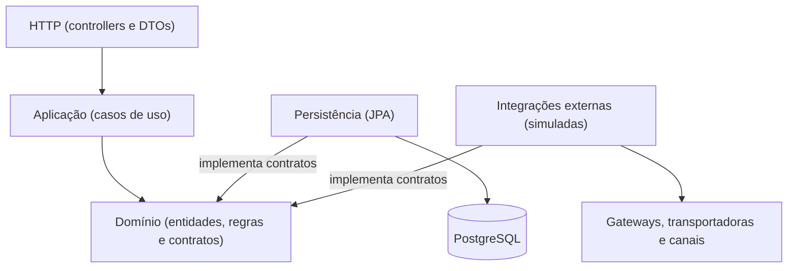
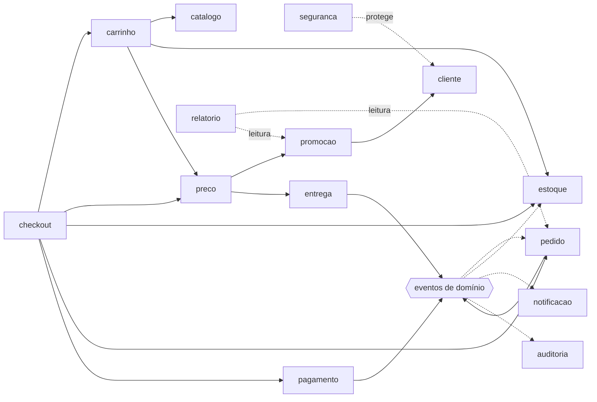
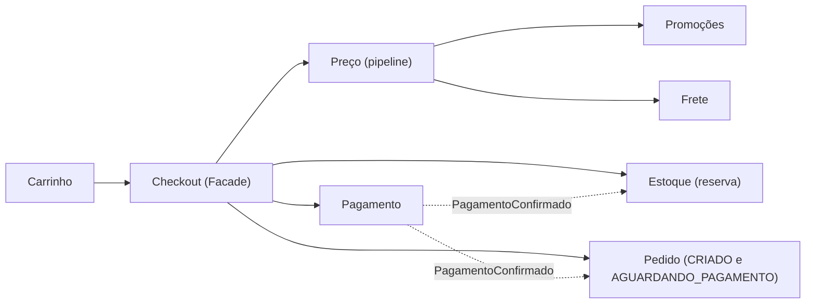

# 03. Arquitetura

> **Objetivo:** definir as camadas, a organização de pacotes por módulo, os pontos de variação e os contratos centrais (interfaces) que sustentam a extensibilidade exigida pelo enunciado.
> **Etapas do roadmap relacionadas:** E1 a E9. A fundação (E1) cria a estrutura; cada etapa seguinte preenche o seu módulo. Ver [08-roadmap.md](08-roadmap.md).
> **Status:** proposto (nomes de pacotes e assinaturas são sugestões preliminares e serão refinados em cada etapa).

## 1. Princípios

1. **Um módulo, uma responsabilidade de negócio.** Nenhum módulo concentra catálogo, carrinho, promoções, checkout, pagamento e entrega (RNF-04).
2. **O domínio não depende de infraestrutura.** Regras de negócio não conhecem Spring MVC, JPA nem clientes HTTP de provedores.
3. **Variação por contrato.** Tudo o que o enunciado diz que "poderá mudar" (promoções, condições, pagamento, frete, notificação) fica atrás de uma interface, e uma nova variante é uma nova classe, não uma alteração nas existentes.
4. **Módulos se comunicam por contratos e eventos**, não por acesso a classes internas uns dos outros.

## 2. Camadas

As camadas se repetem dentro de cada módulo, e a regra de dependência aponta sempre para o domínio.

| Camada | Pacote (dentro do módulo) | Responsabilidade | Pode depender de |
|---|---|---|---|
| HTTP | `web` | Controllers REST, DTOs de entrada e saída, validação de requisição, tradução de erros para respostas HTTP. | aplicação |
| Aplicação | `aplicacao` | Casos de uso: orquestram o domínio, controlam transação, publicam eventos. | domínio |
| Domínio | `dominio` | Entidades, regras de negócio, contratos (interfaces) e eventos de domínio. Sem anotações de framework web. | nada além do módulo compartilhado |
| Persistência | `infra.persistencia` | Repositórios Spring Data JPA, mapeamento e migrações. Implementa as interfaces de repositório declaradas no domínio. | domínio |
| Integrações | `infra.integracao` | Adaptadores para sistemas externos (gateways de pagamento, transportadoras, canais de notificação), todos simulados nesta fase. Implementam contratos do domínio. | domínio |



A seta de persistência e integrações para o domínio é a **inversão de dependência**: o domínio declara a interface (por exemplo `GatewayPagamento`) e a infraestrutura a implementa.

## 3. Organização de pacotes por módulo

Pacote raiz sugerido: `br.com.fatec.ecommerce` (a definir na etapa E1). Cada módulo abaixo é um subpacote com as quatro subdivisões da seção 2.

| Módulo (pacote) | Responsabilidade | Etapa |
|---|---|---|
| `compartilhado` | Tipos comuns sem regra de negócio: `Dinheiro`, `Periodo`, base de eventos de domínio, tratamento de erros. | E1 |
| `seguranca` | Autenticação, autorização por perfil, hash de senha, identidade do usuário logado. Transversal. | E1 |
| `cliente` | Usuário, cliente e endereços. | E1 |
| `catalogo` | Produtos, variações, categorias hierárquicas, combos (opcional). | E2 |
| `estoque` | Saldo, reserva, liberação e baixa de estoque. | E2, E4 |
| `carrinho` | Carrinho e itens; consulta (não reserva) disponibilidade. | E3 |
| `pedido` | Pedido, itens, máquina de estados e histórico. | E4 |
| `checkout` | Orquestração da conversão de carrinho em pedido (Facade). Não tem regras de preço, estoque, pagamento ou entrega: apenas coordena os demais. | E4 |
| `promocao` | Promoções, condições de elegibilidade, política de conflito, cupons. | E5 |
| `preco` | Pipeline de formação do preço: subtotal, promoções, cupom, frete e total. | E5 |
| `pagamento` | Pagamentos, gateways (Adapters), registro de transações e idempotência. | E6 |
| `entrega` | Modalidades, provedores de frete, cotação e acompanhamento. | E7 |
| `notificacao` | Canais de notificação e reação a eventos. | E8 |
| `auditoria` | Registro de operações administrativas (quem, o quê, quando). | E8 |
| `relatorio` | Consultas gerenciais, somente leitura. | E9 |

Estrutura de exemplo de um módulo:

```text
br.com.fatec.ecommerce.promocao
  ├── web                    PromocaoController, PromocaoRequest, PromocaoResponse
  ├── aplicacao              CalcularPromocoes, CadastrarPromocao
  ├── dominio                Promocao, CondicaoElegibilidade, PoliticaConflito, PromocaoRepository
  └── infra
      └── persistencia       PromocaoJpaRepository, PromocaoEntity
```

### Dependências entre módulos



Leitura do diagrama:
- Linhas cheias são dependências diretas (chamada a uma interface de aplicação do outro módulo).
- Linhas pontilhadas para `eventos de domínio` são **reações por evento**: o publicador não conhece quem reage. Por exemplo, `pagamento` publica `PagamentoConfirmado` e `pedido`, `estoque`, `notificacao` e `auditoria` reagem, sem que `pagamento` dependa de nenhum deles.
- Não há dependência circular. `pedido` não depende de `pagamento`, `entrega` nem `notificacao`.
- `seguranca` é transversal e foi simplificado no diagrama (protege todos os módulos expostos por HTTP).

### Verificação da regra "nenhum módulo concentra tudo"

| Responsabilidade do enunciado | Módulo dono |
|---|---|
| Catálogo | `catalogo` |
| Carrinho | `carrinho` |
| Promoções | `promocao` (regras) e `preco` (cálculo em etapas) |
| Checkout | `checkout` (apenas orquestra) |
| Pagamento | `pagamento` |
| Entrega | `entrega` |

Cada responsabilidade tem um dono distinto, e o único módulo que enxerga vários deles é `checkout`, de propósito: ele é uma fachada fina, sem regra de negócio própria.

## 4. Pontos de variação

Cada ponto de variação corresponde a um trecho do enunciado em que "novos itens poderão surgir". A coluna "como adicionar" mostra o impacto esperado de uma mudança.

| Ponto de variação | Origem no enunciado | Contrato | Implementações iniciais (propostas) | Como adicionar uma nova |
|---|---|---|---|---|
| Tipo de promoção | Promoções (4 tipos, quinta ou sexta com baixo impacto) | `Promocao` | Leve 3 pague 2, percentual por categoria, valor fixo acima do mínimo, primeira compra, frete grátis | Nova classe que implementa `Promocao` e registro na fábrica |
| Condição de elegibilidade | Condições (várias simultâneas) | `CondicaoElegibilidade` | Primeira compra, valor mínimo, categoria, região, período, perfil, mais E/OU/NÃO | Nova classe de condição, combinável com as existentes |
| Política de conflito | Conflitos entre promoções | `PoliticaConflito` | Exclusiva primeiro, depois acumuláveis mais a melhor não acumulável (ver [05-regras-negocio.md](05-regras-negocio.md)) | Nova política (por exemplo "somente o maior desconto") |
| Etapa do preço | Formação do preço | `EtapaPreco` | Subtotal, promoções, cupom, frete, total | Nova etapa inserida no pipeline |
| Estado do pedido | Pedidos (ciclo de vida) | `EstadoPedido` | Um estado por situação (ver [06-ciclo-vida-pedido.md](06-ciclo-vida-pedido.md)) | Novo estado com suas transições |
| Gateway de pagamento | Pagamentos (fornecedor diferente) | `GatewayPagamento` | Cartão simulado, PIX simulado, boleto simulado | Novo adaptador para o provedor |
| Provedor de frete | Entrega (novos serviços) | `ProvedorFrete` | Entrega padrão, expressa e retirada simuladas | Novo provedor, sem tocar em checkout |
| Canal de notificação | Notificações (novos canais) | `CanalNotificacao` | E-mail simulado, console/log | Novo canal registrado como ouvinte |
| Reação a eventos | Eventos do sistema | `EventoDominio` e ouvintes | Estoque, pedido, notificação, auditoria | Novo ouvinte do evento, sem alterar o publicador |
| Tipo de benefício do cupom | Cupons (percentual, fixo, outros) | Reuso de `Promocao`/efeito | Percentual e valor fixo | Nova implementação de efeito |

## 5. Contratos centrais (interfaces sugeridas)

As assinaturas abaixo são **sugestões preliminares** para guiar as etapas de implementação. Nomes, parâmetros e tipos de retorno podem mudar, e o que mudar deve ser registrado aqui.

### 5.1 Promoção

```java
public interface Promocao {
    Long id();
    String nome();
    int prioridade();
    ModoAcumulacao modo();                       // ACUMULAVEL, NAO_ACUMULAVEL, EXCLUSIVA
    boolean vigenteEm(Instant momento);
    Optional<DescontoCandidato> avaliar(ContextoPreco contexto);   // empty se não elegível
}
```

- `ContextoPreco` agrega o que as regras precisam: itens do carrinho, cliente (e se é a primeira compra), endereço/região, subtotal e momento atual.
- `DescontoCandidato` descreve o efeito: valor, **alvo** (itens ou frete) e a promoção de origem. Com o alvo `FRETE`, o frete grátis entra no mesmo mecanismo das demais promoções (RF-55).
- Cada tipo de promoção implementa `avaliar`; a verificação de condições é delegada a uma `CondicaoElegibilidade`, então o tipo só cuida do cálculo do desconto.

### 5.2 Condição de elegibilidade

```java
public interface CondicaoElegibilidade {
    boolean avaliar(ContextoPreco contexto);
}
```

Condições simples (primeira compra, valor mínimo, categoria, região, período, perfil) e compostas (`CondicaoE`, `CondicaoOu`, `CondicaoNao`) implementam a mesma interface (Composite). Um objeto `CondicaoE` com três filhos resolve "várias condições simultâneas" sem método grande.

### 5.3 Política de conflito

```java
public interface PoliticaConflito {
    List<DescontoAplicado> resolver(List<DescontoCandidato> elegiveis);
}
```

Recebe todos os descontos candidatos e devolve quais serão efetivamente aplicados. A política padrão proposta está na seção D4 do design e é detalhada em [05-regras-negocio.md](05-regras-negocio.md). Como é uma interface, trocar a política não altera nenhuma promoção.

### 5.4 Etapa de preço (pipeline)

```java
public interface EtapaPreco {
    void processar(CalculoPreco calculo);        // lê e atualiza subtotal, descontos, frete e total
}
```

O serviço de preço executa as etapas em ordem fixa (subtotal, promoções, cupom, frete, total). O resultado detalha cada parcela para o cliente (RF-37).

### 5.5 Gateway de pagamento

```java
public interface GatewayPagamento {
    boolean suporta(FormaPagamento forma);
    ResultadoCobranca cobrar(SolicitacaoCobranca solicitacao);
    ResultadoEstorno estornar(SolicitacaoEstorno solicitacao);
}
```

Cada fornecedor (simulado) tem um adaptador que traduz a interface própria dele para este contrato. As regras centrais (`pagamento`, `pedido`) só conhecem `GatewayPagamento`.

A **confirmação** vinda do exterior carrega um identificador de transação. Ele é registrado com restrição de unicidade, e a repetição vira no-op (idempotência, ver [05-regras-negocio.md](05-regras-negocio.md)).

### 5.6 Provedor de frete

```java
public interface ProvedorFrete {
    String modalidade();
    boolean atende(ContextoFrete contexto);       // região, peso, valor
    CotacaoFrete cotar(ContextoFrete contexto);   // custo e prazo
}
```

O módulo `entrega` coleta as cotações de todos os provedores que atendem o contexto. Uma nova transportadora é um novo `ProvedorFrete`.

### 5.7 Canal de notificação

```java
public interface CanalNotificacao {
    String canal();
    void enviar(Notificacao notificacao);
}
```

O módulo `notificacao` reage a eventos de domínio e envia por todos os canais ativos. O módulo `pedido` não conhece nenhum canal.

### 5.8 Eventos de domínio

```java
public interface EventoDominio {
    Instant ocorridoEm();
}
```

Eventos propostos (nomes preliminares), com origem e interessados:

| Evento | Publicado por | Ouvintes previstos |
|---|---|---|
| `PedidoCriado` | `pedido` | `notificacao`, `auditoria` |
| `PagamentoConfirmado` | `pagamento` | `pedido` (vai para PAGO), `estoque` (converte reserva em baixa), `notificacao`, `auditoria` |
| `PagamentoRecusado` | `pagamento` | `pedido` (PAGAMENTO_RECUSADO), `estoque` (libera reserva), `notificacao` |
| `PedidoEnviado` | `entrega` ou `pedido` | `notificacao` |
| `PedidoCancelado` | `pedido` | `estoque` (libera reserva), `pagamento` (estorno), `notificacao`, `auditoria` |

Implementação prevista: o mecanismo de eventos do Spring (`ApplicationEventPublisher` e `@EventListener`/`@TransactionalEventListener`) atrás de uma interface própria, para que o domínio não dependa do Spring.

### 5.9 Estado do pedido

```java
public interface EstadoPedido {
    EstadoPedido aguardarPagamento(Pedido pedido);
    EstadoPedido confirmarPagamento(Pedido pedido);
    EstadoPedido recusarPagamento(Pedido pedido);
    EstadoPedido iniciarPreparacao(Pedido pedido);
    EstadoPedido enviar(Pedido pedido);
    EstadoPedido entregar(Pedido pedido);
    EstadoPedido cancelar(Pedido pedido);
}
```

Cada estado implementa apenas as transições válidas; as demais lançam erro de transição inválida. Estados e transições estão em [06-ciclo-vida-pedido.md](06-ciclo-vida-pedido.md).

## 6. Fluxo resumido (visão de módulos)

Visão geral do que acontece no checkout, apenas para ilustrar a colaboração entre módulos. Os diagramas de sequência completos ficam em [07-casos-de-uso.md](07-casos-de-uso.md).



## 7. Decisões e questões em aberto

| Item | Situação |
|---|---|
| Monólito modular (um deploy, módulos por pacote), sem microsserviços | `proposto` |
| Pacote raiz `br.com.fatec.ecommerce` | `proposto` (confirmar em E1) |
| Módulo `preco` separado de `promocao` | `proposto` |
| Eventos via Spring com interface própria | `proposto` |
| Dependência entre módulos fiscalizada por testes de arquitetura (por exemplo ArchUnit) | em aberto, avaliar em E1 |
| Mecanismo de concorrência de estoque | em aberto, decidido em E4 |
| Documentação da API via OpenAPI/Swagger | recomendado, a partir da primeira etapa com endpoints |
