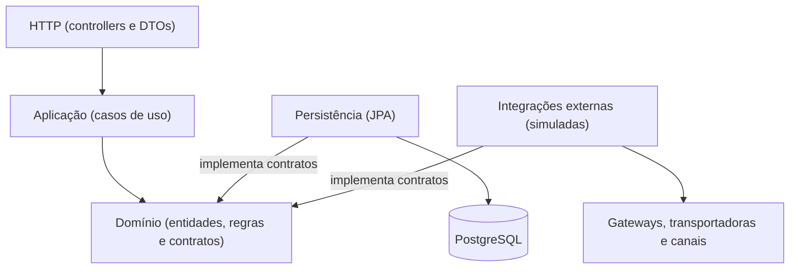
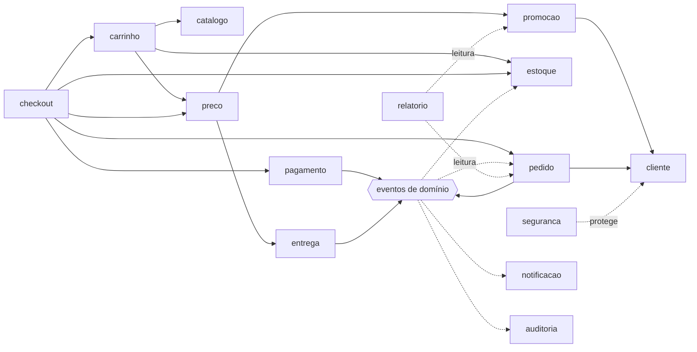
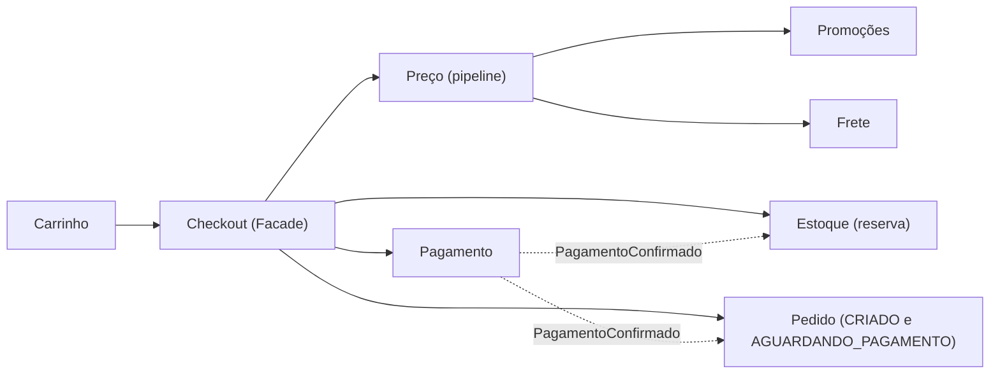

# 03. Arquitetura

> **Objetivo:** definir as camadas, a organização de pacotes por módulo, os pontos de variação e os contratos centrais (interfaces) que sustentam a extensibilidade exigida pelo enunciado.
> **Etapas do roadmap relacionadas:** E1 a E9. A fundação (E1) cria a estrutura; cada etapa seguinte preenche o seu módulo. Ver [08-roadmap.md](08-roadmap.md).
> **Status:** proposto, com a parte da E1 `implementado` (pacotes, contratos da seção 5.1 a 5.8 e regras de arquitetura) e o módulo `pedido` da E4 `implementado` (pacotes efetivos, eventos do pedido, `EstadoPedido` da seção 5.9 e regras de erro e de arquitetura; ver as seções 3, 5 e 7). O restante são sugestões preliminares, refinadas em cada etapa.

## 1. Princípios

1. **Um módulo, uma responsabilidade de negócio.** Nenhum módulo concentra catálogo, carrinho, promoções, checkout, pagamento e entrega (RNF-04).
2. **O domínio não depende de infraestrutura.** Regras de negócio não conhecem Spring MVC, JPA nem clientes HTTP de provedores.
3. **Variação por contrato.** Tudo o que o enunciado diz que "poderá mudar" (promoções, condições, pagamento, frete, notificação) fica atrás de uma interface, e uma nova variante é uma nova classe, não uma alteração nas existentes.
4. **Módulos se comunicam por contratos e eventos**, não por acesso a classes internas uns dos outros.

## 2. Camadas

As camadas se repetem dentro de cada módulo, e a regra de dependência aponta sempre para o domínio.

| Camada | Pacote (dentro do módulo) | Responsabilidade | Pode depender de |
|---|---|---|---|
| HTTP | `web` | Controllers REST, DTOs de entrada e saída, validação de requisição, tradução de erros para respostas HTTP. | aplicação |
| Aplicação | `aplicacao` | Casos de uso: orquestram o domínio, controlam transação, publicam eventos. | domínio |
| Domínio | `dominio` | Entidades, regras de negócio, contratos (interfaces) e eventos de domínio. Sem anotações de framework web. | nada além do módulo compartilhado |
| Persistência | `infra.persistencia` | Repositórios Spring Data JPA, mapeamento e migrações. Implementa as interfaces de repositório declaradas no domínio. | domínio |
| Integrações | `infra.integracao` | Adaptadores para sistemas externos (gateways de pagamento, transportadoras, canais de notificação), todos simulados nesta fase. Implementam contratos do domínio. | domínio |



A seta de persistência e integrações para o domínio é a **inversão de dependência**: o domínio declara a interface (por exemplo `GatewayPagamento`) e a infraestrutura a implementa.

## 3. Organização de pacotes por módulo

Pacote raiz: `br.com.fatec.ecommerce` (`implementado` na E1). Cada módulo abaixo é um subpacote com as subdivisões da seção 2 que a etapa realmente precisa.

| Módulo (pacote) | Responsabilidade | Etapa |
|---|---|---|
| `compartilhado` | Tipos comuns sem regra de negócio: `Dinheiro`, exceções base, `EventoDominio` e `PublicadorEventos`, tratamento de erros (`ProblemDetail`), configuração do OpenAPI. `Periodo` continua previsto. | E1 (`implementado`) |
| `seguranca` | `Usuario` e `Perfil` (credencial e perfis de acesso), autenticação (login e emissão de JWT), autorização por perfil, hash de senha, gestão de usuários administrativos. Transversal. | E1 (`implementado`) |
| `cliente` | `Cliente` (referencia o usuário por `usuarioId`, sem associação JPA) e `Endereco`. | E1 (`implementado`) |
| `catalogo` | Produtos, variações, categorias hierárquicas, combos (opcional). | E2 |
| `estoque` | Saldo, reserva, liberação e baixa de estoque. | E2, E4 |
| `carrinho` | Carrinho e itens; consulta (não reserva) disponibilidade. | E3 |
| `pedido` | Pedido, itens, descontos, máquina de estados (State) e histórico, consultas, cancelamento e eventos do pedido. | E4 (`implementado`, change `pedido-ciclo-vida`) |
| `checkout` | Orquestração da conversão de carrinho em pedido (Facade). Não tem regras de preço, estoque, pagamento ou entrega: apenas coordena os demais. | E4 (change `checkout`, depois de `carrinho-compras`) |
| `promocao` | Promoções, condições de elegibilidade, política de conflito, cupons. | E5 (contratos em `dominio` na E1) |
| `preco` | Pipeline de formação do preço: subtotal, promoções, cupom, frete e total. | E5 (contrato em `dominio` na E1) |
| `pagamento` | Pagamentos, gateways (Adapters), registro de transações e idempotência. | E6 (contratos em `dominio` na E1) |
| `entrega` | Modalidades, provedores de frete, cotação e acompanhamento. | E7 (contratos em `dominio` na E1) |
| `notificacao` | Canais de notificação e reação a eventos. | E8 (contrato em `dominio` na E1) |
| `auditoria` | Registro de operações administrativas (quem, o quê, quando). | E8 |
| `relatorio` | Consultas gerenciais, somente leitura. | E9 |

### Pacotes efetivos (E1 e E4)

Estrutura real do código (raiz `br.com.fatec.ecommerce`), todos com status `implementado`, exceto onde indicado:

| Pacote | Conteúdo (classes principais) |
|---|---|
| `compartilhado.dominio` | `Dinheiro`, `ConflitoException` (com `tipo()`, `titulo()` e `propriedades()` genéricos; ver a seção 7), `DadoInvalidoException`, `NaoAutenticadoException`, `RecursoNaoEncontradoException`, `SenhaForte` (anotação de política de senha) e `SenhaForteValidator`, `EventoDominio`, `PublicadorEventos` |
| `compartilhado.web` | `TratadorGlobalDeErros` (`@RestControllerAdvice` com `ProblemDetail`), `Problemas` |
| `compartilhado.infra` | `PublicadorEventosSpring`, `ConfiguracaoOpenApi` |
| `seguranca.dominio` | `Usuario`, `Perfil`, `UsuarioRepository`, `RegraUltimoAdmin` |
| `seguranca.aplicacao` | `Autenticar`, `EmissorDeToken`, `TokenEmitido`, `GerenciarUsuariosAdministrativos` |
| `seguranca.web` | `AutenticacaoController`, `UsuariosAdministrativosController` e seus DTOs |
| `seguranca.infra.persistencia` | `UsuarioJpaRepository`, `UsuarioRepositoryJpa` |
| `seguranca.infra.config` | `ConfiguracaoSeguranca`, `EmissorDeTokenJwt`, `JwtProperties`, `ProblemDetailAuthenticationEntryPoint`, `ProblemDetailAccessDeniedHandler` |
| `cliente.dominio` | `Cliente`, `Endereco`, `Cpf`, `Uf`, `RegraEnderecoPrincipal`, validações `CpfValido` e `UfValida`, `ClienteRepository`, `EnderecoRepository` |
| `cliente.aplicacao` | `CadastrarCliente`, `GerenciarCliente`, `GerenciarEnderecos` |
| `cliente.web` | `ClienteController`, `EnderecoController` e seus DTOs |
| `cliente.infra.persistencia` | `ClienteJpaRepository`, `ClienteRepositoryJpa`, `EnderecoJpaRepository`, `EnderecoRepositoryJpa` |
| `infra.demo` | `UsuariosDeDemonstracao` (`ApplicationRunner` do perfil `dev`; fica fora dos módulos porque cruza `seguranca`, `cliente` e `pedido`; cria também um pedido de demonstração, ver [10-execucao.md](10-execucao.md)) |
| `pedido.dominio` | `Pedido` (agregado), `ItemPedido`, `DescontoPedido`, `EnderecoEntrega`, `EntradaHistorico`, `SituacaoPedido`, `OperacaoPedido`, `Responsavel`, `TipoResponsavel`, `OrigemDesconto`, `AlvoDoDesconto`, `DadosNovoPedido` (snapshot de entrada), `ResumoPedido`, `TransicaoInvalidaException`, `PedidoRepository` |
| `pedido.dominio.estado` | `EstadoPedido`, `EstadoPedidoBase`, `DadosDaTransicao` e os 8 estados `Criado`, `AguardandoPagamento`, `Pago`, `PagamentoRecusado`, `EmPreparacao`, `Enviado`, `Entregue`, `Cancelado` |
| `pedido.dominio.evento` | `PedidoCriado`, `PedidoPago`, `PedidoPagamentoRecusado`, `PedidoEmPreparacao`, `PedidoEnviado`, `PedidoEntregue`, `PedidoCancelado` |
| `pedido.aplicacao` | `CriarPedido`, `ConfirmarReservaDoPedido`, `TransicionarPedido`, `ConsultarPedidos`, `CancelarPedidoDoCliente` |
| `pedido.web` | `PedidosDoClienteController`, `PedidosAdministrativosController`, `PagamentoSimuladoController` (temporário) e seus DTOs (`PedidoResponse`, `ResumoPedidoResponse`, `MotivoRequest`, `PagamentoSimuladoRequest`, `UsuarioDoToken`) |
| `pedido.infra.persistencia` | `PedidoJpaRepository`, `PedidoRepositoryJpa` (converte o conflito de lock otimista em `ConflitoException`) |
| `promocao.dominio` | Somente contratos e tipos de apoio: `Promocao`, `CondicaoElegibilidade`, `PoliticaConflito`, `ContextoPreco`, `ItemPreco`, `DescontoCandidato`, `DescontoAplicado`, `AlvoDesconto`, `ModoAcumulacao` |
| `preco.dominio` | Somente contratos: `EtapaPreco`, `CalculoPreco` |
| `pagamento.dominio` | Somente contratos: `GatewayPagamento`, `FormaPagamento`, `SolicitacaoCobranca`, `ResultadoCobranca`, `SolicitacaoEstorno`, `ResultadoEstorno` |
| `entrega.dominio` | Somente contratos: `ProvedorFrete`, `ContextoFrete`, `CotacaoFrete` |
| `notificacao.dominio` | Somente contratos: `CanalNotificacao`, `Notificacao` |

Os pacotes `dominio` de `promocao`, `preco`, `pagamento`, `entrega` e `notificacao` não têm nenhuma implementação na E1 (apenas interfaces e `record`s); cada implementação chega na etapa do módulo dono (E5 a E8).

Estrutura de exemplo de um módulo:

```text
br.com.fatec.ecommerce.promocao
  ├── web                    PromocaoController, PromocaoRequest, PromocaoResponse
  ├── aplicacao              CalcularPromocoes, CadastrarPromocao
  ├── dominio                Promocao, CondicaoElegibilidade, PoliticaConflito, PromocaoRepository
  └── infra
      └── persistencia       PromocaoJpaRepository, PromocaoEntity
```

### Dependências entre módulos



Leitura do diagrama:
- Linhas cheias são dependências diretas (chamada a uma interface de aplicação do outro módulo).
- Linhas pontilhadas para `eventos de domínio` são **reações por evento**: o publicador não conhece quem reage. Por exemplo, `pagamento` publica `PagamentoConfirmado` e `pedido`, `estoque`, `notificacao` e `auditoria` reagem, sem que `pagamento` dependa de nenhum deles.
- Não há dependência circular. `pedido` não depende de `pagamento`, `entrega` nem `notificacao`; do `cliente` usa só `ClienteRepository` (conferir que o cliente existe e achar o cliente do usuário autenticado), e do `compartilhado` os tipos comuns.
- `seguranca` é transversal e foi simplificado no diagrama (protege todos os módulos expostos por HTTP).

### Verificação da regra "nenhum módulo concentra tudo"

| Responsabilidade do enunciado | Módulo dono |
|---|---|
| Catálogo | `catalogo` |
| Carrinho | `carrinho` |
| Promoções | `promocao` (regras) e `preco` (cálculo em etapas) |
| Checkout | `checkout` (apenas orquestra) |
| Pagamento | `pagamento` |
| Entrega | `entrega` |

Cada responsabilidade tem um dono distinto, e o único módulo que enxerga vários deles é `checkout`, de propósito: ele é uma fachada fina, sem regra de negócio própria.

## 4. Pontos de variação

Cada ponto de variação corresponde a um trecho do enunciado em que "novos itens poderão surgir". A coluna "como adicionar" mostra o impacto esperado de uma mudança.

| Ponto de variação | Origem no enunciado | Contrato | Implementações iniciais (propostas) | Como adicionar uma nova |
|---|---|---|---|---|
| Tipo de promoção | Promoções (4 tipos, quinta ou sexta com baixo impacto) | `Promocao` | Leve 3 pague 2, percentual por categoria, valor fixo acima do mínimo, primeira compra, frete grátis | Nova classe que implementa `Promocao` e registro na fábrica |
| Condição de elegibilidade | Condições (várias simultâneas) | `CondicaoElegibilidade` | Primeira compra, valor mínimo, categoria, região, período, perfil, mais E/OU/NÃO | Nova classe de condição, combinável com as existentes |
| Política de conflito | Conflitos entre promoções | `PoliticaConflito` | Exclusiva primeiro, depois acumuláveis mais a melhor não acumulável (ver [05-regras-negocio.md](05-regras-negocio.md)) | Nova política (por exemplo "somente o maior desconto") |
| Etapa do preço | Formação do preço | `EtapaPreco` | Subtotal, promoções, cupom, frete, total | Nova etapa inserida no pipeline |
| Estado do pedido | Pedidos (ciclo de vida) | `EstadoPedido` | Um estado por situação (ver [06-ciclo-vida-pedido.md](06-ciclo-vida-pedido.md)) | Novo estado com suas transições |
| Gateway de pagamento | Pagamentos (fornecedor diferente) | `GatewayPagamento` | Cartão simulado, PIX simulado, boleto simulado | Novo adaptador para o provedor |
| Provedor de frete | Entrega (novos serviços) | `ProvedorFrete` | Entrega padrão, expressa e retirada simuladas | Novo provedor, sem tocar em checkout |
| Canal de notificação | Notificações (novos canais) | `CanalNotificacao` | E-mail simulado, console/log | Novo canal registrado como ouvinte |
| Reação a eventos | Eventos do sistema | `EventoDominio` e ouvintes | Estoque, pedido, notificação, auditoria | Novo ouvinte do evento, sem alterar o publicador |
| Tipo de benefício do cupom | Cupons (percentual, fixo, outros) | Reuso de `Promocao`/efeito | Percentual e valor fixo | Nova implementação de efeito |

## 5. Contratos centrais (interfaces sugeridas)

As assinaturas das seções 5.1 a 5.8 foram **criadas na E1 como contratos** (status `implementado` como contrato; nenhuma delas tem implementação, exceto `PublicadorEventos`) e correspondem ao código. Elas ainda são **provisórias**: as etapas dos módulos donos podem refiná-las, e o que mudar deve ser registrado aqui. A seção 5.9 (`EstadoPedido`) foi **implementada na E4** e descreve o código real.

Desvios em relação à proposta original, registrados na E1:

| Desvio | Motivo |
|---|---|
| `ContextoPreco` e `ItemPreco` ficam em `promocao.dominio` (não em `preco`). | Evita o ciclo `preco` ↔ `promocao`: `preco` depende de `promocao`, nunca o contrário. `CalculoPreco` (em `preco.dominio`) referencia o contexto de `promocao`. |
| `ResultadoCobranca` é um `record` com o enum aninhado `Situacao` (`APROVADO`, `RECUSADO`, `PENDENTE`) e o `idTransacaoExterna`. | Torna explícito o resultado da cobrança, incluindo o caso pendente (PIX e boleto). |
| `ContextoFrete` tem `uf`, `pesoKg` e `subtotal`. | Define o mínimo para "região, peso, valor" de `ProvedorFrete.atende`. |
| `PublicadorEventos` (porta em `compartilhado.dominio`) e `PublicadorEventosSpring` (adaptador em `compartilhado.infra`). | O domínio publica eventos sem depender do Spring; o adaptador delega ao `ApplicationEventPublisher`. É a única implementação de contrato existente na E1. |
| `EstadoPedido` e o módulo `pedido` não foram criados na E1. | Criados na E4 (seção 5.9). A assinatura final difere da proposta original: as operações não recebem o `Pedido`; o estado não guarda dados e devolve o próximo estado. |

### 5.1 Promoção

```java
public interface Promocao {
    Long id();
    String nome();
    int prioridade();
    ModoAcumulacao modo();                       // ACUMULAVEL, NAO_ACUMULAVEL, EXCLUSIVA
    boolean vigenteEm(Instant momento);
    Optional<DescontoCandidato> avaliar(ContextoPreco contexto);   // empty se não elegível
}
```

- `ContextoPreco` (`record` em `promocao.dominio`) agrega o que as regras precisam: `itens` (lista de `ItemPreco`), `clienteId`, `primeiraCompra`, `uf`, `subtotal` (`Dinheiro`) e `momento`. `ItemPreco` traz `varianteId`, `sku`, `categoriaIds`, `quantidade` e `precoUnitario`.
- `DescontoCandidato` (`record`) descreve o efeito: `promocaoId`, `nome`, `valor`, **alvo** (`AlvoDesconto`: `ITENS` ou `FRETE`), `modo` e `prioridade`. Com o alvo `FRETE`, o frete grátis entra no mesmo mecanismo das demais promoções (RF-55). `DescontoAplicado` (`promocaoId`, `nome`, `valor`, `alvo`) é o que sobrevive à política de conflito.
- Cada tipo de promoção implementa `avaliar`; a verificação de condições é delegada a uma `CondicaoElegibilidade`, então o tipo só cuida do cálculo do desconto.

### 5.2 Condição de elegibilidade

```java
public interface CondicaoElegibilidade {
    boolean avaliar(ContextoPreco contexto);
}
```

Condições simples (primeira compra, valor mínimo, categoria, região, período, perfil) e compostas (`CondicaoE`, `CondicaoOu`, `CondicaoNao`) implementam a mesma interface (Composite). Um objeto `CondicaoE` com três filhos resolve "várias condições simultâneas" sem método grande.

### 5.3 Política de conflito

```java
public interface PoliticaConflito {
    List<DescontoAplicado> resolver(List<DescontoCandidato> elegiveis);
}
```

Recebe todos os descontos candidatos e devolve quais serão efetivamente aplicados. A política padrão proposta está na seção D4 do design e é detalhada em [05-regras-negocio.md](05-regras-negocio.md). Como é uma interface, trocar a política não altera nenhuma promoção.

### 5.4 Etapa de preço (pipeline)

```java
public interface EtapaPreco {
    void processar(CalculoPreco calculo);        // lê e atualiza subtotal, descontos, frete e total
}
```

`CalculoPreco` (em `preco.dominio`) é a classe mutável que acumula o `ContextoPreco` de entrada, o subtotal, a lista de `DescontoAplicado`, o frete e o total.

O serviço de preço executa as etapas em ordem fixa (subtotal, promoções, cupom, frete, total). O resultado detalha cada parcela para o cliente (RF-37).

### 5.5 Gateway de pagamento

```java
public interface GatewayPagamento {
    boolean suporta(FormaPagamento forma);
    ResultadoCobranca cobrar(SolicitacaoCobranca solicitacao);
    ResultadoEstorno estornar(SolicitacaoEstorno solicitacao);
}
```

Tipos de apoio (`pagamento.dominio`): `FormaPagamento` (`CARTAO_CREDITO`, `PIX`, `BOLETO`), `SolicitacaoCobranca(pedidoId, forma, valor)`, `ResultadoCobranca(situacao, idTransacaoExterna)` com `Situacao` `APROVADO`, `RECUSADO` ou `PENDENTE`, `SolicitacaoEstorno(idTransacaoExterna, valor)` e `ResultadoEstorno(estornado, idTransacaoExterna)`.

Cada fornecedor (simulado) tem um adaptador que traduz a interface própria dele para este contrato. As regras centrais (`pagamento`, `pedido`) só conhecem `GatewayPagamento`.

A **confirmação** vinda do exterior carrega um identificador de transação. Ele é registrado com restrição de unicidade, e a repetição vira no-op (idempotência, ver [05-regras-negocio.md](05-regras-negocio.md)).

### 5.6 Provedor de frete

```java
public interface ProvedorFrete {
    String modalidade();
    boolean atende(ContextoFrete contexto);       // região, peso, valor
    CotacaoFrete cotar(ContextoFrete contexto);   // custo e prazo
}
```

`ContextoFrete(uf, pesoKg, subtotal)` e `CotacaoFrete(modalidade, custo, prazoDias)`, ambos `record`s em `entrega.dominio`.

O módulo `entrega` coleta as cotações de todos os provedores que atendem o contexto. Uma nova transportadora é um novo `ProvedorFrete`.

### 5.7 Canal de notificação

```java
public interface CanalNotificacao {
    String canal();
    void enviar(Notificacao notificacao);
}
```

`Notificacao(destinatario, assunto, mensagem)` é um `record` em `notificacao.dominio`.

O módulo `notificacao` reage a eventos de domínio e envia por todos os canais ativos. O módulo `pedido` não conhece nenhum canal.

### 5.8 Eventos de domínio

```java
public interface EventoDominio {
    Instant ocorridoEm();
}
```

Eventos, com origem e interessados. Os do pedido estão `implementado` (E4, pacote `pedido.dominio.evento`); os do módulo de pagamento são previstos (etapa 6):

| Evento | Publicado por | Ouvintes previstos | Situação |
|---|---|---|---|
| `PedidoCriado` | `pedido` (chegada a `AGUARDANDO_PAGAMENTO`, depois da reserva) | `notificacao`, `auditoria` | `implementado` (E4) |
| `PedidoPago` | `pedido` (chegada a `PAGO`) | `estoque` (converte reserva em baixa), `notificacao`, `auditoria` | `implementado` (E4) |
| `PedidoPagamentoRecusado` | `pedido` (chegada a `PAGAMENTO_RECUSADO`) | `estoque` (libera reserva), `notificacao` | `implementado` (E4) |
| `PedidoEmPreparacao` | `pedido` | a definir (etapas 7 e 8) | `implementado` (E4) |
| `PedidoEnviado` | `pedido` | `notificacao` | `implementado` (E4) |
| `PedidoEntregue` | `pedido` | a definir (etapas 7 e 8) | `implementado` (E4) |
| `PedidoCancelado` | `pedido` (traz `responsavel` e `motivo`) | `estoque` (libera reserva ou repõe a baixa, conforme `de`), `pagamento` (estorno), `notificacao`, `auditoria` | `implementado` (E4) |
| `PagamentoConfirmado` | `pagamento` | `pedido` (vai para `PAGO`), `estoque` (converte reserva em baixa), `notificacao`, `auditoria` | previsto (E6), nome preliminar |
| `PagamentoRecusado` | `pagamento` | `pedido` (vai para `PAGAMENTO_RECUSADO`), `estoque` (libera reserva), `notificacao` | previsto (E6), nome preliminar |

`PedidoPago` e `PedidoPagamentoRecusado` **não são** os eventos do módulo de pagamento: são o aviso do pedido sobre a própria mudança de estado e têm nomes distintos de `PagamentoConfirmado` e `PagamentoRecusado`, que o módulo `pagamento` publicará na etapa 6 e que o `pedido` passará a ouvir para chamar a transição.

Todos os eventos do pedido são `record`s que implementam `EventoDominio` e carregam `pedidoId`, `clienteId`, `de`, `para` e `ocorridoEm`. Cada estado decide o que anuncia ao ser alcançado (`EstadoPedido.eventoDeChegada`); os serviços `ConfirmarReservaDoPedido` e `TransicionarPedido` os publicam depois de salvar. Ainda **não há ouvinte** em produção: só o teste `pedido.aplicacao.OuvinteDeCancelamentoTests` registra um. Ver [04-design-patterns.md](04-design-patterns.md), seção 3.6.

Publicação (`implementado` na E1): a interface `PublicadorEventos` (`void publicar(EventoDominio evento)`, em `compartilhado.dominio`) é implementada por `PublicadorEventosSpring` (`compartilhado.infra`), que delega ao `ApplicationEventPublisher` do Spring. Os ouvintes usarão `@EventListener`/`@TransactionalEventListener` nas etapas seguintes. Assim o domínio não depende do Spring.

### 5.9 Estado do pedido (`implementado`, E4)

Pacote `pedido.dominio.estado`. Assinatura real:

```java
public interface EstadoPedido {
    SituacaoPedido situacao();
    EstadoPedido aguardarPagamento();
    EstadoPedido confirmarPagamento();
    EstadoPedido recusarPagamento();
    EstadoPedido iniciarPreparacao();
    EstadoPedido enviar();
    EstadoPedido entregar();
    EstadoPedido cancelar(Responsavel responsavel);
    Optional<EventoDominio> eventoDeChegada(DadosDaTransicao transicao);
}
```

Diferenças em relação à proposta original: as operações não recebem o `Pedido` (o estado não guarda nem altera dados; só devolve o próximo estado); `cancelar` recebe o `Responsavel`, porque a regra por perfil mora no estado (`Pago` e `EmPreparacao` exigem responsável administrativo); e `eventoDeChegada` permite ao estado de destino anunciar o evento da transição. `EstadoPedidoBase` implementa tudo lançando `TransicaoInvalidaException`, e cada estado concreto sobrescreve só as transições que admite. `SituacaoPedido` (enum persistido como texto) devolve a instância de cada estado (`estado()`). Estados e transições estão em [06-ciclo-vida-pedido.md](06-ciclo-vida-pedido.md); o pattern, em [04-design-patterns.md](04-design-patterns.md), seção 3.4.

`EstadoPedido` não está na lista de contratos da onda 0 verificada pelo ArchUnit (`CONTRATOS_DA_ONDA_0`), porque os estados concretos são do domínio do pedido e não adaptadores em `infra`.

## 6. Fluxo resumido (visão de módulos)

Visão geral do que acontece no checkout, apenas para ilustrar a colaboração entre módulos. Os diagramas de sequência completos ficam em [07-casos-de-uso.md](07-casos-de-uso.md).



## 7. Decisões e questões em aberto

| Item | Situação |
|---|---|
| Monólito modular (um deploy, módulos por pacote), sem microsserviços | `proposto` |
| Pacote raiz `br.com.fatec.ecommerce` | `implementado` (E1) |
| Módulo `preco` separado de `promocao` | `proposto` |
| Eventos via Spring com interface própria (`PublicadorEventos` e `PublicadorEventosSpring`) | `implementado` (E1) |
| Regras de arquitetura fiscalizadas por testes ArchUnit (`RegrasDeArquiteturaTests`): `dominio` não depende de `web`, `infra`, `aplicacao` nem de `org.springframework.web`, `stereotype` e `context`; `web` não depende de `infra`; contratos da onda 0 são interfaces e só têm implementação concreta em `infra` | `implementado` (E1) |
| Regra ArchUnit `compartilhadoNaoDependeDeModulosDeNegocio` (E4): `compartilhado..` não depende de `seguranca`, `cliente`, `pedido`, `promocao`, `preco`, `pagamento`, `entrega`, `notificacao` nem `infra.demo`; a dependência só vai dos módulos para o compartilhado | `implementado` (E4) |
| Conflito (409) com tipo, título e propriedades extras genéricos: `ConflitoException` (em `compartilhado.dominio`, sem depender de web nem Spring) expõe `tipo()`, `titulo()` e `propriedades()`; cada módulo estende e enriquece, e o `TratadorGlobalDeErros` copia as propriedades para o Problem Details. `TransicaoInvalidaException` (`pedido.dominio`) acrescenta `situacaoAtual` e `operacao`. Evita que o `compartilhado` conheça tipos de um módulo | `implementado` (E4) |
| Concorrência nas transições do pedido: lock otimista (`@Version`), com a falha de gravação convertida em `ConflitoException` (409) no adaptador `PedidoRepositoryJpa` | `implementado` (E4) |
| Verificação de dependência circular entre módulos (ciclos de pacotes) | em aberto, avaliar a partir da E2 |
| Mecanismo de concorrência de estoque | em aberto, decidido em E4 |
| Documentação da API via OpenAPI/Swagger (springdoc, com esquema Bearer) | `implementado` (E1); ver [10-execucao.md](10-execucao.md) |
