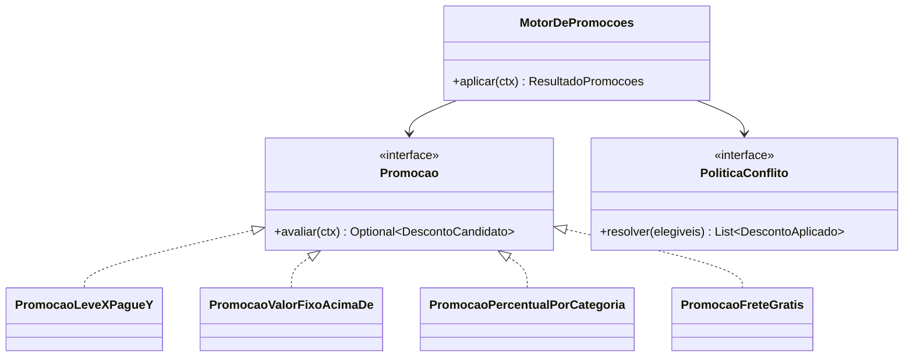
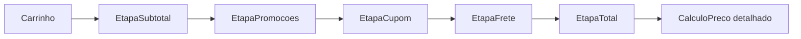
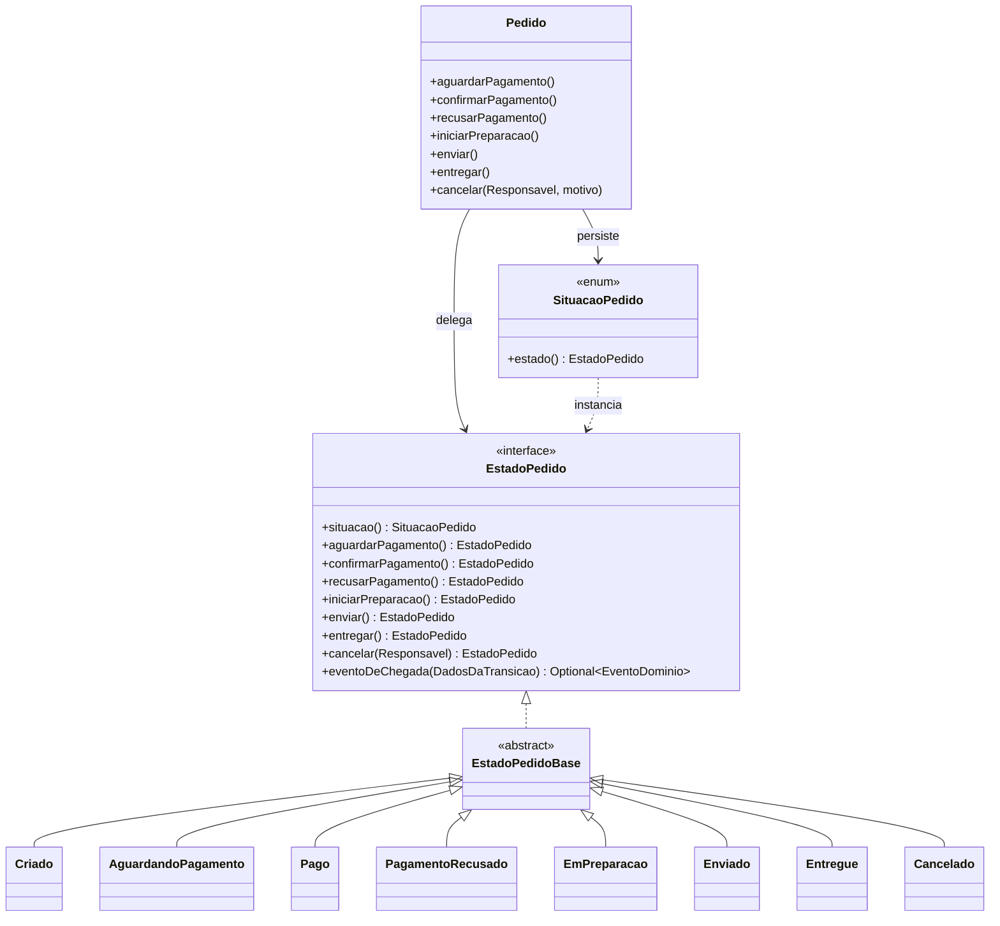

# 04. Design Patterns

> **Objetivo:** identificar os pontos de variação do sistema, escolher os Design Patterns que organizam cada um deles e justificar a escolha, respondendo à pergunta fundamental do enunciado: *"Qual problema de projeto existia, por que este padrão foi escolhido e o que ficou mais simples de modificar depois de sua utilização?"*
>
> **Etapas do roadmap relacionadas:** 2 (catálogo e estoque, combos), 3 (carrinho, pipeline de preço), 4 (checkout e pedido, State, Facade), 5 (promoções e cupons: Strategy, Composite de condições, Factory Method), 6 (pagamento e idempotência: Adapter), 7 (entrega e frete), 8 (eventos, notificações e auditoria: Observer). Ver [08-roadmap.md](08-roadmap.md).
>
> **Status:** parcialmente `implementado`. State (3.4) está **implementado** na E4 (change `pedido-ciclo-vida`) e o lado publicador do Observer (3.6) também; os ouvintes chegam nas etapas de estoque, pagamento, notificação e auditoria. Na E1 foram criados apenas os **contratos** (interfaces e `record`s) dos itens 3.1, 3.2, 3.3, 3.5 e 3.6, com status `contrato definido (E1)`; os patterns 3.1, 3.2, 3.3 e 3.5 não têm implementação ainda. Os nomes de classes concretas dos demais itens são preliminares e serão refinados em cada change de implementação. Um pattern que, na implementação, não se sustentar por um requisito concreto será removido deste documento (o enunciado penaliza padrões introduzidos artificialmente).

Documentos relacionados: [01-requisitos.md](01-requisitos.md), [02-modelo-dominio.md](02-modelo-dominio.md), [03-arquitetura.md](03-arquitetura.md), [05-regras-negocio.md](05-regras-negocio.md), [06-ciclo-vida-pedido.md](06-ciclo-vida-pedido.md).

## 1. Como os patterns foram escolhidos

O enunciado exige que primeiro se analisem os requisitos (comportamentos variáveis, regras combináveis, processos complexos, integrações externas, criação de objetos diferentes, necessidade de reduzir acoplamento) e só depois se escolham os padrões. Cada seção abaixo parte de um requisito concreto do PDF e termina no que ficou mais fácil de modificar. Todos os pontos de variação estão ligados a uma frase do enunciado; não há pattern sem origem.

## 2. Quadro-resumo

São 9 pontos de aplicação, que usam **8 patterns distintos** (o Composite aparece duas vezes, em contextos diferentes).

| # | Ponto de variação | Pattern | Categoria | Requisito de origem (seção do PDF) |
|---|---|---|---|---|
| 1 | Tipos de promoção e política de conflito | Strategy | Comportamental | Promoções; Conflitos entre promoções |
| 2 | Condições de elegibilidade combináveis (E/OU/NÃO) | Composite (Specification) | Estrutural | Condições de elegibilidade |
| 3 | Formação do preço em etapas | Chain of Responsibility (pipeline) | Comportamental | Formação do preço |
| 4 | Ciclo de vida do pedido | State | Comportamental | Pedidos; Cancelamento |
| 5 | Gateways de pagamento heterogêneos | Adapter | Estrutural | Pagamentos |
| 6 | Reação a eventos (pagamento confirmado etc.) | Observer (eventos de domínio) | Comportamental | Eventos do sistema; Notificações |
| 7 | Criação de promoções a partir da configuração | Factory Method / registry | Criação | Administração das promoções |
| 8 | Produto simples vs. combo/kit | Composite | Estrutural | Carrinho de compras; Catálogo de produtos |
| 9 | Orquestração do checkout | Facade | Estrutural | Checkout |

Situação dos pontos de aplicação: o #4 (State) está `implementado` (E4) e o #6 (Observer) tem o publicador e os eventos do pedido `implementados` (E4), com ouvintes nas etapas seguintes; os demais estão como contrato (E1) ou `proposto`.

Contagem por categoria (patterns distintos):

| Categoria | Patterns | Qtde | Mínimo do enunciado |
|---|---|---|---|
| Criação | Factory Method / registry | 1 | pelo menos 1 |
| Estrutural | Composite, Adapter, Facade | 3 | (mais de uma categoria) |
| Comportamental | Strategy, Chain of Responsibility, State, Observer | 4 | pelo menos 2 |
| **Total** | | **8** | pelo menos 6 |

O mínimo de 6 patterns, de mais de uma categoria, com pelo menos 2 comportamentais e 1 de criação, é atendido mesmo contando patterns distintos. Se algum item for cortado na implementação, a ordem de corte sugerida é Facade (se virar apenas repasse de chamadas), depois o Composite de combos (se o escopo de combos for reduzido).

---

## 3. Patterns

### 3.1 Strategy: tipos de promoção e política de conflito

**Requisito de origem.** Seção *Promoções*: "pelo menos quatro tipos diferentes de promoções [...] a arquitetura deverá demonstrar que uma quinta ou sexta promoção poderia ser incorporada com impacto reduzido sobre as classes existentes". Seção *Conflitos entre promoções*: a estratégia de resolução deve ser clara e demonstrável.

**Problema.** Cada promoção calcula seu desconto de um jeito diferente (levar 3 e pagar 2, percentual por categoria, valor fixo acima de um mínimo, frete grátis). Um método `calcularDesconto` com `if/else` por tipo cresceria a cada campanha nova e obrigaria a alterar código já testado.

**Por que este pattern.** O comportamento que varia (como calcular o benefício) é encapsulado atrás de um contrato único, e o motor de promoções trata todas as promoções de forma uniforme. A mesma ideia vale para a política de conflito (D4 do design): trocá-la não mexe no motor.
- *Alternativa descartada:* `switch` por tipo dentro de um `PromocaoService`; ele viola o pedido do enunciado de não transformar o código "em uma grande sequência de estruturas condicionais". Herança JPA com uma subclasse por tipo e lógica na entidade também foi descartada para manter a entidade de configuração simples (ver 3.7).

**Classes participantes (preliminares).**

| Papel | Classe |
|---|---|
| Strategy (contrato) | `Promocao` (método `avaliar(ContextoPreco)` que devolve `Optional<DescontoCandidato>`) |
| Strategies concretas | `PromocaoLeveXPagueY`, `PromocaoPercentualPrimeiraCompra`, `PromocaoValorFixoAcimaDe`, `PromocaoPercentualPorCategoria`, `PromocaoFreteGratis` (e futuras) |
| Contexto | `MotorDePromocoes` (coleta os candidatos e aplica a política) |
| Strategy (contrato) | `PoliticaConflito` |
| Strategies concretas | `PoliticaPadrao` (D4: exclusiva, acumuláveis mais melhor não acumulável, desempate), `PoliticaSomenteMaiorDesconto` (alternativa) |

Uso secundário, ainda sem classe definida: a escolha da modalidade de frete (`ProvedorFrete`, com `atende` e `cotar` por região, peso ou valor) é o mesmo mecanismo. Detalhes de contratos em [03-arquitetura.md](03-arquitetura.md).

**O que ficou mais fácil de modificar.** Nova promoção = uma nova classe `Promocao` mais seu registro (ver 3.7). Nenhuma classe existente muda. Trocar a regra de conflito = nova `PoliticaConflito`.

**Contratos já criados na E1.** Todos em `dominio`, sem nenhuma implementação (o `Promocao` só ganha estratégias concretas na E5):

| Contrato (pacote) | Papel | Tipos de apoio |
|---|---|---|
| `Promocao` (`promocao.dominio`) | Strategy: calcula o benefício (`avaliar(ContextoPreco)` devolve `Optional<DescontoCandidato>`). | `ContextoPreco`, `ItemPreco`, `DescontoCandidato`, `AlvoDesconto`, `ModoAcumulacao` |
| `PoliticaConflito` (`promocao.dominio`) | Strategy: resolve os candidatos em `List<DescontoAplicado>`. | `DescontoCandidato`, `DescontoAplicado` |
| `ProvedorFrete` (`entrega.dominio`) | Uso secundário do mesmo mecanismo (`atende` e `cotar` por região, peso ou valor). | `ContextoFrete`, `CotacaoFrete` |

`ContextoPreco` e `ItemPreco` ficam em `promocao.dominio` para evitar o ciclo `preco` ↔ `promocao` (ver [03-arquitetura.md](03-arquitetura.md), seção 5). Cada contrato tem Javadoc com propósito, pattern e papel.

**Status:** contrato definido (E1), implementação na E5 (`Promocao`, `PoliticaConflito`) e na E7 (`ProvedorFrete`).

---

### 3.2 Composite (Specification): condições de elegibilidade

**Requisito de origem.** Seção *Condições de elegibilidade*: primeira compra, valor mínimo, região, categoria, produto, período, perfil de cliente, "várias condições simultâneas" e "sem criar métodos excessivamente grandes ou difíceis de manter".

**Problema.** Combinar condições com E/OU/NÃO em um único método `elegivel()` gera um bloco de ifs que cresce a cada combinação e é difícil de testar isoladamente.

**Por que este pattern.** Cada condição vira um objeto pequeno com o mesmo contrato, e as combinações lógicas são, elas próprias, condições que contêm outras condições (árvore). Qualquer promoção, cupom ou frete grátis monta suas regras compondo objetos, em vez de escrever lógica nova.
- *Alternativa descartada:* campos booleanos e opcionais na entidade `Promocao` (`apenasPrimeiraCompra`, `valorMinimo`, `categoriaId`...) com um método gigante de verificação. Não suporta OU/NÃO nem combinações arbitrárias.
- *Observação:* Specification não é um padrão GoF; é o Composite aplicado a regras e conta como uma única ocorrência de Composite.

**Classes participantes (preliminares).**

| Papel | Classe |
|---|---|
| Component | `CondicaoElegibilidade` (método `avaliar(ContextoPreco)`) |
| Leaf | `PrimeiraCompra`, `ValorMinimo`, `CategoriaDoProduto`, `ProdutoEspecifico`, `RegiaoDeEntrega`, `PeriodoDeVigencia`, `PerfilDoCliente` |
| Composite | `CondicaoE` (todas), `CondicaoOu` (alguma), `CondicaoNao` (inverte) |
| Cliente | `Promocao`, `Cupom` e a regra de frete grátis, que guardam uma `CondicaoElegibilidade` raiz |

**O que ficou mais fácil de modificar.** Nova condição (por exemplo, "somente aos domingos") = uma nova folha. Novas combinações são configuração, não código. Cada folha é testável isoladamente.

**Contrato já criado na E1.** `CondicaoElegibilidade` (`promocao.dominio`), com `boolean avaliar(ContextoPreco contexto)`, é o papel Component do Composite. Não há folhas (`ValorMinimo`, `PrimeiraCompra` etc.) nem compostos (`CondicaoE`, `CondicaoOu`, `CondicaoNao`) implementados.

**Status:** contrato definido (E1), implementação na E5.

---

### 3.3 Chain of Responsibility (pipeline): formação do preço

**Requisito de origem.** Seção *Formação do preço*: o valor final resulta de várias etapas (preços, promoções, cupons, descontos, custos de entrega) e a equipe "deverá evitar concentrar todo o cálculo em um único método contendo grande quantidade de estruturas condicionais". O cliente deve distinguir subtotal, descontos, frete e total.

**Problema.** Um `calcularTotal()` único mistura subtotal, promoções, cupom e frete, é difícil de testar por etapa e quebra quando uma etapa nova aparece (por exemplo, uma taxa ou um cashback).

**Por que este pattern.** Cada etapa recebe o contexto de preço, faz a sua parte (preenchendo seu trecho do detalhamento) e repassa à próxima. A ordem é explícita e cada etapa é testável sozinha. O resultado acumulado já é o detalhamento que o cliente enxerga (RN-12 em [05-regras-negocio.md](05-regras-negocio.md)).
- *Alternativa descartada:* método único com ifs; também Decorator sobre o preço, pois o resultado não é um número único e sim um detalhamento por etapa.
- *Ressalva honesta:* é a variante "pipeline" do padrão: nenhuma etapa interrompe a cadeia, exceto por erro. Mantém a ideia central (elos desacoplados com sucessor), mas não é a versão em que um único elo trata a requisição.

**Classes participantes (preliminares).**

| Papel | Classe |
|---|---|
| Handler | `EtapaPreco` (método `processar(ContextoPreco)`) |
| Handlers concretos | `EtapaSubtotal`, `EtapaPromocoes` (usa o `MotorDePromocoes`), `EtapaCupom`, `EtapaFrete`, `EtapaTotal` |
| Contexto compartilhado | `CalculoPreco` (subtotal, descontos, frete e total detalhados) |
| Montagem da cadeia | `CalculadoraDePreco` (recebe a lista ordenada de etapas por injeção do Spring) |

**O que ficou mais fácil de modificar.** Nova etapa (taxa de embalagem, cashback) = nova classe inserida na posição desejada da lista. Mudar a ordem não exige reescrever lógica.

**Contratos já criados na E1.** `EtapaPreco` (`preco.dominio`), com `void processar(CalculoPreco calculo)`, é o papel Handler. `CalculoPreco` (`preco.dominio`) é o contexto compartilhado e mutável (contexto de entrada, subtotal, descontos aplicados, frete e total). Não há etapas concretas nem a montagem da cadeia (`CalculadoraDePreco`).

**Status:** contrato definido (E1), implementação na E3 (primeiras etapas) e na E5 (promoções e cupom).

---

### 3.4 State: ciclo de vida do pedido

**Requisito de origem.** Seção *Pedidos*: "cada pedido deverá possuir um ciclo de vida" e a equipe define as transições válidas. Seção *Cancelamento*: o cancelamento só vale em certos estados e produz efeitos (liberar estoque, estorno). Seção *Testes automatizados*: cenário "transição inválida de pedido".

**Problema.** O que uma ação faz depende do estado atual (cancelar em `AGUARDANDO_PAGAMENTO` libera reserva; cancelar em `PAGO` estorna; cancelar em `ENVIADO` é erro). Com `if (status == ...)` espalhado pelos serviços, as transições ficam duplicadas e é fácil esquecer uma.

**Por que este pattern.** Cada estado é um objeto que conhece as próprias transições permitidas e devolve o próximo estado; uma transição não permitida lança erro em um único lugar (a classe-base). O `Pedido` não tem condicional por situação: delega ao estado atual. Ver [06-ciclo-vida-pedido.md](06-ciclo-vida-pedido.md).

**Alternativas descartadas.**
- `switch (situacao)` em cada operação do `Pedido`: cada estado novo exigiria editar todas as operações, que é a cadeia de condicionais que o enunciado pede para evitar. A variante intermediária (enum com comportamento por constante ou mapa de transições) também não foi necessária: o custo das 8 classes pequenas se mostrou baixo.
- Biblioteca de máquina de estados (Spring Statemachine): pesada para 8 estados e esconde o pattern que precisa ser defendido na apresentação.

**Classes participantes (`implementado`, E4).** Pacote `br.com.fatec.ecommerce.pedido`.

| Papel | Classe (pacote) |
|---|---|
| Context | `Pedido` (`pedido.dominio`): cada operação do ciclo de vida (`aguardarPagamento`, `confirmarPagamento`, `recusarPagamento`, `iniciarPreparacao`, `enviar`, `entregar`, `cancelar`) delega ao estado atual e só então aplica a transição (`transicionar`), registrando o histórico e acumulando o evento. |
| State (contrato) | `EstadoPedido` (`pedido.dominio.estado`): as sete operações acima, mais `situacao()` e `eventoDeChegada(DadosDaTransicao)`. |
| State base | `EstadoPedidoBase` (`pedido.dominio.estado`): implementa todas as operações lançando `TransicaoInvalidaException` (estado atual e operação) e não anuncia evento. |
| States concretos | `Criado`, `AguardandoPagamento`, `Pago`, `PagamentoRecusado`, `EmPreparacao`, `Enviado`, `Entregue`, `Cancelado` (`pedido.dominio.estado`): cada um sobrescreve só as próprias transições; `Entregue` e `Cancelado` não sobrescrevem nenhuma. Os estados não guardam dados (uma instância por constante). |
| Persistência | `SituacaoPedido` (`pedido.dominio`): enum persistido como texto que mapeia o valor gravado para a instância do estado (`situacao.estado()`). O estado em si é `@Transient` no `Pedido`. |
| Apoio | `OperacaoPedido` (enum das operações), `DadosDaTransicao` (record que leva ao estado de destino o que o evento precisa), `Responsavel` e `TransicaoInvalidaException` (`pedido.dominio`). |

**Regra de cancelamento por perfil.** Vive nos estados, não no controller. `Criado`, `AguardandoPagamento` e `PagamentoRecusado` aceitam `cancelar` de qualquer responsável (cliente inclusive). `Pago.cancelar` e `EmPreparacao.cancelar` chamam `exigirResponsavelAdministrativo` (em `EstadoPedidoBase`) e rejeitam o cliente com `TransicaoInvalidaException`; `Enviado`, `Entregue` e `Cancelado` não aceitam cancelamento. Mudar a política (por exemplo, permitir o cliente em `PAGO`) é alterar só `Pago.cancelar` e `EmPreparacao.cancelar`. A política está em RN-26 ([05-regras-negocio.md](05-regras-negocio.md)).

**O que ficou mais fácil de modificar.** Novo estado (por exemplo, `EM_DEVOLUCAO`, da extensão opcional) = nova classe de estado e ajuste local nas transições que levam a ele, sem condicional nova no `Pedido`. As regras de cancelamento ficam em um lugar só. A extensibilidade é demonstrada por teste: em `PedidoTests`, `estadoNovoImplementandoEstadoPedidoFuncionaSemAlterarOPedido` define um estado novo (`EmRevisaoAntifraude`, uma revisão entre `CRIADO` e o pagamento) apenas estendendo `EstadoPedidoBase`, e o `Pedido` o percorre, emite o evento do novo estado e rejeita as demais operações sem nenhuma alteração.

**Testes que comprovam.**
- `pedido.dominio.estado.EstadosDoPedidoTests`: os 56 pares estado x operação (8 estados x 7 operações); as 11 transições válidas levam ao estado certo e as 45 restantes lançam `TransicaoInvalidaException` com estado e operação; cliente não cancela `PAGO` nem `EM_PREPARACAO`, mas cancela os estados anteriores ao pagamento; estados finais rejeitam tudo.
- `pedido.dominio.PedidoTests`: transição rejeitada não altera situação, histórico nem eventos; cancelamento de `PAGO` pelo cliente (rejeitado) e pelo administrador (aceito); motivo obrigatório; extensibilidade.
- `pedido.dominio.evento.EventosDoPedidoTests`: cada transição válida produz o evento esperado.
- `pedido.aplicacao.TransicionarPedidoTests` e `pedido.web.PedidosAdministrativosTests`: fluxo completo, concorrência e `409` com `situacaoAtual` e `operacao`.

**Status:** implementado (E4, change `pedido-ciclo-vida`).

---

### 3.5 Adapter: gateways de pagamento

**Requisito de origem.** Seção *Pagamentos*: "diferentes empresas ou serviços externos poderão possuir interfaces diferentes" e "uma mudança de fornecedor não deverá exigir alterações significativas nas regras centrais do e-commerce".

**Problema.** Cada fornecedor simulado (cartão, PIX, boleto) expõe métodos, nomes e respostas próprios. Se o checkout os chamasse diretamente, a mudança de fornecedor se espalharia pelo domínio.

**Por que este pattern.** O domínio define o contrato que precisa (`GatewayPagamento`), e um adaptador por fornecedor traduz as chamadas e as respostas do serviço externo para esse contrato. As regras centrais enxergam só o contrato.
- *Alternativa descartada:* `if (forma == CARTAO) ... else if (forma == PIX)` no serviço de pagamento, que acopla o domínio às interfaces externas.
- *Extensão:* o mesmo desenho serve para transportadoras externas (adaptar o serviço da transportadora ao contrato de frete) e para os canais de notificação simulados.

**Classes participantes (preliminares).**

| Papel | Classe |
|---|---|
| Target (contrato do domínio) | `GatewayPagamento` (`cobrar`, `estornar`) e `ResultadoCobranca` |
| Adapters | `CartaoGatewayAdapter`, `PixGatewayAdapter`, `BoletoGatewayAdapter` |
| Adaptees (serviços simulados, interfaces distintas) | `CartaoApiSimulada`, `PixApiSimulada`, `BoletoApiSimulada` |
| Seleção | o gateway que responde `suporta(FormaPagamento)` (lista de gateways injetada pelo Spring) |

**O que ficou mais fácil de modificar.** Novo meio de pagamento ou troca de fornecedor = novo adapter registrado como bean. Checkout, Pedido e a regra de idempotência não mudam.

**Contratos já criados na E1.** Em `pagamento.dominio`: `GatewayPagamento` (Target do Adapter: `suporta`, `cobrar`, `estornar`) com `FormaPagamento`, `SolicitacaoCobranca`, `ResultadoCobranca` (com o enum aninhado `Situacao`: `APROVADO`, `RECUSADO`, `PENDENTE`), `SolicitacaoEstorno` e `ResultadoEstorno`. Em `entrega.dominio` (extensão para transportadoras): `ProvedorFrete` com `ContextoFrete` e `CotacaoFrete`. Em `notificacao.dominio` (extensão para canais): `CanalNotificacao` com `Notificacao`. Nenhum adapter nem adaptee simulado existe ainda.

**Status:** contrato definido (E1), implementação na E6 (pagamento), E7 (frete) e E8 (canais de notificação).

---

### 3.6 Observer (eventos de domínio): reação a acontecimentos

**Requisito de origem.** Seção *Eventos do sistema*: "o sistema deverá evitar que uma única classe conheça diretamente todos os componentes interessados" quando um pagamento é confirmado. Seção *Notificações*: novos canais sem "forte dependência entre o módulo de pedidos e a tecnologia de notificação".

**Problema.** Ao confirmar um pagamento, é preciso dar baixa no estoque, notificar o cliente, registrar auditoria e alimentar relatórios. Um `PedidoService` que chama cada um deles diretamente conhece todos e muda a cada interessado novo.

**Por que este pattern.** Quem confirma o pagamento publica um evento de domínio (`PagamentoConfirmado`) e não sabe quem reage. Cada interessado é um observador independente. No Spring, a infraestrutura é o `ApplicationEventPublisher` com `@EventListener` (reações que devem estar na mesma transação, como a baixa de estoque) e `@TransactionalEventListener` após o commit (notificação, auditoria).
- *Alternativa descartada:* chamadas diretas a cada componente a partir do serviço de pedido; broker de mensagens externo (excesso para o porte do trabalho).

**Classes participantes.** O lado publicador do pedido está `implementado` (E4); os ouvintes são das etapas seguintes.

| Papel | Classe |
|---|---|
| Evento (contrato) | `EventoDominio` (`compartilhado.dominio`) |
| Eventos do pedido (`implementado`, E4; `pedido.dominio.evento`) | `PedidoCriado`, `PedidoPago`, `PedidoPagamentoRecusado`, `PedidoEmPreparacao`, `PedidoEnviado`, `PedidoEntregue`, `PedidoCancelado`. Todos são `record`s que carregam `pedidoId`, `clienteId`, `de`, `para` e `ocorridoEm`; o `PedidoCancelado` carrega também `responsavel` e `motivo`. |
| Eventos do pagamento (etapa 6, preliminares) | `PagamentoConfirmado`, `PagamentoRecusado` (módulo `pagamento`; distintos de `PedidoPago` e `PedidoPagamentoRecusado`, que são o aviso do pedido sobre a própria mudança de estado) |
| Subject/publicador | `ConfirmarReservaDoPedido` e `TransicionarPedido` (`pedido.aplicacao`), que publicam pelo `PublicadorEventos` depois de salvar o pedido |
| Observers | `EstoqueListener` (baixa e liberação), `NotificacaoListener`, `AuditoriaListener` (etapas 6 e 8; nenhum existe ainda) |
| Canais de notificação (contrato) | `CanalNotificacao`, com `EmailSimulado` e `SmsSimulado` (etapa 8) |

**Como o pedido anuncia os eventos.** Cada estado decide o que anuncia ao ser alcançado, por `EstadoPedido.eventoDeChegada(DadosDaTransicao)`: `AguardandoPagamento` anuncia `PedidoCriado` (efeito de T1: o pedido só é anunciado depois da reserva), `Pago` anuncia `PedidoPago`, `PagamentoRecusado` anuncia `PedidoPagamentoRecusado`, `EmPreparacao` anuncia `PedidoEmPreparacao`, `Enviado` anuncia `PedidoEnviado`, `Entregue` anuncia `PedidoEntregue` e `Cancelado` anuncia `PedidoCancelado`. `Criado` (estado inicial) não anuncia nada. O `Pedido` acumula os eventos de cada transição aplicada (`consumirEventos()`), e o serviço de aplicação os publica depois de salvar, na mesma transação; uma transição rejeitada não salva nem publica. O campo `de` permite ao ouvinte futuro decidir o efeito (o estoque libera a reserva se o cancelamento vem de `AGUARDANDO_PAGAMENTO` e repõe a baixa se vem de `PAGO` ou `EM_PREPARACAO`; o pagamento estorna).

**Testes.** `pedido.aplicacao.OuvinteDeCancelamentoTests` registra um `@EventListener` só no teste, sem alterar o módulo `pedido`, e comprova que um novo interessado recebe `PedidoCancelado` com `de = PAGO` e que nada é publicado quando a transição é rejeitada (estado ou perfil). `pedido.dominio.evento.EventosDoPedidoTests` cobre o evento de cada transição válida e `pedido.aplicacao.CriarPedidoTests` a publicação de `PedidoCriado`.

**O que ficou mais fácil de modificar.** Novo interessado (por exemplo, enviar o pedido a um sistema de fidelidade) = novo listener. Novo canal de comunicação (WhatsApp) = nova implementação de `CanalNotificacao`. O módulo de pedidos não importa nenhuma tecnologia de notificação.

**Contratos já criados na E1.** `EventoDominio` (`compartilhado.dominio`, com `Instant ocorridoEm()`) e `PublicadorEventos` (`compartilhado.dominio`, com `void publicar(EventoDominio evento)`). O adaptador `PublicadorEventosSpring` (`compartilhado.infra`) delega ao `ApplicationEventPublisher`; é a **única implementação concreta** de contrato existente na E1, e há um teste de integração em que um evento publicado chega a um `@EventListener` (`PublicadorEventosSpringTests`). Os eventos do pedido passaram a existir na E4 (ver acima); os eventos de pagamento (`PagamentoConfirmado`, `PagamentoRecusado`), os listeners e os canais ainda não existem. `CanalNotificacao` e `Notificacao` (`notificacao.dominio`) estão descritos em 3.5.

**Status:** publicador e eventos do pedido implementados (E4, change `pedido-ciclo-vida`); ouvintes nas etapas de estoque, pagamento e notificação (e auditoria na E8). Eventos de pagamento nas E6 e E8.

---

### 3.7 Factory Method / registry: criação de promoções a partir da configuração

**Requisito de origem.** Seção *Administração das promoções*: "pelo menos parte das informações das campanhas deverá poder ser configurada" (nome, validade, prioridade e demais parâmetros) com preocupação de extensibilidade.

**Problema.** O administrador cadastra uma campanha por API; o banco guarda apenas dados (tipo, parâmetros, vigência, prioridade). Em algum ponto é preciso transformar esses dados no objeto `Promocao` correto, com sua árvore de `CondicaoElegibilidade`. Um `switch` por tipo nesse ponto recria o problema que o Strategy resolveu.

**Por que este pattern.** Para cada tipo existe uma fábrica que sabe montar a promoção a partir da configuração, e um registro (mapa tipo para fábrica, preenchido por injeção das fábricas existentes) escolhe a fábrica certa. Quem carrega promoções do banco não conhece as classes concretas.
- *Alternativa descartada:* Abstract Factory, pois não há famílias de objetos relacionados; um `switch` ou `if` por tipo no serviço, pela mesma razão do 3.1.

**Classes participantes (preliminares).**

| Papel | Classe |
|---|---|
| Creator (contrato) | `PromocaoFactory` (`tipo()` e `criar(PromocaoConfig)`) |
| Creators concretos | `LeveXPagueYFactory`, `ValorFixoAcimaDeFactory`, `PercentualPorCategoriaFactory`, `FreteGratisFactory` |
| Registro | `PromocaoFactoryRegistry` |
| Dados de entrada | `PromocaoConfig` (nome, tipo, parâmetros, vigência, prioridade, modo de acumulação, condições) |
| Produto | `Promocao` (ver 3.1) |

**O que ficou mais fácil de modificar.** O custo de uma nova promoção é "nova classe `Promocao` + nova fábrica registrada". O registro e o carregamento do banco não mudam. É isso que sustenta a promessa de "quinta ou sexta promoção com impacto reduzido".

**Status:** proposto.

---

### 3.8 Composite: produto simples vs. combo/kit

**Requisito de origem.** Seção *Carrinho de compras*: "a equipe poderá também representar conjuntos de produtos comercializados como combos ou kits". Seção *Catálogo*: acrescentar novos tipos de produto "sem exigir mudanças excessivas no código existente".

**Problema.** O carrinho, o preço e o estoque precisam tratar da mesma forma um item único e um combo composto por vários itens. Sem uma abstração comum, cada ponto teria `if (ehCombo)`.

**Por que este pattern.** Produto simples (folha) e combo (composto, que contém outros itens vendáveis) compartilham um contrato; o combo delega aos filhos (preço, peso, itens para baixa de estoque). Um combo pode conter outro combo.
- *Alternativa descartada:* flag `ehCombo` e lista de componentes dentro de `Produto`, com condicionais em carrinho, preço e estoque.
- *Escopo:* combos são opcionais no enunciado ("poderá"); se forem cortados, este item sai do documento e o total continua acima do mínimo de 6.

**Classes participantes (preliminares).**

| Papel | Classe |
|---|---|
| Component | `ItemVendavel` (`preco()`, `peso()`, `componentesDeEstoque()`) |
| Leaf | `Produto` / `VariacaoDeProduto` (detalhes em [02-modelo-dominio.md](02-modelo-dominio.md)) |
| Composite | `Combo` (lista de `ItemVendavel` com quantidades) |
| Clientes | `ItemDoCarrinho`, `EtapaSubtotal`, `ServicoDeEstoque` |

**O que ficou mais fácil de modificar.** Novo tipo de agrupamento (kit sazonal, combo aninhado) = composição de itens existentes, sem tocar carrinho, preço ou estoque.

**Status:** proposto.

---

### 3.9 Facade: orquestração do checkout

**Requisito de origem.** Seção *Checkout*: antes de concluir é preciso verificar "preços, estoque, promoções, endereço, entrega e pagamento" e transformar o carrinho em pedido. Seção *Arquitetura*: evitar "uma única classe responsável por catálogo, carrinho, promoções, checkout, pagamento e entrega".

**Problema.** O checkout atravessa seis módulos. Se o controller HTTP chamasse cada um, a sequência (revalidar, calcular, reservar, criar pedido, iniciar pagamento) ficaria duplicada e vazaria para a camada web.

**Por que este pattern.** Uma fachada de aplicação expõe uma operação simples (`concluir(carrinho, endereco, entrega, pagamento)`) e esconde a ordem e a transação. Cada módulo continua pequeno e com responsabilidade própria; a fachada só coordena, sem regra de negócio própria.
- *Alternativa descartada:* orquestrar no controller, que mistura HTTP e processo de negócio.
- *Ressalva honesta:* é o pattern com maior risco de parecer artificial. Se na implementação a fachada virar um repasse sem coordenação real, será removida e o caso de uso ficará como serviço de aplicação comum.

**Classes participantes (preliminares).**

| Papel | Classe |
|---|---|
| Facade | `CheckoutFacade` |
| Subsistemas | `RevalidadorDeCarrinho`, `CalculadoraDePreco` (3.3), `ServicoDeEstoque` (reserva), `PedidoService`, `PagamentoService` |
| Cliente | `CheckoutController` |

**O que ficou mais fácil de modificar.** Inserir um passo (por exemplo, validação antifraude simulada) altera a fachada em um ponto; o controller e os módulos permanecem como estão.

**Status:** proposto.

---

## 3A. Uso de framework (não conta como pattern do projeto)

A E1 usa mecanismos de frameworks que lembram patterns, mas que **não entram na contagem** do quadro-resumo (conforme D13 do design da change `fundacao-projeto`):

- **Cadeia de filtros do Spring Security** (`SecurityFilterChain`): é o framework que aplica a autenticação JWT e a autorização por perfil; o projeto só a configura (`seguranca.infra.config.ConfiguracaoSeguranca`). Não é a Chain of Responsibility do item 3.3, que é o pipeline de preço do próprio sistema.
- **`DelegatingPasswordEncoder`** (`PasswordEncoderFactories.createDelegatingPasswordEncoder()`): delega a codificação e a verificação a algoritmos identificados por prefixo no hash. É um recurso do Spring Security usado como está, sem classes próprias do projeto.

---

## 4. Como responder a uma alteração de requisito na defesa

O enunciado diz que a equipe deverá "explicar quais componentes seriam criados ou modificados". Roteiro de resposta (nomes preliminares):

| Alteração apresentada | Criar | Modificar | Não muda | Pattern que sustenta |
|---|---|---|---|---|
| Nova promoção (ex.: "leve 2 e ganhe um brinde") | Nova classe `Promocao`, nova `PromocaoFactory` registrada; condições reaproveitadas | Nenhuma classe existente (apenas dados de configuração) | `MotorDePromocoes`, `PoliticaConflito`, pipeline de preço, checkout | Strategy, Factory Method |
| Nova condição de elegibilidade (ex.: "só aos domingos") | Nova folha `CondicaoElegibilidade` | Nenhuma | Promoções e cupons que já usam condições | Composite |
| Nova regra de conflito (ex.: sempre a maior economia) | Nova `PoliticaConflito` | Escolha da política na configuração | Todas as promoções | Strategy |
| Nova forma de pagamento ou novo fornecedor | Novo `GatewayAdapter` (mais o cliente simulado/externo) registrado como bean; novo valor em `FormaPagamento` se for um meio novo | Nenhuma regra central | Checkout, `Pedido`, idempotência, estados | Adapter |
| Nova transportadora ou modalidade de entrega | Nova implementação do contrato de frete (e adapter, se houver API externa) e registro | Nenhuma | Frete grátis (continua sendo promoção), pipeline de preço | Strategy / Adapter |
| Novo canal de notificação (ex.: WhatsApp) | Nova implementação de `CanalNotificacao` | Configuração de canais | `NotificacaoListener`, módulo de pedidos, eventos | Observer |
| Novo interessado em um evento (ex.: programa de fidelidade) | Novo listener | Nenhuma | Quem publica o evento | Observer |
| Nova etapa de preço (ex.: taxa de embalagem) | Nova `EtapaPreco` | Ordem da lista de etapas | Demais etapas | Chain of Responsibility |
| Novo estado do pedido | Nova classe de estado | Transições que chegam ao novo estado; [06-ciclo-vida-pedido.md](06-ciclo-vida-pedido.md) | Demais estados | State |

Frase-guia: "o ponto de variação já está isolado atrás de um contrato; a mudança entra como uma classe nova e um registro, e as regras centrais não são alteradas".
