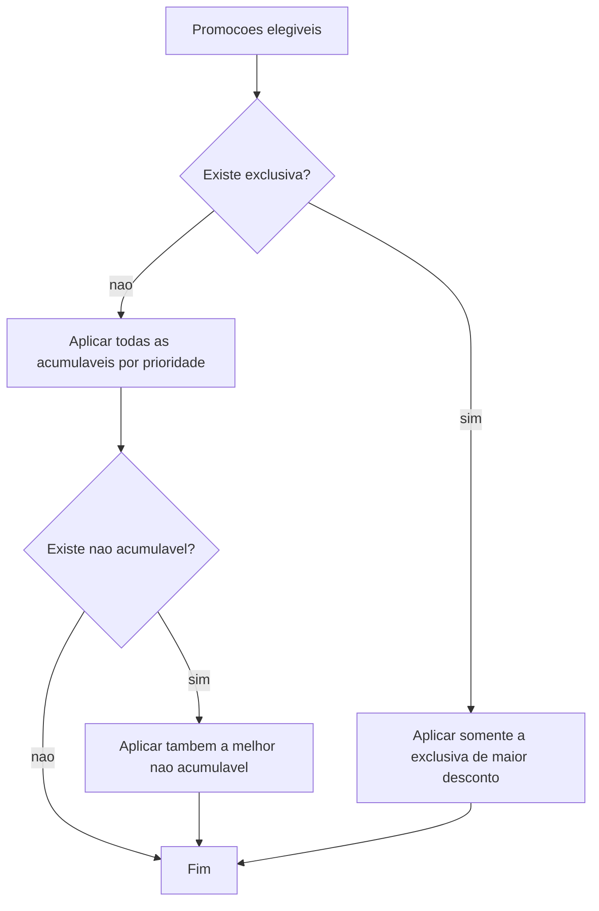

# 05. Regras de negócio

> **Objetivo:** fixar as regras comerciais do sistema (conflito entre promoções, cupons, formação do preço, frete grátis, estoque, idempotência, cancelamento e revalidação no checkout), cada uma com exemplo ou cenário, para servirem de base às próximas changes e aos testes.
>
> **Etapas do roadmap relacionadas:** 2 (catálogo e estoque), 3 (carrinho e recálculo), 4 (checkout e pedido), 5 (promoções e cupons), 6 (pagamento e idempotência), 7 (entrega e frete). Ver [08-roadmap.md](08-roadmap.md).
>
> **Status:** proposto, com RN-23, RN-26 e RN-28 `implementado` na E4 (change `pedido-ciclo-vida`) e RN-17 a RN-21 `implementado` na E2 (change `catalogo-estoque`, no nível do módulo `estoque`; a ligação com o carrinho e com o checkout é das etapas 3 e 4). Os efeitos de estoque de RN-26 também estão `implementado` na E2; os de cupom e estorno (RN-26 e RN-27) continuam futuros. As decisões D4 (conflito), D5 (estoque) e D6 (idempotência) do design da change vêm do design aprovado; os pontos marcados como *premissa* são escolhas preliminares desta documentação e podem ser revistas na change da etapa, registrando o motivo.

Documentos relacionados: [04-design-patterns.md](04-design-patterns.md), [06-ciclo-vida-pedido.md](06-ciclo-vida-pedido.md), [09-testes.md](09-testes.md).

## Índice das regras

| ID | Regra | Seção |
|---|---|---|
| RN-01 a RN-04 | Elegibilidade e conflito entre promoções | 1 |
| RN-05 a RN-10 | Cupons | 2 |
| RN-11 a RN-14 | Formação do preço | 3 |
| RN-15 a RN-16 | Frete e frete grátis | 4 |
| RN-17 a RN-21 | Reserva de estoque | 5 |
| RN-22 a RN-23 | Revalidação no checkout e preservação do pedido | 6 |
| RN-24 a RN-25 | Idempotência da confirmação de pagamento | 7 |
| RN-26 a RN-28 | Cancelamento e estorno | 8 |

Convenções: valores em reais com duas casas decimais (RN-14). Nas promoções, **quanto maior o número de prioridade, maior a prioridade**.

---

## 1. Promoções: elegibilidade e conflito

### RN-01. Elegibilidade por condições combináveis
Uma promoção só entra no cálculo se estiver vigente (período de validade) e sua condição raiz for satisfeita. As condições (primeira compra, valor mínimo, categoria, produto, região, período, perfil de cliente) combinam-se com E, OU e NÃO (Composite, ver [04-design-patterns.md](04-design-patterns.md)).

*Exemplo:* "R$ 50,00 de desconto" com condição `ValorMinimo(300)`. Carrinho de R$ 400,00 é elegível; carrinho de R$ 250,00 não é.

### RN-02. Política de conflito (D4)
Dado o conjunto de promoções elegíveis:
1. Se houver alguma **exclusiva**, aplica-se apenas a exclusiva de maior desconto.
2. Caso contrário, aplicam-se todas as **acumuláveis**, em ordem de prioridade, mais a **melhor** (maior desconto) entre as **não acumuláveis**.
3. Em empate, vence a maior prioridade; persistindo o empate, vence a promoção mais antiga (menor data de criação).

A política em si é uma Strategy trocável (`PoliticaConflito`).

**Cenário-base.** Carrinho com Teclado (R$ 200,00, Eletrônicos), Livro (R$ 100,00, Livros) e Mouse (R$ 100,00, Eletrônicos). Subtotal: **R$ 400,00**.

| Promoção | Regra | Modo | Prioridade | Desconto calculado |
|---|---|---|---|---|
| P1 | R$ 50,00 em compras acima de R$ 300,00 | acumulável | 10 | R$ 50,00 |
| P2 | 20% em Livros | acumulável | 20 | 20% de R$ 100,00 = R$ 20,00 |
| P3 | 10% no carrinho | não acumulável | 5 | 10% de R$ 400,00 = R$ 40,00 |

**Cenário A (as 3 promoções acima).** Não há exclusiva. Aplicam-se as acumuláveis em ordem de prioridade (P2, depois P1) e a melhor não acumulável (P3, a única). Desconto total: 20 + 50 + 40 = **R$ 110,00**; valor após promoções: R$ 290,00.

**Cenário B (entra P4: 15% no carrinho, não acumulável).** P4 = R$ 60,00 é maior que P3 = R$ 40,00. Aplicam-se P2, P1 e P4; **P3 é descartada**. Desconto: 20 + 50 + 60 = **R$ 130,00**.

**Cenário C (entra P5: "Queima" de 25% no carrinho, exclusiva).** Existe exclusiva: aplica-se somente P5 = R$ 100,00. P1, P2, P3 e P4 não são aplicadas, embora somassem R$ 130,00. Isso é intencional: a exclusiva "impede qualquer outro desconto" (enunciado, *Conflitos entre promoções*). Desconto: **R$ 100,00**.

**Cenário D (empate).** Entra P6 "R$ 40,00 de desconto", não acumulável, prioridade 8, no lugar de P4 e P5. P3 (R$ 40,00, prioridade 5) empata com P6 (R$ 40,00, prioridade 8). Vence P6 pela maior prioridade; P3 é descartada. Desconto: 20 + 50 + 40 = R$ 110,00, agora atribuído a P6 no relatório de campanhas.

### RN-03. Base de cálculo e teto do desconto *(premissa)*
O desconto percentual incide sobre o valor original dos itens elegíveis (não sobre o valor já reduzido por outra promoção); o valor fixo incide sobre o carrinho. A soma dos descontos de promoção nunca pode ultrapassar o subtotal: se ultrapassar, reduz-se o desconto da promoção de menor prioridade até o limite.

*Exemplo:* subtotal R$ 60,00; aplicam-se R$ 50,00 (prioridade 20) e R$ 20,00 (prioridade 10). A soma, R$ 70,00, excede o subtotal; o segundo desconto é limitado a R$ 10,00 e o valor após promoções é R$ 0,00 (nunca negativo).

### RN-04. Promoção fora da vigência
Uma promoção cujo período terminou deixa de ser elegível imediatamente, sem precisar ser removida. Na semana seguinte ao término ela não influencia nenhum cálculo.

*Exemplo:* P2 com vigência até 30/11. Um carrinho calculado em 01/12 não recebe P2.

---

## 2. Cupons

Um cupom tem: código (único), período de validade, limite de utilizações (total e, opcionalmente, por cliente), condições específicas (as mesmas `CondicaoElegibilidade` de RN-01), tipo de benefício (percentual, valor fixo ou frete) e indicação de acumulável com promoções.

### RN-05. Cupom inexistente
Código que não existe é rejeitado com erro de cupom inexistente; o carrinho permanece como estava.
*Exemplo:* `NATAL25` não cadastrado resulta em rejeição e o total não muda.

### RN-06. Cupom expirado
Fora do período de validade, o cupom é rejeitado. O limite do período vale pela data do cálculo (e é revalidado no checkout, RN-22).
*Exemplo:* `VERAO10`, válido até 31/03/2026, usado em 15/04/2026: rejeitado como expirado.

### RN-07. Limite de utilizações
Cada confirmação de uso incrementa o contador de forma atômica (atualização condicional `usos < limite`, mesma ideia da reserva de estoque); sem vaga, o cupom é rejeitado como esgotado. O uso é consumido na conclusão do checkout (junto com a reserva de estoque) e devolvido se o pedido for recusado ou cancelado (RN-26).
*Exemplo:* `PRIMEIRA50` com limite 100 e 100 usos já consumidos: o cliente 101 é rejeitado. Se um dos 100 pedidos for cancelado, o uso volta e a vaga é liberada.

### RN-08. Cupom incompatível com a campanha
O cupom é rejeitado quando suas condições não são satisfeitas ou quando conflita com as promoções aplicadas:
- condição não atendida: `LIVROS15` (condição: categoria Livros) em carrinho sem livros;
- cupom não acumulável (`acumulavel = falso`) com ao menos uma promoção de desconto aplicada;
- promoção **exclusiva** aplicada (a exclusiva impede qualquer outro desconto, inclusive cupom) *(premissa)*.

*Exemplo:* no cenário C da RN-02 (P5 exclusiva), o cupom `BEMVINDO10` é rejeitado como incompatível.

### RN-09. Tipos de benefício do cupom
Percentual (incide sobre o valor após promoções, RN-11), valor fixo (limitado ao valor após promoções) e frete (zera ou reduz o frete). O tipo é um ponto de variação como as promoções (novo benefício = nova classe).
*Exemplo:* `BEMVINDO10` (10%) sobre R$ 290,00 concede R$ 29,00; um cupom fixo de R$ 400,00 sobre R$ 290,00 concede apenas R$ 290,00.

### RN-10. Um cupom por pedido *(premissa)*
Cada pedido aceita no máximo um cupom. Aplicar um segundo cupom substitui o primeiro, desde que o novo seja válido; se o novo for rejeitado, o primeiro é mantido.

Resumo das rejeições:

| Situação | Resultado | Exemplo |
|---|---|---|
| Código inexistente | rejeitado (inexistente) | `NATAL25` |
| Fora da validade | rejeitado (expirado) | `VERAO10` em 15/04/2026 |
| Limite de uso atingido | rejeitado (esgotado) | `PRIMEIRA50` com 100 de 100 usos |
| Condição não atendida | rejeitado (incompatível) | `LIVROS15` sem livros |
| Conflito com exclusiva ou não acumulável | rejeitado (incompatível) | `BEMVINDO10` no cenário C |

---

## 3. Formação do preço

### RN-11. Etapas e ordem
O valor final é formado em etapas, sempre nesta ordem (pipeline, ver [04-design-patterns.md](04-design-patterns.md)):

1. **Subtotal:** soma de preço unitário vezes quantidade dos itens (combos pelo preço do combo).
2. **Promoções:** desconto conforme RN-02 e RN-03.
3. **Cupom:** incide sobre o valor após promoções (RN-09).
4. **Frete:** valor calculado pela modalidade escolhida, menos o desconto de frete (RN-16).
5. **Total:** subtotal menos promoções menos cupom mais frete final.

### RN-12. Detalhamento visível ao cliente
O carrinho e o pedido expõem o detalhamento completo, para que o cliente distinga subtotal, descontos (por promoção e por cupom), frete e total, como exige o enunciado.

**Exemplo numérico** (cenário A da RN-02, cupom `BEMVINDO10`, frete econômico de R$ 25,00, promoção de frete grátis, acumulável, para subtotal bruto a partir de R$ 300,00):

| Linha | Valor |
|---|---|
| Subtotal dos itens | R$ 400,00 |
| Promoção P2 (20% em Livros) | - R$ 20,00 |
| Promoção P1 (R$ 50,00 acima de R$ 300,00) | - R$ 50,00 |
| Promoção P3 (10% no carrinho) | - R$ 40,00 |
| Subtotal após promoções | R$ 290,00 |
| Cupom `BEMVINDO10` (10%) | - R$ 29,00 |
| Frete (econômico) | R$ 25,00 |
| Frete grátis (promoção de frete) | - R$ 25,00 |
| **Total** | **R$ 261,00** |

Verificação: 400 - 20 - 50 - 40 - 29 + 25 - 25 = 261. Descontos concedidos no total: 110 + 29 + 25 = R$ 164,00 (insumo do relatório de desconto por campanha).

Sem as promoções de frete (carrinho de R$ 250,00, sem desconto algum): subtotal R$ 250,00 + frete R$ 25,00 = total R$ 275,00; o frete é mostrado em linha própria.

### RN-13. Recálculo a cada alteração
Toda inclusão, alteração de quantidade ou remoção de item, e toda aplicação ou remoção de cupom ou troca de modalidade de frete, dispara o recálculo completo. O valor nunca é mantido incrementalmente.
*Exemplo:* no carrinho do exemplo acima, remover o Livro (R$ 100,00) leva o subtotal a R$ 300,00; P2 deixa de ser aplicável, P1 continua (300 ≥ 300) e todo o detalhamento é refeito.

### RN-14. Arredondamento
Cálculos monetários usam `BigDecimal`, duas casas decimais, arredondamento `HALF_UP`, aplicado ao resultado de cada desconto.
*Exemplo:* 15% sobre R$ 33,30 = R$ 4,995, arredondado para R$ 5,00.

---

## 4. Frete e frete grátis

### RN-15. Cálculo do frete
O frete é calculado pela modalidade e pela transportadora (simulada) escolhidas, podendo variar por região, peso, quantidade, valor da compra ou modalidade. Novos serviços de entrega entram implementando o contrato de frete.
*Exemplo:* a modalidade econômica custa R$ 25,00 para a região Sudeste e R$ 40,00 para o Nordeste.

### RN-16. Frete grátis é uma promoção
O frete grátis é uma promoção como as demais: tem nome, vigência, prioridade, modo de acumulação e `CondicaoElegibilidade` raiz (valor mínimo, região, produto, categoria ou perfil de cliente), mas seu benefício incide sobre o frete e não sobre os itens. Assim, usa o mesmo motor, a mesma política de conflito e o mesmo cadastro administrativo.
- Sua condição de valor mínimo usa, por padrão, o subtotal bruto dos itens *(premissa; configurável pela condição)*.
- Participa da mesma política de conflito (RN-02): sendo acumulável, soma-se às demais; se uma promoção exclusiva for aplicada, o frete grátis não é aplicado. O teto da RN-03 considera apenas descontos sobre itens.

*Exemplo:* regra "frete grátis acima de R$ 300,00 para o Sudeste". Cliente do Sudeste com subtotal de R$ 400,00: frete de R$ 25,00 menos desconto de frete de R$ 25,00, resultando em R$ 0,00. Cliente do Nordeste com o mesmo carrinho: condição de região falha e paga R$ 40,00.

---

## 5. Estoque

Cada produto/variação tem `disponivel` (unidades livres) e `reservado` (unidades comprometidas com pedidos aguardando pagamento).

### RN-17. O carrinho só consulta
Adicionar ou alterar item no carrinho consulta a disponibilidade para avisar o cliente, mas **não reserva**. Verificar no carrinho não garante o estoque no checkout (enunciado, *Estoque*).
*Exemplo:* o cliente vê "2 disponíveis" ao adicionar; ao concluir o checkout, a quantidade é conferida de novo (RN-22).

**Status:** `implementado` (E2) como consulta: `ConsultarSaldo` não reserva nada, e o detalhe público do produto e do combo mostram a disponibilidade (`disponivel` de cada variação; a do combo é o mínimo de `disponivel / quantidade` entre os componentes). Testes: `catalogo.aplicacao.ConsultarCatalogoTests` e `estoque.aplicacao.AjusteEConsultaDeSaldoTests`. O carrinho que usa essa consulta é da etapa 3.

### RN-18. Reserva na conclusão do checkout (D5)
A reserva acontece quando o checkout é concluído e o pedido entra em `AGUARDANDO_PAGAMENTO`. Ela move unidades de `disponivel` para `reservado`, de todos os itens do pedido na mesma transação: se um item falhar, nenhum é reservado e o checkout é abortado com erro de estoque insuficiente.

**Status:** `implementado` (E2) em `estoque.aplicacao.ReservarEstoque.para(pedidoId, componentes)`. É **tudo-ou-nada**: roda na transação do chamador, e a exceção `EstoqueInsuficienteException` (409, com `variacaoId` e `disponivel` no Problem Details) desfaz as reservas já feitas dessa chamada. As quantidades são somadas por variação e processadas **ordenadas por `variacaoId`**, o que evita deadlock entre pedidos que disputam as mesmas variações. Reservar de novo para um pedido que já tem reserva é rejeitado (409). Para um combo, o chamador reserva os `componentesDeEstoque` (variações e quantidades já agregadas). Testes: `estoque.aplicacao.ReservarEstoqueTests`. Quem aciona a reserva é o checkout (etapa 4); até lá, só o pedido de demonstração do perfil `dev`.

### RN-19. Pagamento aprovado converte a reserva em baixa
Na confirmação do pagamento (`PAGO`), as unidades saem de `reservado` (baixa definitiva).

**Status:** `implementado` (E2): o ouvinte `OuvinteDePedidosDoEstoque` reage a `PedidoPago` e chama `MovimentarReservas.baixar` (reserva `ATIVA` para `BAIXADA`; o `reservado` diminui e o `disponivel` não muda). É **idempotente**: a troca de situação é um `UPDATE ... WHERE situacao = 'ATIVA'` e o saldo só muda se a troca de fato aconteceu; repetir o evento, ou um pedido sem reserva, não tem efeito nem erro. Testes: `estoque.aplicacao.MovimentarReservasTests` e `estoque.aplicacao.OuvintesDoEstoqueTests` (com os serviços reais do pedido).

### RN-20. Liberação da reserva
Pagamento recusado, cancelamento em `AGUARDANDO_PAGAMENTO` ou expiração por falta de pagamento devolvem as unidades de `reservado` para `disponivel`. A expiração (prazo a definir na etapa 6) equivale a um cancelamento automático do pedido, com o sistema como ator no histórico.

| Evento | disponivel | reservado | Físico (disponivel + reservado) |
|---|---|---|---|
| Checkout concluído (reserva de 1) | -1 | +1 | inalterado |
| Pagamento aprovado (baixa) | inalterado | -1 | -1 |
| Pagamento recusado, cancelamento ou expiração (liberação) | +1 | -1 | inalterado |
| Cancelamento após baixa (RN-26) | +1 | inalterado | +1 |

**Status:** `implementado` (E2), exceto a expiração (etapa 6). Os efeitos saem do mesmo ouvinte, `OuvinteDePedidosDoEstoque`, que escolhe a ação por um mapa da situação de origem (`de`) do `PedidoCancelado`, sem `switch`:

| Evento do pedido | Ação (`MovimentarReservas`) | Transição da reserva |
|---|---|---|
| `PedidoPagamentoRecusado` | `liberar` | `ATIVA` para `LIBERADA` |
| `PedidoCancelado` com `de = AGUARDANDO_PAGAMENTO` | `liberar` | `ATIVA` para `LIBERADA` |
| `PedidoCancelado` com `de = PAGO` ou `EM_PREPARACAO` | `repor` (a mercadoria não saiu) | `BAIXADA` para `REPOSTA` |
| `PedidoPago` | `baixar` (RN-19) | `ATIVA` para `BAIXADA` |

Liberar, baixar e repor são idempotentes: liberar duas vezes devolve ao `disponivel` uma única vez, e a reposição só age sobre uma reserva `BAIXADA`. Cancelar de `CRIADO` ou `PAGAMENTO_RECUSADO` não tem efeito de estoque (sem reserva ativa, ou já liberada). Uma transição rejeitada pelo pedido não publica evento e, portanto, não altera o estoque. Testes: `estoque.aplicacao.MovimentarReservasTests` (`liberarDuasVezes...`, `reporDesfaz...`, `pedidoSemReserva...`) e `estoque.aplicacao.OuvintesDoEstoqueTests` (cancelamento antes e depois do pagamento, em preparação, recusa, transição rejeitada e pedido sem reserva).

### RN-21. Concorrência pela última unidade (D5)
A reserva é uma atualização condicional atômica: decrementa `disponivel` somente se `disponivel >= quantidade`, e a quantidade de linhas afetadas decide o resultado.

**Decisão (`implementado`, E2):** `UPDATE saldo_estoque SET disponivel = disponivel - :q, reservado = reservado + :q WHERE variacao_id = :v AND disponivel >= :q`. Zero linhas afetadas lança `EstoqueInsuficienteException`, e a transação desfaz as reservas anteriores (tudo-ou-nada, RN-18). O ajuste administrativo usa a mesma técnica (`disponivel + :delta >= 0`), e o `CHECK (disponivel >= 0)` do banco é a última barreira. *Alternativas descartadas:* lock otimista com `@Version` e nova tentativa (gera retentativas sob disputa e mais código; o `UPDATE` condicional resolve em uma ida ao banco) e lock pessimista (serializa leituras desnecessariamente).

**Cenário: a última unidade.** O Teclado tem `disponivel = 1`. Os clientes A e B têm o Teclado no carrinho (a consulta de ambos mostrou 1 disponível, RN-17).
1. A conclui o checkout: a atualização condicional (`disponivel = disponivel - 1 ... where disponivel >= 1`) afeta 1 linha. A reserva é bem-sucedida; o pedido de A vai a `AGUARDANDO_PAGAMENTO`.
2. B conclui o checkout logo depois: a atualização afeta 0 linhas (agora `disponivel = 0`). O checkout de B é abortado com erro de estoque insuficiente; nenhum pedido é criado e nada fica reservado.
3. Se A tiver o pagamento recusado, a unidade é liberada (`disponivel = 1`) e B pode tentar novamente.

Duas requisições simultâneas competem na mesma linha do banco; como a condição é avaliada de forma atômica, apenas uma tem sucesso.

**Teste de concorrência (`implementado`, E2):** `estoque.aplicacao.ReservaConcorrenteTests` dispara 10 threads, com uma barreira de largada, pela única unidade de uma variação (`@RepeatedTest(3)`, sem instabilidade): exatamente 1 sucesso e 9 `EstoqueInsuficienteException`, com saldo final de 0 disponível e 1 reservado, e uma única reserva gravada.

---

## 6. Checkout

### RN-22. Revalidação antes de concluir
O checkout nunca confia nos valores do carrinho. Antes de criar o pedido, recalcula e confere: preço atual dos produtos, vigência das promoções, validade e uso do cupom, estoque, endereço (pertence ao cliente), entrega e forma de pagamento. Se o resultado diferir do que o cliente viu, o checkout **não conclui**: devolve as divergências e o novo detalhamento (resposta de conflito, preliminar) e o cliente precisa confirmar novamente. Estoque insuficiente aborta o checkout (RN-18).

**Cenário: preço e promoção mudaram.** O cliente montou o carrinho do cenário A (total R$ 261,00). Antes do checkout, o Teclado passou de R$ 200,00 para R$ 220,00 e a promoção P2 (20% em Livros) expirou.

| Linha | Valor no carrinho | Valor revalidado |
|---|---|---|
| Subtotal | R$ 400,00 | R$ 420,00 |
| Promoções | - R$ 110,00 | - R$ 92,00 (P1 R$ 50,00 e P3 10% de R$ 420,00 = R$ 42,00) |
| Cupom `BEMVINDO10` | - R$ 29,00 | - R$ 32,80 (10% de R$ 328,00) |
| Frete após frete grátis | R$ 0,00 | R$ 0,00 |
| **Total** | **R$ 261,00** | **R$ 295,20** |

O sistema responde com as duas divergências (preço do Teclado e promoção P2 encerrada) e o total novo de R$ 295,20. Nenhum pedido é criado, nada é reservado. Se o cliente confirmar, o checkout é refeito com os valores atuais.

### RN-23. O pedido preserva o momento da compra
O pedido grava uma cópia (snapshot) dos dados comerciais: preço unitário, cada promoção aplicada com seu valor, cupom, frete e total. Alterações futuras de preço ou promoção não alteram pedidos antigos.
*Exemplo:* o Teclado, comprado a R$ 220,00, passa a custar R$ 250,00; o pedido continua mostrando R$ 220,00.

**Status:** `implementado` na E4. O agregado `Pedido` copia itens (SKU, nome, descrição da variação, preço unitário, quantidade, total do item), descontos (descrição, origem `PROMOCAO` ou `CUPOM`, alvo `ITENS` ou `FRETE`, valor), frete, totais e o endereço de entrega, sem setters, e confere na criação que `subtotal` é a soma dos itens e `total = subtotal - descontos + frete` (senão, `DadoInvalidoException`: "Totais inconsistentes"). O cupom entra como um desconto com origem `CUPOM`. Teste: `pedido.aplicacao.CriarPedidoTests` (preço e endereço alterados depois da compra não mudam o pedido). A revalidação do checkout (RN-22) é da change `checkout`.

---

## 7. Idempotência da confirmação de pagamento

### RN-24. Identificador de transação único (D6)
Toda confirmação externa de pagamento traz o identificador da transação (`idTransacaoExterna`). Ele é registrado em tabela própria com restrição de **unicidade**. O registro e o efeito (transição do pedido, baixa de estoque, evento) acontecem na mesma transação do banco.

### RN-25. Confirmação repetida é no-op
Se a inserção do identificador falhar por duplicidade, a confirmação já foi processada: o sistema responde como sucesso (para a origem não reenviar) e **não faz nada**: sem segunda baixa de estoque, sem segunda transição do pedido, sem segundo evento. A restrição de unicidade no banco resolve também o caso de duas entregas simultâneas.

**Cenário: confirmação duplicada.** O pedido 100 está em `AGUARDANDO_PAGAMENTO`, com 2 unidades do Teclado reservadas.
1. Chega a confirmação `TX-123`. O identificador é inserido com sucesso. O pedido vai a `PAGO`, a reserva de 2 unidades vira baixa, o evento `PagamentoConfirmado` é publicado.
2. O gateway reenvia `TX-123` (nova tentativa por timeout). A inserção viola a unicidade; o sistema responde sucesso sem efeito. O estoque continua com baixa de 2 (e não 4); o pedido segue em `PAGO` e nenhuma notificação duplicada sai.

Observação: uma confirmação com **outro** identificador para um pedido que já não está em `AGUARDANDO_PAGAMENTO` (por exemplo, pedido cancelado) não é duplicata: é uma transição inválida e gera erro, sem alterar o pedido (ver [06-ciclo-vida-pedido.md](06-ciclo-vida-pedido.md)).

---

## 8. Cancelamento e estorno

### RN-26. Estados que permitem cancelar e efeitos
O cancelamento é permitido a partir de `CRIADO`, `AGUARDANDO_PAGAMENTO`, `PAGAMENTO_RECUSADO`, `PAGO` e `EM_PREPARACAO`. Em `ENVIADO`, `ENTREGUE` e `CANCELADO` é uma transição inválida (erro 409, nenhuma alteração). O motivo é obrigatório.

**Política por perfil (decidida na E4).** Quem pode cancelar depende do estado:
- **Cliente** (somente o próprio pedido): `CRIADO`, `AGUARDANDO_PAGAMENTO` e `PAGAMENTO_RECUSADO`.
- **`ADMIN` e `OPERADOR_COMERCIAL`**: todos os estados que admitem cancelamento, inclusive `PAGO` e `EM_PREPARACAO`.
- Em `PAGO` e `EM_PREPARACAO` só o cancelamento administrativo é aceito (o cliente recebe 409): depois do pagamento, o cancelamento envolve estorno e reposição de estoque, e por isso fica com a administração. O perfil `ESTOQUE` não cancela.
- A regra mora nos estados `Pago` e `EmPreparacao` (não no controller): mudar a política exige ajustar só essas duas classes. Ver [06-ciclo-vida-pedido.md](06-ciclo-vida-pedido.md), seção 8.2.

| Estado de origem | Estoque (`implementado`, E2) | Pagamento *(futuro)* | Cupom *(futuro)* |
|---|---|---|---|
| `CRIADO` | nada a liberar (sem reserva) | nada | uso devolvido, se consumido |
| `AGUARDANDO_PAGAMENTO` | reserva liberada | cobrança pendente cancelada | uso devolvido |
| `PAGAMENTO_RECUSADO` | nada (já liberada na recusa) | nada | nada (já devolvido na recusa) |
| `PAGO` | unidades repostas (a baixa é revertida, pois a mercadoria não saiu) | **estorno simulado** | uso devolvido |
| `EM_PREPARACAO` | unidades repostas | **estorno simulado** | uso devolvido |

**Status:** `implementado` na E4 quanto às regras de estado, perfil, motivo e histórico (testes: `pedido.dominio.estado.EstadosDoPedidoTests`, `pedido.dominio.PedidoTests`, `pedido.web.PedidosDoClienteTests`, `pedido.web.PedidosAdministrativosTests`). O efeito de **estoque** passou a ser executado na E2 (ver RN-19 e RN-20): o `PedidoCancelado` é publicado com o estado de origem (`de`) e o ouvinte do estoque libera ou repõe conforme a origem. Os efeitos de **pagamento** e de **cupom** **não são executados ainda** e serão ouvintes nas etapas de pagamento (E6) e cupons (E5).

### RN-27. Estorno simulado
**Status:** futuro (etapa 6, `pagamento-idempotencia`); nesta etapa só o evento `PedidoCancelado` com `de` é publicado.

Se existe pagamento aprovado, o cancelamento chama o contrato do gateway para estornar o valor total pago (sem transação financeira real). O estorno também é idempotente: um pedido não é estornado duas vezes.
*Exemplo:* pedido `PAGO` de R$ 261,00 é cancelado: estorno simulado de R$ 261,00, unidades repostas, uso do cupom devolvido, pedido em `CANCELADO`.

### RN-28. O cancelamento fica no histórico
Todo cancelamento registra no histórico do pedido: estado anterior, momento, responsável (cliente, administrador ou sistema, no caso de expiração) e motivo. O cancelamento de pedidos também entra na auditoria de operações administrativas (etapa 8).
*Exemplo:* "Pedido 100: `PAGO` para `CANCELADO`, por admin@loja, em 10/05/2026 14:32, motivo: pedido em duplicidade; estorno simulado realizado".

**Status:** `implementado` na E4 (exceto a auditoria, etapa 8). Cada transição grava uma `EntradaHistorico` com estado anterior, estado novo, momento, responsável (`CLIENTE`, `ADMINISTRATIVO` com o id do usuário, ou `SISTEMA`) e motivo; a criação do pedido gera uma entrada inicial (de nulo para `CRIADO`, responsável `SISTEMA`), e o detalhe do pedido devolve o histórico em ordem cronológica. Testes: `pedido.aplicacao.TransicionarPedidoTests` e `pedido.web.PedidosDoClienteTests`.

Devolução parcial ou total é a extensão opcional do enunciado e está fora do escopo desta versão das regras.
