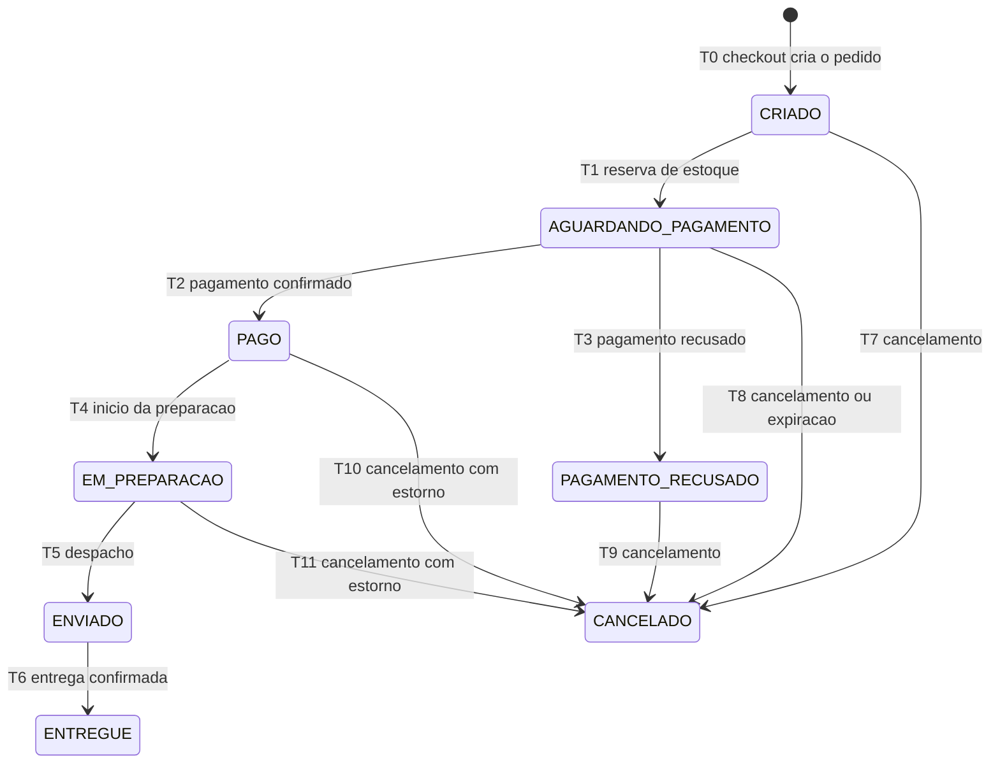

# 06. Ciclo de vida do pedido

> **Objetivo:** definir os estados do pedido, as transições válidas e inválidas e os efeitos colaterais de cada transição (estoque, estorno, eventos), cumprindo a exigência do enunciado de um diagrama do ciclo de vida do pedido e da definição de "quais transições entre essas situações são válidas".
>
> **Etapas do roadmap relacionadas:** 4 (checkout e pedido: estados e transições), 6 (pagamento e idempotência: `PAGO`, `PAGAMENTO_RECUSADO`, estorno), 7 (entrega e frete: `ENVIADO`, `ENTREGUE`), 8 (eventos, notificações e auditoria: eventos emitidos e histórico). Ver [08-roadmap.md](08-roadmap.md).
>
> **Status:** proposto (estados e transições conforme D7 do design).

Documentos relacionados: [04-design-patterns.md](04-design-patterns.md) (State), [05-regras-negocio.md](05-regras-negocio.md) (RN-18 a RN-28), [09-testes.md](09-testes.md).

## 1. Estados

| Estado | Significado | Final? |
|---|---|---|
| `CRIADO` | Pedido gerado a partir do checkout, com os dados comerciais preservados; ainda sem reserva de estoque. | não |
| `AGUARDANDO_PAGAMENTO` | Estoque reservado; esperando a confirmação do pagamento. | não |
| `PAGO` | Pagamento aprovado; reserva convertida em baixa. | não |
| `EM_PREPARACAO` | Separação e embalagem. | não |
| `ENVIADO` | Entregue à transportadora (simulada). | não |
| `ENTREGUE` | Recebido pelo cliente. | sim |
| `CANCELADO` | Cancelado, com histórico. | sim |
| `PAGAMENTO_RECUSADO` | Pagamento recusado; reserva já liberada. Só admite cancelamento. | não (apenas cancelável) |

## 2. Diagrama de estados

Cada seta traz o identificador da transição (T0 a T11), igual ao da tabela da seção 3.

`ENTREGUE` e `CANCELADO` são estados finais: não têm transição de saída.

## 3. Transições válidas

São 11 transições entre estados (T1 a T11) mais a criação do pedido (T0). Qualquer outra é inválida (seção 4).

| ID | De | Para | Gatilho | Quem aciona |
|---|---|---|---|---|
| T0 | (início) | `CRIADO` | Checkout concluído e revalidado | cliente |
| T1 | `CRIADO` | `AGUARDANDO_PAGAMENTO` | Reserva de estoque bem-sucedida | sistema (checkout) |
| T2 | `AGUARDANDO_PAGAMENTO` | `PAGO` | Confirmação de pagamento (identificador novo) | gateway/sistema |
| T3 | `AGUARDANDO_PAGAMENTO` | `PAGAMENTO_RECUSADO` | Recusa do pagamento | gateway/sistema |
| T4 | `PAGO` | `EM_PREPARACAO` | Início da separação | responsável pelo estoque |
| T5 | `EM_PREPARACAO` | `ENVIADO` | Despacho | responsável pelo estoque |
| T6 | `ENVIADO` | `ENTREGUE` | Confirmação de entrega | transportadora (simulada)/sistema |
| T7 | `CRIADO` | `CANCELADO` | Cancelamento | cliente, administrador |
| T8 | `AGUARDANDO_PAGAMENTO` | `CANCELADO` | Cancelamento ou expiração do prazo de pagamento | cliente, administrador, sistema |
| T9 | `PAGAMENTO_RECUSADO` | `CANCELADO` | Cancelamento | cliente, administrador |
| T10 | `PAGO` | `CANCELADO` | Cancelamento | administrador (e cliente, conforme política) |
| T11 | `EM_PREPARACAO` | `CANCELADO` | Cancelamento | administrador (e cliente, conforme política) |

Quem pode acionar cada transição é *proposto* e depende dos perfis definidos na etapa de segurança; o que não muda é o conjunto de transições.

## 4. Transições inválidas

Dos 8 x 7 = 56 pares ordenados de estados distintos, 11 são válidos; os 45 restantes são inválidos. Todos produzem o mesmo resultado: lança-se `TransicaoInvalidaException` (resposta HTTP de conflito, preliminar), o pedido permanece no estado atual, nenhum efeito colateral é executado e a mensagem informa o estado atual e a operação tentada.

| Tentativa | Por que é inválida | Resultado esperado |
|---|---|---|
| `ENVIADO` para `CANCELADO` | A mercadoria já saiu; devolução é outro fluxo (extensão opcional) | erro; pedido segue `ENVIADO` |
| `ENTREGUE` para `CANCELADO` | Estado final | erro |
| `CANCELADO` para `PAGO` | Pagamento tardio de um pedido já cancelado (com identificador novo) | erro; pedido segue `CANCELADO`; a confirmação fica registrada para tratamento manual *(premissa)* |
| `CANCELADO` para qualquer estado | Estado final | erro |
| `CRIADO` para `PAGO` | Pula `AGUARDANDO_PAGAMENTO` (sem reserva) | erro |
| `AGUARDANDO_PAGAMENTO` para `EM_PREPARACAO` | Pula `PAGO` | erro |
| `PAGO` para `AGUARDANDO_PAGAMENTO` | Retrocesso | erro |
| `PAGAMENTO_RECUSADO` para `PAGO` ou `AGUARDANDO_PAGAMENTO` | Recusa não reabre o pedido; nova tentativa é um novo checkout | erro |
| `ENTREGUE` para `ENVIADO` | Retrocesso | erro |
| `EM_PREPARACAO` para `ENTREGUE` | Pula `ENVIADO` | erro |

Caso especial, que **não** é transição inválida: a confirmação de pagamento **repetida** (mesmo identificador de transação). Ela é interceptada antes da máquina de estados e vira no-op (RN-24 e RN-25 em [05-regras-negocio.md](05-regras-negocio.md)); o pedido em `PAGO` não tenta `PAGO` para `PAGO`.

## 5. Efeitos colaterais por transição

Efeitos de estoque seguem RN-17 a RN-21; os de cancelamento, RN-26 a RN-28. Os eventos são publicados como eventos de domínio (Observer, ver [04-design-patterns.md](04-design-patterns.md)); notificação e auditoria são reações a eles.

| ID | Estoque | Estorno / pagamento | Cupom | Evento emitido | Histórico / notificação |
|---|---|---|---|---|---|
| T0 | nenhum | nenhum | validado e conferido (RN-22) | nenhum (ver observação abaixo) | snapshot comercial gravado (RN-23) |
| T1 | **reserva** (`disponivel` para `reservado`), atômica (RN-18, RN-21) | inicia a cobrança no gateway | uso consumido (RN-07) | `PedidoCriado` | notifica criação do pedido |
| T2 | **baixa**: `reservado` sai do estoque (RN-19) | confirmação registrada com identificador único (RN-24) | mantido | `PagamentoConfirmado` | notifica confirmação do pagamento |
| T3 | **liberação** da reserva (RN-20) | nenhum | uso devolvido | `PagamentoRecusado` | histórico; notificação opcional |
| T4 | nenhum | nenhum | mantido | `PedidoEmPreparacao` | histórico |
| T5 | nenhum | nenhum | mantido | `PedidoEnviado` | registra transportadora e rastreio simulado; notifica envio |
| T6 | nenhum | nenhum | mantido | `PedidoEntregue` | histórico |
| T7 | nenhum (não havia reserva) | nenhum | uso devolvido, se consumido | `PedidoCancelado` | histórico com responsável e motivo; notifica cancelamento |
| T8 | **liberação** da reserva (RN-20) | cobrança pendente cancelada | uso devolvido | `PedidoCancelado` | idem T7; na expiração o ator é o sistema |
| T9 | nenhum (já liberada em T3) | nenhum | nenhum (já devolvido em T3) | `PedidoCancelado` | idem T7 |
| T10 | **reposição** das unidades baixadas *(premissa)* | **estorno simulado** do valor pago (RN-27) | uso devolvido | `PedidoCancelado` | idem T7, com registro do estorno |
| T11 | **reposição** das unidades baixadas *(premissa)* | **estorno simulado** do valor pago (RN-27) | uso devolvido | `PedidoCancelado` | idem T7, com registro do estorno |

**Observação sobre T0 e T1.** No desenho proposto, `CRIADO` é um estado transitório dentro da mesma transação do checkout: se a reserva falha (estoque insuficiente), a transação é desfeita e nenhum pedido persiste. A transição `CRIADO` para `CANCELADO` (T7) existe para o caso em que a etapa 4 opte por persistir o pedido antes da reserva ou por haver cancelamento administrativo nesse intervalo. A decisão final cabe à change de checkout.

## 6. Cenários de exemplo

1. **Fluxo feliz.** Checkout (T0, T1) estoque reservado; confirmação `TX-123` (T2) baixa de estoque; preparação (T4); despacho (T5); entrega (T6). Estado final: `ENTREGUE`.
2. **Pagamento recusado.** T0, T1, T3: a reserva é liberada e o cupom devolvido; o pedido fica em `PAGAMENTO_RECUSADO`. O cliente que quiser comprar de novo faz um novo checkout (e não reabre este pedido). Se cancelar o pedido recusado, T9 apenas fecha o histórico.
3. **Cancelamento com estorno.** Pedido `PAGO` de R$ 261,00 cancelado pelo administrador (T10): estorno simulado de R$ 261,00, unidades repostas, cupom devolvido, evento `PedidoCancelado`, notificação ao cliente e registro no histórico.
4. **Transição inválida.** Tentativa de cancelar um pedido `ENVIADO`: o sistema responde com erro de transição inválida, o pedido continua `ENVIADO`, estoque e pagamento ficam intactos. É um dos cenários obrigatórios de teste ([09-testes.md](09-testes.md)).
5. **Confirmação duplicada.** `TX-123` chega duas vezes para o mesmo pedido: o segundo envio é no-op (sem nova baixa, sem novo evento) e o pedido continua `PAGO`.

## 7. Histórico do pedido

Cada transição bem-sucedida grava uma linha de histórico: pedido, estado de origem, estado de destino, momento, responsável (cliente, administrador ou sistema) e motivo (obrigatório no cancelamento). O histórico alimenta o acompanhamento do pedido pelo cliente, a auditoria e os relatórios de cancelamento.
