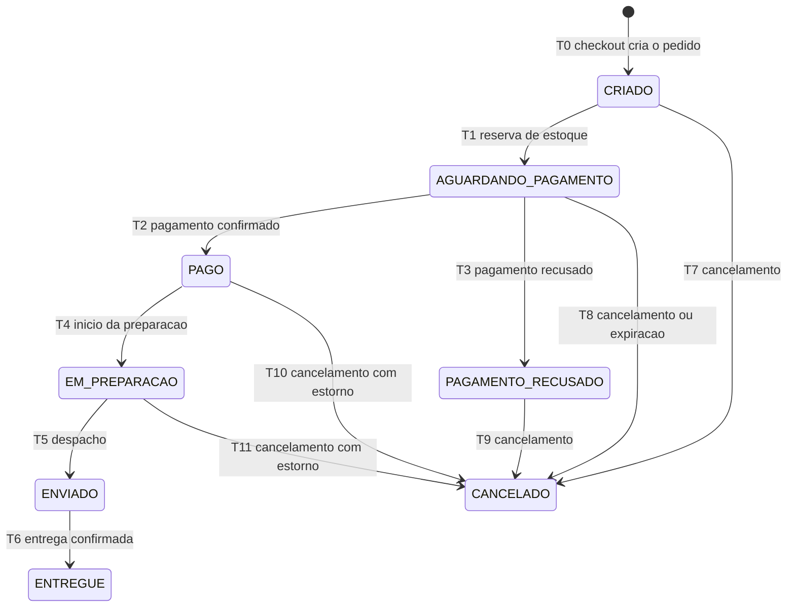

# 06. Ciclo de vida do pedido

> **Objetivo:** definir os estados do pedido, as transições válidas e inválidas e os efeitos colaterais de cada transição (estoque, estorno, eventos), cumprindo a exigência do enunciado de um diagrama do ciclo de vida do pedido e da definição de "quais transições entre essas situações são válidas".
>
> **Etapas do roadmap relacionadas:** 4 (checkout e pedido: estados e transições), 6 (pagamento e idempotência: `PAGO`, `PAGAMENTO_RECUSADO`, estorno), 7 (entrega e frete: `ENVIADO`, `ENTREGUE`), 8 (eventos, notificações e auditoria: eventos emitidos e histórico). Ver [08-roadmap.md](08-roadmap.md).
>
> **Status:** implementado (E4, change `pedido-ciclo-vida`): estados, transições, cancelamento por perfil, histórico e eventos do pedido. Os efeitos de **estoque** (baixa, liberação e reposição) foram implementados na E2 (change `catalogo-estoque`) como ouvintes dos eventos do pedido, sem alterar este módulo; os de cupom, estorno e notificação ainda não existem: são ouvintes previstos nas etapas seguintes e estão marcados como *futuro* na seção 5.

Documentos relacionados: [04-design-patterns.md](04-design-patterns.md) (State, seção 3.4; Observer, seção 3.6), [05-regras-negocio.md](05-regras-negocio.md) (RN-18 a RN-28), [09-testes.md](09-testes.md).

## 1. Estados

| Estado | Significado | Final? |
|---|---|---|
| `CRIADO` | Pedido gerado a partir do checkout, com os dados comerciais preservados; ainda sem reserva de estoque. | não |
| `AGUARDANDO_PAGAMENTO` | Estoque reservado; esperando a confirmação do pagamento. | não |
| `PAGO` | Pagamento aprovado; reserva convertida em baixa. | não |
| `EM_PREPARACAO` | Separação e embalagem. | não |
| `ENVIADO` | Entregue à transportadora (simulada). | não |
| `ENTREGUE` | Recebido pelo cliente. | sim |
| `CANCELADO` | Cancelado, com histórico. | sim |
| `PAGAMENTO_RECUSADO` | Pagamento recusado; reserva já liberada. Só admite cancelamento. | não (apenas cancelável) |

## 2. Diagrama de estados

Cada seta traz o identificador da transição (T0 a T11), igual ao da tabela da seção 3.

`ENTREGUE` e `CANCELADO` são estados finais: não têm transição de saída.

## 3. Transições válidas

São 11 transições entre estados (T1 a T11) mais a criação do pedido (T0). Qualquer outra é inválida (seção 4).

| ID | De | Para | Gatilho | Quem aciona |
|---|---|---|---|---|
| T0 | (início) | `CRIADO` | Checkout concluído e revalidado | cliente |
| T1 | `CRIADO` | `AGUARDANDO_PAGAMENTO` | Reserva de estoque bem-sucedida | sistema (checkout) |
| T2 | `AGUARDANDO_PAGAMENTO` | `PAGO` | Confirmação de pagamento (identificador novo) | gateway/sistema |
| T3 | `AGUARDANDO_PAGAMENTO` | `PAGAMENTO_RECUSADO` | Recusa do pagamento | gateway/sistema |
| T4 | `PAGO` | `EM_PREPARACAO` | Início da separação | responsável pelo estoque |
| T5 | `EM_PREPARACAO` | `ENVIADO` | Despacho | responsável pelo estoque |
| T6 | `ENVIADO` | `ENTREGUE` | Confirmação de entrega | transportadora (simulada)/sistema |
| T7 | `CRIADO` | `CANCELADO` | Cancelamento | cliente, administrador |
| T8 | `AGUARDANDO_PAGAMENTO` | `CANCELADO` | Cancelamento ou expiração do prazo de pagamento | cliente, administrador, sistema |
| T9 | `PAGAMENTO_RECUSADO` | `CANCELADO` | Cancelamento | cliente, administrador |
| T10 | `PAGO` | `CANCELADO` | Cancelamento | administrador (e cliente, conforme política) |
| T11 | `EM_PREPARACAO` | `CANCELADO` | Cancelamento | administrador (e cliente, conforme política) |

Quem aciona cada transição, como implementado (detalhes e rotas na seção 8):
- T0: serviço `CriarPedido` (o checkout o chamará); T1: serviço `ConfirmarReservaDoPedido` (responsável `SISTEMA`).
- T2 e T3: hoje apenas o endpoint administrativo **temporário** de pagamento simulado (`ADMIN`; responsável `SISTEMA`, motivo "pagamento simulado"), até a etapa 6 (pagamento).
- T4, T5 e T6: `ADMIN` ou `ESTOQUE`.
- T7, T8 e T9: o próprio cliente ou `ADMIN`/`OPERADOR_COMERCIAL`. T10 e T11: somente `ADMIN`/`OPERADOR_COMERCIAL` (política da seção 8; o cliente não cancela pedido pago nem em preparação).
- A expiração do prazo de pagamento por sistema (T8) não existe ainda (etapa 6).

O conjunto de transições é o da tabela acima e não depende de quem as aciona.

## 4. Transições inválidas

Dos 8 x 7 = 56 pares estado x operação (cada um dos 8 estados diante das 7 operações do ciclo de vida: aguardar pagamento, confirmar pagamento, recusar pagamento, iniciar preparação, enviar, entregar e cancelar), 11 são válidos; os 45 restantes são inválidos. Todos produzem o mesmo resultado: lança-se `TransicaoInvalidaException`, que a API devolve como **409 Conflito** em Problem Details com as propriedades `situacaoAtual` e `operacao` além do `detail`; o pedido permanece no estado atual, nenhum histórico, evento ou efeito colateral é gerado e a mensagem informa o estado atual e a operação tentada.

| Tentativa | Por que é inválida | Resultado esperado |
|---|---|---|
| `ENVIADO` para `CANCELADO` | A mercadoria já saiu; devolução é outro fluxo (extensão opcional) | erro; pedido segue `ENVIADO` |
| `ENTREGUE` para `CANCELADO` | Estado final | erro |
| `CANCELADO` para `PAGO` | Pagamento tardio de um pedido já cancelado (com identificador novo) | erro; pedido segue `CANCELADO`; a confirmação fica registrada para tratamento manual *(premissa)* |
| `CANCELADO` para qualquer estado | Estado final | erro |
| `CRIADO` para `PAGO` | Pula `AGUARDANDO_PAGAMENTO` (sem reserva) | erro |
| `AGUARDANDO_PAGAMENTO` para `EM_PREPARACAO` | Pula `PAGO` | erro |
| `PAGO` para `AGUARDANDO_PAGAMENTO` | Retrocesso | erro |
| `PAGAMENTO_RECUSADO` para `PAGO` ou `AGUARDANDO_PAGAMENTO` | Recusa não reabre o pedido; nova tentativa é um novo checkout | erro |
| `ENTREGUE` para `ENVIADO` | Retrocesso | erro |
| `EM_PREPARACAO` para `ENTREGUE` | Pula `ENVIADO` | erro |

Caso especial, que **não** é transição inválida: a confirmação de pagamento **repetida** (mesmo identificador de transação). Ela é interceptada antes da máquina de estados e vira no-op (RN-24 e RN-25 em [05-regras-negocio.md](05-regras-negocio.md)); o pedido em `PAGO` não tenta `PAGO` para `PAGO`.

## 5. Efeitos colaterais por transição

Efeitos de estoque seguem RN-17 a RN-21; os de cancelamento, RN-26 a RN-28. Os eventos são publicados como eventos de domínio (Observer, ver [04-design-patterns.md](04-design-patterns.md)); notificação e auditoria são reações a eles.

| ID | Estoque (`implementado`, E2; a reserva de T1 é chamada pelo checkout, *futuro*) | Estorno / pagamento *(futuro)* | Cupom *(futuro)* | Evento emitido (`implementado`) | Histórico (`implementado`) / notificação *(futuro)* |
|---|---|---|---|---|---|
| T0 | nenhum | nenhum | validado e conferido (RN-22) | nenhum (ver observação abaixo) | snapshot comercial gravado (RN-23) e entrada inicial de histórico |
| T1 | **reserva** (`disponivel` para `reservado`), atômica (RN-18, RN-21) | inicia a cobrança no gateway | uso consumido (RN-07) | `PedidoCriado` | notifica criação do pedido |
| T2 | **baixa**: `reservado` sai do estoque (RN-19) | confirmação registrada com identificador único (RN-24) | mantido | `PedidoPago` | notifica confirmação do pagamento |
| T3 | **liberação** da reserva (RN-20) | nenhum | uso devolvido | `PedidoPagamentoRecusado` | histórico; notificação opcional |
| T4 | nenhum | nenhum | mantido | `PedidoEmPreparacao` | histórico |
| T5 | nenhum | nenhum | mantido | `PedidoEnviado` | registra transportadora e rastreio simulado; notifica envio |
| T6 | nenhum | nenhum | mantido | `PedidoEntregue` | histórico |
| T7 | nenhum (não havia reserva) | nenhum | uso devolvido, se consumido | `PedidoCancelado` | histórico com responsável e motivo; notifica cancelamento |
| T8 | **liberação** da reserva (RN-20) | cobrança pendente cancelada | uso devolvido | `PedidoCancelado` | idem T7; na expiração o ator é o sistema |
| T9 | nenhum (já liberada em T3) | nenhum | nenhum (já devolvido em T3) | `PedidoCancelado` | idem T7 |
| T10 | **reposição** das unidades baixadas | **estorno simulado** do valor pago (RN-27) | uso devolvido | `PedidoCancelado` | idem T7, com registro do estorno |
| T11 | **reposição** das unidades baixadas | **estorno simulado** do valor pago (RN-27) | uso devolvido | `PedidoCancelado` | idem T7, com registro do estorno |

**O que já existe e o que é futuro.** Na change `pedido-ciclo-vida` só o que é do próprio pedido está implementado: a mudança de estado, o histórico e o **evento** de cada transição, publicado depois de salvar (seção 8). Baixa, liberação e reposição de estoque passaram a existir na change `catalogo-estoque` (E2) como ouvintes desses eventos (`OuvinteDePedidosDoEstoque`, que usa o estado de origem `de` do `PedidoCancelado` para liberar a reserva ou repor a baixa), sem alterar o módulo `pedido`; a reserva em si (T1) é chamada pelo checkout, futuro. Devolução de cupom, cobrança e estorno simulado e notificação são **ouvintes futuros** (cupons, pagamento e notificação, nas changes `promocoes-cupons`, `pagamento-idempotencia` e `eventos-notificacoes-auditoria`). Os eventos `PagamentoConfirmado` e `PagamentoRecusado` da tabela original passam a ser, para o pedido, `PedidoPago` e `PedidoPagamentoRecusado`; os do módulo de pagamento (mesmos nomes antigos) nascem na etapa 6 e serão distintos.

**Observação sobre T0 e T1.** `CriarPedido` persiste o pedido em `CRIADO` a partir do snapshot (T0, sem evento) e `ConfirmarReservaDoPedido` o leva a `AGUARDANDO_PAGAMENTO` (T1, que emite `PedidoCriado`). O checkout chamará os dois na mesma transação, depois de reservar o estoque: se a reserva falha, a transação é desfeita e nenhum pedido persiste. A transição `CRIADO` para `CANCELADO` (T7) cobre o cancelamento nesse intervalo. Nesta change não há endpoint HTTP de criação: o pedido de demonstração do perfil `dev` e os testes usam os serviços.

## 6. Cenários de exemplo

Os cenários descrevem o comportamento completo do sistema. Hoje valem as mudanças de estado, o histórico, os eventos e as reações de estoque (baixa, liberação e reposição); as de estorno, cupom e notificação são as *futuras* da seção 5.

1. **Fluxo feliz.** Checkout (T0, T1) estoque reservado; confirmação `TX-123` (T2) baixa de estoque; preparação (T4); despacho (T5); entrega (T6). Estado final: `ENTREGUE`.
2. **Pagamento recusado.** T0, T1, T3: a reserva é liberada e o cupom devolvido; o pedido fica em `PAGAMENTO_RECUSADO`. O cliente que quiser comprar de novo faz um novo checkout (e não reabre este pedido). Se cancelar o pedido recusado, T9 apenas fecha o histórico.
3. **Cancelamento com estorno.** Pedido `PAGO` de R$ 261,00 cancelado pelo administrador (T10): estorno simulado de R$ 261,00, unidades repostas, cupom devolvido, evento `PedidoCancelado`, notificação ao cliente e registro no histórico.
4. **Transição inválida.** Tentativa de cancelar um pedido `ENVIADO`: o sistema responde com erro de transição inválida, o pedido continua `ENVIADO`, estoque e pagamento ficam intactos. É um dos cenários obrigatórios de teste ([09-testes.md](09-testes.md)).
5. **Confirmação duplicada.** `TX-123` chega duas vezes para o mesmo pedido: o segundo envio é no-op (sem nova baixa, sem novo evento) e o pedido continua `PAGO`.

## 7. Histórico do pedido

Cada transição bem-sucedida grava uma linha de histórico (`EntradaHistorico`, tabela `pedido_historico`): estado de origem, estado de destino, momento, responsável (tipo `CLIENTE`, `ADMINISTRATIVO` ou `SISTEMA` e, para os dois primeiros, o id do usuário) e motivo (obrigatório no cancelamento). A **criação** do pedido também gera uma entrada inicial, com origem nula (de nulo para `CRIADO`) e responsável `SISTEMA`; por isso um pedido recém-criado já tem uma linha de histórico, e o fluxo completo de 6 estados tem uma entrada por estado alcançado. Uma transição rejeitada não grava nada. O histórico vem em ordem cronológica no detalhe do pedido e alimenta o acompanhamento pelo cliente, a auditoria e os relatórios de cancelamento.

## 8. Implementação (E4)

### 8.1 Classes

Módulo `br.com.fatec.ecommerce.pedido`; o pattern State e a justificativa estão em [04-design-patterns.md](04-design-patterns.md), seção 3.4.

| Papel | Classes |
|---|---|
| Contexto | `Pedido` (agregado, `pedido.dominio`), com `@Version` para o lock otimista |
| Estados | `EstadoPedido` (contrato), `EstadoPedidoBase` (rejeição padrão) e os 8 estados concretos `Criado`, `AguardandoPagamento`, `Pago`, `PagamentoRecusado`, `EmPreparacao`, `Enviado`, `Entregue` e `Cancelado` (`pedido.dominio.estado`) |
| Persistência do estado | `SituacaoPedido` (enum em texto, que devolve o objeto de estado por `estado()`) |
| Erro | `TransicaoInvalidaException` (com `situacaoAtual` e `operacao`) e `OperacaoPedido` |
| Responsável | `Responsavel` e `TipoResponsavel` (`CLIENTE`, `ADMINISTRATIVO`, `SISTEMA`) |
| Eventos (`pedido.dominio.evento`) | `PedidoCriado`, `PedidoPago`, `PedidoPagamentoRecusado`, `PedidoEmPreparacao`, `PedidoEnviado`, `PedidoEntregue`, `PedidoCancelado` |
| Serviços de aplicação | `CriarPedido`, `ConfirmarReservaDoPedido`, `TransicionarPedido`, `ConsultarPedidos`, `CancelarPedidoDoCliente` |

### 8.2 Regra de cancelamento por perfil

A regra vive nos estados (`Pago` e `EmPreparacao` exigem responsável administrativo), não no controller.

| Estado | Cliente (próprio pedido) | `ADMIN` / `OPERADOR_COMERCIAL` | Transição |
|---|---|---|---|
| `CRIADO` | pode cancelar | pode cancelar | T7 |
| `AGUARDANDO_PAGAMENTO` | pode cancelar | pode cancelar | T8 |
| `PAGAMENTO_RECUSADO` | pode cancelar | pode cancelar | T9 |
| `PAGO` | **não** (409) | pode cancelar | T10 |
| `EM_PREPARACAO` | **não** (409) | pode cancelar | T11 |
| `ENVIADO`, `ENTREGUE`, `CANCELADO` | não (409) | não (409) | inválida |

O motivo é obrigatório (sem ele, 400 e o pedido não muda). O perfil `ESTOQUE` não cancela (a rota é de `ADMIN` e `OPERADOR_COMERCIAL`). A política está registrada em RN-26 ([05-regras-negocio.md](05-regras-negocio.md)); mudá-la exige ajustar só `Pago.cancelar` e `EmPreparacao.cancelar`.

### 8.3 API

Rotas e casos de uso em [07-casos-de-uso.md](07-casos-de-uso.md) (UC-09, UC-10, UC-A07 a UC-A09). Uma transição inválida responde 409 com `situacaoAtual` e `operacao`; pedido de outro cliente responde 404; disputa simultânea pelo mesmo pedido (lock otimista) aplica uma transição e responde 409 à outra.
