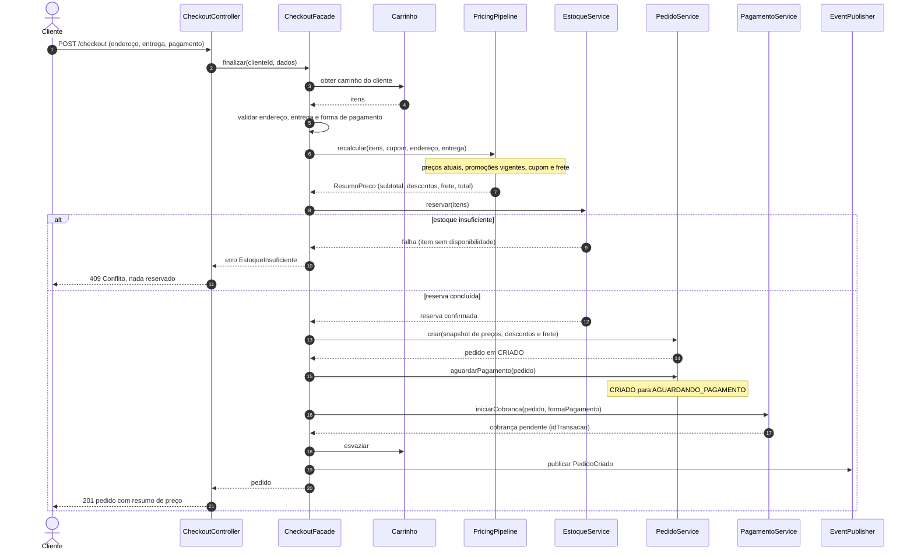
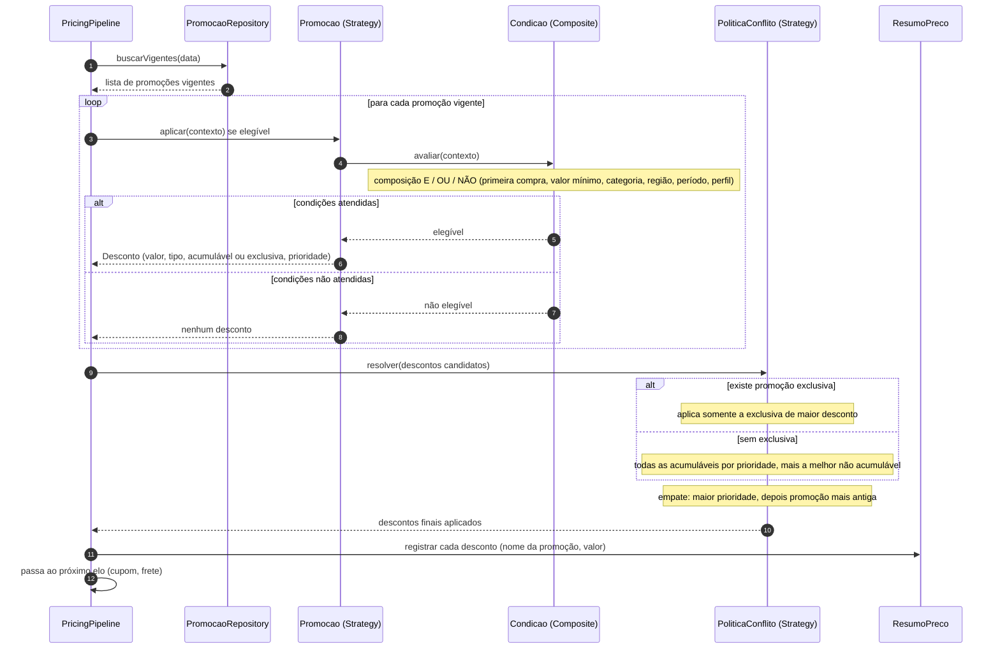
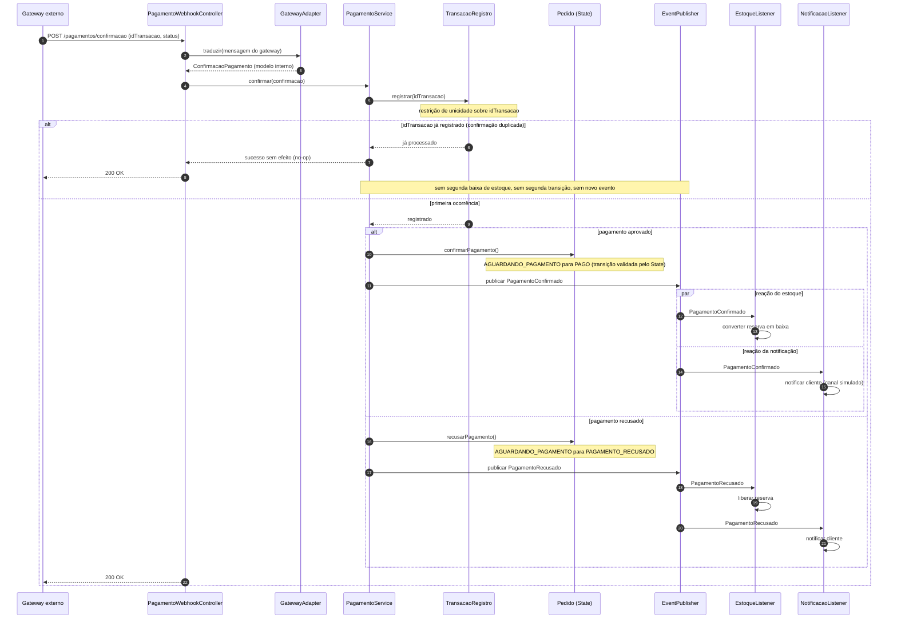

# 07 - Casos de uso

- **Objetivo:** descrever os principais casos de uso do sistema (cliente e perfis administrativos) e registrar roteiros preliminares, em diagramas de sequência, para os três processos centrais pedidos no enunciado: checkout, aplicação de promoções e confirmação de pagamento.
- **Etapas do roadmap relacionadas:** todas. Cada caso de uso indica a etapa em que será implementado (ver [08-roadmap.md](08-roadmap.md)). Os diagramas são refinados nas etapas 4 (checkout), 5 (promoções) e 6 (pagamento).
- **Status:** proposto (diagramas e nomes de participantes são preliminares e podem mudar na implementação). Os casos UC-09 e UC-10 (parte de pedido) e UC-A07 a UC-A09 estão `implementado` na E4 (change `pedido-ciclo-vida`), com as rotas reais indicadas em cada um; o pagamento, a entrega e os efeitos de estoque, estorno e notificação continuam nas etapas 6 a 8.

Documentos relacionados: [05-regras-negocio.md](05-regras-negocio.md) (regras citadas aqui), [06-ciclo-vida-pedido.md](06-ciclo-vida-pedido.md) (estados do pedido), [09-testes.md](09-testes.md) (cenários de teste derivados destes fluxos).

## 1. Atores e perfis

O enunciado exige ao menos clientes e administradores, e permite perfis administrativos adicionais, cada um com permissões compatíveis com a função. Proposta de perfis:

| Ator / perfil | Descrição | Permissões principais |
|---|---|---|
| Cliente | Usuário final da loja. | Conta própria, catálogo, carrinho, endereços, pedidos próprios, pagamento, acompanhamento de entrega, cancelamento de pedido próprio. |
| Administrador (`ADMIN`) | Acesso total. | Todas as funcionalidades administrativas, gestão de usuários/perfis, auditoria e relatórios. |
| Operador comercial (`OPERADOR_COMERCIAL`) | Gestão do catálogo e dos pedidos. | Catálogo, categorias, preços, consulta e andamento de pedidos, cancelamento administrativo, relatórios. |
| Responsável pelo estoque (`ESTOQUE`) | Controle de disponibilidade. | Consulta e ajuste de estoque. |
| Responsável pelas promoções (`PROMOCOES`) | Campanhas comerciais. | Criação e manutenção de promoções e cupons, relatório de descontos por campanha. |
| Gateway de pagamento (sistema externo) | Serviço simulado que envia confirmações. | Apenas o endpoint de confirmação/notificação de pagamento. |

Observações:
- A separação entre `OPERADOR_COMERCIAL`, `ESTOQUE` e `PROMOCOES` é opcional (o enunciado a admite). Se a equipe preferir, os três podem ser fundidos em `ADMIN`; os casos de uso abaixo continuam válidos.
- Toda operação administrativa relevante gera registro de auditoria (usuário, momento, operação), ver UC-A12.

## 2. Visão geral

## 3. Casos de uso do cliente

### UC-01 - Criar conta e autenticar-se
- **Ator:** Cliente (visitante).
- **Etapa:** 1 (fundação).
- **Pré-condições:** e-mail ainda não cadastrado (criação); conta existente (login).
- **Fluxo principal:**
  1. O visitante envia nome, e-mail, senha e demais dados cadastrais.
  2. O sistema valida os dados, grava a senha somente como hash (nunca em texto puro) e cria o cliente com perfil `CLIENTE`.
  3. O cliente faz login informando e-mail e senha e recebe um token/sessão de acesso.
- **Fluxos alternativos / erro:**
  - A1. E-mail já cadastrado: o sistema rejeita o cadastro.
  - A2. Dados inválidos (e-mail mal formado, senha fraca): rejeição com mensagem por campo.
  - E1. Credenciais incorretas no login: acesso negado, sem revelar se o e-mail existe.

### UC-02 - Gerenciar endereços
- **Ator:** Cliente.
- **Etapa:** 1 (cadastro), 7 (uso no frete).
- **Pré-condições:** cliente autenticado.
- **Fluxo principal:**
  1. O cliente cadastra um ou mais endereços (inclusive CEP/região, usado no cálculo de frete).
  2. O cliente edita ou remove endereços.
  3. No checkout, seleciona qual endereço será usado na entrega.
- **Fluxos alternativos / erro:**
  - A1. Endereço de outro cliente: acesso negado (cliente só acessa os próprios dados).
  - E1. Remoção de endereço vinculado a pedido em andamento: bloqueada ou feita por inativação, preservando o pedido (decisão a confirmar na etapa 4).

### UC-03 - Consultar catálogo
- **Ator:** Cliente (ou visitante, se a consulta for pública).
- **Etapa:** 2.
- **Pré-condições:** nenhuma além de haver produtos ativos.
- **Fluxo principal:**
  1. O ator lista produtos, filtrando por categoria (incluindo subcategorias), nome ou faixa de preço.
  2. O ator abre um produto e vê descrição, preço, variações (tamanho, cor, capacidade) e disponibilidade.
- **Fluxos alternativos / erro:**
  - A1. Filtro sem resultados: lista vazia.
  - E1. Produto inexistente ou inativo: erro "não encontrado".

### UC-04 - Gerenciar carrinho
- **Ator:** Cliente.
- **Etapa:** 3.
- **Pré-condições:** cliente autenticado; produto/variação ativo.
- **Fluxo principal:**
  1. O cliente inclui um produto (ou combo/kit) com quantidade.
  2. O cliente altera quantidades ou remove itens.
  3. A cada modificação, o sistema recalcula os valores (subtotal, descontos, frete estimado, total), exibindo a composição.
- **Fluxos alternativos / erro:**
  - A1. Item já existe no carrinho: a quantidade é somada.
  - E1. Quantidade acima do disponível: o sistema avisa. Nesta etapa o carrinho apenas **consulta** disponibilidade, não reserva (ver [05-regras-negocio.md](05-regras-negocio.md)); o aviso não garante disponibilidade no checkout.
  - E2. Quantidade menor ou igual a zero: rejeitada.

### UC-05 - Aplicar cupom
- **Ator:** Cliente.
- **Etapa:** 5.
- **Pré-condições:** carrinho com ao menos um item.
- **Fluxo principal:**
  1. O cliente informa o código do cupom.
  2. O sistema valida existência, validade, limite de usos e condições/compatibilidade com as promoções do carrinho.
  3. O cupom é associado ao carrinho e os valores são recalculados.
- **Fluxos alternativos / erro:**
  - E1. Cupom inexistente: rejeitado.
  - E2. Cupom expirado (ou ainda não vigente): rejeitado.
  - E3. Limite de utilizações esgotado: rejeitado.
  - E4. Cupom incompatível com as regras da campanha (por exemplo, não acumulável com promoção exclusiva ativa, ou valor mínimo não atingido): rejeitado com o motivo.
  - A1. O cliente remove o cupom: valores recalculados sem ele.

### UC-06 - Consultar composição do preço e simular frete
- **Ator:** Cliente.
- **Etapa:** 3 (subtotal), 5 (descontos), 7 (frete).
- **Pré-condições:** carrinho com itens; para frete, endereço selecionado.
- **Fluxo principal:**
  1. O cliente solicita o resumo do carrinho.
  2. O sistema devolve subtotal, descontos aplicados (um por promoção/cupom, com nome), frete e total.
  3. O cliente escolhe a modalidade de entrega entre as opções simuladas e vê o custo de cada uma.
- **Fluxos alternativos / erro:**
  - A1. Frete grátis por promoção: o frete aparece zerado, com a promoção responsável listada entre os descontos.
  - E1. Região não atendida por nenhum provedor: nenhuma modalidade disponível, checkout bloqueado.

### UC-07 - Realizar checkout
- **Ator:** Cliente.
- **Etapa:** 4 (base), 5 (promoções), 6 (pagamento), 7 (entrega).
- **Pré-condições:** cliente autenticado; carrinho não vazio; endereço, modalidade de entrega e forma de pagamento escolhidos.
- **Fluxo principal:**
  1. O cliente solicita o checkout.
  2. O sistema **revalida** preços, estoque, promoções, cupom, endereço, entrega e pagamento, recalculando o preço a partir dos dados atuais.
  3. O sistema cria o pedido com um retrato (snapshot) dos preços, descontos e frete, reserva o estoque e coloca o pedido em `AGUARDANDO_PAGAMENTO`.
  4. O sistema solicita a cobrança ao gateway de pagamento (simulado) e devolve o pedido ao cliente.
  5. O sistema esvazia o carrinho.
- **Fluxos alternativos / erro:**
  - A1. Preço ou promoção mudou desde a inclusão no carrinho: o sistema usa os valores atuais e informa as diferenças ao cliente (decisão de exigir ou não nova confirmação a ser fechada na etapa 4).
  - E1. Estoque insuficiente para algum item: checkout rejeitado e nada é reservado (reserva tudo-ou-nada), com indicação do item.
  - E2. Cupom deixou de ser válido: rejeitado ou removido com aviso.
  - E3. Pagamento recusado de forma síncrona: o pedido vai para `PAGAMENTO_RECUSADO` e a reserva é liberada (ver UC-S01 para o caso assíncrono).
  - E4. Carrinho vazio, endereço ausente ou forma de pagamento inválida: rejeitado.
  - E5. Concorrência pela última unidade: apenas um dos checkouts simultâneos reserva a unidade; o outro recebe E1.
- Diagrama de sequência: [seção 6.1](#61-checkout).

### UC-08 - Pagar pedido
- **Ator:** Cliente (e gateway simulado).
- **Etapa:** 6.
- **Pré-condições:** pedido em `AGUARDANDO_PAGAMENTO`.
- **Fluxo principal:**
  1. O cliente paga pela forma escolhida (cartão fictício, PIX simulado, boleto simulado).
  2. O gateway processa e envia a confirmação (ver UC-S01).
  3. O cliente consulta o pedido e vê o pagamento aprovado.
- **Fluxos alternativos / erro:**
  - E1. Pagamento recusado: pedido em `PAGAMENTO_RECUSADO`, reserva liberada, cliente notificado.
  - A1. Nova tentativa de pagamento após recusa: regra a definir na etapa 6 (nova tentativa sobre o mesmo pedido ou novo checkout).
  - Observação: nenhum dado real de cartão é usado; os dados de demonstração são fictícios.
  - **Temporário (E4):** até a etapa 6 não há gateway. O resultado do pagamento é simulado pelo endpoint administrativo `POST /api/admin/pedidos/{id}/pagamento-simulado` (ver UC-A07 a UC-A09), que a etapa 6 remove.

### UC-09 - Acompanhar pedido, pagamento e entrega
- **Ator:** Cliente.
- **Etapa:** 4 (pedido, `implementado`), 6 (pagamento), 7 (entrega).
- **Pré-condições:** cliente autenticado (perfil `CLIENTE`).
- **Rotas (`implementado`):**
  - `GET /api/clientes/me/pedidos`: lista paginada (`page`, `size`) dos próprios pedidos, do mais recente para o mais antigo, em resumo (id, situação, total e data).
  - `GET /api/clientes/me/pedidos/{id}`: detalhe com itens, descontos, frete, totais, endereço de entrega e histórico de transições em ordem cronológica (com responsável e motivo).
- **Fluxo principal:**
  1. O cliente lista seus pedidos.
  2. Abre um pedido e vê itens, valores congelados, situação atual, histórico de transições, situação do pagamento e andamento da entrega (pagamento e entrega reais chegam nas etapas 6 e 7; hoje a situação já reflete a simulação de pagamento e as ações administrativas).
- **Fluxos alternativos / erro:**
  - E1. Pedido de outro cliente ou inexistente: 404 (a busca é sempre por pedido e cliente, sem revelar a existência).
  - E2. Página negativa ou tamanho menor que 1: 400. Sem token: 401; perfil administrativo na rota do cliente: 403.

### UC-10 - Cancelar pedido
- **Ator:** Cliente (próprio pedido) ou perfil administrativo (UC-A09).
- **Etapa:** 4 (cancelamento, `implementado`), 6 (estorno).
- **Pré-condições:** pedido em estado que admite cancelamento (`CRIADO`, `AGUARDANDO_PAGAMENTO`, `PAGAMENTO_RECUSADO`, `PAGO` ou `EM_PREPARACAO`, conforme [06-ciclo-vida-pedido.md](06-ciclo-vida-pedido.md)). O **cliente** só cancela em `CRIADO`, `AGUARDANDO_PAGAMENTO` e `PAGAMENTO_RECUSADO`; `PAGO` e `EM_PREPARACAO` só são cancelados por `ADMIN` ou `OPERADOR_COMERCIAL` (RN-26 em [05-regras-negocio.md](05-regras-negocio.md)).
- **Rota do cliente (`implementado`):** `POST /api/clientes/me/pedidos/{id}/cancelamento` com `{"motivo": "..."}`.
- **Fluxo principal:**
  1. O ator solicita o cancelamento informando o motivo (obrigatório).
  2. O sistema valida a transição pelo estado atual do pedido e a registra.
  3. O pedido vai para `CANCELADO`, o cancelamento é registrado no histórico (estado anterior, momento, responsável e motivo) e o evento `PedidoCancelado` é publicado.
  4. *(Futuro)* Os ouvintes liberam a reserva de estoque (se houver), disparam o estorno simulado (se existir pagamento aprovado) e notificam o cliente (etapas de estoque, 6 e 8). Hoje o cancelamento muda o estado, grava o histórico e publica o evento.
- **Fluxos alternativos / erro:**
  - E1. Pedido `ENVIADO`, `ENTREGUE` ou já `CANCELADO`: transição inválida, 409 com `situacaoAtual` e `operacao`, nenhuma alteração.
  - E2. Cliente tenta cancelar pedido `PAGO` ou `EM_PREPARACAO`: 409 com `situacaoAtual` e `operacao` e o pedido não muda.
  - E3. Motivo ausente ou em branco: 400 e o pedido não muda.
  - E4. Pedido de outro cliente ou inexistente: 404.
  - E5. Falha no estorno simulado: comportamento a definir na etapa 6 (proposta: manter o pedido e registrar a falha para nova tentativa).

### UC-11 - Receber notificações
- **Ator:** Cliente (destinatário), sistema (emissor).
- **Etapa:** 8.
- **Pré-condições:** evento relevante ocorreu (pedido criado, pagamento confirmado, pedido enviado, cancelamento).
- **Fluxo principal:**
  1. O sistema publica o evento de domínio correspondente.
  2. O módulo de notificações reage e envia a mensagem por um canal (simulado, por exemplo log ou e-mail falso).
- **Fluxos alternativos / erro:**
  - E1. Falha no canal: não afeta o pedido nem o pagamento. A falha é registrada.

### UC-12 - Solicitar devolução (opcional)
- **Ator:** Cliente.
- **Etapa:** extensão pós-etapa 9 (não obrigatória).
- **Pré-condições:** pedido `ENTREGUE`.
- **Fluxo principal:** o cliente informa itens e quantidades a devolver; o sistema valida a quantidade devolvível, devolve ao estoque e calcula o valor proporcional (considerando descontos). Regras a definir se a extensão for implementada.
- **Fluxos alternativos / erro:** quantidade acima da comprada ou já devolvida: rejeitada.

## 4. Casos de uso administrativos

Os perfis que podem executar cada caso estão na coluna "Perfis". `ADMIN` pode executar todos.

| ID | Caso de uso | Perfis | Etapa |
|---|---|---|---|
| UC-A01 | Gerenciar catálogo (produtos, variações, combos/kits) | ADMIN, OPERADOR_COMERCIAL | 2 |
| UC-A02 | Gerenciar categorias e subcategorias | ADMIN, OPERADOR_COMERCIAL | 2 |
| UC-A03 | Alterar preços | ADMIN, OPERADOR_COMERCIAL | 2 |
| UC-A04 | Gerenciar estoque | ADMIN, ESTOQUE | 2 |
| UC-A05 | Gerenciar promoções | ADMIN, PROMOCOES | 5 |
| UC-A06 | Gerenciar cupons | ADMIN, PROMOCOES | 5 |
| UC-A07 | Consultar pedidos | ADMIN, OPERADOR_COMERCIAL | 4 (`implementado`) |
| UC-A08 | Avançar andamento do pedido (preparação, envio, entrega) | ADMIN, ESTOQUE | 4 (`implementado`), 7 |
| UC-A09 | Cancelar pedido administrativamente | ADMIN, OPERADOR_COMERCIAL | 4 (`implementado`), 6 |
| UC-A10 | Consultar relatórios gerenciais | ADMIN, OPERADOR_COMERCIAL, PROMOCOES (relatório de campanhas) | 9 |
| UC-A11 | Gerenciar usuários e perfis | ADMIN | 1 |
| UC-A12 | Consultar trilha de auditoria | ADMIN | 8 |

### UC-A01 a UC-A03 - Catálogo, categorias e preços
- **Ator:** Administrador ou operador comercial.
- **Pré-condições:** usuário autenticado com perfil permitido.
- **Fluxo principal:**
  1. O ator cria ou edita produto (nome, descrição, preço, categoria, variações, atributos opcionais), categoria/subcategoria ou combo/kit.
  2. O sistema valida e persiste. Alterações de preço valem apenas para novos carrinhos e checkouts, sem modificar pedidos antigos.
  3. Alterações de preço e criação/remoção relevantes são registradas na auditoria (usuário, momento, valor anterior e novo).
- **Fluxos alternativos / erro:**
  - E1. Perfil sem permissão: acesso negado.
  - E2. Preço negativo ou categoria inexistente: rejeitado.
  - E3. Remoção de produto presente em pedidos: inativação em vez de exclusão física.
  - E4. Ciclo na hierarquia de categorias: rejeitado.

### UC-A04 - Gerenciar estoque
- **Ator:** Responsável pelo estoque.
- **Pré-condições:** produto/variação cadastrado.
- **Fluxo principal:** o ator consulta e ajusta a quantidade disponível (entrada de mercadoria, correção). O sistema distingue quantidade disponível, reservada e baixada.
- **Fluxos alternativos / erro:** ajuste que deixaria o disponível negativo ou abaixo do já reservado: rejeitado.

### UC-A05 - Gerenciar promoções
- **Ator:** Responsável pelas promoções (ou administrador).
- **Etapa:** 5.
- **Pré-condições:** usuário autenticado com perfil permitido.
- **Fluxo principal:**
  1. O ator cria uma promoção informando nome, tipo (ex.: leve 3 pague 2, percentual por categoria, valor fixo acima de mínimo, frete grátis), parâmetros do tipo, condições de elegibilidade, período de validade, prioridade e se é acumulável ou exclusiva.
  2. O sistema valida os parâmetros e persiste. A promoção passa a valer no período configurado.
  3. A criação/alteração é registrada na auditoria.
  4. O ator pode ativar, desativar ou encerrar a promoção.
- **Fluxos alternativos / erro:**
  - E1. Tipo desconhecido ou parâmetros inválidos (percentual fora de 0 a 100, período invertido): rejeitado.
  - A1. Promoção encerrada não afeta pedidos já criados.

### UC-A06 - Gerenciar cupons
- **Ator:** Responsável pelas promoções (ou administrador).
- **Etapa:** 5.
- **Fluxo principal:** o ator cria cupom com código único, tipo (percentual, valor fixo ou outro benefício), validade, limite de utilizações e condições; pode consultar o consumo e desativá-lo.
- **Fluxos alternativos / erro:** código duplicado ou parâmetros inválidos: rejeitado.

### UC-A07 a UC-A09 - Pedidos (visão administrativa)
- **Ator:** `ADMIN`, `OPERADOR_COMERCIAL` (consulta e cancelamento) e `ESTOQUE` (andamento).
- **Pré-condições:** usuário com o perfil permitido para a rota.
- **Rotas (`implementado`, E4)** sob `/api/admin/pedidos`:

| Caso | Rota | Perfis |
|---|---|---|
| UC-A07 | `GET /api/admin/pedidos?situacao=&page=&size=` (lista paginada de qualquer cliente, filtro opcional por situação) e `GET /api/admin/pedidos/{id}` (detalhe com histórico) | `ADMIN`, `OPERADOR_COMERCIAL` |
| UC-A08 | `POST /api/admin/pedidos/{id}/preparacao` (`PAGO` para `EM_PREPARACAO`), `POST /api/admin/pedidos/{id}/envio` (para `ENVIADO`) e `POST /api/admin/pedidos/{id}/entrega` (para `ENTREGUE`) | `ADMIN`, `ESTOQUE` |
| UC-A09 | `POST /api/admin/pedidos/{id}/cancelamento` com `{"motivo": "..."}` | `ADMIN`, `OPERADOR_COMERCIAL` |
| **Temporário** | `POST /api/admin/pedidos/{id}/pagamento-simulado` com `{"aprovado": true}` ou `{"aprovado": false}` | somente `ADMIN` |

- **Fluxo principal:** o ator filtra e consulta pedidos de qualquer cliente; avança o andamento (`PAGO` para `EM_PREPARACAO`, para `ENVIADO`, para `ENTREGUE`); ou cancela um pedido (conforme UC-10; o administrativo cancela inclusive `PAGO` e `EM_PREPARACAO`).
- **Endpoint de pagamento simulado (TEMPORÁRIO).** Existe só para tornar o fluxo exercitável até a etapa 6: aprova (`PAGO`) ou recusa (`PAGAMENTO_RECUSADO`) um pedido em `AGUARDANDO_PAGAMENTO`, com responsável `SISTEMA` e motivo "pagamento simulado" no histórico. Está marcado `@Deprecated` e descrito como temporário no Swagger, e a change `pagamento-idempotencia` o remove, quando o gateway passa a aprovar ou recusar o pedido. Um pedido `PAGAMENTO_RECUSADO` não é reaberto.
- **Fluxos alternativos / erro:**
  - E1. Transição inválida (por exemplo, enviar pedido `AGUARDANDO_PAGAMENTO`, pular etapa ou mexer em pedido de estado final): 409 em Problem Details com `situacaoAtual` e `operacao`, e nenhuma alteração.
  - E2. Perfil sem permissão para a rota (por exemplo, `ESTOQUE` cancelando): 403; sem token: 401; cliente na área administrativa: 403.
  - E3. Pedido inexistente: 404. Filtro `situacao` desconhecido: 400. Motivo do cancelamento ausente: 400.
  - E4. Alterações simultâneas no mesmo pedido: uma é aplicada e a outra recebe 409 (lock otimista).
  - A1. O cancelamento administrativo gera registro de auditoria com o responsável (a trilha de auditoria é da etapa 8; o histórico do pedido já registra o responsável).

### UC-A10 - Consultar relatórios
- **Ator:** Administrador, operador comercial; responsável pelas promoções (relatório de campanhas).
- **Etapa:** 9.
- **Fluxo principal:** o ator escolhe o relatório e o período: total de vendas, quantidade de pedidos, ticket médio, produtos mais vendidos, campanhas mais utilizadas, total concedido em descontos, cancelamentos e desconto concedido por campanha.
- **Fluxos alternativos / erro:** período sem pedidos: relatório vazio (valores zero). Período inválido: rejeitado.

### UC-A11 - Gerenciar usuários e perfis
- **Ator:** Administrador.
- **Etapa:** 1.
- **Fluxo principal:** o administrador cria usuários administrativos e atribui perfis (`ADMIN`, `OPERADOR_COMERCIAL`, `ESTOQUE`, `PROMOCOES`).
- **Fluxos alternativos / erro:** atribuição de perfil inexistente ou tentativa de remover o último `ADMIN`: rejeitada.

### UC-A12 - Consultar trilha de auditoria
- **Ator:** Administrador.
- **Etapa:** 8.
- **Fluxo principal:** o administrador filtra registros por usuário, tipo de operação e período, vendo quem fez o quê e quando (alterações de preço, criação de campanhas, cancelamentos etc.).
- **Fluxos alternativos / erro:** os registros são somente leitura. Não há edição nem exclusão pela API.

## 5. Caso de uso de sistema

### UC-S01 - Confirmar pagamento (callback do gateway)
- **Ator:** Gateway de pagamento (sistema externo simulado).
- **Etapa:** 6 (núcleo e idempotência), 8 (reação por eventos).
- **Pré-condições:** pedido em `AGUARDANDO_PAGAMENTO` com reserva de estoque ativa; confirmação traz o identificador da transação.
- **Fluxo principal:**
  1. O gateway envia a confirmação (aprovada ou recusada) com o identificador da transação.
  2. O sistema registra o identificador (restrição de unicidade) e traduz a mensagem para o modelo interno por meio do adaptador do gateway.
  3. Se aprovada: pedido vai para `PAGO`, a reserva é convertida em baixa de estoque e é publicado o evento `PagamentoConfirmado`; estoque e notificação reagem de forma independente.
  4. Se recusada: pedido vai para `PAGAMENTO_RECUSADO`, a reserva é liberada e o cliente é notificado.
- **Fluxos alternativos / erro:**
  - A1. **Confirmação duplicada:** o identificador já foi processado. O sistema responde sucesso sem repetir efeitos: nenhuma segunda baixa de estoque, nenhuma segunda transição, nenhum novo evento (idempotência, ver [05-regras-negocio.md](05-regras-negocio.md)).
  - E1. Pedido inexistente: erro registrado, sem efeito.
  - E2. Pedido em estado que não admite pagamento (por exemplo, já `CANCELADO`): a confirmação é registrada e sinalizada, sem alterar o pedido (tratamento de conflito, como estorno do valor, definido na etapa 6).
  - E3. Mensagem malformada ou assinatura inválida (se simulada): rejeitada.
- Diagrama de sequência: [seção 6.3](#63-confirmação-de-pagamento).

## 6. Diagramas de sequência preliminares

Os nomes de participantes são provisórios. Seguem os patterns candidatos de [04-design-patterns.md](04-design-patterns.md): Facade (checkout), Chain of Responsibility (formação do preço), Strategy (promoções e política de conflito), Composite/Specification (elegibilidade), Adapter (gateway), State (pedido) e Observer (eventos).

### 6.1 Checkout

Fluxo do UC-07, com revalidação, reserva de estoque e criação do pedido. Mostra o caminho feliz e o ramo de estoque insuficiente.

Pontos a decidir na etapa 4: se diferenças de preço em relação ao carrinho exigem nova confirmação do cliente; se a reserva e a criação do pedido ocorrem na mesma transação (proposta: sim, tudo-ou-nada).

### 6.2 Aplicação de promoções

Fluxo interno do passo de promoções do pipeline de preço, incluindo a política de conflito (D4): filtrar elegíveis; se houver exclusiva, aplica só a exclusiva de maior desconto; caso contrário, todas as acumuláveis em ordem de prioridade mais a melhor não acumulável; desempate por maior prioridade e depois pela promoção mais antiga.

O frete grátis é tratado como uma promoção como as demais (desconto sobre o frete), participando da mesma política de conflito (ver [05-regras-negocio.md](05-regras-negocio.md)). A troca da política de conflito não altera o restante do pipeline.

### 6.3 Confirmação de pagamento

Fluxo do UC-S01, com idempotência explícita e reação por eventos. O primeiro envio percorre todo o fluxo. O segundo envio da mesma confirmação termina em no-op.

Observações:
- O registro do identificador e a transição do pedido devem ocorrer na mesma transação, de modo que uma falha no meio não deixe o identificador registrado sem efeito.
- Na etapa 6 a reação ao pagamento pode ser uma chamada direta; a etapa 8 a substitui por eventos de domínio e acrescenta notificação e auditoria (ver [08-roadmap.md](08-roadmap.md)).
- Se a notificação falhar, a falha não desfaz o pagamento nem a baixa de estoque.

## 7. Rastreabilidade casos de uso x enunciado

| Seção do enunciado | Casos de uso |
|---|---|
| Usuários, segurança | UC-01, UC-A11 |
| Clientes e endereços | UC-01, UC-02 |
| Catálogo, categorias | UC-03, UC-A01, UC-A02, UC-A03 |
| Estoque | UC-A04, UC-07 (reserva), UC-10 (liberação), UC-S01 (baixa) |
| Carrinho | UC-04, UC-06 |
| Promoções, conflitos, administração | UC-A05, UC-06, diagrama 6.2 |
| Cupons | UC-05, UC-A06 |
| Formação do preço | UC-06, diagrama 6.1 |
| Checkout, pedidos | UC-07, UC-09, UC-A07, UC-A08 |
| Pagamentos, idempotência | UC-08, UC-S01, diagrama 6.3 |
| Entrega e frete, frete grátis | UC-06, UC-A08 |
| Cancelamento, devolução | UC-10, UC-A09, UC-12 |
| Notificações, eventos | UC-11, UC-S01 |
| Auditoria | UC-A12 e registros nos UC-A01 a UC-A09 |
| Relatórios | UC-A10 |
