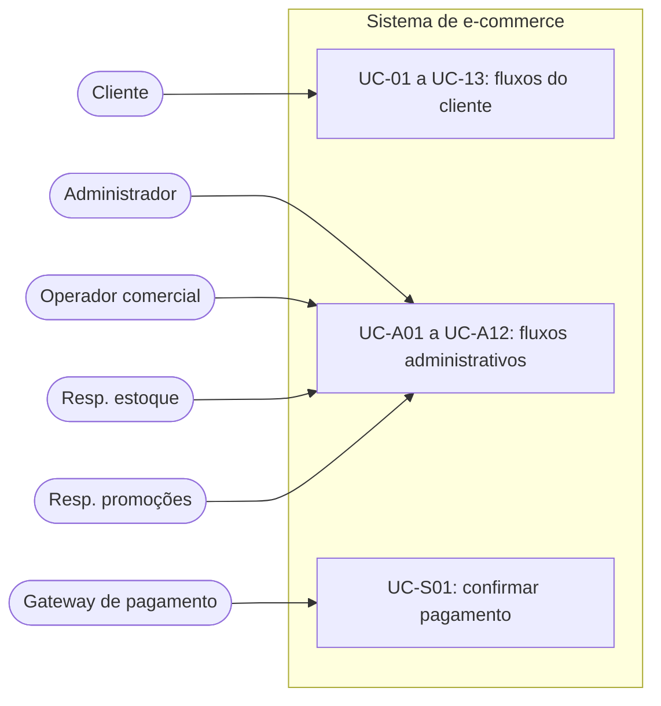
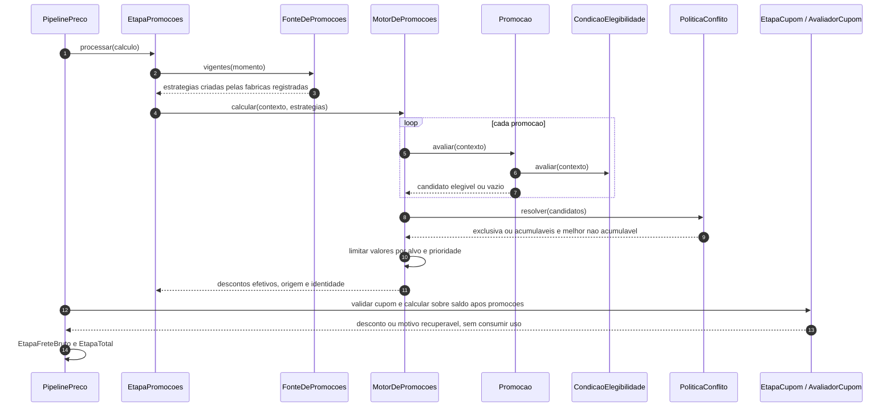
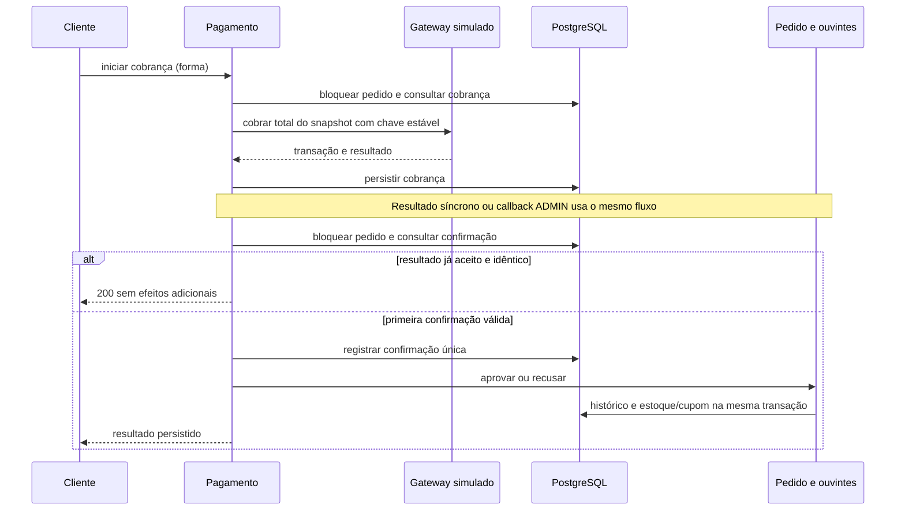
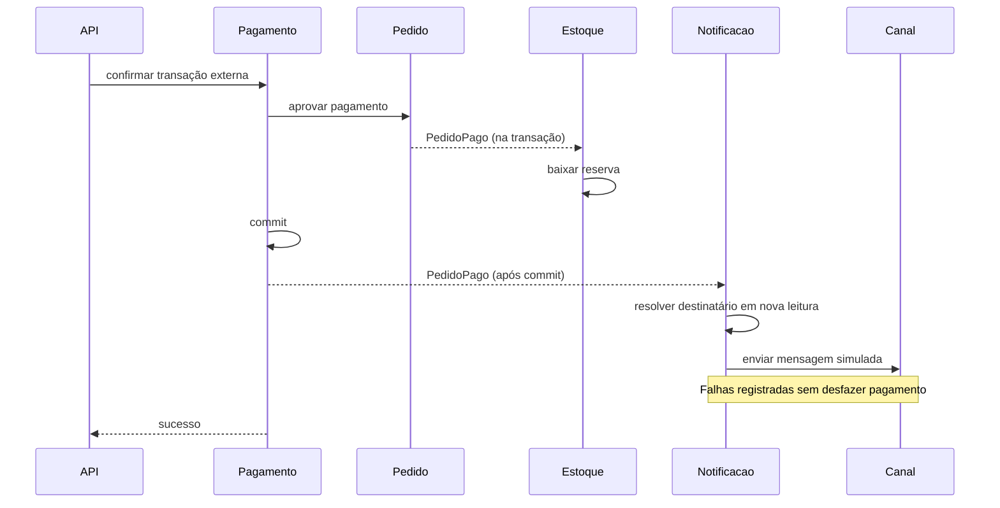

# 07 - Casos de uso

- **Objetivo:** descrever os principais casos de uso do sistema (cliente e perfis administrativos) e registrar roteiros preliminares, em diagramas de sequência, para os três processos centrais pedidos no enunciado: checkout, aplicação de promoções e confirmação de pagamento.
- **Etapas do roadmap relacionadas:** todas. Cada caso de uso indica a etapa em que será implementado (ver [08-roadmap.md](08-roadmap.md)). Os diagramas são refinados nas etapas 4 (checkout), 5 (promoções) e 6 (pagamento).
- **Status:** implementado (E1–E9): os casos de uso foram implementados pelas changes arquivadas até 2026-10-23 (pedido na E4, catálogo e estoque na E2, pagamento/estorno na E6, entrega na E7, notificação e auditoria na E8 e relatórios gerenciais na E9), com as rotas reais indicadas em cada um.

Documentos relacionados: [05-regras-negocio.md](05-regras-negocio.md) (regras citadas aqui), [06-ciclo-vida-pedido.md](06-ciclo-vida-pedido.md) (estados do pedido), [09-testes.md](09-testes.md) (cenários de teste derivados destes fluxos).

## 1. Atores e perfis

O enunciado exige ao menos clientes e administradores, e permite perfis administrativos adicionais, cada um com permissões compatíveis com a função. Proposta de perfis:

| Ator / perfil | Descrição | Permissões principais |
|---|---|---|
| Cliente | Usuário final da loja. | Conta própria, catálogo, carrinho, endereços, pedidos próprios, pagamento, acompanhamento de entrega, cancelamento de pedido próprio. |
| Administrador (`ADMIN`) | Acesso total. | Todas as funcionalidades administrativas, gestão de usuários/perfis, auditoria e relatórios. |
| Operador comercial (`OPERADOR_COMERCIAL`) | Gestão do catálogo e dos pedidos. | Catálogo, categorias, preços, consulta e andamento de pedidos, cancelamento administrativo, relatórios. |
| Responsável pelo estoque (`ESTOQUE`) | Controle de disponibilidade. | Consulta e ajuste de estoque. |
| Responsável pelas promoções (`PROMOCOES`) | Campanhas comerciais. | Criação e manutenção de promoções e cupons, relatório de descontos por campanha. |
| Gateway de pagamento (sistema externo) | Serviço simulado que envia confirmações. | Apenas o endpoint de confirmação/notificação de pagamento. |

Observações:
- A separação entre `OPERADOR_COMERCIAL`, `ESTOQUE` e `PROMOCOES` é opcional (o enunciado a admite). Se a equipe preferir, os três podem ser fundidos em `ADMIN`; os casos de uso abaixo continuam válidos.
- Toda operação administrativa relevante gera registro de auditoria (usuário, momento, operação), ver UC-A12.

## 2. Visão geral



## 3. Casos de uso do cliente

### UC-01 - Criar conta e autenticar-se
- **Ator:** Cliente (visitante).
- **Etapa:** 1 (fundação).
- **Pré-condições:** e-mail ainda não cadastrado (criação); conta existente (login).
- **Fluxo principal:**
  1. O visitante envia nome, e-mail, senha e demais dados cadastrais.
  2. O sistema valida os dados, grava a senha somente como hash (nunca em texto puro) e cria o cliente com perfil `CLIENTE`.
  3. O cliente faz login informando e-mail e senha e recebe um token/sessão de acesso.
- **Fluxos alternativos / erro:**
  - A1. E-mail já cadastrado: o sistema rejeita o cadastro.
  - A2. Dados inválidos (e-mail mal formado, senha fraca): rejeição com mensagem por campo.
  - E1. Credenciais incorretas no login: acesso negado, sem revelar se o e-mail existe.

### UC-02 - Gerenciar endereços
- **Ator:** Cliente.
- **Etapa:** 1 (cadastro), 7 (uso no frete).
- **Pré-condições:** cliente autenticado.
- **Fluxo principal:**
  1. O cliente cadastra um ou mais endereços (inclusive CEP/região, usado no cálculo de frete).
  2. O cliente edita ou remove endereços.
  3. No checkout, seleciona qual endereço será usado na entrega.
- **Fluxos alternativos / erro:**
  - A1. Endereço de outro cliente: acesso negado (cliente só acessa os próprios dados).
  - E1. Remoção de endereço vinculado a pedido em andamento: bloqueada ou feita por inativação, preservando o pedido (decisão a confirmar na etapa 4).

### UC-03 - Consultar catálogo
- **Ator:** Visitante (sem login) ou Cliente. A consulta é **pública**: não exige token.
- **Etapa:** 2 (`implementado`, change `catalogo-estoque`).
- **Pré-condições:** nenhuma além de haver produtos ativos.
- **Rotas (`implementado`, E2)**, todas `GET` sob `/api/catalogo`, sem token:

| Rota | Resultado |
|---|---|
| `/api/catalogo/categorias` | Árvore de categorias: as raízes, cada uma com as subcategorias em `filhas`, ordenadas pelo nome em todos os níveis. |
| `/api/catalogo/produtos?categoriaId=&nome=&precoMin=&precoMax=&page=&size=` | Página de produtos ordenada pelo nome, com os filtros opcionais: categoria (**inclui as subcategorias**), nome (contém, sem diferenciar maiúsculas) e faixa de preço (considera as variações ativas). `page` começa em 0, `size` padrão 20 e máximo 100. |
| `/api/catalogo/produtos/{id}` | Detalhe com nome, descrição, marca, categoria e as variações ativas (SKU, nome, preço, atributos e `disponivel`). |
| `/api/catalogo/combos` e `/api/catalogo/combos/{id}` | Combos disponíveis para venda, com SKU, preço, componentes e `disponibilidade` (o mínimo de `disponivel / quantidade` entre os componentes). |

- **Fluxo principal:**
  1. O ator lista produtos, filtrando por categoria (incluindo subcategorias), nome ou faixa de preço.
  2. O ator abre um produto e vê descrição, preço, variações (tamanho, cor, capacidade) e disponibilidade.
- **Fluxos alternativos / erro:**
  - A1. Filtro sem resultados (inclusive categoria inexistente): página vazia, sem erro.
  - E1. Produto inexistente, inativo ou sem variação ativa, ou combo inexistente ou indisponível (inativo ou com componente inativo): 404 "não encontrado".
  - E2. Página negativa ou tamanho menor que 1: 400.

### UC-04 - Gerenciar carrinho
- **Ator:** Cliente.
- **Etapa:** 3 (`implementado`, change `carrinho-compras`).
- **Pré-condições:** cliente autenticado; produto/variação ativo.
- **Fluxo principal:**
  1. O cliente inclui um produto (ou combo/kit) com quantidade.
  2. O cliente altera quantidades ou remove itens.
  3. A cada modificação, o sistema recalcula os valores (subtotal, descontos, frete estimado, total), exibindo a composição.
- **Fluxos alternativos / erro:**
  - A1. Item já existe no carrinho: a quantidade é somada.
  - E1. Quantidade acima do disponível: o sistema avisa. Nesta etapa o carrinho apenas **consulta** disponibilidade, não reserva (ver [05-regras-negocio.md](05-regras-negocio.md)); o aviso não garante disponibilidade no checkout.
  - E2. Quantidade menor ou igual a zero: rejeitada.

### UC-05 - Aplicar cupom

**Implementado na E5:** PUT `/api/clientes/me/carrinho/cupom` com `{"codigo":"DEMO10"}` e DELETE na mesma rota. A seleção persiste e não consome uso. Rejeições respondem 409 com motivo estruturado; dados malformados, 400. Substituição rejeitada preserva o cupom anterior. Cupom selecionado que perde validade gera aviso no resumo, sem bloquear CRUD de itens, e impede checkout até remoção/substituição.

- **Ator:** Cliente.
- **Etapa:** 5.
- **Pré-condições:** carrinho com ao menos um item.
- **Fluxo principal:**
  1. O cliente informa o código do cupom.
  2. O sistema valida existência, validade, limite de usos e condições/compatibilidade com as promoções do carrinho.
  3. O cupom é associado ao carrinho e os valores são recalculados.
- **Fluxos alternativos / erro:**
  - E1. Cupom inexistente: rejeitado.
  - E2. Cupom expirado (ou ainda não vigente): rejeitado.
  - E3. Limite de utilizações esgotado: rejeitado.
  - E4. Cupom incompatível com as regras da campanha (por exemplo, não acumulável com promoção exclusiva ativa, ou valor mínimo não atingido): rejeitado com o motivo.
  - A1. O cliente remove o cupom: valores recalculados sem ele.

### UC-06 - Consultar composição do preço e simular frete

**Implementado até a E7:** composição de preço com benefícios e consulta de modalidades/cotação para endereço próprio. O carrinho mostra resumo sem entrega escolhida; a prévia do checkout inclui cotação, prazo e frete líquido.

- **Ator:** Cliente.
- **Etapa:** 3 (subtotal), 5 (descontos), 7 (frete).
- **Pré-condições:** carrinho com itens; para frete, endereço ativo próprio selecionado.
- **Fluxo principal:**
  1. O cliente solicita o resumo do carrinho.
  2. O sistema devolve subtotal, descontos aplicados (um por promoção/cupom, com nome), frete e total.
  3. O cliente escolhe a modalidade de entrega entre as opções simuladas e vê o custo de cada uma.
- **Fluxos alternativos / erro:**
  - A1. Frete grátis por promoção: o frete aparece zerado, com a promoção responsável listada entre os descontos.
  - E1. Região não atendida por nenhum provedor: nenhuma modalidade disponível, checkout bloqueado.

### UC-07 - Realizar checkout
- **Ator:** Cliente.
- **Etapa:** 4 (base), 5 (promoções), 6 (pagamento), 7 (entrega).
- **Pré-condições:** cliente autenticado; carrinho não vazio; endereço, modalidade de entrega e forma de pagamento escolhidos.
- **Fluxo principal:**
  1. O cliente solicita o checkout.
  2. O sistema **revalida** preços, estoque, promoções, cupom, endereço, entrega e pagamento, recalculando o preço a partir dos dados atuais.
  3. O sistema cria o pedido com um retrato (snapshot) dos preços, descontos e frete, reserva o estoque e coloca o pedido em `AGUARDANDO_PAGAMENTO`.
  4. O sistema solicita a cobrança ao gateway de pagamento (simulado) e devolve o pedido ao cliente.
  5. O sistema esvazia o carrinho.
- **Fluxos alternativos / erro:**
  - A1. Preço ou detalhamento mudou desde a prévia confirmada: responde 409 com divergências e prévia atualizada, sem criar pedido nem reservar; o cliente confere e confirma novamente. Decisão implementada na E4b conforme RN-22. Promoções entram na E5.
  - E1. Estoque insuficiente para algum item: checkout rejeitado e nada é reservado (reserva tudo-ou-nada), com indicação do item.
  - E2. Cupom deixou de ser válido: rejeitado ou removido com aviso.
  - E3. Pagamento recusado de forma síncrona: o pedido vai para `PAGAMENTO_RECUSADO` e a reserva é liberada (ver UC-S01 para o caso assíncrono).
  - E4. Carrinho vazio, endereço ausente ou forma de pagamento inválida: rejeitado.
  - E5. Concorrência pela última unidade: apenas um dos checkouts simultâneos reserva a unidade; o outro recebe E1.
- Diagrama de sequência: [seção 6.1](#61-checkout).

**Implementado na E4b:** prévia autenticada (`POST /api/clientes/me/checkout/previa`) e conclusão (`POST /api/clientes/me/checkout`), endereço ativo próprio, revalidação comercial, reserva tudo-ou-nada e limpeza transacional do carrinho. A resposta é 201 com pedido AGUARDANDO_PAGAMENTO e Location. A exigência de modalidade de entrega e forma de pagamento e a chamada automática de cobrança dos passos 1–4 pertencem às E6/E7; nesta etapa frete é zero, descontos são vazios e aprovação/recusa são acionadas separadamente pela simulação administrativa existente. Cancelamento do pedido aguardando pagamento libera sua reserva.

### UC-08 - Pagar pedido
- **Ator:** Cliente (e gateway simulado).
- **Etapa:** 6.
- **Pré-condições:** pedido em `AGUARDANDO_PAGAMENTO`.
- **Fluxo principal:**
  1. O cliente paga pela forma escolhida (cartão fictício, PIX simulado, boleto simulado).
  2. O gateway processa e envia a confirmação (ver UC-S01).
  3. O cliente consulta o pedido e vê o pagamento aprovado.
- **Fluxos alternativos / erro:**
  - E1. Pagamento recusado: pedido em `PAGAMENTO_RECUSADO`, reserva liberada, cliente notificado.
  - A1. Nova tentativa de pagamento após recusa: regra a definir na etapa 6 (nova tentativa sobre o mesmo pedido ou novo checkout).
  - Observação: nenhum dado real de cartão é usado; os dados de demonstração são fictícios.
  - **Implementado na E6:** o próprio cliente inicia cobrança em `POST /api/clientes/me/pedidos/{id}/pagamento` com `{ "forma": "PIX" }` (ou CARTAO_CREDITO/BOLETO). Cartão é síncrono; PIX/boleto são confirmados pelo ADMIN em `/api/admin/pagamentos/confirmacoes`. Consulta no GET da rota do cliente.

### UC-09 - Acompanhar pedido, pagamento e entrega
- **Ator:** Cliente.
- **Etapa:** 4 (pedido, `implementado`), 6 (pagamento), 7 (entrega).
- **Pré-condições:** cliente autenticado (perfil `CLIENTE`).
- **Rotas (`implementado`):**
  - `GET /api/clientes/me/pedidos`: lista paginada (`page`, `size`) dos próprios pedidos, do mais recente para o mais antigo, em resumo (id, situação, total e data).
  - `GET /api/clientes/me/pedidos/{id}`: detalhe com itens, descontos, frete, totais, endereço de entrega e histórico de transições em ordem cronológica (com responsável e motivo).
- **Fluxo principal:**
  1. O cliente lista seus pedidos.
  2. Abre um pedido e vê itens, valores congelados, situação atual, histórico de transições, situação do pagamento e andamento da entrega (pagamento e entrega reais chegam nas etapas 6 e 7; hoje a situação já reflete a simulação de pagamento e as ações administrativas).
- **Fluxos alternativos / erro:**
  - E1. Pedido de outro cliente ou inexistente: 404 (a busca é sempre por pedido e cliente, sem revelar a existência).
  - E2. Página negativa ou tamanho menor que 1: 400. Sem token: 401; perfil administrativo na rota do cliente: 403.

### UC-10 - Cancelar pedido
- **Ator:** Cliente (próprio pedido) ou perfil administrativo (UC-A09).
- **Etapa:** 4 (cancelamento, `implementado`), 6 (estorno).
- **Pré-condições:** pedido em estado que admite cancelamento (`CRIADO`, `AGUARDANDO_PAGAMENTO`, `PAGAMENTO_RECUSADO`, `PAGO` ou `EM_PREPARACAO`, conforme [06-ciclo-vida-pedido.md](06-ciclo-vida-pedido.md)). O **cliente** só cancela em `CRIADO`, `AGUARDANDO_PAGAMENTO` e `PAGAMENTO_RECUSADO`; `PAGO` e `EM_PREPARACAO` só são cancelados por `ADMIN` ou `OPERADOR_COMERCIAL` (RN-26 em [05-regras-negocio.md](05-regras-negocio.md)).
- **Rota do cliente (`implementado`):** `POST /api/clientes/me/pedidos/{id}/cancelamento` com `{"motivo": "..."}`.
- **Fluxo principal:**
  1. O ator solicita o cancelamento informando o motivo (obrigatório).
  2. O sistema valida a transição pelo estado atual do pedido e a registra.
  3. O pedido vai para `CANCELADO`, o cancelamento é registrado no histórico (estado anterior, momento, responsável e motivo) e o evento `PedidoCancelado` é publicado.
  4. Os ouvintes liberam reserva ou repõem estoque, devolvem cupom e disparam estorno simulado quando existe pagamento aprovado (E2/E5/E6); notificação ao cliente ocorre após commit (E8, grupo 1). O cancelamento muda estado, grava histórico e publica evento.
- **Fluxos alternativos / erro:**
  - E1. Pedido `ENVIADO`, `ENTREGUE` ou já `CANCELADO`: transição inválida, 409 com `situacaoAtual` e `operacao`, nenhuma alteração.
  - E2. Cliente tenta cancelar pedido `PAGO` ou `EM_PREPARACAO`: 409 com `situacaoAtual` e `operacao` e o pedido não muda.
  - E3. Motivo ausente ou em branco: 400 e o pedido não muda.
  - E4. Pedido de outro cliente ou inexistente: 404.
  - E5. Falha no estorno simulado: manter CANCELADO e devoluções comerciais, registrar pendência consultável e permitir retentativa exclusiva do ADMIN. Sucesso anterior é no-op.

### UC-11 - Receber notificações
- **Status:** implementado na E8, grupo 1.
- **Ator:** Cliente (destinatário), sistema (emissor).
- **Etapa:** 8.
- **Pré-condições:** evento relevante ocorreu (pedido criado, pagamento confirmado, pedido enviado, cancelamento).
- **Fluxo principal:**
  1. O sistema publica o evento de domínio correspondente.
  2. Após commit, `OuvinteDePedidosDaNotificacao` resolve o destinatário e envia a mensagem por cada canal ativo; o padrão é `CanalNotificacaoSimulado`, sem envio externo.
  3. A recusa de pagamento também é comunicada. Replay de confirmação não comunica novamente; rollback não envia.
- **Fluxos alternativos / erro:**
  - E1. Falha no canal: não afeta o pedido nem o pagamento e os demais canais continuam. A falha é registrada por pedido/acontecimento/canal/categoria sem conteúdo sensível.
  - E2. Falha de resolução do destinatário é registrada sem alterar o resultado comercial. Comunicação simulada não tem retentativa automática nem garantia após queda do processo.

### UC-12 - Solicitar devolução (opcional)
- **Ator:** Cliente.
- **Etapa:** extensão pós-etapa 9 (não obrigatória).
- **Pré-condições:** pedido `ENTREGUE`.
- **Fluxo principal:** o cliente informa itens e quantidades a devolver; o sistema valida a quantidade devolvível, devolve ao estoque e calcula o valor proporcional (considerando descontos). Regras a definir se a extensão for implementada.
- **Fluxos alternativos / erro:** quantidade acima da comprada ou já devolvida: rejeitada.

## 4. Casos de uso administrativos

Os perfis que podem executar cada caso estão na coluna "Perfis". `ADMIN` pode executar todos.

| ID | Caso de uso | Perfis | Etapa |
|---|---|---|---|
| UC-A01 | Gerenciar catálogo (produtos, variações, combos/kits) | ADMIN, OPERADOR_COMERCIAL | 2 (`implementado`) |
| UC-A02 | Gerenciar categorias e subcategorias | ADMIN, OPERADOR_COMERCIAL | 2 (`implementado`) |
| UC-A03 | Alterar preços | ADMIN, OPERADOR_COMERCIAL | 2 (`implementado`) |
| UC-A04 | Gerenciar estoque | ADMIN, ESTOQUE | 2 (`implementado`) |
| UC-A05 | Gerenciar promoções | ADMIN, PROMOCOES | 5 |
| UC-A06 | Gerenciar cupons | ADMIN, PROMOCOES | 5 |
| UC-A07 | Consultar pedidos | ADMIN, OPERADOR_COMERCIAL | 4 (`implementado`) |
| UC-A08 | Avançar andamento do pedido (preparação, envio, entrega) | ADMIN, ESTOQUE | 4 (`implementado`), 7 |
| UC-A09 | Cancelar pedido administrativamente | ADMIN, OPERADOR_COMERCIAL | 4 (`implementado`), 6 |
| UC-A10 | Consultar relatórios gerenciais | ADMIN, OPERADOR_COMERCIAL, PROMOCOES (relatório de campanhas) | 9 (`implementado`) |
| UC-A11 | Gerenciar usuários e perfis | ADMIN | 1 |
| UC-A12 | Consultar trilha de auditoria | ADMIN | 8 |

### UC-A01 a UC-A03 - Catálogo, categorias e preços
- **Ator:** Administrador ou operador comercial.
- **Pré-condições:** usuário autenticado com perfil permitido.
- **Rotas (`implementado`, E2)**, sob `/api/admin`, para `ADMIN` e `OPERADOR_COMERCIAL`:

| Caso | Rota | Resultado |
|---|---|---|
| UC-A01 | `POST /api/admin/produtos` (produto com suas variações; SKU, preço e atributos livres nome/valor) | 201 |
| UC-A01 | `PUT /api/admin/produtos/{id}` (nome, descrição, marca e categoria) | 200 |
| UC-A01 | `POST /api/admin/produtos/{id}/variacoes` (nova variação) | 201 |
| UC-A01 | `POST /api/admin/produtos/{id}/inativacao` e `POST /api/admin/produtos/variacoes/{id}/inativacao` | 204 |
| UC-A01 | `POST /api/admin/combos` (SKU e preço próprios e componentes: SKU de variação ou de outro combo, com quantidade) | 201 |
| UC-A01 | `PUT /api/admin/combos/{id}` (preço e/ou componentes, que substituem os atuais) e `POST /api/admin/combos/{id}/inativacao` | 200 e 204 |
| UC-A02 | `POST /api/admin/categorias` (sem `paiId` = raiz), `PUT /api/admin/categorias/{id}` (nome e pai) e `DELETE /api/admin/categorias/{id}` | 201, 200 e 204 |
| UC-A03 | `PUT /api/admin/produtos/variacoes/{id}` (novo preço da variação) e `PUT /api/admin/combos/{id}` (novo preço do combo) | 200 |

- **Fluxo principal:**
  1. O ator cria ou edita produto (nome, descrição, preço, categoria, variações, atributos opcionais), categoria/subcategoria ou combo/kit.
  2. O sistema valida e persiste. Alterações de preço valem apenas para novos carrinhos e checkouts, sem modificar pedidos antigos. Toda variação cadastrada gera o evento `VariacaoCadastrada`, e o estoque cria o saldo zero dela.
  3. Alterações de preço e criação/remoção relevantes são registradas na auditoria (usuário, momento, valor anterior e novo). *(Implementado na E8, grupo 2.)*
- **Fluxos alternativos / erro:**
  - E1. Perfil sem permissão: 403 (por exemplo, `ESTOQUE` ou `CLIENTE`); sem token: 401.
  - E2. Preço menor ou igual a zero, corpo inválido ou categoria (ou categoria pai) informada que não existe: 400 (o corpo inválido traz os campos com erro). Categoria, produto, variação ou combo alvo da rota inexistente: 404.
  - E3. Remoção de produto presente em pedidos: inativação em vez de exclusão física (produto, variação e combo só se inativam). Remover categoria com produtos ou subcategorias: 409.
  - E4. Ciclo na hierarquia de categorias (mover para si mesma ou para uma descendente): 409. Nome de categoria repetido entre irmãs (sem diferenciar maiúsculas): 409.
  - E5. SKU repetido no catálogo inteiro, inclusive SKU de variação contra SKU de combo, ou repetido na mesma requisição: 409.
  - E6. Combo que contém a si mesmo, direta ou indiretamente, ou com componente repetido: 409.

### UC-A04 - Gerenciar estoque
- **Ator:** Responsável pelo estoque.
- **Pré-condições:** produto/variação cadastrado.
- **Rotas (`implementado`, E2)**, sob `/api/admin/estoque`, para `ADMIN` e `ESTOQUE`:

| Rota | Resultado |
|---|---|
| `GET /api/admin/estoque/{variacaoId}` | Saldo da variação: `disponivel`, `reservado` e `atualizadoEm`. |
| `GET /api/admin/estoque?abaixoDe=` | Estoque baixo: variações com `disponivel` estritamente menor que o limite (parâmetro obrigatório), ordenadas pela variação. |
| `POST /api/admin/estoque/{variacaoId}/ajustes` com `{"quantidade": 10, "motivo": "compra do fornecedor"}` | Soma (positivo) ou subtrai (negativo) do disponível e devolve o saldo. |

- **Fluxo principal:** o ator consulta e ajusta a quantidade disponível (entrada de mercadoria, correção). O saldo distingue quantidade disponível e reservada; a baixa de um pedido pago fica registrada na situação `BAIXADA` da reserva (`reserva_estoque`). As reservas, liberações, baixas e reposições são movimentadas pelo próprio sistema (checkout e eventos do pedido), não por rota administrativa.
- **Fluxos alternativos / erro:**
  - E1. Ajuste que deixaria o disponível negativo: 409, e o saldo não muda. O `reservado` não entra na conta: `disponivel` já exclui o que está reservado, e o ajuste nunca mexe nele.
  - E2. Quantidade zero, ausente, ou motivo em branco: 400. Variação sem saldo: 404.
  - E3. Perfil sem permissão (por exemplo, `OPERADOR_COMERCIAL`): 403; sem token: 401.

### UC-A05 - Gerenciar promoções

**Implementado na E5:** GET/POST `/api/admin/promocoes`, GET/PUT `/{id}`, POST `/{id}/ativacao` e `/{id}/inativacao` (corpo com versão). GET `/tipos` e `/condicoes` descrevem os registros disponíveis. Exige ADMIN ou PROMOCOES na rota e aplicação, com paginação page/size. Edição de versão antiga é 409; parâmetros/tipo/referências inválidos são 400. Registro de auditoria implementado na E8, grupo 2; consulta implementada no grupo 3.

- **Ator:** Responsável pelas promoções (ou administrador).
- **Etapa:** 5.
- **Pré-condições:** usuário autenticado com perfil permitido.
- **Fluxo principal:**
  1. O ator cria uma promoção informando nome, tipo (ex.: leve 3 pague 2, percentual por categoria, valor fixo acima de mínimo, frete grátis), parâmetros do tipo, condições de elegibilidade, período de validade, prioridade e se é acumulável ou exclusiva.
  2. O sistema valida os parâmetros e persiste. A promoção passa a valer no período configurado.
  3. A criação/alteração guarda configuração e versão. O registro da trilha está implementado na E8, grupo 2; consulta implementada no grupo 3.
  4. O ator pode ativar, desativar ou encerrar a promoção.
- **Fluxos alternativos / erro:**
  - E1. Tipo desconhecido ou parâmetros inválidos (percentual fora de 0 a 100, período invertido): rejeitado.
  - A1. Promoção encerrada não afeta pedidos já criados.

### UC-A06 - Gerenciar cupons

**Implementado na E5:** mesmas operações em `/api/admin/cupons`, com código normalizado/imutável, limites total/individual e consulta de usos ativos. ALTER/ativação exigem a versão corrente. Código duplicado ou limite reduzido abaixo do consumo ativo dá 409; benefício/condições inválidos dão 400.

- **Ator:** Responsável pelas promoções (ou administrador).
- **Etapa:** 5.
- **Fluxo principal:** o ator cria cupom com código único, tipo (percentual, valor fixo ou outro benefício), validade, limite de utilizações e condições; pode consultar o consumo e desativá-lo.
- **Fluxos alternativos / erro:** código duplicado ou parâmetros inválidos: rejeitado.

### UC-A07 a UC-A09 - Pedidos (visão administrativa)
- **Ator:** `ADMIN`, `OPERADOR_COMERCIAL` (consulta e cancelamento) e `ESTOQUE` (andamento).
- **Pré-condições:** usuário com o perfil permitido para a rota.
- **Rotas (`implementado`, E4)** sob `/api/admin/pedidos`:

| Caso | Rota | Perfis |
|---|---|---|
| UC-A07 | `GET /api/admin/pedidos?situacao=&page=&size=` (lista paginada de qualquer cliente, filtro opcional por situação) e `GET /api/admin/pedidos/{id}` (detalhe com histórico) | `ADMIN`, `OPERADOR_COMERCIAL` |
| UC-A08 | `POST /api/admin/pedidos/{id}/preparacao` (`PAGO` para `EM_PREPARACAO`), `POST /api/admin/pedidos/{id}/envio` (para `ENVIADO`) e `POST /api/admin/pedidos/{id}/entrega` (para `ENTREGUE`) | `ADMIN`, `ESTOQUE` |
| UC-A09 | `POST /api/admin/pedidos/{id}/cancelamento` com `{"motivo": "..."}` | `ADMIN`, `OPERADOR_COMERCIAL` |
| **Pagamento E6** | `POST /api/admin/pagamentos/confirmacoes` com transação externa conhecida e situacao APROVADO/RECUSADO | somente `ADMIN` (integração simulada) |

- **Fluxo principal:** o ator filtra e consulta pedidos de qualquer cliente; avança o andamento (`PAGO` para `EM_PREPARACAO`, para `ENVIADO`, para `ENTREGUE`); ou cancela um pedido (conforme UC-10; o administrativo cancela inclusive `PAGO` e `EM_PREPARACAO`).
- **Pagamento na E6.** O cliente inicia cobrança por forma de pagamento; ADMIN confirma a transação conhecida, de modo idempotente. As transições registram responsável SISTEMA e fornecedor/transação no histórico. O atalho temporário foi removido. Pedido PAGAMENTO_RECUSADO não é reaberto; resultado contraditório gera 409.
- **Fluxos alternativos / erro:**
  - E1. Transição inválida (por exemplo, enviar pedido `AGUARDANDO_PAGAMENTO`, pular etapa ou mexer em pedido de estado final): 409 em Problem Details com `situacaoAtual` e `operacao`, e nenhuma alteração.
  - E2. Perfil sem permissão para a rota (por exemplo, `ESTOQUE` cancelando): 403; sem token: 401; cliente na área administrativa: 403.
  - E3. Pedido inexistente: 404. Filtro `situacao` desconhecido: 400. Motivo do cancelamento ausente: 400.
  - E4. Alterações simultâneas no mesmo pedido: uma é aplicada e a outra recebe 409 (lock otimista).
  - A1. O cancelamento administrativo gera registro de auditoria com o responsável (a trilha de auditoria é da etapa 8; o histórico do pedido já registra o responsável).

### UC-A10 - Consultar relatórios
- **Ator:** Administrador, operador comercial; responsável pelas promoções (relatório de campanhas).
- **Etapa:** 9 (`implementado`, change `relatorios-gerenciais`).
- **Fluxo principal:** o ator escolhe o relatório e o período (`inicio` e `fim`, ISO-8601, inclusivos). Rotas `GET`, sob `/api/admin/relatorios`:

| Rota | Conteúdo | Perfis |
|---|---|---|
| `/vendas` | valor total de vendas, quantidade de pedidos, ticket médio, total concedido em descontos e quantidade de cancelamentos | `ADMIN`, `OPERADOR_COMERCIAL` |
| `/produtos-mais-vendidos` (`limite` de 1 a 50, padrão 10) | produtos por quantidade e valor vendido | `ADMIN`, `OPERADOR_COMERCIAL` |
| `/campanhas` | campanhas e cupons mais utilizados e desconto concedido por campanha | `ADMIN`, `OPERADOR_COMERCIAL`, `PROMOCOES` |

- **Critério de venda:** pedido pago dentro do período e não cancelado no momento da consulta; o valor é o total do pedido. Pedido pago e depois cancelado não conta; o cancelamento entra na contagem de cancelamentos do período em que ocorreu.
- **Fluxos alternativos / erro:** período sem pedidos: 200 com valores zero e listas vazias. Período ausente, malformado ou invertido, ou `limite` fora de 1 a 50: 400. Sem token: 401. Perfil sem permissão (`PROMOCOES` em vendas e produtos, `ESTOQUE` e `CLIENTE` em qualquer relatório): 403.

### UC-A11 - Gerenciar usuários e perfis
- **Ator:** Administrador.
- **Etapa:** 1.
- **Fluxo principal:** o administrador cria usuários administrativos e atribui perfis (`ADMIN`, `OPERADOR_COMERCIAL`, `ESTOQUE`, `PROMOCOES`).
- **Fluxos alternativos / erro:** atribuição de perfil inexistente ou tentativa de remover o último `ADMIN`: rejeitada.

### UC-A12 - Consultar trilha de auditoria
- **Status:** implementado na E8 (grupo 3), change arquivada em 2026-10-23.
- **Ator:** Administrador.
- **Etapa:** 8.
- **Fluxo principal:** o administrador filtra registros por usuário, tipo de operação e período, vendo quem fez o quê e quando (alterações de preço, criação de campanhas, cancelamentos etc.).
- **Fluxos alternativos / erro:** os registros são somente leitura. Não há edição nem exclusão pela API.

## 5. Caso de uso de sistema

### UC-S01 - Confirmar pagamento (callback do gateway)
- **Ator:** Gateway de pagamento (sistema externo simulado).
- **Etapa:** 6 implementada (cobrança, idempotência e efeitos comerciais por eventos), 8 (notificação/auditoria).
- **Pré-condições:** pedido em `AGUARDANDO_PAGAMENTO` com reserva de estoque ativa; confirmação traz o identificador da transação.
- **Fluxo principal:**
  1. O gateway envia a confirmação (aprovada ou recusada) com o identificador da transação.
  2. O sistema registra o identificador (restrição de unicidade) e traduz a mensagem para o modelo interno por meio do adaptador do gateway.
  3. Se aprovada: pedido vai para `PAGO`, a reserva é convertida em baixa de estoque e é publicado o evento `PedidoPago`; estoque reage sincronamente e notificação ocorre após commit (E8, grupo 1).
  4. Se recusada: pedido vai para `PAGAMENTO_RECUSADO`, a reserva e o uso de cupom são liberados; notificação ocorre após commit (E8, grupo 1).
- **Fluxos alternativos / erro:**
  - A1. **Confirmação duplicada:** o identificador já foi processado. O sistema responde sucesso sem repetir efeitos: nenhuma segunda baixa de estoque, nenhuma segunda transição, nenhum novo evento (idempotência, ver [05-regras-negocio.md](05-regras-negocio.md)).
  - E1. Pedido inexistente: erro registrado, sem efeito.
  - E2. Confirmação inédita de pedido já `CANCELADO`: 409, sem confirmação aceita nem mudança comercial; diagnóstico no log. Replay idêntico de confirmação aceita anteriormente retorna 200, mesmo após cancelamento posterior. Decisão E6 alinhada a RN-24/25.
  - E3. Mensagem malformada ou assinatura inválida (se simulada): rejeitada.
- Diagrama de sequência: [seção 6.3](#63-confirmação-de-pagamento).

## 6. Diagramas de sequência preliminares

Os nomes de participantes são provisórios. Seguem os patterns candidatos de [04-design-patterns.md](04-design-patterns.md): Facade (checkout), Chain of Responsibility (formação do preço), Strategy (promoções e política de conflito), Composite/Specification (elegibilidade), Adapter (gateway), State (pedido) e Observer (eventos).

### 6.1 Checkout

Fluxo implementado na E4b. O prefixo das duas rotas é `/api/clientes/me/checkout`.

```mermaid
sequenceDiagram
    autonumber
    actor Cliente
    participant API as CheckoutController
    participant CF as CheckoutFacade
    participant Rev as RevalidarCheckout
    participant Pre as PipelinePreco
    participant Cri as CriarPedido
    participant Est as ReservarEstoque
    participant Cup as ConfirmarUsoCupom
    participant Conf as ConfirmarReservaDoPedido
    participant Car as CarrinhoRepository
    Cliente->>API: POST /previa (enderecoId)
    API->>CF: previa(enderecoId)
    CF->>Rev: executar(cliente do JWT, enderecoId)
    Rev->>Pre: calcular com itens correntes e UF
    Rev-->>CF: compra revalidada sem escrita
    CF-->>Cliente: 200 confirmacao e insuficiencias
    Cliente->>API: POST (enderecoId, confirmacao)
    API->>CF: concluir
    Note over CF,Car: Uma transacao para toda a conclusao
    CF->>Rev: revalidar dados correntes
    CF->>CF: comparar detalhamento confirmado
    alt compra mudou
        CF-->>Cliente: 409 divergencias e previaAtualizada
    else confirmacao atual
        CF->>Cri: executar(snapshot corrente)
        Cri-->>CF: pedido CRIADO com id
        CF->>Est: para(pedidoId, componentes agregados)
        alt estoque insuficiente
            Est-->>CF: conflito com componente e saldo
            Note over CF,Car: Rollback de pedido, historico e reservas
            CF-->>Cliente: 409, carrinho preservado
        else reserva efetuada
            CF->>Cup: consumir uso somente se beneficio de cupom for positivo
            Note over Cup: Limites global/individual e configuracao corrente; falha reverte tudo
            CF->>Conf: executar(pedidoId)
            Note over Conf: AGUARDANDO_PAGAMENTO e PedidoCriado
            CF->>Car: esvaziar agregado e salvar com versao
            Note over CF,Car: Falha de versao tambem desfaz toda a compra
            CF-->>API: pedido confirmado
            API-->>Cliente: 201 pedido e Location
        end
    end
```

A conclusão exige nova confirmação de qualquer diferença comercial (RN-22) e mantém atomicidade entre pedido, reserva, consumo de cupom e limpeza. A E5 inclui identidade/origem de descontos e situação do cupom na confirmação. Cupom inválido é bloqueado com motivo e prévia atualizada. Cobrança automática e escolha de entrega serão integradas nas E6/E7; os diagramas seguintes continuam propostos para as etapas futuras.

### 6.2 Aplicação de promoções

Fluxo implementado na E5 e integrado à cotação escolhida na E7; a entrada do motor inclui o frete bruto antes de avaliar benefícios.



Empate de benefícios: prioridade, criação mais antiga e menor id; o teto preserva maior prioridade. Consumo não acontece na cadeia: ocorre na Facade durante a conclusão. `OuvinteDePedidosDoCupom` devolve uso de forma idempotente em recusa/cancelamento, na transação do pedido, depois do ouvinte de estoque. Os interessados continuam independentes do domínio do pedido.

### 6.3 Confirmação de pagamento

Fluxo implementado do UC-S01 (E6), executado na mesma transação do banco:

```mermaid
sequenceDiagram
    participant ADM as ADMIN (gateway simulado)
    participant API as API de pagamentos
    participant DB as PostgreSQL
    participant P as Pedido
    participant E as Estoque e cupom
    ADM->>API: confirmar transação e resultado
    API->>DB: localizar cobrança, bloquear pedido e consultar confirmação
    alt confirmação aceita anteriormente
        API-->>ADM: 200 se idêntica, 409 se divergente
    else nova confirmação
        API->>P: validar AGUARDANDO_PAGAMENTO
        API->>DB: inserir identificador único e resultado
        API->>P: aprovar ou recusar com responsável SISTEMA
        P->>DB: gravar estado e histórico
        P->>E: publicar PedidoPago ou PedidoPagamentoRecusado
        E->>DB: baixar ou liberar reserva; devolver cupom na recusa
        API-->>ADM: 200 após commit
    end
```

Falha em qualquer efeito comercial desfaz confirmação, transição e efeitos para reenvio. Confirmação inédita depois de cancelamento dá 409. Replay idêntico de resultado aceito antes do cancelamento dá 200 sem novo evento. Notificações estão implementadas após commit no grupo 1 da E8; registro de auditoria implementado no grupo 2; consulta implementada no grupo 3.

## 7. Rastreabilidade casos de uso x enunciado

| Seção do enunciado | Casos de uso |
|---|---|
| Usuários, segurança | UC-01, UC-A11 |
| Clientes e endereços | UC-01, UC-02 |
| Catálogo, categorias | UC-03, UC-A01, UC-A02, UC-A03 |
| Estoque | UC-A04, UC-07 (reserva), UC-10 (liberação), UC-S01 (baixa) |
| Carrinho | UC-04, UC-06 |
| Promoções, conflitos, administração | UC-A05, UC-06, diagrama 6.2 |
| Cupons | UC-05, UC-A06 |
| Formação do preço | UC-06, diagrama 6.1 |
| Checkout, pedidos | UC-07, UC-09, UC-A07, UC-A08 |
| Pagamentos, idempotência | UC-08, UC-S01, diagrama 6.3 |
| Entrega e frete, frete grátis | UC-06, UC-A08 |
| Cancelamento, devolução | UC-10, UC-A09, UC-12 |
| Notificações, eventos | UC-11, UC-S01 |
| Auditoria | UC-A12 e registros nos UC-A01 a UC-A09 |
| Relatórios | UC-A10 |

## Rotas efetivas do carrinho — UC-04 e parcela de UC-06 (E3)

Todas exigem token CLIENTE e retornam 200 com o carrinho próprio recalculado.

| Método | Rota | Entrada |
|---|---|---|
| GET | `/api/clientes/me/carrinho` | nenhuma; consulta vazia não cria registro |
| POST | `/api/clientes/me/carrinho/itens` | `sku`, `quantidade` positiva; soma se SKU repetido |
| PUT | `/api/clientes/me/carrinho/itens/{sku}` | `quantidade` positiva; substitui a quantidade |
| DELETE | `/api/clientes/me/carrinho/itens/{sku}` | nenhuma; remover ausente não gera erro |

UC-06 foi implementado inicialmente na E3 para subtotal e total; a E5 acrescenta descontos comerciais conforme a seção final de promoções/cupons. Modalidades de frete continuam na E7. A resposta tem `itens` (SKU, nome, quantidade, preço unitário, subtotal, `disponivelParaVenda` e `precoDeReferencia`), `subtotal`, `descontos`, `frete`, `total` e `insuficiencias` por componente de estoque. A indisponibilidade de estoque é aviso; inclusão/aumento de inativo dá 409; quantidade inválida dá 400, SKU inexistente na inclusão/alteração dá 404, ausência de token dá 401 e perfil sem CLIENTE dá 403. GET recalcula preços atuais; seleção persiste entre sessões.


### Contrato executável de UC-08 e UC-S01 (E6)

O checkout conclui sem iniciar cobrança. O comprador inicia/consulta pagamento somente do próprio pedido; outro cliente recebe 404. POST de início retorna 201 com Location, repetição da mesma forma 200 e troca de forma 409. O valor sempre vem do snapshot. A integração de confirmação simulada exige ADMIN/JWT; nenhuma rota pública pode aprovar pedido. Falta de autenticação é 401, perfil indevido 403 e dados inválidos 400. Evento de aprovação implementado é `PedidoPago`; notificação automática implementada no grupo 1 da E8. Para recuperar estorno: `POST /api/admin/pagamentos/{pedidoId}/estorno/tentativas`.




### UC-06/07 — contrato E7 executável

CLIENTE consulta `POST /api/clientes/me/checkout/fretes` com `{enderecoId}` e recebe `{opcoes:[{codigo,fornecedor,modalidade,custoBruto,prazoDias}]}`. Seleciona o código e envia `{enderecoId,opcaoEntrega}` a `/previa`; conclui com `{enderecoId,opcaoEntrega,confirmacao}`. O bloco de confirmação inclui `opcaoEntrega` (código/fornecedor/modalidade/prazo) e `freteLiquido`, junto dos demais valores. Seleção ausente é 400; opção indisponível é 409 com opções atuais. Divergência em opção ainda válida é 409 com `divergencias`/`previaAtualizada`. Sem cobertura não é possível comprar; indisponibilidade de cotação é 503. Consultar e obter prévia não reservam estoque nem consomem cupom. O pedido preserva a escolha e percorre o ciclo de entrega existente.


### Sequência de comunicação E8 — grupo 1



### Registros administrativos — E8, grupo 2

UC-A01 a UC-A09 e gestão de usuários já publicam a trilha transacional nas operações de escrita cobertas. Alterações de preço guardam valores anterior/novo; campanhas e cupons guardam configuração/versão; estoque guarda quantidade/motivo; cancelamento administrativo guarda estado anterior/motivo. O responsável é o usuário autenticado, sem guardar senha ou token. Uma operação rejeitada ou revertida não cria registro de sucesso. Falha ao persistir a auditoria reverte também a alteração.

O registro já existe no banco pela V8. UC-A12 está implementado no grupo 3: GET `/api/admin/auditoria`, com filtros/paginação e acesso exclusivo ADMIN.

### Consulta implementada de auditoria — E8, grupo 3

GET `/api/admin/auditoria` usa `ConsultarAuditoria`, protegido por ADMIN na aplicação e no controller; a cadeia de segurança também restringe `/api/admin/**` a ADMIN fora das rotas setoriais. `ConsultarRegistrosAuditoriaJdbc` executa filtros, contagem e paginação no PostgreSQL. A resposta tem `conteudo`, `page`, `size`, `totalElementos` e `totalPaginas`; registros têm id, usuarioId, ocorridoEm UTC, operacao, recursoTipo, recursoId e detalhes.

Filtros opcionais combinados por AND: `usuarioId` positivo, `operacao` exata no formato `[A-Z][A-Z0-9_]{0,99}`, `inicio` e `fim` ISO-8601 com fuso. Limites temporais inclusivos; offset é normalizado para UTC. Ordem `ocorridoEm DESC, id DESC`. `page` começa em 0; `size` padrão 20, entre 1 e 100. Tamanho acima de 100 é 400. Operação desconhecida bem formada ou página além do fim retorna 200 com conteúdo vazio, preservando o total correspondente.

Filtros malformados, intervalo invertido, id inválido ou paginação inválida respondem 400 antes da consulta ao banco; sem autenticação é 401 e sem ADMIN é 403. A API não oferece POST, PUT, PATCH ou DELETE para registros. Consultar a trilha não cria uma nova operação administrativa. Roteiro e testes reproduzíveis em [10-execucao.md](10-execucao.md), seção de eventos/auditoria.
