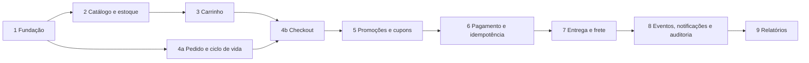

# 08 - Roadmap incremental

- **Objetivo:** organizar a construção do sistema em 9 etapas incrementais, cada uma mapeada para uma futura change do OpenSpec, indicando escopo, documentos a atualizar, patterns introduzidos e o critério de "sistema executável" ao final. Atende à exigência do enunciado de desenvolvimento incremental com o sistema sempre executável.
- **Etapas do roadmap relacionadas:** todas (este é o documento do roadmap).
- **Status:** proposto (ordem e divisão podem ser revistas, registrando o motivo, na change da etapa afetada). A etapa 1 foi arquivada; a etapa 4 foi dividida em duas changes, `pedido-ciclo-vida` (implementada, em revisão até o commit e o arquivamento) e `checkout` (a fazer, depois de `carrinho-compras`). A sequência de execução está na seção 7.

Documentos relacionados: [07-casos-de-uso.md](07-casos-de-uso.md), [09-testes.md](09-testes.md), [10-execucao.md](10-execucao.md), [05-regras-negocio.md](05-regras-negocio.md), [06-ciclo-vida-pedido.md](06-ciclo-vida-pedido.md).

## 1. Visão geral

O enunciado sugere a sequência: clientes, produtos, catálogo e carrinho; depois pedidos, estoque e checkout; depois promoções e cupons; por fim pagamentos, entrega, notificações e relatórios. O roadmap abaixo detalha essa sequência em 9 etapas; a etapa 4 foi dividida em duas changes (4a `pedido-ciclo-vida` e 4b `checkout`), porque o pedido não depende de nenhum outro módulo e o checkout depende do carrinho e do estoque. A ordem em que as changes são de fato executadas, com as dependências, está na seção 7. Regras que valem para todas:

- Cada etapa é uma change do OpenSpec (propose, apply, archive) e termina com o sistema **compilando, com testes passando e executável** (a aplicação sobe, migrações rodam e o fluxo implementado até ali pode ser exercitado via API/Swagger).
- Cada etapa atualiza os documentos de `docs/` listados, mudando o `Status` de `proposto` para `implementado` onde couber e registrando decisões que mudaram.
- Cada etapa inclui os testes dos cenários de [09-testes.md](09-testes.md) que se aplicam a ela.
- O histórico de commits em Git é evidência de desenvolvimento e participação da equipe (exigência do enunciado): preferir commits pequenos e frequentes por integrante.

## 2. Resumo

| # | Etapa | Change OpenSpec sugerida | Patterns que entram |
|---|---|---|---|
| 1 | Fundação | `fundacao-projeto` | nenhum obrigatório |
| 2 | Catálogo e estoque | `catalogo-estoque` | Composite (categorias e combos/kits) |
| 3 | Carrinho | `carrinho-compras` | Chain of Responsibility (pipeline de preço, passos iniciais) |
| 4a | Pedido e ciclo de vida | `pedido-ciclo-vida` (implementada) | State, Observer (lado publicador) |
| 4b | Checkout | `checkout` | Facade |
| 5 | Promoções e cupons | `promocoes-cupons` | Strategy, Composite (Specification), Factory Method, Chain of Responsibility (passos de promoção e cupom) |
| 6 | Pagamento e idempotência | `pagamento-idempotencia` | Adapter |
| 7 | Entrega e frete | `entrega-frete` | Strategy/Adapter (provedores de frete, ver nota) |
| 8 | Eventos, notificações e auditoria | `eventos-notificacoes-auditoria` | Observer |
| 9 | Relatórios | `relatorios-gerenciais` | nenhum obrigatório |

Os patterns e suas justificativas estão em [04-design-patterns.md](04-design-patterns.md). Nota sobre a etapa 7: o contrato de provedor de frete segue o mesmo princípio do gateway de pagamento (interface própria do domínio mais adaptadores). Se a equipe adotar Strategy para o cálculo de custo por modalidade, ele deve ser registrado em 04 apenas se houver o vínculo concreto com o enunciado (custo varia por região, peso, quantidade, valor ou modalidade).

## 3. Etapas

### Etapa 1 - Fundação
- **Change sugerida:** `fundacao-projeto`
- **Escopo:**
  - Projeto Java 21 + Spring Boot (Maven), estrutura de pacotes por módulo conforme [03-arquitetura.md](03-arquitetura.md).
  - Conexão com PostgreSQL e migrações Flyway (versão inicial do esquema).
  - Spring Security: autenticação, autorização por perfil (`CLIENTE`, `ADMIN`, `OPERADOR_COMERCIAL`, `ESTOQUE`, `PROMOCOES`), senha com hash (nunca texto puro).
  - Cadastro de cliente e de endereços (UC-01, UC-02) e gestão de usuários/perfis (UC-A11).
  - OpenAPI/Swagger, tratamento padronizado de erros, perfil de testes.
  - Usuários de demonstração com dados fictícios.
- **Documentos a atualizar:** `03-arquitetura.md`, `02-modelo-dominio.md` (cliente, endereço), `10-execucao.md` (preencher build, migrações, Swagger, usuários de demonstração), `README.md`.
- **Patterns que entram:** nenhum obrigatório (o foco é infraestrutura).
- **Critério de sistema executável:** `mvn` compila e roda os testes; a aplicação sobe contra o PostgreSQL local; as migrações rodam do zero; é possível criar conta, autenticar e chamar um endpoint protegido pelo Swagger; um cliente não acessa dados de outro.
- **Testes desta etapa:** ver [09-testes.md](09-testes.md) (segurança básica).

### Etapa 2 - Catálogo e estoque
- **Change sugerida:** `catalogo-estoque`
- **Escopo:**
  - Produtos com nome, descrição, preço, categoria e atributos opcionais; variações (tamanho, cor, capacidade); categorias hierárquicas; combos/kits.
  - Consulta de catálogo (UC-03) e gestão administrativa de catálogo, categorias e preços (UC-A01 a UC-A03).
  - Estoque por variação: disponível, reservado, baixado; ajuste de estoque (UC-A04).
  - Operação de reserva/liberação/baixa no serviço de estoque, com proteção de concorrência (atualização condicional atômica ou lock otimista, a decidir; ver [05-regras-negocio.md](05-regras-negocio.md)). A reserva só será acionada pelo checkout (etapa 4), mas o mecanismo e seu teste de concorrência nascem aqui.
- **Documentos a atualizar:** `02-modelo-dominio.md`, `03-arquitetura.md`, `04-design-patterns.md` (Composite), `05-regras-negocio.md` (estoque), `07-casos-de-uso.md`, `09-testes.md`.
- **Patterns que entram:** Composite (hierarquia de categorias e produto simples vs. combo/kit).
- **Critério de sistema executável:** administrador cadastra categorias, produtos, variações e estoque; cliente consulta o catálogo por categoria (incluindo subcategorias); a regra de reserva rejeita quantidade acima do disponível e resiste a requisições concorrentes pela última unidade.

### Etapa 3 - Carrinho
- **Change sugerida:** `carrinho-compras`
- **Escopo:**
  - Carrinho por cliente: incluir, alterar quantidade, remover (UC-04); suporte a combos/kits.
  - Recálculo a cada modificação, com resumo de preço (subtotal e total; descontos e frete ficam zerados até as etapas 5 e 7), exibido de forma que o cliente entenda a composição (UC-06).
  - O carrinho apenas consulta disponibilidade, sem reservar.
  - Esqueleto do pipeline de formação de preço com o primeiro passo (subtotal), pronto para receber novos passos sem alterar os existentes.
- **Documentos a atualizar:** `02-modelo-dominio.md`, `03-arquitetura.md`, `04-design-patterns.md` (Chain of Responsibility), `05-regras-negocio.md` (formação do preço), `07-casos-de-uso.md`, `09-testes.md`.
- **Patterns que entram:** Chain of Responsibility (pipeline de preço; os passos de promoção, cupom e frete entram nas etapas seguintes).
- **Critério de sistema executável:** um cliente autenticado monta o carrinho pela API e vê os valores recalculados a cada alteração; itens inexistentes ou quantidades inválidas são rejeitados.

### Etapa 4 - Pedido e checkout (duas changes)

A etapa foi dividida porque o pedido (snapshot, ciclo de vida, cancelamento, histórico e consultas) não depende de nenhum outro módulo, e o checkout depende do carrinho e do estoque, que ainda não existem. O pedido é entregue primeiro (4a), e deixa pronto o ponto de integração (`CriarPedido` e `ConfirmarReservaDoPedido`) que o checkout (4b) vai usar. Responsável pelas duas: Arthur ([11-divisao-equipe.md](11-divisao-equipe.md)).

#### 4a. Pedido e ciclo de vida
- **Change:** `pedido-ciclo-vida` (Arthur). **Situação:** implementada; em revisão até o commit e o arquivamento.
- **Escopo (implementado):**
  - Módulo `pedido` com o agregado `Pedido` e o snapshot comercial imutável (itens, preços unitários, descontos, frete, totais e endereço de entrega copiado), conferido na criação.
  - Ciclo de vida com 8 estados e 11 transições válidas, pelo pattern State; transição inválida responde 409 com `situacaoAtual` e `operacao` (ver [06-ciclo-vida-pedido.md](06-ciclo-vida-pedido.md)).
  - Histórico de cada transição, com a entrada inicial de criação, responsável e motivo (obrigatório no cancelamento); lock otimista contra transições simultâneas.
  - Serviços `CriarPedido` e `ConfirmarReservaDoPedido` (usados pelo checkout), `TransicionarPedido`, `ConsultarPedidos` e `CancelarPedidoDoCliente`.
  - API do cliente (listar, detalhar e cancelar os próprios pedidos) e administrativa (listar com filtro, detalhar, preparar, enviar, entregar e cancelar), com regra de cancelamento por perfil (UC-09, UC-10, UC-A07 a UC-A09).
  - Eventos de domínio de cada transição (`PedidoCriado`, `PedidoPago`, `PedidoPagamentoRecusado`, `PedidoEmPreparacao`, `PedidoEnviado`, `PedidoEntregue`, `PedidoCancelado`): lado publicador do Observer.
  - **Temporário:** endpoint administrativo de pagamento simulado, que a etapa 6 remove.
  - Pedido de demonstração do `cliente@demo.local` no perfil `dev`.
- **Fora do escopo (próximas changes):** checkout, reserva, baixa e reposição de estoque, estorno e expiração automática do pagamento; os efeitos sobre outros módulos serão ouvintes dos eventos.
- **Documentos atualizados:** `02-modelo-dominio.md`, `03-arquitetura.md`, `04-design-patterns.md` (State e publicador do Observer), `05-regras-negocio.md` (RN-23, RN-26, RN-28), `06-ciclo-vida-pedido.md`, `07-casos-de-uso.md`, `09-testes.md`, `10-execucao.md`, `12-board.md`.
- **Patterns que entram:** State (ciclo de vida do pedido) e Observer (publicador, com os ouvintes nas etapas seguintes).
- **Critério de sistema executável:** o pedido de demonstração em `AGUARDANDO_PAGAMENTO` vai a `PAGO` pela simulação, avança até `ENVIADO` com `estoque@demo.local`, o cancelamento nesse estado responde 409 e o histórico é consultado pelo cliente; transição inválida gera erro e o cancelamento respeita o perfil.

#### 4b. Checkout
- **Change:** `checkout` (Arthur), depois de `carrinho-compras` (e de `catalogo-estoque`, para a reserva).
- **Escopo:**
  - Checkout que transforma o carrinho válido em pedido (UC-07), revalidando preços, estoque, endereço e dados correntes; reserva de estoque tudo-ou-nada ao criar o pedido. Chama `CriarPedido` e `ConfirmarReservaDoPedido` na mesma transação, depois de reservar o estoque (o pedido nasce em `AGUARDANDO_PAGAMENTO`).
  - Reação do estoque aos eventos do pedido: liberação da reserva no cancelamento e na recusa (ouvintes de `PedidoCancelado` e `PedidoPagamentoRecusado`, conforme o campo `de`). O estorno simulado entra na etapa 6.
- **Documentos a atualizar:** `03-arquitetura.md`, `04-design-patterns.md` (Facade), `05-regras-negocio.md` (RN-18 a RN-22), `07-casos-de-uso.md` (diagrama de checkout), `09-testes.md`, `10-execucao.md`.
- **Patterns que entram:** Facade (orquestração do checkout).
- **Critério de sistema executável:** da inclusão no carrinho até a criação de um pedido em `AGUARDANDO_PAGAMENTO` com estoque reservado; estoque insuficiente bloqueia o checkout; cancelamento libera a reserva.

### Etapa 5 - Promoções e cupons
- **Change sugerida:** `promocoes-cupons`
- **Escopo:**
  - Mecanismo de promoções configurável (nome, período, prioridade, acumulável ou exclusiva, parâmetros) e gestão administrativa (UC-A05).
  - Pelo menos 4 tipos de natureza distinta, por exemplo: leve 3 pague 2 (quantidade), percentual por categoria (catálogo), valor fixo acima de um mínimo (valor do carrinho), 10% na primeira compra (perfil do cliente) e frete grátis acima de um valor.
  - Condições de elegibilidade combináveis (E/OU/NÃO): primeira compra, valor mínimo, categoria, produto, região, período, perfil do cliente.
  - Política de conflito entre promoções (D4) como Strategy trocável.
  - Cupons (UC-05, UC-A06): código, validade, limite de usos, condições, tipos percentual e valor fixo; rejeição de inexistente, expirado, esgotado e incompatível.
  - Passos de promoção e cupom no pipeline de preço, com discriminação de cada desconto no resumo; checkout passa a usar o preço recalculado e a registrar descontos no pedido.
  - Evidência de extensibilidade: incluir uma quinta promoção deve exigir apenas uma nova classe de tipo e seu registro, sem mexer nas existentes.
- **Documentos a atualizar:** `02-modelo-dominio.md`, `03-arquitetura.md`, `04-design-patterns.md` (Strategy, Composite/Specification, Factory Method), `05-regras-negocio.md`, `07-casos-de-uso.md` (diagrama de promoções), `09-testes.md`.
- **Patterns que entram:** Strategy (tipos de promoção e política de conflito), Composite/Specification (condições), Factory Method/registry (criar promoção a partir da configuração), Chain of Responsibility (novos passos do pipeline).
- **Critério de sistema executável:** administrador cria promoções e cupons; o carrinho e o checkout mostram subtotal, cada desconto, frete e total; duas ou mais promoções válidas são resolvidas pela política definida; cupom inválido é rejeitado com motivo.

### Etapa 6 - Pagamento e idempotência
- **Change sugerida:** `pagamento-idempotencia`
- **Escopo:**
  - Contrato de gateway de pagamento do domínio, com adaptadores simulados distintos (cartão com dados fictícios, PIX e boleto simulados) que falam interfaces diferentes entre si (UC-08).
  - Endpoint de confirmação de pagamento (UC-S01): identificador da transação registrado com unicidade; confirmação repetida é no-op, sem segunda baixa de estoque nem segunda transição.
  - Aprovado: `PAGO` e conversão da reserva em baixa. Recusado: `PAGAMENTO_RECUSADO` e liberação da reserva.
  - Cancelamento de pedido pago dispara estorno simulado.
  - Troca de fornecedor sem alterar as regras centrais (demonstrada trocando o adaptador).
  - Nesta etapa a reação ao pagamento pode ser chamada direta entre serviços; a etapa 8 a converte em eventos.
  - **Remover a simulação de pagamento** da change `pedido-ciclo-vida` (endpoint administrativo temporário `POST /api/admin/pedidos/{id}/pagamento-simulado`): o gateway passa a aprovar ou recusar o pedido pelas operações `confirmarPagamento` e `recusarPagamento` já existentes no pedido.
- **Documentos a atualizar:** `03-arquitetura.md`, `04-design-patterns.md` (Adapter), `05-regras-negocio.md` (idempotência, estorno), `06-ciclo-vida-pedido.md`, `07-casos-de-uso.md` (diagrama de pagamento), `09-testes.md`.
- **Patterns que entram:** Adapter (gateways de pagamento).
- **Critério de sistema executável:** compra completa até `PAGO` com baixa de estoque; pagamento recusado leva a `PAGAMENTO_RECUSADO` com a reserva liberada; a mesma confirmação enviada duas vezes produz um único efeito.

### Etapa 7 - Entrega e frete
- **Change sugerida:** `entrega-frete`
- **Escopo:**
  - Modalidades de entrega simuladas (por exemplo, econômica e expressa) com custo por região, peso, quantidade, valor ou modalidade; contrato de provedor de frete para incorporar novas transportadoras (UC-06).
  - Seleção de endereço e modalidade no checkout; passo de frete no pipeline de preço.
  - Frete grátis integrado ao mecanismo de promoções (promoção sobre o frete), conforme [05-regras-negocio.md](05-regras-negocio.md).
  - Andamento da entrega: `EM_PREPARACAO`, `ENVIADO`, `ENTREGUE` e sua consulta pelo cliente (UC-09, UC-A08).
- **Documentos a atualizar:** `02-modelo-dominio.md`, `03-arquitetura.md`, `04-design-patterns.md` (se houver pattern adicional vinculado a requisito), `05-regras-negocio.md`, `06-ciclo-vida-pedido.md`, `09-testes.md`.
- **Patterns que entram:** ver nota da seção 2 (contrato de provedor com adaptadores; Strategy para custo por modalidade apenas se justificado).
- **Critério de sistema executável:** o cliente escolhe a modalidade, vê o custo composto no total, e o pedido pago pode ser preparado, enviado e entregue; frete grátis zera o frete quando a promoção é elegível; incluir um novo provedor não altera o checkout.

### Etapa 8 - Eventos, notificações e auditoria
- **Change sugerida:** `eventos-notificacoes-auditoria`
- **Escopo:**
  - Eventos de domínio (`PedidoCriado`, `PagamentoConfirmado`, `PagamentoRecusado`, `PedidoEnviado`, `PedidoCancelado`) e publicação pelos serviços de pedido e pagamento.
  - Listeners independentes: estoque (baixa/liberação), notificação e auditoria, de modo que nenhuma classe conheça todos os interessados.
  - Notificações por canal simulado (UC-11), com contrato de canal para futuros canais; falha de notificação não afeta o pedido.
  - Auditoria de operações administrativas (preço, campanhas, cancelamentos, etc.) com usuário e momento, e consulta (UC-A12).
  - Refatoração da reação direta da etapa 6 para os listeners, mantendo os testes de idempotência verdes.
- **Documentos a atualizar:** `03-arquitetura.md`, `04-design-patterns.md` (Observer), `05-regras-negocio.md`, `07-casos-de-uso.md` (diagrama de pagamento com eventos), `09-testes.md`.
- **Patterns que entram:** Observer (eventos de domínio).
- **Critério de sistema executável:** confirmar um pagamento dispara notificação e baixa de estoque por listeners separados; adicionar um novo canal ou listener não altera o módulo de pedidos; operações administrativas aparecem na trilha de auditoria com responsável e horário.

### Etapa 9 - Relatórios
- **Change sugerida:** `relatorios-gerenciais`
- **Escopo:**
  - Relatórios (UC-A10): valor total de vendas, quantidade de pedidos, ticket médio, produtos mais vendidos, campanhas mais utilizadas, total concedido em descontos, quantidade de cancelamentos e desconto concedido por campanha em um período.
  - Consultas de leitura sobre os snapshots dos pedidos, sem alterar o modelo transacional.
  - Fechamento da entrega: revisão da documentação, ajuste final de `10-execucao.md`, roteiro e dados da demonstração.
- **Documentos a atualizar:** `02-modelo-dominio.md`, `07-casos-de-uso.md`, `09-testes.md`, `10-execucao.md`, `README.md`; revisão geral de todos os `Status`.
- **Patterns que entram:** nenhum obrigatório.
- **Critério de sistema executável:** relatórios retornam valores coerentes com os pedidos da demonstração (incluindo o desconto por campanha); o sistema completo roda do zero seguindo [10-execucao.md](10-execucao.md).

## 4. Cobertura dos requisitos obrigatórios por etapa

Cada seção obrigatória do enunciado é atendida por pelo menos uma etapa. A conferência detalhada contra `01-requisitos.md` deve ser refeita se aquele documento mudar.

| Seção do enunciado | Etapa(s) |
|---|---|
| Usuários, segurança (autenticação e autorização) | 1 |
| Clientes e endereços | 1 |
| Catálogo de produtos, variações, categorias | 2 |
| Estoque (reserva, baixa, última unidade) | 2, 4, 6 |
| Carrinho | 3 |
| Promoções, condições, conflitos, administração | 5 |
| Cupons | 5 |
| Formação do preço | 3, 5, 7 |
| Checkout | 4b |
| Pedidos e ciclo de vida | 4a |
| Pagamentos | 6 |
| Idempotência | 6 |
| Entrega e frete, frete grátis | 7 (frete grátis também 5) |
| Cancelamento | 4a, 4b (liberação da reserva), 6 (estorno) |
| Notificações | 8 |
| Eventos do sistema | 8 |
| Auditoria | 8 |
| Relatórios | 9 |
| API REST e OpenAPI/Swagger | 1 e todas |
| Testes automatizados | todas (ver [09-testes.md](09-testes.md)) |
| Documentação e diagramas | todas (atualização contínua de `docs/`) |
| Devolução (opcional) | fora do roadmap (extensão, UC-12) |
| Interface gráfica (opcional) | fora do roadmap |

## 5. Checklist da demonstração final

Exigências do enunciado para a apresentação prática: pelo menos uma compra completa, um cenário com múltiplas promoções e um cenário de erro. Os integrantes devem também explicar a arquitetura e os patterns, e estar prontos para a alteração de requisito (ver seção 6).

Preparação:
- [ ] Sistema sobe do zero com as instruções de [10-execucao.md](10-execucao.md) (banco limpo, migrações, usuários de demonstração).
- [ ] Dados fictícios carregados: categorias e subcategorias, produtos com variações, estoque, ao menos um combo/kit, promoções e cupons, usuários por perfil.
- [ ] Nenhum dado real de cartão ou pessoal nos dados de demonstração.

Compra completa (cliente):
- [ ] Autenticar como cliente.
- [ ] Consultar o catálogo e adicionar produtos ao carrinho; alterar quantidade e remover um item, mostrando o recálculo.
- [ ] Informar endereço e escolher a modalidade de entrega.
- [ ] Mostrar a composição do preço: subtotal, descontos aplicados, frete e total.
- [ ] Realizar o checkout e mostrar o pedido em `AGUARDANDO_PAGAMENTO` com estoque reservado.
- [ ] Confirmar o pagamento (simulado) e mostrar pedido `PAGO`, baixa de estoque e notificação enviada.
- [ ] Acompanhar o pedido até `ENTREGUE` (ações administrativas de preparação, envio e entrega) e o histórico de transições.

Múltiplas promoções:
- [ ] Carrinho em que duas ou mais promoções são elegíveis ao mesmo tempo (por exemplo, percentual por categoria, leve 3 pague 2, frete grátis).
- [ ] Mostrar a política de conflito em ação: caso com acumuláveis, caso com promoção exclusiva e caso de empate resolvido por prioridade (ver D4 em [05-regras-negocio.md](05-regras-negocio.md)).
- [ ] Mostrar o desconto de cada promoção discriminado no resumo e registrado no pedido.
- [ ] Mostrar cupom válido combinado com promoções.

Cenário de erro (apresentar ao menos um, de preferência dois ou três):
- [ ] Cupom inválido (inexistente, expirado, esgotado ou incompatível), com mensagem clara.
- [ ] Estoque insuficiente no checkout, sem reserva parcial.
- [ ] Pagamento recusado: pedido em `PAGAMENTO_RECUSADO` e reserva liberada.
- [ ] Confirmação de pagamento enviada duas vezes, com efeito único (idempotência).
- [ ] Transição inválida de pedido rejeitada (por exemplo, enviar pedido não pago).

Administração e demais requisitos:
- [ ] Criar/alterar uma promoção pelo perfil `PROMOCOES` e mostrar o registro na auditoria.
- [ ] Mostrar que um perfil sem permissão recebe acesso negado.
- [ ] Mostrar o relatório de desconto por campanha.
- [ ] Mostrar o Swagger e executar a suíte de testes automatizados.
- [ ] Mostrar o diagrama de classes, o ciclo de vida do pedido e os diagramas de sequência da documentação.
- [ ] Mostrar o histórico de commits com a participação de todos os integrantes.

## 6. Preparação para a alteração de requisito

Na defesa o professor pode pedir uma pequena alteração (nova promoção, forma de pagamento, transportadora, regra comercial ou canal de comunicação). A equipe deve saber responder quais componentes seriam criados ou modificados. Roteiro proposto (a ser refinado conforme as classes reais):

| Alteração pedida | Componentes a criar | Componentes a modificar |
|---|---|---|
| Nova promoção | Nova classe de tipo de promoção e, se preciso, nova condição | Registro/fábrica de promoções (uma linha); nenhuma classe de promoção existente |
| Nova forma de pagamento | Novo adaptador de gateway | Registro dos gateways; nenhuma regra central |
| Nova transportadora | Novo provedor de frete | Registro dos provedores |
| Novo canal de notificação | Novo canal e listener/configuração | Nenhum código no módulo de pedidos |
| Nova política de conflito | Nova implementação da política | Configuração que escolhe a política |

## 7. Ordem sequencial de execução

Ordem em que as changes são executadas (uma depois da outra, cada uma com o sistema executável ao final). A etapa 4 aparece em duas changes; as demais seguem a numeração das etapas, com `pedido-ciclo-vida` na frente por não depender de nenhum outro módulo. Os responsáveis são os de [12-board.md](12-board.md) e [11-divisao-equipe.md](11-divisao-equipe.md).

| Ordem | Change | Responsável | Depende de | Situação |
|:-:|---|---|---|---|
| 1 | `pedido-ciclo-vida` | Arthur | `fundacao-projeto` (arquivada) | implementada; em revisão até o commit e o arquivamento |
| 2 | `catalogo-estoque` | Lucas | `fundacao-projeto` | a fazer |
| 3 | `carrinho-compras` | Lucas | `catalogo-estoque` | a fazer |
| 4 | `checkout` | Arthur | `pedido-ciclo-vida`, `catalogo-estoque` (reserva) e `carrinho-compras` | a fazer |
| 5 | `promocoes-cupons` | Amanda | `carrinho-compras` (pipeline de preço) e `checkout` (descontos registrados no pedido) | a fazer |
| 6 | `pagamento-idempotencia` | Mateus | `checkout` e `pedido-ciclo-vida`; **remove a simulação de pagamento** (endpoint temporário `pagamento-simulado`) | a fazer |
| 7 | `entrega-frete` | Mateus | `checkout` e `promocoes-cupons` (frete grátis como promoção) | a fazer |
| 8 | `eventos-notificacoes-auditoria` | Mateus (eventos e notificações) e Amanda (auditoria) | `pagamento-idempotencia` e os eventos do pedido (`pedido-ciclo-vida`) | a fazer |
| 9 | `relatorios-gerenciais` | Lucas | `checkout` e `promocoes-cupons` (snapshots dos pedidos e descontos) | a fazer |

Observações:
- As changes de pessoas diferentes que só dependem da fundação (`catalogo-estoque`, `promocoes-cupons` em domínio puro, `pagamento-idempotencia` e `entrega-frete` em adaptadores) podem andar em paralelo, conforme as ondas de [11-divisao-equipe.md](11-divisao-equipe.md); a ordem acima é a sequência de integração.
- Cada change integra com as anteriores por contratos e eventos: por exemplo, o `checkout` usa os serviços do pedido, e o estoque, o pagamento e a notificação reagem aos eventos do pedido sem alterá-lo.
