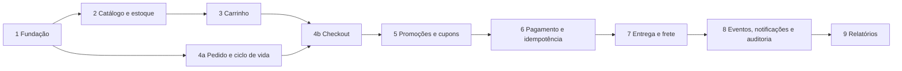

# 08 - Roadmap incremental

- **Objetivo:** organizar a construção do sistema em 9 etapas incrementais, cada uma mapeada para uma futura change do OpenSpec, indicando escopo, documentos a atualizar, patterns introduzidos e o critério de "sistema executável" ao final. Atende à exigência do enunciado de desenvolvimento incremental com o sistema sempre executável.
- **Etapas do roadmap relacionadas:** todas (este é o documento do roadmap).
- **Status:** implementado (E1–E9): todas as etapas foram concluídas e arquivadas (E1 e E4a em 2026-10-14, E2 em 2026-10-19 e E3 a E9 em 2026-10-23), com `./mvnw -o clean verify` em BUILD SUCCESS e 649 testes. A etapa 2 (`catalogo-estoque`) foi feita por Arthur embora a atribuição original seja do Lucas; a etapa 4 foi dividida em duas changes, `pedido-ciclo-vida` e `checkout`. A sequência de execução está na seção 7.

Documentos relacionados: [07-casos-de-uso.md](07-casos-de-uso.md), [09-testes.md](09-testes.md), [10-execucao.md](10-execucao.md), [05-regras-negocio.md](05-regras-negocio.md), [06-ciclo-vida-pedido.md](06-ciclo-vida-pedido.md).

## 1. Visão geral

O enunciado sugere a sequência: clientes, produtos, catálogo e carrinho; depois pedidos, estoque e checkout; depois promoções e cupons; por fim pagamentos, entrega, notificações e relatórios. O roadmap abaixo detalha essa sequência em 9 etapas; a etapa 4 foi dividida em duas changes (4a `pedido-ciclo-vida` e 4b `checkout`), porque o pedido não depende de nenhum outro módulo e o checkout depende do carrinho e do estoque. A ordem em que as changes são de fato executadas, com as dependências, está na seção 7. Regras que valem para todas:

- Cada etapa é uma change do OpenSpec (propose, apply, archive) e termina com o sistema **compilando, com testes passando e executável** (a aplicação sobe, migrações rodam e o fluxo implementado até ali pode ser exercitado via API/Swagger).
- Cada etapa atualiza os documentos de `docs/` listados, mudando o `Status` de `proposto` para `implementado` onde couber e registrando decisões que mudaram.
- Cada etapa inclui os testes dos cenários de [09-testes.md](09-testes.md) que se aplicam a ela.
- O histórico de commits em Git é evidência de desenvolvimento e participação da equipe (exigência do enunciado): preferir commits pequenos e frequentes por integrante.

## 2. Resumo

| # | Etapa | Change OpenSpec sugerida | Patterns que entram |
|---|---|---|---|
| 1 | Fundação | `fundacao-projeto` | nenhum obrigatório |
| 2 | Catálogo e estoque | `catalogo-estoque` (arquivada em 2026-10-19) | Composite (combos), Observer (ouvintes do estoque) |
| 3 | Carrinho | `carrinho-compras` | Chain of Responsibility (pipeline de preço, passos iniciais) |
| 4a | Pedido e ciclo de vida | `pedido-ciclo-vida` (implementada) | State, Observer (lado publicador) |
| 4b | Checkout | `checkout` | Facade |
| 5 | Promoções e cupons | `promocoes-cupons` | Strategy, Composite (Specification), Factory Method, Chain of Responsibility (passos de promoção e cupom) |
| 6 | Pagamento e idempotência | `pagamento-idempotencia` | Adapter |
| 7 | Entrega e frete | `entrega-frete` | Strategy/Adapter (provedores de frete, ver nota) |
| 8 | Eventos, notificações e auditoria | `eventos-notificacoes-auditoria` | Observer |
| 9 | Relatórios | `relatorios-gerenciais` | nenhum obrigatório (nenhum aplicado) |

Os patterns e suas justificativas estão em [04-design-patterns.md](04-design-patterns.md). Nota sobre a etapa 7: o contrato de provedor de frete segue o mesmo princípio do gateway de pagamento (interface própria do domínio mais adaptadores). Se a equipe adotar Strategy para o cálculo de custo por modalidade, ele deve ser registrado em 04 apenas se houver o vínculo concreto com o enunciado (custo varia por região, peso, quantidade, valor ou modalidade).

## 3. Etapas

### Etapa 1 - Fundação
- **Change sugerida:** `fundacao-projeto`
- **Escopo:**
  - Projeto Java 21 + Spring Boot (Maven), estrutura de pacotes por módulo conforme [03-arquitetura.md](03-arquitetura.md).
  - Conexão com PostgreSQL e migrações Flyway (versão inicial do esquema).
  - Spring Security: autenticação, autorização por perfil (`CLIENTE`, `ADMIN`, `OPERADOR_COMERCIAL`, `ESTOQUE`, `PROMOCOES`), senha com hash (nunca texto puro).
  - Cadastro de cliente e de endereços (UC-01, UC-02) e gestão de usuários/perfis (UC-A11).
  - OpenAPI/Swagger, tratamento padronizado de erros, perfil de testes.
  - Usuários de demonstração com dados fictícios.
- **Documentos a atualizar:** `03-arquitetura.md`, `02-modelo-dominio.md` (cliente, endereço), `10-execucao.md` (preencher build, migrações, Swagger, usuários de demonstração), `README.md`.
- **Patterns que entram:** nenhum obrigatório (o foco é infraestrutura).
- **Critério de sistema executável:** `mvn` compila e roda os testes; a aplicação sobe contra o PostgreSQL local; as migrações rodam do zero; é possível criar conta, autenticar e chamar um endpoint protegido pelo Swagger; um cliente não acessa dados de outro.
- **Testes desta etapa:** ver [09-testes.md](09-testes.md) (segurança básica).

### Etapa 2 - Catálogo e estoque
- **Change sugerida:** `catalogo-estoque`
- **Escopo:**
  - Produtos com nome, descrição, preço, categoria e atributos opcionais; variações (tamanho, cor, capacidade); categorias hierárquicas; combos/kits.
  - Consulta de catálogo (UC-03) e gestão administrativa de catálogo, categorias e preços (UC-A01 a UC-A03).
  - Estoque por variação: disponível, reservado, baixado; ajuste de estoque (UC-A04).
  - Operação de reserva/liberação/baixa no serviço de estoque, com proteção de concorrência (atualização condicional atômica ou lock otimista, a decidir; ver [05-regras-negocio.md](05-regras-negocio.md)). A reserva só será acionada pelo checkout (etapa 4), mas o mecanismo e seu teste de concorrência nascem aqui.
- **Documentos a atualizar:** `02-modelo-dominio.md`, `03-arquitetura.md`, `04-design-patterns.md` (Composite e Observer), `05-regras-negocio.md` (estoque), `07-casos-de-uso.md`, `09-testes.md`, `10-execucao.md`.
- **Patterns que entram:** Composite (combos: item vendável, com a variação como folha e o combo como composto) e Observer (ouvintes do estoque: `OuvinteDePedidosDoEstoque` e `OuvinteDeCatalogoDoEstoque`). As categorias são uma árvore simples e **não** usam pattern.
- **Situação:** implementada pela change `catalogo-estoque` (responsável original: Lucas; implementada por Arthur), verificada e arquivada em 2026-10-19. A reserva só é acionada pelo checkout (etapa 4b); até lá, só o pedido de demonstração a usa.
- **Critério de sistema executável:** administrador cadastra categorias, produtos, variações e estoque; cliente consulta o catálogo por categoria (incluindo subcategorias); a regra de reserva rejeita quantidade acima do disponível e resiste a requisições concorrentes pela última unidade.

### Etapa 3 - Carrinho
- **Change:** `carrinho-compras`. **Situação:** implementação concluída e arquivada em 2026-10-23. Atribuição original: Lucas. Evidência: `./mvnw -o verify` em 2026-10-21, 480 testes sem falha/erro/skip; `openspec validate carrinho-compras --strict` aprovado.
- **Escopo:**
  - Carrinho por cliente: incluir, alterar quantidade, remover (UC-04); suporte a combos/kits.
  - Recálculo a cada modificação, com resumo de preço (subtotal e total; descontos e frete ficam zerados até as etapas 5 e 7), exibido de forma que o cliente entenda a composição (UC-06).
  - O carrinho apenas consulta disponibilidade, sem reservar.
  - Esqueleto do pipeline de formação de preço com o primeiro passo (subtotal), pronto para receber novos passos sem alterar os existentes.
- **Documentos a atualizar:** `02-modelo-dominio.md`, `03-arquitetura.md`, `04-design-patterns.md` (Chain of Responsibility), `05-regras-negocio.md` (formação do preço), `07-casos-de-uso.md`, `09-testes.md`.
- **Patterns que entram:** Chain of Responsibility (pipeline de preço; os passos de promoção, cupom e frete entram nas etapas seguintes).
- **Critério de sistema executável:** um cliente autenticado monta o carrinho pela API e vê os valores recalculados a cada alteração; itens inexistentes ou quantidades inválidas são rejeitados.

### Etapa 4 - Pedido e checkout (duas changes)

A etapa foi dividida porque o pedido (snapshot, ciclo de vida, cancelamento, histórico e consultas) não depende de nenhum outro módulo, e o checkout depende do carrinho e do estoque, que ainda não existem. O pedido é entregue primeiro (4a), e deixa pronto o ponto de integração (`CriarPedido` e `ConfirmarReservaDoPedido`) que o checkout (4b) vai usar. Responsável pelas duas: Arthur ([11-divisao-equipe.md](11-divisao-equipe.md)).

#### 4a. Pedido e ciclo de vida
- **Change:** `pedido-ciclo-vida` (Arthur). **Situação:** implementada por Arthur, conforme planejado, e arquivada em 2026-10-14.
- **Escopo (implementado):**
  - Módulo `pedido` com o agregado `Pedido` e o snapshot comercial imutável (itens, preços unitários, descontos, frete, totais e endereço de entrega copiado), conferido na criação.
  - Ciclo de vida com 8 estados e 11 transições válidas, pelo pattern State; transição inválida responde 409 com `situacaoAtual` e `operacao` (ver [06-ciclo-vida-pedido.md](06-ciclo-vida-pedido.md)).
  - Histórico de cada transição, com a entrada inicial de criação, responsável e motivo (obrigatório no cancelamento); lock otimista contra transições simultâneas.
  - Serviços `CriarPedido` e `ConfirmarReservaDoPedido` (usados pelo checkout), `TransicionarPedido`, `ConsultarPedidos` e `CancelarPedidoDoCliente`.
  - API do cliente (listar, detalhar e cancelar os próprios pedidos) e administrativa (listar com filtro, detalhar, preparar, enviar, entregar e cancelar), com regra de cancelamento por perfil (UC-09, UC-10, UC-A07 a UC-A09).
  - Eventos de domínio de cada transição (`PedidoCriado`, `PedidoPago`, `PedidoPagamentoRecusado`, `PedidoEmPreparacao`, `PedidoEnviado`, `PedidoEntregue`, `PedidoCancelado`): lado publicador do Observer.
  - **Histórico E4:** houve endpoint administrativo temporário de pagamento; removido na E6 em favor de cobrança e confirmação identificada.
  - Pedido de demonstração do `cliente@demo.local` no perfil `dev`.
- **Fora do escopo (próximas changes):** checkout, reserva, baixa e reposição de estoque, estorno e expiração automática do pagamento; os efeitos sobre outros módulos serão ouvintes dos eventos. (Os efeitos de estoque entraram depois, na etapa 2, como ouvintes, sem alterar o módulo `pedido`.)
- **Documentos atualizados:** `02-modelo-dominio.md`, `03-arquitetura.md`, `04-design-patterns.md` (State e publicador do Observer), `05-regras-negocio.md` (RN-23, RN-26, RN-28), `06-ciclo-vida-pedido.md`, `07-casos-de-uso.md`, `09-testes.md`, `10-execucao.md`, `12-board.md`.
- **Patterns que entram:** State (ciclo de vida do pedido) e Observer (publicador, com os ouvintes nas etapas seguintes).
- **Critério de sistema executável:** o pedido de demonstração em `AGUARDANDO_PAGAMENTO` vai a `PAGO` pela simulação, avança até `ENVIADO` com `estoque@demo.local`, o cancelamento nesse estado responde 409 e o histórico é consultado pelo cliente; transição inválida gera erro e o cancelamento respeita o perfil.

#### 4b. Checkout
- **Change:** `checkout` (Arthur), dependente de `carrinho-compras` e `catalogo-estoque`. **Situação:** implementação concluída em 2026-10-22 e arquivada em 2026-10-23. Evidência: `./mvnw -o verify`, 507 testes sem falhas, erros ou ignorados, JAR gerado; `openspec validate checkout --strict` aprovado.
- **Escopo:**
  - Checkout que transforma o carrinho válido em pedido (UC-07), revalidando preços, estoque, endereço e dados correntes; reserva de estoque tudo-ou-nada ao criar o pedido. Na mesma transação chama `CriarPedido` para obter o id em `CRIADO`, reserva por esse id, chama `ConfirmarReservaDoPedido` e esvazia o carrinho com controle de versão. A compra só fica visível como concluída em `AGUARDANDO_PAGAMENTO`; falhas desfazem toda a tentativa.
  - Reação do estoque aos eventos do pedido: liberação da reserva no cancelamento e na recusa (ouvintes de `PedidoCancelado` e `PedidoPagamentoRecusado`, conforme o campo `de`). O estorno simulado entra na etapa 6.
- **Documentos a atualizar:** `03-arquitetura.md`, `04-design-patterns.md` (Facade), `05-regras-negocio.md` (RN-18 a RN-22), `07-casos-de-uso.md` (diagrama de checkout), `09-testes.md`, `10-execucao.md`.
- **Patterns que entram:** Facade (orquestração do checkout).
- **Critério de sistema executável:** da inclusão no carrinho até a criação de um pedido em `AGUARDANDO_PAGAMENTO` com estoque reservado; estoque insuficiente bloqueia o checkout; cancelamento libera a reserva.

### Etapa 5 - Promoções e cupons
- **Change:** `promocoes-cupons` (atribuição original: Amanda). **Situação:** implementação concluída em 2026-10-22 e arquivada em 2026-10-23; `./mvnw -o verify` aprovado com 540 testes, sem falhas/erros/ignorados, JAR gerado e `openspec validate promocoes-cupons --strict` aprovado.
- **Escopo:**
  - Mecanismo de promoções configurável (nome, período, prioridade, acumulável ou exclusiva, parâmetros) e gestão administrativa (UC-A05).
  - Pelo menos 4 tipos de natureza distinta, por exemplo: leve 3 pague 2 (quantidade), percentual por categoria (catálogo), valor fixo acima de um mínimo (valor do carrinho), 10% na primeira compra (perfil do cliente) e frete grátis acima de um valor.
  - Condições de elegibilidade combináveis (E/OU/NÃO): primeira compra, valor mínimo, categoria, produto, região, período, perfil do cliente.
  - Política de conflito entre promoções (D4) como Strategy trocável.
  - Cupons (UC-05, UC-A06): código, validade, limite de usos, condições, tipos percentual e valor fixo; rejeição de inexistente, expirado, esgotado e incompatível.
  - Passos de promoção e cupom no pipeline de preço, com discriminação de cada desconto no resumo; checkout passa a usar o preço recalculado e a registrar descontos no pedido.
  - Evidência de extensibilidade: incluir uma quinta promoção deve exigir apenas uma nova classe de tipo e seu registro, sem mexer nas existentes.
- **Documentos a atualizar:** `02-modelo-dominio.md`, `03-arquitetura.md`, `04-design-patterns.md` (Strategy, Composite/Specification, Factory Method), `05-regras-negocio.md`, `07-casos-de-uso.md` (diagrama de promoções), `09-testes.md`.
- **Patterns que entram:** Strategy (tipos de promoção e política de conflito), Composite/Specification (condições), Factory Method/registry (criar promoção a partir da configuração), Chain of Responsibility (novos passos do pipeline).
- **Entrega E5:** cinco estratégias de promoção, condições E/OU/NÃO, política D4 trocável, benefícios de cupom, configuração persistente, seleção no carrinho, confirmação com origem/identidade, uso concorrente/devolução idempotente e demonstração dev. Na entrega original E5 o frete bruto era zero; E7 agora integra cotação simulada escolhida pelo cliente.
- **Critério de sistema executável:** administrador cria promoções e cupons; o carrinho e o checkout mostram subtotal, cada desconto, frete e total; duas ou mais promoções válidas são resolvidas pela política definida; cupom inválido é rejeitado com motivo.

### Etapa 6 - Pagamento e idempotência
- **Change sugerida:** `pagamento-idempotencia`
- **Escopo:**
  - Contrato de gateway de pagamento do domínio, com adaptadores simulados distintos (cartão com dados fictícios, PIX e boleto simulados) que falam interfaces diferentes entre si (UC-08).
  - Endpoint de confirmação de pagamento (UC-S01): identificador da transação registrado com unicidade; confirmação repetida é no-op, sem segunda baixa de estoque nem segunda transição.
  - Aprovado: `PAGO` e conversão da reserva em baixa. Recusado: `PAGAMENTO_RECUSADO` e liberação da reserva.
  - Cancelamento de pedido pago dispara estorno simulado.
  - Troca de fornecedor sem alterar as regras centrais (demonstrada trocando o adaptador).
  - E6 preserva os eventos e ouvintes já implementados para estoque/cupons e adiciona ouvinte de estorno; notificações permanecem na E8.
  - **Atalho temporário removido na E6:** o gateway aprova/recusa pelas transições existentes, com cobrança identificada e confirmação administrativa autenticada.
- **Documentos a atualizar:** `03-arquitetura.md`, `04-design-patterns.md` (Adapter), `05-regras-negocio.md` (idempotência, estorno), `06-ciclo-vida-pedido.md`, `07-casos-de-uso.md` (diagrama de pagamento), `09-testes.md`.
- **Patterns que entram:** Adapter (gateways de pagamento).
- **Entrega E6:** três fornecedores simulados com interfaces distintas, cobrança do próprio cliente, confirmação ADMIN idempotente e atômica, cancelamento com estorno único/recuperável e migração V6. `./mvnw clean verify`: 562 testes aprovados. Expiração automática permanece pendente de definição de prazo e rotina; não é fornecida por esta entrega.
- **Critério de sistema executável:** compra completa até `PAGO` com baixa de estoque; pagamento recusado leva a `PAGAMENTO_RECUSADO` com a reserva liberada; a mesma confirmação enviada duas vezes produz um único efeito.

### Etapa 7 - Entrega e frete
- **Change sugerida:** `entrega-frete`
- **Escopo:**
  - Modalidades de entrega simuladas (por exemplo, econômica e expressa) com custo por região, peso, quantidade, valor ou modalidade; contrato de provedor de frete para incorporar novas transportadoras (UC-06).
  - Seleção de endereço e modalidade no checkout; passo de frete no pipeline de preço.
  - Frete grátis integrado ao mecanismo de promoções (promoção sobre o frete), conforme [05-regras-negocio.md](05-regras-negocio.md).
  - Andamento da entrega: `EM_PREPARACAO`, `ENVIADO`, `ENTREGUE` e sua consulta pelo cliente (UC-09, UC-A08).
- **Documentos a atualizar:** `02-modelo-dominio.md`, `03-arquitetura.md`, `04-design-patterns.md` (se houver pattern adicional vinculado a requisito), `05-regras-negocio.md`, `06-ciclo-vida-pedido.md`, `09-testes.md`.
- **Patterns que entram:** ver nota da seção 2 (contrato de provedor com adaptadores; Strategy para custo por modalidade apenas se justificado).
- **Critério de sistema executável:** o cliente escolhe a modalidade, vê o custo composto no total, e o pedido pago pode ser preparado, enviado e entregue; frete grátis zera o frete quando a promoção é elegível; incluir um novo provedor não altera o checkout.

### Etapa 8 - Eventos, notificações e auditoria
- **Change:** `eventos-notificacoes-auditoria` (Mateus: eventos/notificações; Amanda: auditoria, atribuições originais). **Situação:** concluída (grupos 1–4) e arquivada em 2026-10-23.
- **Escopo:**
  - Eventos de domínio (`PedidoCriado`, `PedidoPago`, `PedidoPagamentoRecusado`, `PedidoEnviado`, `PedidoCancelado`), mais `OperacaoAdministrativa` para auditoria e publicação pelos serviços de pedido e pagamento.
  - Listeners independentes: estoque (baixa/liberação), notificação e auditoria, de modo que nenhuma classe conheça todos os interessados.
  - Notificações por canal simulado (UC-11), com contrato de canal para futuros canais; falha de notificação não afeta o pedido.
  - Auditoria de operações administrativas (preço, campanhas, cancelamentos, etc.) com usuário e momento, e consulta (UC-A12).
  - Refatoração da reação direta da etapa 6 para os listeners, mantendo os testes de idempotência verdes.
- **Documentos a atualizar:** `03-arquitetura.md`, `04-design-patterns.md` (Observer), `05-regras-negocio.md`, `07-casos-de-uso.md` (diagrama de pagamento com eventos), `09-testes.md`.
- **Patterns que entram:** Observer (eventos de domínio).
- **Critério de sistema executável:** confirmar um pagamento dispara notificação e baixa de estoque por listeners separados; adicionar um novo canal ou listener não altera o módulo de pedidos; operações administrativas aparecem na trilha de auditoria com responsável e horário.

### Etapa 9 - Relatórios
- **Change sugerida:** `relatorios-gerenciais`
- **Escopo:**
  - Relatórios (UC-A10): valor total de vendas, quantidade de pedidos, ticket médio, produtos mais vendidos, campanhas mais utilizadas, total concedido em descontos, quantidade de cancelamentos e desconto concedido por campanha em um período.
  - Consultas de leitura sobre os snapshots dos pedidos, sem alterar o modelo transacional.
  - Fechamento da entrega: revisão da documentação, ajuste final de `10-execucao.md`, roteiro e dados da demonstração.
- **Documentos a atualizar:** `02-modelo-dominio.md`, `07-casos-de-uso.md`, `09-testes.md`, `10-execucao.md`, `README.md`; revisão geral de todos os `Status`.
- **Patterns que entram:** nenhum obrigatório; a change não aplica nenhum por não haver ponto de variação (ver [04-design-patterns.md](04-design-patterns.md)).
- **Situação:** `relatorios-gerenciais` implementada e arquivada em 2026-10-23 (UC-A10): `GET /api/admin/relatorios/vendas`, `/produtos-mais-vendidos` e `/campanhas`, sem migração nova. A revisão geral dos `Status` de `docs/` 01 a 12 foi feita no fechamento de 2026-10-23, com `./mvnw -o clean verify` em 649 testes; o roteiro da demonstração está em [10-execucao.md](10-execucao.md) e a apresentação da defesa é a única atividade pendente.
- **Critério de sistema executável:** relatórios retornam valores coerentes com os pedidos da demonstração (incluindo o desconto por campanha); o sistema completo roda do zero seguindo [10-execucao.md](10-execucao.md).

## 4. Cobertura dos requisitos obrigatórios por etapa

Cada seção obrigatória do enunciado é atendida por pelo menos uma etapa. A conferência detalhada contra `01-requisitos.md` deve ser refeita se aquele documento mudar.

| Seção do enunciado | Etapa(s) |
|---|---|
| Usuários, segurança (autenticação e autorização) | 1 |
| Clientes e endereços | 1 |
| Catálogo de produtos, variações, categorias | 2 |
| Estoque (reserva, baixa, última unidade) | 2, 4, 6 |
| Carrinho | 3 |
| Promoções, condições, conflitos, administração | 5 |
| Cupons | 5 |
| Formação do preço | 3, 5, 7 |
| Checkout | 4b |
| Pedidos e ciclo de vida | 4a |
| Pagamentos | 6 |
| Idempotência | 6 |
| Entrega e frete, frete grátis | 7 (frete grátis também 5) |
| Cancelamento | 4a, 4b (liberação da reserva), 6 (estorno) |
| Notificações | 8 |
| Eventos do sistema | 8 |
| Auditoria | 8 |
| Relatórios | 9 |
| API REST e OpenAPI/Swagger | 1 e todas |
| Testes automatizados | todas (ver [09-testes.md](09-testes.md)) |
| Documentação e diagramas | todas (atualização contínua de `docs/`) |
| Devolução (opcional) | fora do roadmap (extensão, UC-12) |
| Interface gráfica (opcional) | fora do roadmap |

## 5. Checklist da demonstração final

Exigências do enunciado para a apresentação prática: pelo menos uma compra completa, um cenário com múltiplas promoções e um cenário de erro. Os integrantes devem também explicar a arquitetura e os patterns, e estar prontos para a alteração de requisito (ver seção 6).

Preparação:
- [x] Sistema sobe do zero com as instruções de [10-execucao.md](10-execucao.md) (banco limpo, migrações, usuários de demonstração).
- [x] Dados fictícios carregados: categorias e subcategorias, produtos com variações, estoque, ao menos um combo/kit, promoções e cupons, usuários por perfil.
- [x] Nenhum dado real de cartão ou pessoal nos dados de demonstração.

Compra completa (cliente):
- [x] Autenticar como cliente.
- [x] Consultar o catálogo e adicionar produtos ao carrinho; alterar quantidade e remover um item, mostrando o recálculo.
- [x] Informar endereço e escolher a modalidade de entrega.
- [x] Mostrar a composição do preço: subtotal, descontos aplicados, frete e total.
- [x] Realizar o checkout e mostrar o pedido em `AGUARDANDO_PAGAMENTO` com estoque reservado.
- [x] Confirmar o pagamento (simulado) e mostrar pedido `PAGO`, baixa de estoque e notificação enviada.
- [x] Acompanhar o pedido até `ENTREGUE` (ações administrativas de preparação, envio e entrega) e o histórico de transições.

Múltiplas promoções:
- [x] Carrinho em que duas ou mais promoções são elegíveis ao mesmo tempo (por exemplo, percentual por categoria, leve 3 pague 2, frete grátis).
- [x] Mostrar a política de conflito em ação: caso com acumuláveis, caso com promoção exclusiva e caso de empate resolvido por prioridade (ver D4 em [05-regras-negocio.md](05-regras-negocio.md)).
- [x] Mostrar o desconto de cada promoção discriminado no resumo e registrado no pedido.
- [x] Mostrar cupom válido combinado com promoções.

Cenário de erro (apresentar ao menos um, de preferência dois ou três):
- [x] Cupom inválido (inexistente, expirado, esgotado ou incompatível), com mensagem clara.
- [x] Estoque insuficiente no checkout, sem reserva parcial.
- [x] Pagamento recusado: pedido em `PAGAMENTO_RECUSADO` e reserva liberada.
- [x] Confirmação de pagamento enviada duas vezes, com efeito único (idempotência).
- [x] Transição inválida de pedido rejeitada (por exemplo, enviar pedido não pago).

Administração e demais requisitos:
- [x] Criar/alterar uma promoção pelo perfil `PROMOCOES` e mostrar o registro na auditoria.
- [x] Mostrar que um perfil sem permissão recebe acesso negado.
- [x] Mostrar o relatório de desconto por campanha.
- [x] Mostrar o Swagger e executar a suíte de testes automatizados.
- [x] Mostrar o diagrama de classes, o ciclo de vida do pedido e os diagramas de sequência da documentação.
- [x] Mostrar o histórico de commits com a participação de todos os integrantes (`git shortlog -sn`).

Ensaio em 2026-10-24: banco recriado (`docker compose down -v` + `up -d`), app em perfil `dev` e roteiro executado por curl/jq com os usuários de demonstração, repetido do zero com o script do ensaio sem divergências. Compra: previa 88,94 (itens) e 113,94 (com frete 25,00), checkout 201 pedido 2 `AGUARDANDO_PAGAMENTO` (caneca 14/1 para 13/2), PIX `PIX-2` 201, confirmação `APROVADO` 200 e replay 200 sem novo histórico (reservado 2 para 1), preparação/envio/entrega 200 até `ENTREGUE`, notificações `email-simulado` no log. Promoções: carrinho 3 camisetas M + 2 cafés, empate de duas não acumuláveis resolvido pela prioridade 8, acumuláveis (leve 3 pague 2 59,90; 10% 17,97; frete grátis 25,00) mais cupom `EXEMPLO15` 21,24, total 120,39 (pedido 3 grava os 5 descontos); exclusiva substitui tudo (total 234,50, cupom `INCOMPATIVEL`). Erros: cupom 409 `LIMITE_CLIENTE`/`INEXISTENTE`/`FORA_DA_VIGENCIA`; estoque insuficiente 409 sem reserva parcial (café 25/2 antes e depois); envio de pedido não pago 409; recusa PIX leva o pedido 1 a `PAGAMENTO_RECUSADO` e libera a reserva (13/1 para 14/0). Admin: PUT de promoção 200 por `PROMOCOES`, auditoria `CAMPANHA_CRIADA` (6), `CAMPANHA_ALTERADA`, `CUPOM_CRIADO`, `PEDIDO_CANCELADO`; 403 para CLIENTE em `/api/admin/usuarios`, COMERCIAL em estoque, ESTOQUE em promoções, PROMOCOES em auditoria e vendas; 401 sem token; relatório de campanhas 200 (vendas 234,33; desconto por campanha discriminado). Cancelamento do pedido 3 pago: estorno `CONCLUIDO` (`REF-CARD-3`) e estoque reposto. Swagger UI e `/v3/api-docs` 200 (63 rotas); suíte já validada no dia (`./mvnw -o clean verify`, 649 testes após a correção, 0 falhas); diagramas presentes em `02` (classes), `06` (estados) e `07` (5 de sequência). Observação corrigida no mesmo dia: a prévia de checkout serializava um desconto fixo de 20 como `2E+1`; `ConfirmacaoCheckout` passou a normalizar sem escala negativa (teste `valoresInteirosNaoViramNotacaoCientifica`).

## 6. Preparação para a alteração de requisito

Na defesa o professor pode pedir uma pequena alteração (nova promoção, forma de pagamento, transportadora, regra comercial ou canal de comunicação). A equipe deve saber responder quais classes seriam criadas e quais seriam modificadas. O roteiro abaixo usa os nomes reais do código em `src/main/java/br/com/fatec/ecommerce` (pacotes `promocao`, `preco`, `pagamento`, `entrega`, `notificacao`, `pedido`, `relatorio`); os patterns são os de [04-design-patterns.md](04-design-patterns.md). "Modificar" aqui significa só o ponto de registro, de fábrica ou de configuração, nunca uma regra já existente.

| Alteração pedida | Pattern envolvido | Classes/interfaces a criar (implementa qual interface) | Classes a modificar (registro/fábrica/config, migração) | Classes que NÃO mudam |
|---|---|---|---|---|
| Nova promoção | Strategy + Factory Method (registry) | Uma classe `PromocaoXxx extends PromocaoBase` (que implementa `Promocao`; basta implementar `beneficio(ContextoPreco)`) e uma `XxxFactory implements PromocaoFactory` (`tipo()`, `parametros()`, `criar(...)`) | `ConfiguracaoPromocoes`: um `@Bean PromocaoFactory` novo. Sem migração: `promocao_config.tipo` é `VARCHAR(100)` sem CHECK (V5) | `MotorDePromocoes`, `PoliticaConflito`/`PoliticaPadrao`, `PromocaoFactoryRegistry`, `PromocaoBase`, `PromocaoLeveXPagueY`, `PromocaoValorFixoAcimaDe`, `PromocaoPercentualPorCategoria`, `PromocaoPercentualPrimeiraCompra`, `PromocaoFreteGratis`, `EtapaPromocoes`, `PromocoesController` (o `GET /tipos` já lista o novo tipo) |
| Nova condição de promoção | Composite (Specification) + Factory Method | Uma folha `Xxx implements CondicaoElegibilidade` (`avaliar(ContextoPreco)`) e um `CriadorCondicao` para ela (pode ser um `new CriadoresDeCondicao.Criador("TIPO", List.of("param"), (p,f) -> new Xxx(...))`) | Uma linha em `CriadoresDeCondicao.padrao()`, ou um `@Bean CriadorCondicao` (o `ConfiguracaoPromocoes.condicoes` já agrega os `CriadorCondicao` extras, sem editar nada existente). Sem migração: a condição é JSONB (`condicao`). Se referenciar catálogo (SKU, categoria), `ValidarConfiguracaoComercial.referencias` | `CondicaoElegibilidade`, `CondicaoE`, `CondicaoOu`, `CondicaoNao`, `CondicaoRegistry`, folhas existentes (`PrimeiraCompra`, `ValorMinimo`, `CategoriaDoProduto`, `ItemPorSku`, `RegiaoDeEntrega`, `PerfilDoCliente`, `PeriodoDeVigencia`), `PromocaoBase`, todas as `Promocao*` |
| Nova política de conflito | Strategy | `PoliticaXxx implements PoliticaConflito` (`resolver(List<DescontoCandidato>)`), no estilo de `PoliticaSomenteMaiorDesconto` | `ConfiguracaoPromocoes.politicaPromocional` (hoje devolve `new PoliticaPadrao()` com `@ConditionalOnMissingBean`): trocar o `new` ou declarar a nova política como `@Bean`/`@Component`. Sem migração | `PoliticaConflito`, `PoliticaPadrao`, `PoliticaSomenteMaiorDesconto`, `Promocao*`, `CondicaoElegibilidade` e implementações. **Atenção:** `MotorDePromocoes.calcular` reordena os escolhidos por `PoliticaPadrao.PRIORIDADE`; uma política que exija ordem de aplicação própria obriga a tocar também o `MotorDePromocoes` |
| Nova forma de pagamento | Adapter | Um `AdaptadorXxxSimulado implements GatewayPagamento` (`fornecedor()`, `suporta(FormaPagamento)`, `cobrar`, `estornar`) e a classe `XxxFicticio` que simula a API do fornecedor, como `PixFicticio` | **Novo fornecedor para forma existente:** nenhuma classe (o `@Component` entra na lista de `ConfiguracaoPagamento.registroGateways`); se houver 2 fornecedores para a mesma forma, definir `ecommerce.pagamento.fornecedores.<forma>`. **Forma nova (por exemplo `DEBITO`):** novo valor no enum `FormaPagamento` e migração `V9__...sql` que recria o CHECK de `cobranca.forma` (V6, constraint inline sem nome: o nome gerado pelo PostgreSQL deve ser conferido antes do `DROP`). `RegistroGateways` falha na subida se alguma forma ficar sem gateway | `GatewayPagamento`, `RegistroGateways`, `PagarPedido`, `ConfirmarPagamento`, `EstornarPagamento`, `AdaptadorCartaoSimulado`, `AdaptadorPixSimulado`, `AdaptadorBoletoSimulado`, `TransicionarPedido`/`Pedido` |
| Nova transportadora ou serviço de frete | Strategy (escolha da modalidade) + Adapter (API do transportador) | Um `AdaptadorEntregaXxx implements ProvedorFrete` (`fornecedor()`, `modalidade()`, `atende(ContextoFrete)`, `cotar(ContextoFrete)`) e o simulador `TransporteXxxFicticio` da API externa; a tabela pode reaproveitar `TabelaFreteSimulado` | Nenhuma: `ConfiguracaoEntrega.registroProvedoresFrete` recebe todos os `ProvedorFrete` do contexto. `fornecedor` deve casar `[a-z0-9_-]{1,80}`, `modalidade` `[A-Z0-9_-]{1,40}` e o par ser único. Sem migração: o CHECK `ck_pedido_opcao_entrega` (V7) só exige `codigo = fornecedor:modalidade`. Limite honesto: `TabelaFreteSimulado` só traz tarifas padrão para `"expressa"` e para o resto usa as da econômica; tarifas próprias vêm de propriedades `ecommerce.entrega.<modalidade>.*` | `ProvedorFrete`, `RegistroProvedoresFrete`, `AdaptadorEntregaEconomica`, `AdaptadorEntregaExpressa`, `CheckoutFacade`, `EtapaFreteBruto` |
| Nova regra de frete grátis | Strategy + Composite (Specification) | **Só configuração, sem classe,** quando a regra se expressa com condições existentes: nova campanha do tipo `FRETE_GRATIS` (`FreteGratisFactory`/`PromocaoFreteGratis`) com condição `E(VALOR_MINIMO, REGIAO)`. Para frete grátis por cupom: `FreteGratisCupom` e `ReducaoFreteCupom` já existem (`BeneficioCupomRegistry`). Se a regra pedir um critério novo, cria-se uma folha de `CondicaoElegibilidade` (linha "nova condição") | Só se a condição usar dado que ainda não está no `ContextoPreco` (por exemplo peso, hoje só no `ContextoFrete`): ampliar `ContextoPreco` e o montador `ContextoDeCompra`. Sem migração | `PromocaoFreteGratis`, `FreteGratisFactory`, `MotorDePromocoes`, `EtapaPromocoes`, `EtapaFreteBruto`, `EtapaTotal`, `RegistroProvedoresFrete` |
| Novo canal de notificação | Observer (o canal é o observador final do evento já ouvido) | Um `CanalXxx implements CanalNotificacao` (`canal()` com `[a-z0-9][a-z0-9-]{0,59}`, `enviar(Notificacao)`), como `CanalNotificacaoSimulado` | Nenhuma: `EnviarNotificacoes` recebe `List<CanalNotificacao>` pelo Spring e envia a todos, isolando falhas por canal. Limite honesto: `Notificacao` só tem `destinatario` (e-mail) e `DestinatariosNotificacao` só expõe `emailDoCliente`; um canal que precise de telefone obriga a ampliar `DestinatariosNotificacao`/`DestinatariosNotificacaoJdbc`. Todo canal recebe todo evento (não há roteamento por canal) | `EnviarNotificacoes`, `OuvinteDePedidosDaNotificacao`, `PublicadorEventos`/`PublicadorEventosSpring`, `Pedido`, `CanalNotificacaoSimulado` |
| Nova regra de transição de pedido (novo estado) | State | `EstadoXxx extends EstadoPedidoBase` (sobrescreve só as operações permitidas e, se for notificar algo, `eventoDeChegada`), no pacote `pedido.dominio.estado`; evento novo opcional em `pedido.dominio.evento` (como `PedidoPago`) | Constante nova em `SituacaoPedido` (`XXX(new EstadoXxx())`); o estado anterior passa a devolver `SituacaoPedido.XXX.estado()` (por exemplo `Pago.iniciarPreparacao`). **Migração obrigatória** (`V9__...sql`): refazer os três CHECKs que listam situações, `ck_pedido_situacao`, `ck_pedido_historico_de` e `ck_pedido_historico_para` (V2). Se a mudança for uma **operação nova** (não só um estado entre dois existentes): também `OperacaoPedido`, `EstadoPedido`, `EstadoPedidoBase`, um método em `Pedido`, em `TransicionarPedido` e no `PedidosAdministrativosController` | `Pedido.transicionar`, `EstadoPedidoBase`, demais estados que não participam da transição, `PublicadorEventos`, `OuvinteDePedidosDaNotificacao` (só se o novo estado não notificar), `PedidoRepository` |
| Nova etapa no cálculo de preço | Chain of Responsibility (pipeline) | `EtapaXxx implements EtapaPreco` (`processar(CalculoPreco)`), no estilo de `EtapaCupom` | `ConfiguracaoPreco.pipelinePreco`: inserir `new EtapaXxx(...)` na lista, antes de `EtapaTotal`. Se a etapa só concede abatimento, reaproveita `CalculoPreco.adicionarDesconto`. Se criar uma **linha monetária nova** (taxa, cashback): ampliar `CalculoPreco`, `EtapaTotal` e as respostas que detalham o preço (`PreviaCheckout`, `ResumoCarrinho`). Sem migração, salvo se o valor novo for gravado no pedido | `PipelinePreco`, `EtapaPreco`, `EtapaSubtotal`, `EtapaPromocoes`, `EtapaCupom`, `EtapaFreteBruto`, `MotorDePromocoes` |
| Novo relatório | Nenhum pattern: **não há ponto de extensão**. Os relatórios são consultas de leitura | Nenhuma classe só de registro. Cada relatório novo é um método novo em `ConsultarRelatorios`, mais um record de resposta em `relatorio.dominio` (como `DescontoPorCampanha`) | `ConsultarRelatorios` (porta), `ConsultarRelatoriosJdbc` (consulta SQL), `ConsultarRelatoriosGerenciais` (serviço) e `RelatoriosController` (endpoint). Sem migração, salvo para nova coluna ou índice | `PeriodoRelatorio`, `ResumoVendas`, `ProdutoMaisVendido`, `DescontoPorCampanha` e os demais relatórios existentes |

### 6.1 Exemplo passo a passo: nova promoção "percentual acima de um valor"

Pedido hipotético: "10% de desconto no subtotal para compras a partir de R$ 300". Patterns: Strategy (a regra de cálculo), Factory Method (criação a partir da configuração) e Composite/Specification (condições opcionais, sem código novo).

1. Criar `PromocaoPercentualAcimaDe extends PromocaoBase` em `promocao.dominio`. O construtor guarda `Parametros.dinheiro(config.parametros(),"minimo")` e `Parametros.percentual(config.parametros())`, rejeitando valores inválidos com `Parametros.invalido(...)`. `beneficio(ContextoPreco)` devolve `contexto.subtotal().multiplicar(taxa)` quando `contexto.subtotal().maiorOuIgualA(minimo)` e `Dinheiro.zero()` no caso contrário (mesmo desenho de `PromocaoValorFixoAcimaDe`).
2. Criar `PercentualAcimaDeFactory implements PromocaoFactory`: `tipo()` devolve `"PERCENTUAL_ACIMA_DE"`, `parametros()` devolve `List.of("minimo","percentual")` e `criar(config, condicao)` devolve `new PromocaoPercentualAcimaDe(config, condicao)`.
3. Registrar em `ConfiguracaoPromocoes`: `@Bean PromocaoFactory percentualAcimaDeFactory() { return new PercentualAcimaDeFactory(); }`. O `PromocaoFactoryRegistry` recebe a lista de fábricas e recusa tipo duplicado.
4. Migração Flyway: **nenhuma**. `promocao_config.tipo` é texto livre e `parametros` é JSONB (V5).
5. Criar a campanha pela API administrativa, sem novo deploy: `POST /api/admin/promocoes` com `tipo` `PERCENTUAL_ACIMA_DE`, `parametros` `{"minimo":300,"percentual":10}` e, se quiser limitar, uma `condicao` composta (por exemplo `E` com `REGIAO`). `GET /api/admin/promocoes/tipos` já mostra o tipo novo.
6. Teste JUnit: em `src/test/java/br/com/fatec/ecommerce/promocao/PromocoesDominioTests.java`, incluir `new PercentualAcimaDeFactory()` na lista do `PromocaoFactoryRegistry fabricas` e adicionar um `@Test`, por exemplo `percentualAcimaDeAplicaSoDoMinimoEmDiante`. Com os auxiliares da classe: `var promo = campanha(1, "PERCENTUAL_ACIMA_DE", Map.of("minimo", 300, "percentual", 10), 1, ModoAcumulacao.ACUMULAVEL);` e então `assertThat(promo.avaliar(contexto("400"))).get().extracting(d -> d.valor().toString()).isEqualTo("40.00")` e `assertThat(promo.avaliar(contexto("200"))).isEmpty()`. Um segundo caso passa parâmetro inválido (`percentual` 0 ou 101) e espera `DadoInvalidoException`.
7. Rodar `./mvnw test -Dtest=PromocoesDominioTests` (ou o comando de testes do projeto). Os testes das promoções existentes devem continuar verdes sem edição, o que demonstra o requisito "impacto reduzido sobre as classes existentes".
8. Resposta para o professor: 2 classes novas (`PromocaoPercentualAcimaDe`, `PercentualAcimaDeFactory`), 1 linha em `ConfiguracaoPromocoes`, 0 migrações, 0 classes de promoção alteradas e `MotorDePromocoes` intocado.

## 7. Ordem sequencial de execução

Ordem em que as changes são executadas (uma depois da outra, cada uma com o sistema executável ao final). A etapa 4 aparece em duas changes; as demais seguem a numeração das etapas, com `pedido-ciclo-vida` na frente por não depender de nenhum outro módulo. Os responsáveis são os de [12-board.md](12-board.md) e [11-divisao-equipe.md](11-divisao-equipe.md).

| Ordem | Change | Responsável | Depende de | Situação |
|:-:|---|---|---|---|
| 1 | `pedido-ciclo-vida` | Arthur | `fundacao-projeto` (arquivada) | arquivada (2026-10-14); implementada por Arthur, conforme planejado |
| 2 | `catalogo-estoque` | Lucas (atribuição original); implementada por Arthur | `fundacao-projeto` | arquivada em 2026-10-19 |
| 3 | `carrinho-compras` | Lucas (atribuição original); implementada por Arthur em sessão assistida | `catalogo-estoque` | concluída e arquivada em 2026-10-23 |
| 4 | `checkout` | Arthur | `pedido-ciclo-vida`, `catalogo-estoque` (reserva) e `carrinho-compras` | concluída e arquivada em 2026-10-23 |
| 5 | `promocoes-cupons` | Amanda | `carrinho-compras` (pipeline de preço) e `checkout` (descontos registrados no pedido) | concluída e arquivada em 2026-10-23; implementada por Arthur em sessão assistida (atribuição original: Amanda) |
| 6 | `pagamento-idempotencia` | Mateus | `checkout` e `pedido-ciclo-vida`; cobrança, confirmação e estorno simulados | concluída e arquivada em 2026-10-23; implementada por Arthur em sessão assistida (atribuição original: Mateus) |
| 7 | `entrega-frete` | Mateus | `checkout` e `promocoes-cupons` (frete grátis como promoção) | concluída e arquivada em 2026-10-23; implementada por Arthur em sessão assistida (atribuição original: Mateus) |
| 8 | `eventos-notificacoes-auditoria` | Mateus (eventos e notificações) e Amanda (auditoria) | `pagamento-idempotencia` e os eventos do pedido (`pedido-ciclo-vida`) | concluída e arquivada em 2026-10-23; implementada por Arthur em sessão assistida (atribuições originais: Mateus e Amanda) |
| 9 | `relatorios-gerenciais` | Lucas (atribuição original); implementada por Arthur em sessão assistida | `checkout` e `promocoes-cupons` (snapshots dos pedidos e descontos) | concluída e arquivada em 2026-10-23 |

Observações:
- As changes de pessoas diferentes que só dependem da fundação (`catalogo-estoque`, `promocoes-cupons` em domínio puro, `pagamento-idempotencia` e `entrega-frete` em adaptadores) podem andar em paralelo, conforme as ondas de [11-divisao-equipe.md](11-divisao-equipe.md); a ordem acima é a sequência de integração.
- Cada change integra com as anteriores por contratos e eventos: por exemplo, o `checkout` usa os serviços do pedido, e o estoque, o pagamento e a notificação reagem aos eventos do pedido sem alterá-lo.

Entrega E7 implementada: dois provedores simulados, seleção obrigatória no checkout, composição de preço com frete grátis/cupom residual, reconfirmação de tarifa/prazo, snapshot V7 e ciclo pago→preparação→envio→entrega. Change arquivada em 2026-10-23.

Evidência E7 em 2026-10-22: `./mvnw -o clean verify` — BUILD SUCCESS, 584 testes, zero falhas/erros/ignorados; JAR gerado. Os 21 itens de `entrega-frete` foram concluídos e a validação OpenSpec strict passou. São 22 casos novos (9 domínio, 12 integração e 1 migração), mantendo as regressões anteriores com tarifa cotada. Change arquivada em 2026-10-23.

E8, grupo 3: consulta somente leitura de auditoria implementada com filtros por usuário/operação/período inclusivo, ordenação estável, paginação no banco e restrição ADMIN. Notificações e registro transacional já estavam implementados nos grupos 1 e 2. Roteiro HTTP de preço→campanha→compra→pagamento notificado→cancelamento→consulta documentado e exercitado em testes de integração; falha de canal mantém pagamento confirmado. Atribuições originais preservadas. O grupo 4 (validação integrada final) foi concluído e a change foi arquivada em 2026-10-23.
