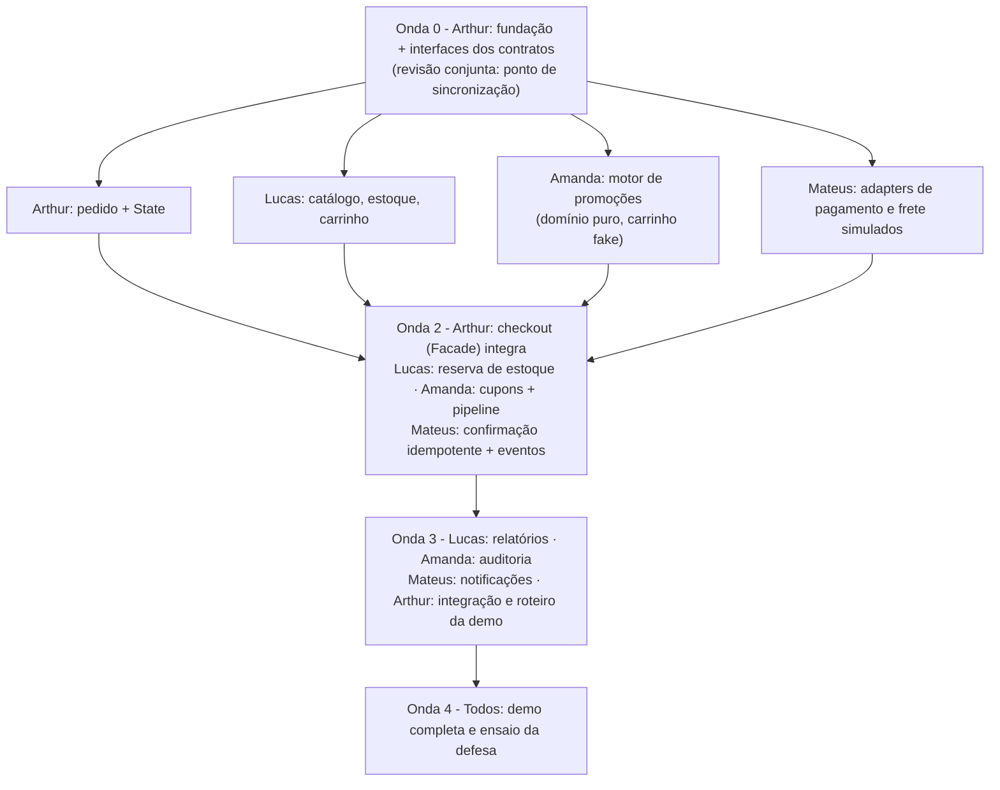

# 11 - Divisão da equipe

> **Objetivo:** dividir o desenvolvimento completo entre os 4 integrantes com carga equilibrada. Cada pessoa é dona de um conjunto de módulos (código, testes, diagramas e justificativa dos patterns).
> **Etapas do roadmap relacionadas:** todas (E1 a E9). Ver [08-roadmap.md](08-roadmap.md).
> **Status:** proposto

## 1. Peso das etapas

Os pontos são esforço relativo, não horas.

| Etapa | Pontos | Motivo |
|---|:-:|---|
| E1 Fundação | 5 | Spring Security, Flyway, estrutura de pacotes, cadastro de cliente e endereços |
| E2 Catálogo e estoque | 5 | Variações, categorias hierárquicas, concorrência na última unidade |
| E3 Carrinho | 3 | Itens, recálculo, passos iniciais do pipeline de preço |
| E4 Checkout e pedido | 8 | Facade, State, snapshot de preços, revalidação, integração dos módulos |
| E5 Promoções e cupons | 10 | Núcleo da avaliação: Strategy, condições, política de conflito, cupons |
| E6 Pagamento e idempotência | 6 | Adapters de gateway, confirmação externa, deduplicação |
| E7 Entrega e frete | 4 | Provedores simulados, cálculo de custo |
| E8 Eventos e notificações | 3 | Observer, canais simulados |
| E8 Auditoria | 2 | Registro de operações administrativas |
| E9 Relatórios | 4 | Consultas agregadas |
| **Total** | **50** | cerca de 12,5 por pessoa |

## 2. Responsabilidades

| | Arthur (13) | Lucas Gomes (12) | Amanda Duara (12) | Mateus Rocha (13) |
|---|---|---|---|---|
| **Etapas** | E1 Fundação; E4 Checkout e pedido | E2 Catálogo e estoque; E3 Carrinho; E9 Relatórios | E5 Promoções e cupons; E8 Auditoria | E6 Pagamento e idempotência; E7 Entrega e frete; E8 Eventos e notificações |
| **Patterns que defende** | State, Facade | Composite (categorias/combos), Chain of Responsibility (pipeline de preço) | Strategy, Composite/Specification (condições), Factory Method | Adapter, Observer |
| **Diagramas** | Estados do pedido; sequência do checkout; consolidação do diagrama de classes | Classes do catálogo | Sequência de aplicação de promoções; classes de promoção | Sequência de confirmação de pagamento (idempotente) |
| **Testes-chave** ([09-testes.md](09-testes.md)) | Transição inválida de pedido; checkout com preço/promoção alterados; segurança | Estoque insuficiente; última unidade concorrente; recálculo do carrinho | Cada tipo de promoção; múltiplas promoções (conflito); cupom inválido | Pagamento recusado; confirmação duplicada; troca de gateway |
| **Documentos que mantém** | 03, 06, 10, README | 02 (catálogo), 05 (estoque), 09 | 04 (seções de promoção), 05 (promoções/cupons) | 04 (Adapter/Observer), 05 (idempotência), 07 (pagamento) |

Motivos da divisão:
- **Promoções (Amanda) leva o maior peso.** É a parte mais avaliada, então vem acompanhada apenas de auditoria, que é leve.
- **Fundação e checkout (Arthur).** Quem monta a base integra os módulos no checkout e consolida o diagrama de classes.
- **Integrações externas (Mateus).** Pagamento, frete e notificação seguem o mesmo princípio (interface do domínio + adaptadores simulados).
- **Patterns.** Cada integrante tem pelo menos 2 patterns para explicar na defesa.

## 3. Ordem de trabalho

Os contratos da onda 0 são os de [03-arquitetura.md](03-arquitetura.md): `Promocao`, `CondicaoElegibilidade`, `PoliticaConflito`, `EtapaPreco`, `GatewayPagamento`, `ProvedorFrete`, `CanalNotificacao`, `EventoDominio` e `EstadoPedido`. Eles devem ser fechados em conjunto antes da onda 1.

## 4. Fluxo de trabalho

- Cada integrante trabalha em branches próprias (por exemplo, `feature/promocoes-cupons`) e abre PR para `main`.
- **Revisão cruzada rotativa:** Arthur revisa Amanda, Amanda revisa Mateus, Mateus revisa Lucas e Lucas revisa Arthur. Assim cada um conhece pelo menos dois módulos.
- Cada integrante commita o próprio trabalho com sua própria identidade Git. Pair programming é registrado com o trailer `Co-authored-by`.
- Cada etapa segue o ciclo OpenSpec (propose, apply, archive) com o nome de change de [08-roadmap.md](08-roadmap.md).

## 5. Riscos

| Risco | Mitigação |
|---|---|
| Contratos da onda 0 mudarem depois | Fechar em reunião conjunta. Mudanças posteriores passam por PR revisado por todos. |
| Promoções dependerem do carrinho real | Motor de promoções testado como domínio puro, com carrinho fake, até a onda 2 |
| Checkout bloquear por falta de módulos | Arthur integra por interfaces, com stubs até os módulos ficarem prontos |
| Alguém não dominar a arquitetura na defesa | Revisão cruzada e ensaio da onda 4, em que cada um explica um módulo que não é seu |
